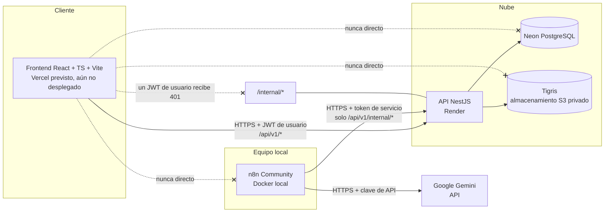
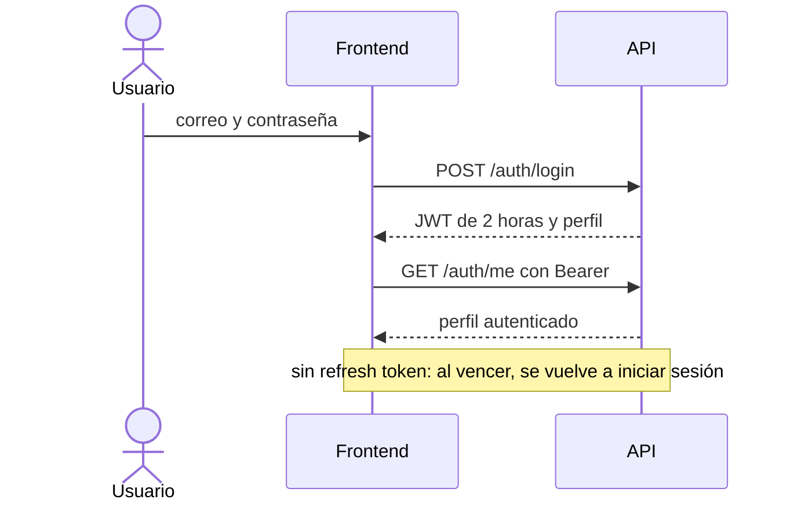
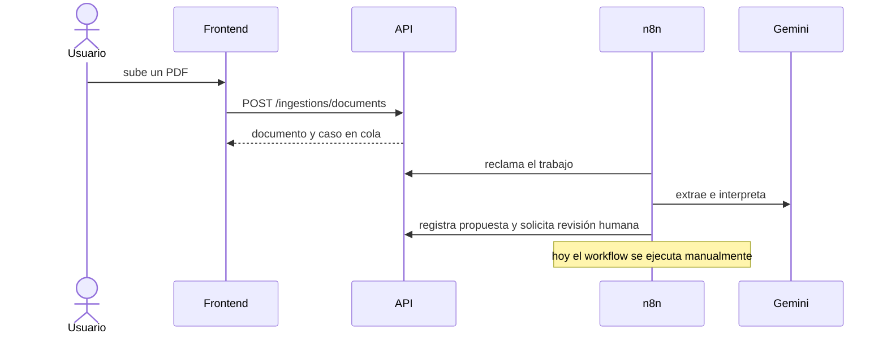
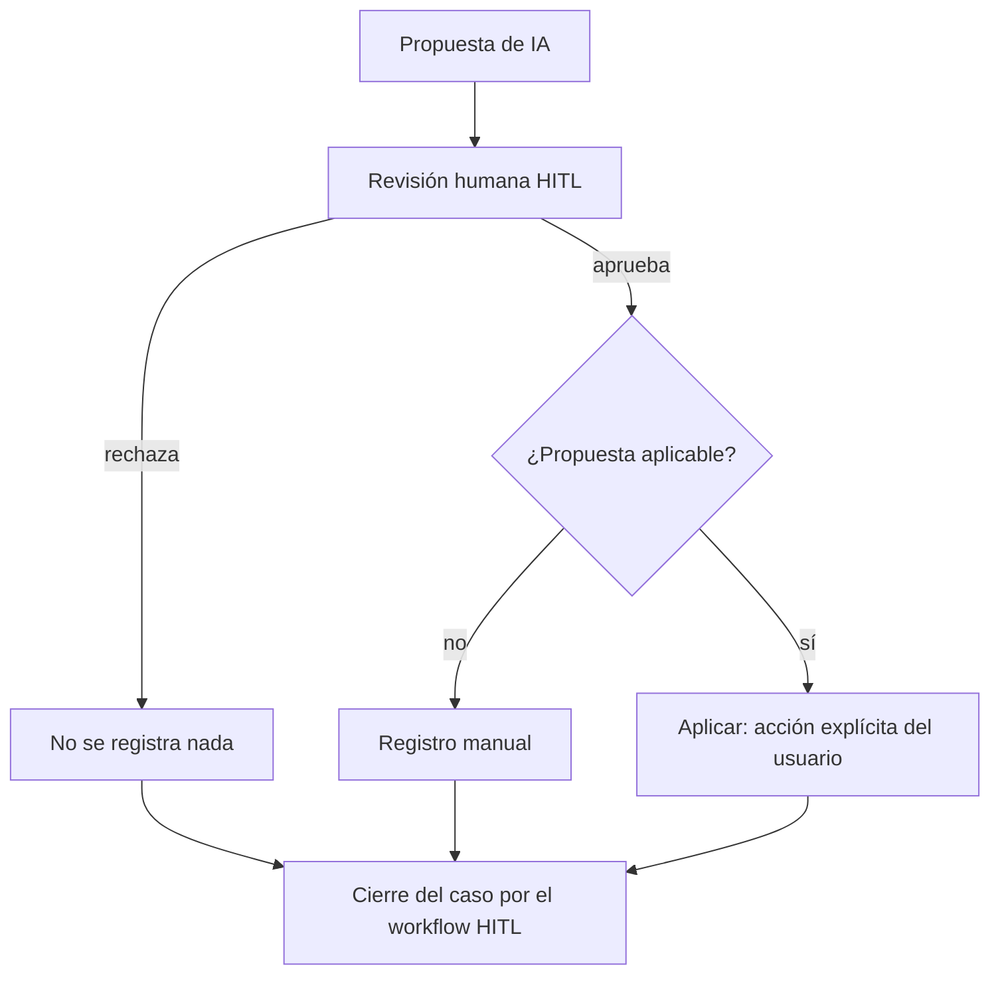
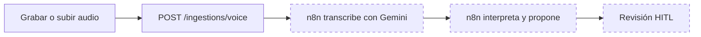

# NotiHouse-Pal

**Hiperautomatización para la gestión de obligaciones del hogar, arriendos, contratos y vencimientos, con procesos asistidos por inteligencia artificial y supervisión humana.**

> **Estado:** actualizado el **7 de noviembre de 2026** (Etapa 7). Backend desplegado en Render hasta la Etapa 6. Los cambios de la Etapa 7 (kill switch, automatización programada, verificaciones del agente, resumen de alertas) están probados en local y **pendientes de publicación controlada**. Frontend en desarrollo. Informe de la etapa: [docs/testing/etapa7-informe-final.md](docs/testing/etapa7-informe-final.md).

## Contenido

- [A. ¿Qué es NotiHouse-Pal?](#a-qué-es-notihouse-pal)
- [B. Funcionalidades principales](#b-funcionalidades-principales)
- [C. Arquitectura general](#c-arquitectura-general)
- [D. Estructura del monorepositorio](#d-estructura-del-monorepositorio)
- [E. Tecnologías utilizadas](#e-tecnologías-utilizadas)
- [F. Flujos principales](#f-flujos-principales)
- [G. Estado actual del MVP](#g-estado-actual-del-mvp)
- [H. Servicios y direcciones](#h-servicios-y-direcciones)
- [I. Cómo comenzar](#i-cómo-comenzar)
- [J. Variables de entorno y seguridad](#j-variables-de-entorno-y-seguridad)
- [K. Desarrollo colaborativo y Git](#k-desarrollo-colaborativo-y-git)
- [L. Pruebas y datos de demostración](#l-pruebas-y-datos-de-demostración)
- [M. Despliegues](#m-despliegues)
- [N. Documentación adicional](#n-documentación-adicional)
- [O. Limitaciones conocidas y próximos pasos](#o-limitaciones-conocidas-y-próximos-pasos)
- [Licencia](#licencia)

---

## A. ¿Qué es NotiHouse-Pal?

Quien administra su hogar o uno o varios inmuebles en arriendo suele tener obligaciones y fechas repartidas entre facturas en PDF, correos, mensajes y notas mentales: servicios públicos, administración, internet, cobros de arriendo, vencimientos de contratos. NotiHouse-Pal **centraliza** esa información, **vigila los vencimientos** y **apoya el registro** con inteligencia artificial, dejando siempre a la persona al mando de las decisiones.

**Propuesta de valor**

- **Un solo lugar** para inmuebles, obligaciones y sus períodos, arriendos y cobros, y contratos.
- **Seguimiento de pendientes:** un dashboard y una bandeja de atención priorizada por urgencia, y alertas internas.
- **IA que propone, no decide:** a partir de una factura PDF (y, en desarrollo, de una nota de voz) el sistema extrae los datos y los presenta como **propuesta**.
- **Control humano (HITL, *human in the loop*):** nada interpretado por IA se registra como dato definitivo sin que la persona lo apruebe y lo aplique de forma explícita.
- **Trazabilidad y auditoría:** cada proceso tiene un identificador de correlación y las operaciones relevantes quedan auditadas.

**Lo que NotiHouse-Pal no hace.** No ejecuta pagos, no verifica transferencias, no modifica contratos ni envía comunicaciones sensibles por su cuenta. Registra **declaraciones y confirmaciones humanas** ("declaro que pagué", "declaro que recibí") y ningún monto es un saldo bancario. Gmail, cuando se integre, se usará solo con permisos de lectura.

**Capacidades implementadas frente a planificadas.** La tabla de la sección B distingue lo que ya funciona de lo que está pendiente; este documento no presenta como terminado nada que no lo esté.

## B. Funcionalidades principales

Estado a la fecha de la fotografía. "Probado" significa que el responsable del backend informó pruebas de extremo a extremo o que el repositorio incluye pruebas automatizadas; el detalle por componente está en la [guía frontend, §13](docs/frontend/GUIA_FRONTEND_NOTIHOUSE_PAL.md#13-matriz-de-estado-y-dependencias).

| Funcionalidad | Estado | Dependencia pendiente |
|---|---|---|
| Autenticación y perfiles (JWT de 2 horas, cuentas demo) | Implementada y probada contra Render | — (sin registro público, refresh token ni logout en servidor) |
| Gestión de inmuebles | Implementada en la API | Pantalla de frontend |
| Obligaciones y períodos (con confirmación humana de pago) | Implementada en la API | Pantalla de frontend |
| Arriendos y cobros (con confirmación humana de recepción) | Implementada en la API | Pantalla de frontend |
| Contratos (solo metadatos y vigilancia de vencimiento) | Implementada en la API | Pantalla de frontend |
| Dashboard | Implementado en la API | Pantalla de frontend |
| Bandeja de atención | Implementada en la API (cálculo en vivo) | Pantalla de frontend |
| Alertas internas persistentes (sin push; ver [ajuste al PDD](docs/architecture/ajuste-pdd-alertas-internas-web.md)) | Implementadas; `GET /alerts/summary` para la campana; evaluación programada en el workflow 06 (probada en laboratorio) | Publicar la Etapa 7 y autorizar la activación de los disparadores |
| Carga y descarga privada de documentos (PDF y audio) | Implementada; carga de PDF probada contra Render | Pantalla de frontend |
| Procesamiento de facturas PDF con IA | Implementado y probado de extremo a extremo; Etapa 7: anclaje determinístico de monto, fecha y proveedor, varios montos → alternativas, detección de inyección | Activar la ruta programada (requiere autorización) |
| Procesamiento de notas de voz | Implementado y validado con servicios reales (Etapa 5); Etapa 7: abstención ante fragmentos inciertos, notas cortadas y fechas relativas | Activar la ruta programada (requiere autorización) |
| Propuestas de IA | Implementadas y probadas | — |
| Revisión y decisión HITL; aplicación de propuestas aprobadas | Implementadas y probadas de extremo a extremo | Pantalla de frontend |
| Gmail (recepción de facturas por correo) | Implementado y validado con servicios reales (Etapa 6); solo lectura | Activar la ruta programada cada 15 min (requiere autorización) |
| Automatizaciones periódicas (polling, alertas, vencimiento de revisiones) | Implementadas en los workflows 02–06 (inactivas por defecto) y **probadas con disparadores reales en laboratorio** | Autorización para activarlas en el n8n operativo |
| Kill switch (SDD §6) | Implementado y probado (manual, 3 fallos críticos, operación prohibida; reanudación controlada y auditada) | Publicar la Etapa 7 |
| Entrada por texto libre ("Recuérdame pagar el agua") | **No existe** en el backend | Contrato nuevo de backend y workflow |
| Notificaciones push (FCM) | **Pospuestas** (decisión del MVP: alertas internas web persistentes) | Versión posterior |
| Frontend | **Por construir** (la carpeta solo tiene `.gitkeep`) | Diseño de referencia entregado por separado |

## C. Arquitectura general



| Componente | Papel |
|---|---|
| **Frontend** (React + TypeScript + Vite) | Interfaz de usuario. Habla **solo** con la API, con el JWT del usuario. Previsto en Vercel; aún no existe |
| **Backend** (NestJS, API REST bajo `/api/v1`) | Único componente con acceso a la fuente de verdad: autenticación, autorización, validación, auditoría y comunicación autenticada con n8n. Desplegado en Render |
| **Base de datos** (Neon PostgreSQL) | Fuente de verdad. Esquema y migraciones versionados en `database/` |
| **Almacenamiento** (Tigris, S3-compatible, privado) | Facturas PDF y notas de voz. El navegador nunca accede al bucket: descarga a través de la API |
| **n8n Community** (Docker local) | Orquesta los flujos de IA mediante polling HTTPS a la API con un **token de servicio**; no accede a la base de datos |
| **Google Gemini** | Interpreta documentos y transcribe/interpreta voz, invocado por n8n |

**Autenticación en dos clases separadas:** las rutas de usuario exigen el JWT del usuario; las rutas `/internal/*` exigen **solo** el token de servicio de n8n. Un JWT de usuario no sirve en `/internal/*` y el token de servicio no sirve en las rutas de usuario (ambos casos responden 401). No aparece ningún secreto ni cadena de conexión en este diagrama ni en este documento.

## D. Estructura del monorepositorio

```text
notihouse-pal/
├── frontend/     # Aplicación React + Vite — vacía (solo .gitkeep), por construir
├── backend/      # API REST NestJS (src/, test/, scripts y configuración)
├── database/
│   ├── migrations/   # Migraciones SQL (Drizzle Kit): 0000, 0001, 0002
│   └── admin/        # Scripts SQL administrativos (rol restringido de la API)
├── n8n/
│   ├── workflows/    # Cuatro workflows exportados (JSON)
│   └── test-data/    # Factura PDF ficticia para pruebas
├── infra/
│   ├── n8n/          # docker-compose.yml de n8n local
│   ├── render/       # render.yaml (Blueprint del backend)
│   └── testing/      # Compose de PostgreSQL desechable para pruebas de concurrencia
├── docs/
│   ├── api/  architecture/  deployment/  frontend/  security/  testing/
├── .env.example  .gitignore  LICENSE  README.md
```

| Carpeta | Responsabilidad |
|---|---|
| `frontend/` | Cliente web. **En preparación**: se construirá a partir de la [guía frontend](docs/frontend/GUIA_FRONTEND_NOTIHOUSE_PAL.md) y de un diseño de referencia entregado por separado |
| `backend/` | API NestJS: módulos de autenticación, inmuebles, obligaciones, arriendos, contratos, dashboard, alertas, bandeja de atención, casos, HITL, ingesta de documentos, almacenamiento y rutas internas de n8n |
| `database/` | Migraciones del esquema (18 tablas) y scripts administrativos SQL. **Las migraciones no se ejecutan desde Render** |
| `n8n/` | Workflows de automatización (`01` prueba de conexión, `02` procesamiento documental, `03` cierre HITL, `04` procesamiento de voz, `05` Gmail, `06` mantenimiento programado), pruebas (`n8n/tests/`) y datos de prueba ficticios |
| `infra/` | Configuración de infraestructura: n8n en Docker, Blueprint de Render y entorno de pruebas de concurrencia |
| `docs/` | Documentación técnica especializada ([sección N](#n-documentación-adicional)) |

> **Nota de versionado:** en el momento de esta fotografía, `n8n/workflows/*.json`, `n8n/test-data/`, `infra/n8n/docker-compose.yml` y `docs/frontend/` existen en el directorio de trabajo pero **aún no están confirmados en Git**.

## E. Tecnologías utilizadas

Versiones respaldadas por los archivos del repositorio (`backend/package.json`, `backend/.node-version`, `infra/n8n/docker-compose.yml`).

| Tecnología | Componente | Finalidad |
|---|---|---|
| NestJS 12, TypeScript 6 | Backend | API REST, validación (`class-validator`), JWT (`@nestjs/jwt`), límite de intentos de login (`@nestjs/throttler`) |
| Drizzle ORM + Drizzle Kit, `pg` | Backend / base de datos | Acceso a PostgreSQL y migraciones |
| Argon2 | Backend | Hash de contraseñas |
| Multer, AWS SDK S3 | Backend | Recepción multipart y almacenamiento S3-compatible (el adaptador `local` es solo para desarrollo) |
| Vitest, PGlite | Backend | Pruebas unitarias, de integración y end-to-end sin depender de Neon |
| oxlint, Prettier | Backend | Lint y formato |
| PostgreSQL (Neon) | Base de datos | Fuente de verdad |
| Tigris (S3-compatible) | Almacenamiento | Archivos privados |
| n8n Community 2.46.6 (imagen Docker) | Automatización | Orquestación de flujos de IA |
| Google Gemini (API) | IA | Interpretación de documentos y voz |
| Render | Despliegue | Hosting de la API (plan Free, región Ohio) |
| React + TypeScript + Vite | Frontend | **Previsto**; aún no hay código |
| Vercel | Despliegue | **Previsto** para el frontend |
| Node.js (`^22.22.3`, `^24.15.0` o `>=26`; `.node-version` = 24) | Backend | Entorno de ejecución |

## F. Flujos principales

Versión resumida. El detalle (contratos, estados, errores, idempotencia) está en la [guía frontend, §9](docs/frontend/GUIA_FRONTEND_NOTIHOUSE_PAL.md#9-flujos-de-usuario).

**1. Inicio de sesión**



**2. Procesamiento de una factura PDF**



**3. Propuesta de IA → revisión humana → aplicación**



El orden de una propuesta aplicable es **aprobar → aplicar explícitamente → cierre del workflow HITL**. La aplicación nunca es automática y solo crea un período pendiente: no registra pagos.

**4. Procesamiento de voz** — *pendiente de validación completa*



La carga del audio funciona; la cadena transcripción → interpretación → revisión **aún no tiene una ejecución real completa validada** (cuota diaria de Gemini).

## G. Estado actual del MVP

Fotografía del **4 de noviembre de 2026**, basada en el código del repositorio y en la [guía frontend](docs/frontend/GUIA_FRONTEND_NOTIHOUSE_PAL.md). Deberá actualizarse conforme avance el MVP.

| Hecho | Estado |
|---|---|
| API NestJS desplegada en Render | Operativa |
| Base de datos Neon conectada | Operativa (18 tablas, 3 migraciones, cuatro cuentas demo con datos ficticios) |
| Tigris integrado para archivos privados | Operativo |
| Autenticación JWT; login y consultas privadas con las cuatro cuentas demo | Probado contra Render |
| Gestión de inmuebles, obligaciones, períodos, arriendos, cobros y contratos; dashboard; bandeja de atención | Implementados en la API |
| Procesamiento documental con Gemini | Probado de extremo a extremo |
| Propuestas de IA y revisión HITL (aprobar y rechazar), cierre de casos y aplicación de una propuesta | Probados de extremo a extremo |
| Procesamiento de voz | Implementado; **ejecución real completa pendiente** por la cuota diaria del nivel gratuito de Gemini |
| Gmail | OAuth configurado en n8n; **recepción automática pendiente** |
| Polling, alertas programadas y demás automatizaciones | **Implementadas y probadas en laboratorio**; inactivas en el entorno operativo hasta autorización |
| Frontend | **En desarrollo (por construir)**; **no desplegado** |

## H. Servicios y direcciones

| Servicio | Dirección |
|---|---|
| **API pública (Render)** | **https://notihouse-pal-api.onrender.com** |
| Base de la API | `https://notihouse-pal-api.onrender.com/api/v1` |
| **Health** | **https://notihouse-pal-api.onrender.com/api/v1/health** |
| **Readiness** | **https://notihouse-pal-api.onrender.com/api/v1/health/ready** |
| Frontend en Vercel | *No existe todavía; no hay URL* |

- **Health** (liveness) indica solo que el proceso de la API responde; no consulta la base de datos. **Readiness** comprueba además PostgreSQL con un límite de 3 segundos: responde `200` si Neon contesta y `503` si no.
- **Arranque en frío:** el plan gratuito de Render **duerme el servicio tras ~15 minutos sin tráfico** y tarda cerca de un minuto en despertar. Para despertarlo, abre la URL de Health y espera; luego abre Readiness. Un `503` en Readiness suele indicar que Neon todavía está despertando: reintenta a los pocos segundos.
- Swagger (`/api/docs`) **no está disponible en producción** (404); solo en entornos de desarrollo locales.

## I. Cómo comenzar

### Frontend

No necesitas Docker, n8n, Neon ni ejecutar el backend: basta Node.js y la API pública de Render. La referencia completa es la [guía frontend](docs/frontend/GUIA_FRONTEND_NOTIHOUSE_PAL.md) (especialmente su [inicio rápido](docs/frontend/GUIA_FRONTEND_NOTIHOUSE_PAL.md#inicio-rápido-para-el-equipo-frontend) y su [protocolo de pruebas seguras](docs/frontend/GUIA_FRONTEND_NOTIHOUSE_PAL.md#128-protocolo-de-desarrollo-y-pruebas-seguras)).

```bash
# Con el directorio de trabajo limpio
git switch develop
git pull origin develop
git switch -c feature/frontend-nombre
git branch --show-current

# Solo si frontend/ sigue vacía (revisa el package.json que se genere; no asumas scripts)
cd frontend
npm create vite@latest . -- --template react-ts
npm install
```

1. Instala una versión de Node.js compatible con Vite (la LTS 24.x es la usada en el proyecto).
2. Crea `frontend/.env.local` (no se versiona) con `VITE_API_BASE_URL=https://notihouse-pal-api.onrender.com/api/v1`. Es una URL pública, no un secreto.
3. Inicia Vite en el puerto **5173** (`npm run dev`, con `strictPort`): es el único origen que la API admite hoy.
4. Despierta Render y comprueba Health y Readiness ([sección H](#h-servicios-y-direcciones)).
5. Solicita al responsable, **por un canal privado**, las credenciales de una cuenta demo.
6. Prueba login y consultas (`GET`) sin modificar datos; antes de cualquier escritura, coordina ([sección L](#l-pruebas-y-datos-de-demostración)).

El diseño visual se toma de una **referencia entregada por separado**; este repositorio no define paleta ni identidad gráfica.

### Backend

Detalle completo en [docs/api/backend-setup.md](docs/api/backend-setup.md).

| Requisito | Valor |
|---|---|
| Node.js | `^22.22.3`, `^24.15.0` o `>=26` (recomendada la LTS 24.x; `backend/.node-version` = 24) |
| npm | El incluido con Node.js (probado con 11.19) |

```bash
cd backend
npm ci
cp .env.example .env     # completar los valores localmente; el archivo no se versiona
npm run start:dev
```

Scripts verificados en `backend/package.json`:

| Script | Función |
|---|---|
| `npm run build` | Compila con `nest build` |
| `npm run start:dev` / `start:prod` | Desarrollo con recarga / `node dist/main` |
| `npm run lint`, `npm run format` | oxlint / Prettier |
| `npm test` | Pruebas unitarias (Vitest, sobre PGlite: no requieren Neon ni red) |
| `npm run test:e2e` | Pruebas end-to-end |
| `npm run db:check` | Verifica la conexión con Neon (solo lectura; requiere `DATABASE_URL`) |
| `npm run storage:check` | Comprueba el almacenamiento configurado |
| `npm run smoke:api` | Comprobaciones de solo lectura contra una API ya desplegada |

> **Cuidado con la base compartida.** Existen también `db:migrate`, `db:seed:demo`, `db:demo:*` y los scripts `conc:*`. **No se ejecutan contra la Neon compartida** salvo decisión expresa de la persona responsable ([sección L](#l-pruebas-y-datos-de-demostración)).

Variables de entorno del backend (solo nombres): [sección J](#j-variables-de-entorno-y-seguridad). Swagger local (fuera de producción): `http://localhost:3000/api/docs`.

### n8n

- **Papel:** orquesta el procesamiento con IA. Reclama trabajos de la API (polling HTTPS con el token de servicio), invoca a Gemini y devuelve propuestas y solicitudes de revisión; no accede a la base de datos.
- **Infraestructura:** contenedor Docker definido en [`infra/n8n/docker-compose.yml`](infra/n8n/docker-compose.yml) (imagen n8n Community 2.46.6, accesible solo desde el propio equipo, sin reinicio automático: corre solo cuando alguien lo inicia).
- **Workflows:** en [`n8n/workflows/`](n8n/workflows/): `01` prueba de conexión, `02` procesamiento documental, `03` cierre HITL, `04` procesamiento de voz, `05` recepción por Gmail y `06` mantenimiento programado (alertas y vencimientos HITL). Desde la Etapa 7, `02`–`06` tienen además un disparador programado, pero **todos están inactivos** y la ruta programada exige `AUTOMATIZACION_PROGRAMADA = true` (en el repositorio, `false`).
- **Operación:** hoy se ejecuta con Docker en el equipo de la persona responsable. Ejecutar workflows, usar su cuota de Gemini o tocar su configuración **requiere coordinación con esa persona**. Las credenciales viven cifradas en el volumen de n8n, no en el repositorio.

## J. Variables de entorno y seguridad

**Públicas frente a secretas.** Todo lo que empiece por `VITE_` en el frontend queda **público en el navegador**: solo debe contener la URL base de la API. Las credenciales de infraestructura **nunca** van al navegador ni al repositorio.

| Variable | Dónde | Finalidad |
|---|---|---|
| `VITE_API_BASE_URL` | Frontend (pública) | URL base de la API |
| `NODE_ENV`, `PORT` | Backend | Entorno y puerto |
| `FRONTEND_URL` | Backend | Origen único autorizado por CORS |
| `DATABASE_URL` | Backend (secreta) | Conexión de ejecución a Neon (con *pooling*) |
| `DATABASE_URL_DIRECT` | Solo local, administración (secreta) | Migraciones y verificaciones; **no se carga en Render** |
| `JWT_SECRET` | Backend (secreta) | Firma de los JWT de usuario |
| `N8N_SERVICE_TOKEN` | Backend y n8n (secreta) | Token de servicio de las rutas `/internal/*` |
| `STORAGE_DRIVER`, `STORAGE_S3_*` | Backend (credenciales secretas) | Almacenamiento de archivos (`s3` en producción) |
| `STORAGE_MAX_PDF_BYTES`, `STORAGE_MAX_AUDIO_BYTES` | Backend | Tamaños máximos de carga |
| `DUE_DATES_*` | Backend | Zona horaria y umbrales de aviso |
| `TRUST_PROXY_HOPS` | Backend | Proxies de confianza (IP real para el límite de login) |

Las plantillas [`.env.example`](.env.example) y [`backend/.env.example`](backend/.env.example) documentan las variables sin valores reales. Los secretos de los entornos desplegados se cargan directamente en cada plataforma.

**Mecanismos de seguridad implementados** (detalle en [docs/security/backend-security-review.md](docs/security/backend-security-review.md) y [docs/architecture/authentication.md](docs/architecture/authentication.md)):

- **JWT de usuario:** HS256, 2 horas, sin refresh token ni cookies; el cierre de sesión consiste en descartar el token en el cliente. Cambiar la contraseña de una cuenta invalida sus tokens anteriores.
- **Token de servicio para n8n:** solo válido en `/internal/*`; un JWT de usuario no sirve allí.
- **Aislamiento por propietario:** el propietario sale siempre del JWT (nunca de un campo enviado por el cliente) y un recurso ajeno responde 404.
- **Almacenamiento privado:** los archivos se guardan en un bucket privado y se descargan solo a través de la API autenticada.
- **Auditoría** de las operaciones relevantes, con identificador de correlación por proceso.
- **HITL:** una revisión vencida nunca equivale a aprobación; aprobar no aplica datos; aplicar solo ejecuta una lista cerrada de acciones y crea períodos pendientes.
- **Idempotencia:** `requestId` en cargas y creación de casos, claves de idempotencia en los trabajos y respuestas idempotentes en confirmaciones, decisiones y aplicación.
- **CORS** de un único origen y sin credenciales; límite de 5 intentos de login por minuto por IP.
- **Credenciales demo:** se entregan por canal privado y nunca se publican.

## K. Desarrollo colaborativo y Git

| Rama | Uso |
|---|---|
| `main` | Rama principal |
| `develop` | Rama compartida de **integración** |
| `feature/*` | Ramas individuales de trabajo (por ejemplo `feature/frontend-auth`, `feature/frontend-dashboard`) |

- **Nadie desarrolla ni hace `push` directamente sobre `main` ni sobre `develop`.**
- Cada integrante crea su rama a partir de `develop` **actualizado** y con el directorio de trabajo limpio (`git switch develop`, `git pull origin develop`, `git switch -c feature/<nombre>`).
- Los cambios se integran mediante **Pull Request**, con revisión del equipo y resolución de conflictos.
- **No se crean proyectos base de frontend en paralelo:** primero se coordina la estructura común (ver [guía frontend, §11.1](docs/frontend/GUIA_FRONTEND_NOTIHOUSE_PAL.md#111-estructura-sugerida)).
- **Los asistentes de programación no ejecutan `git add`, `commit`, `push`, `merge` ni crean Pull Requests**; esas operaciones las realiza el integrante responsable de su rama.
- No se modifica el trabajo local ajeno ni se descartan cambios sin autorización.
- No se modifican `backend/`, `database/`, `n8n/` ni `infra/` sin coordinar con la persona responsable.

La política completa está en la [guía frontend, §14](docs/frontend/GUIA_FRONTEND_NOTIHOUSE_PAL.md#14-colaboración-del-equipo).

## L. Pruebas y datos de demostración

- **Neon, conectada a Render, es una base compartida** que el backend sigue usando para pruebas de integración.
- Para desarrollar el frontend se pueden usar libremente los **mocks locales**, las pruebas unitarias y las **consultas autorizadas** (Health, Readiness, login con cuentas demo y `GET` de recursos propios).
- **Requieren coordinar con el responsable del backend:** cualquier escritura real (`POST`/`PATCH`), la carga de archivos, la confirmación de pagos o cobros, las decisiones HITL, la aplicación de propuestas y toda prueba que genere trabajos para n8n.
- **No se ejecutan migraciones, seeds ni limpiezas sobre la Neon compartida.**
- Se usan **exclusivamente datos ficticios**; nunca documentos reales ni datos personales.
- Las **cuentas demo** (cuatro, ficticias) se entregan por canal privado; sus contraseñas no se publican.
- Las pruebas integrales dependen de que **n8n/Docker estén encendidos** y de la **cuota del nivel gratuito de Gemini**, que es diaria y baja.

Detalle y clasificación de acciones: [guía frontend, §12.8 (pruebas seguras)](docs/frontend/GUIA_FRONTEND_NOTIHOUSE_PAL.md#128-protocolo-de-desarrollo-y-pruebas-seguras).

## M. Despliegues

| Pieza | Plataforma | Estado |
|---|---|---|
| API (backend) | Render | **Operativo** (plan Free, región Ohio; Blueprint en [`infra/render/render.yaml`](infra/render/render.yaml)) |
| Base de datos | Neon PostgreSQL | **Operativa** |
| Almacenamiento | Tigris (S3-compatible) | **Operativo** |
| Automatización | n8n en Docker local | **Local** (equipo de la persona responsable) |
| Frontend | Vercel | **Previsto; no desplegado todavía** |

**Vercel (previsto):** el proyecto usará `frontend` como directorio raíz, el preset **Vite**, `npm run build` como comando de compilación, `dist` como salida y la variable pública `VITE_API_BASE_URL`. Los pasos y la lista de comprobaciones posteriores están en la [guía frontend, §12.9 y §12.10](docs/frontend/GUIA_FRONTEND_NOTIHOUSE_PAL.md#129-despliegue-del-frontend-en-vercel). El despliegue requiere autorización de la persona responsable.

**Punto pendiente de CORS:** hoy el backend en Render autoriza **un único origen** (`http://localhost:5173`). Para que el frontend desplegado en Vercel llame a la API, y para seguir desarrollando en local al mismo tiempo, hará falta una **modificación coordinada del backend** (lista explícita de orígenes). No se usan comodines ni proxies para evitarlo.

## N. Documentación adicional

Este README es el punto de entrada. Para quienes desarrollan React, la referencia especializada es la **[Guía frontend](docs/frontend/GUIA_FRONTEND_NOTIHOUSE_PAL.md)**, con el inventario de los 62 endpoints, contratos, autenticación, pantallas, flujos, integración técnica y criterios de aceptación.

| Tema | Documento |
|---|---|
| **Frontend (referencia especializada)** | [docs/frontend/GUIA_FRONTEND_NOTIHOUSE_PAL.md](docs/frontend/GUIA_FRONTEND_NOTIHOUSE_PAL.md) |
| Puesta en marcha del backend | [docs/api/backend-setup.md](docs/api/backend-setup.md) |
| API de negocio (inmuebles, obligaciones, arriendos, contratos) | [docs/api/business-api.md](docs/api/business-api.md) |
| Alertas, bandeja de atención y dashboard | [docs/api/alerts-and-dashboard.md](docs/api/alerts-and-dashboard.md) |
| Casos, propuestas, HITL y trabajos de n8n | [docs/api/workflow-integration.md](docs/api/workflow-integration.md) |
| Ingesta de PDF y voz | [docs/api/ingestion-api.md](docs/api/ingestion-api.md) |
| Aplicación de propuestas aprobadas | [docs/api/proposal-application.md](docs/api/proposal-application.md) |
| Autenticación | [docs/architecture/authentication.md](docs/architecture/authentication.md) |
| Diseño de la base de datos | [docs/architecture/database-design.md](docs/architecture/database-design.md) |
| Despliegue del backend (demo del MVP) | [docs/deployment/mvp-demo-setup.md](docs/deployment/mvp-demo-setup.md) |
| Preparación para Render | [docs/deployment/render-readiness.md](docs/deployment/render-readiness.md) |
| Revisión de seguridad del backend | [docs/security/backend-security-review.md](docs/security/backend-security-review.md) |
| Gobierno del agente, OWASP ASI y kill switch (Etapa 7) | [docs/security/gobierno-agente-y-kill-switch.md](docs/security/gobierno-agente-y-kill-switch.md) |
| Contrato frontend de notificaciones y HITL (Etapa 8) | [docs/frontend/CONTRATO_ETAPA8_NOTIFICACIONES_HITL.md](docs/frontend/CONTRATO_ETAPA8_NOTIFICACIONES_HITL.md) |
| Operación local y guion de sustentación | [docs/deployment/operacion-y-sustentacion.md](docs/deployment/operacion-y-sustentacion.md) |
| Informe de la Etapa 7 (evaluación, KPI, GO/NO-GO) | [docs/testing/etapa7-informe-final.md](docs/testing/etapa7-informe-final.md) |
| Plan y resultados de pruebas de concurrencia | [docs/testing/neon-concurrency-plan.md](docs/testing/neon-concurrency-plan.md), [docs/testing/postgres-concurrency-results.md](docs/testing/postgres-concurrency-results.md) |

> **Aviso sobre documentación anterior:** algunos documentos de `docs/` se escribieron antes del despliegue (por ejemplo, `mvp-demo-setup.md` dice que aún no hay nada desplegado y `business-api.md` que no hay IA ni workflows). Donde contradigan el código, prevalece el código y la [guía frontend](docs/frontend/GUIA_FRONTEND_NOTIHOUSE_PAL.md#171-diferencias-entre-documentación-previa-y-código-prevalece-el-código), que registra esas diferencias.

## O. Limitaciones conocidas y próximos pasos

Pendientes respaldados por el código o por la documentación auditada. No son compromisos con fecha.

| Pendiente | Detalle |
|---|---|
| Validación completa de voz (Etapa 5) | El workflow existe; falta una ejecución real completa, limitada por la cuota diaria de Gemini. Los workflows de voz solo procesan audios de hasta 13 MiB, aunque el backend admite hasta 25 MiB por defecto |
| Integración de Gmail (Etapa 6) | OAuth configurado en n8n; no existe recepción automática y la ruta interna del backend responde siempre 403 |
| Activación operativa de la automatización | Los disparadores están implementados y probados en laboratorio, pero inactivos en el n8n operativo; activarlos requiere autorización y que el equipo local esté encendido |
| Rotación de las contraseñas demo | Comparten una contraseña que quedó expuesta en una transcripción local (no en Git); rotar con `db:demo:rotate-passwords` coordinando con frontend |
| Desarrollo y despliegue del frontend | La carpeta está vacía; el despliegue en Vercel requiere autorización |
| Ajuste de CORS para Vercel | Un único origen autorizado hoy; requiere cambio coordinado del backend |
| Pruebas integradas finales | Dependen de n8n, Gemini y de coordinar las escrituras sobre la Neon compartida |
| Entrada por texto libre | No existe contrato en el backend |
| Versionado de los artefactos nuevos | Workflows, datos de prueba, Compose de n8n y guía frontend aún sin confirmar en Git |

Otros puntos a coordinar con el backend (estado de procesamiento visible al usuario, saber si una propuesta ya se aplicó, cabeceras expuestas por CORS, `POST /cases` manual) están en la [guía frontend, §17.2](docs/frontend/GUIA_FRONTEND_NOTIHOUSE_PAL.md#172-puntos-que-requieren-coordinación-con-backend--integraciones).

## Licencia

Distribuido bajo la licencia MIT. Consulta [LICENSE](LICENSE).
