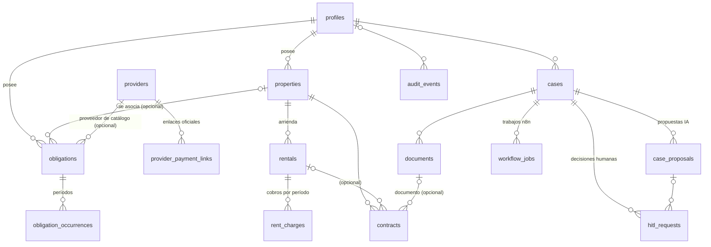

# Diseño de la base de datos

Modelo relacional de NotiHouse-Pal en PostgreSQL (Neon), implementado con Drizzle ORM en la Fase 3.

> **Alcance actual:** el esquema existe y está migrado en Neon, y el backend puede conectarse. **No** existen todavía endpoints CRUD, autenticación, workflows de n8n ni procesos HITL funcionales: el modelo los prepara, pero no los implementa.

- Definición del esquema: [`backend/src/database/schema/`](../../backend/src/database/schema/)
- Migraciones: [`database/migrations/`](../../database/migrations/)
- Configuración de Drizzle Kit: [`backend/drizzle.config.ts`](../../backend/drizzle.config.ts)

## 1. Modelo de datos



Hay 15 tablas, 20 tipos enumerados, 29 claves foráneas, 18 restricciones `UNIQUE`, 34 restricciones `CHECK` y 63 índices (incluidos los de PK y `UNIQUE`). Todas las tablas viven en el esquema `public`. Drizzle registra el historial de migraciones en `drizzle.__drizzle_migrations`.

## 2. Tablas y responsabilidades

| Tabla | Responsabilidad |
|---|---|
| `profiles` | Propietario de la información. `external_auth_id` queda reservado para el proveedor de identidad futuro. |
| `properties` | Inmuebles de un propietario. El nombre es único por propietario. |
| `providers` | Catálogo **global** de proveedores (energía, agua, gas…), identificados por un `slug` único. |
| `provider_payment_links` | Enlaces oficiales de pago por proveedor. Solo se presentan los `validated`. |
| `obligations` | **Definición** de una obligación recurrente: proveedor, concepto, categoría, valor esperado, periodicidad, día de vencimiento y días de recordatorio. |
| `obligation_occurrences` | **Período concreto** de una obligación: valor, fecha de vencimiento, estado y confirmación humana. |
| `rentals` | Arriendo de un inmueble: valor esperado, día de cobro, vigencia y alias del arrendatario. |
| `rent_charges` | Cobro de arriendo por período: monto esperado, fecha esperada, estado y evidencia de recepción. |
| `contracts` | Contrato de un inmueble (y opcionalmente de un arriendo): vigencia, días de preaviso y documento. |
| `cases` | Caso de procesamiento identificado por `correlation_id`: tipo, origen, estado y entidad relacionada. |
| `documents` | Metadatos de archivos (tipo, origen, MIME, `storage_key`, hash, mensaje de Gmail). El contenido **no** se guarda en PostgreSQL. |
| `case_proposals` | Datos interpretados por IA, OCR o STT, versionados y pendientes de revisión. |
| `hitl_requests` | Solicitudes de intervención humana, con SLA, alternativas y decisión. |
| `workflow_jobs` | Cola persistente de trabajos que n8n consultará mediante la API. |
| `audit_events` | Registro de auditoría append-only. |

### Decisiones de diseño relevantes

- **Obligación ≠ pago.** `obligations` define la recurrencia y `obligation_occurrences` guarda un registro por período. Un período nuevo es una fila nueva; el histórico nunca se sobrescribe.
- **Catálogo de proveedores (`providers`).** Esta tabla no figuraba en la lista inicial. Se agregó porque es indispensable para la integridad de los enlaces de pago: un enlace se asocia por FK a un proveedor, y una obligación solo muestra enlaces si tiene `provider_id`. Así se evita relacionar enlaces y obligaciones por texto libre. `obligations.provider_name` conserva el nombre tal como lo escribe el usuario.
- **Contratos ligados a inmuebles.** `contracts.property_id` es obligatorio y `rental_id` opcional, pero si existe debe pertenecer al mismo inmueble (FK compuesta).
- **Entidad relacionada del caso.** Un caso apunta como máximo a una entidad (`obligation_id`, `rental_id` o `contract_id`), con FKs reales en lugar de una referencia polimórfica sin integridad.
- **Datos personales minimizados.** No se guardan nombres completos ni documentos de identidad de arrendatarios (solo `tenant_alias`), ni datos bancarios. `audit_events.metadata` y `workflow_jobs.payload` deben contener referencias, nunca credenciales ni documentos completos.
- **Estados con `pgEnum`.** Los valores permitidos se controlan en la base de datos. Agregar un valor es aditivo (`ALTER TYPE … ADD VALUE`); eliminarlo requiere una migración revisada.
- **`updated_at`** se actualiza desde Drizzle (`$onUpdate`) al escribir mediante el ORM. No hay trigger para esto.

## 3. Relaciones y aislamiento por propietario

Todas las tablas de negocio llevan `owner_id NOT NULL`. Para evitar relacionar datos de usuarios distintos, las referencias entre entidades de un propietario usan **claves foráneas compuestas** `(entidad_id, owner_id)`, que apuntan a una restricción `UNIQUE (id, owner_id)` de la tabla destino:

| Referencia | Garantía |
|---|---|
| `obligations (property_id, owner_id)` → `properties` | La obligación y el inmueble son del mismo propietario. |
| `obligation_occurrences (obligation_id, owner_id)` → `obligations` | Igual. |
| `rentals (property_id, owner_id)` → `properties` | Igual. |
| `rent_charges (rental_id, owner_id)` → `rentals` | Igual. |
| `contracts (property_id, owner_id)` → `properties` | Igual. |
| `contracts (rental_id, property_id, owner_id)` → `rentals` | El arriendo es del mismo inmueble **y** propietario. |
| `contracts (document_id, owner_id)` → `documents` | Igual. |
| `cases (obligation_id \| rental_id \| contract_id, owner_id)` | Igual. |
| `documents (case_id, owner_id)` → `cases` | Igual. |
| `case_proposals (case_id \| document_id, owner_id)` | Igual. |
| `hitl_requests (case_id \| proposal_id, owner_id)` | Igual. |

Cuando la referencia opcional es `NULL`, PostgreSQL no evalúa la FK compuesta (`MATCH SIMPLE`), que es el comportamiento deseado.

El filtrado por usuario autenticado en cada consulta será responsabilidad de la API cuando exista autenticación. Para entonces se evaluará añadir Row-Level Security.

## 4. Restricciones de integridad

- **Claves:** UUID (`gen_random_uuid()`) como PK de todas las tablas. `cases.correlation_id` es UUID y único.
- **Sin borrado en cascada:** las 29 FKs usan `ON DELETE RESTRICT`. No se puede borrar un perfil, inmueble u obligación con historial.
- **Dinero:** `numeric(14,2)` (exacto, sin `float`). Drizzle lo expone como `string` para no perder precisión. Hay checks de no negatividad (obligaciones y períodos) y de positividad (arriendos y cobros).
- **Moneda:** `char(3)`, por defecto `COP`, con el check `^[A-Z]{3}$`.
- **Fechas:** `date` para fechas de calendario (vencimientos, períodos, vigencias) y `timestamptz` para eventos, confirmaciones y auditoría. Hay checks de orden (`period_end >= period_start`, `ends_on >= starts_on`).
- **Rangos:** `due_day` entre 1 y 31 (en meses cortos, las reglas futuras lo ajustarán al último día), `reminder_days_before` entre 0 y 60, `notice_period_days` entre 0 y 365, `confidence` entre 0 y 1.
- **Unicidad de períodos:** `UNIQUE (obligation_id, period_start)` y `UNIQUE (rental_id, period_start)` impiden duplicar un mismo período.
- **Formato:** `slug` de proveedor, MIME type, SHA-256 hexadecimal, `job_type` y URL de pago `https://`.

## 5. Datos definitivos frente a propuestas de IA

- La IA **no escribe** en las tablas de negocio. Sus resultados se guardan en `case_proposals` (`proposed_data` en JSONB, con `evidence`, `confidence`, `source` y `version`).
- Cada nueva interpretación es una **versión nueva** (`UNIQUE (case_id, version)`). Las anteriores pasan a `superseded`; no se reescriben.
- `review_status` ∈ {`pending_review`, `accepted`, `rejected`, `superseded`}. El check `case_proposals_review` exige `reviewed_at` y `reviewed_by` si y solo si la propuesta fue aceptada o rechazada.
- Una propuesta aceptada **no** se convierte sola en un registro financiero: la API futura deberá validarla y escribir el registro definitivo en la tabla correspondiente (por ejemplo, `obligation_occurrences`), dentro de una transacción y con su evento de auditoría.

## 6. Confirmaciones humanas

Las reglas "nunca se asume un pago" y "nunca se asume un arriendo recibido" están implementadas como checks en la base de datos:

| Tabla | Regla (`CHECK`) |
|---|---|
| `obligation_occurrences` | `status IN ('paid','attended')` ⇔ `confirmed_at` y `confirmed_by` presentes |
| `rent_charges` | `status = 'received'` ⇔ `confirmed_at`, `confirmed_by` y `confirmation_evidence` presentes |
| `hitl_requests` | `status IN ('approved','rejected')` ⇔ `decision` y `responded_at` presentes |

Por lo tanto:

- Ningún proceso automático puede marcar un período como pagado o un arriendo como recibido sin registrar quién lo confirmó y cuándo.
- **HITL:** `due_at` toma por defecto `now() + interval '24 hours'` (SLA inicial). Al vencer, el estado debe pasar a `expired`, y el check impide que una solicitud `expired` tenga decisión, así que **un SLA vencido nunca equivale a aprobación**. La lógica que marca `expired` corresponde a una fase posterior.

## 7. Cola de trabajos para n8n (`workflow_jobs`)

El backend estará en Render y n8n correrá inicialmente en Docker local. Render no puede llamar al `localhost` del equipo, así que la integración será de tipo **pull**: n8n consultará y reclamará trabajos mediante una API autenticada (aún no implementada).

| Columna | Uso |
|---|---|
| `idempotency_key` (`UNIQUE`) | Evita encolar dos veces el mismo trabajo (p. ej. `gmail:<message_id>:process_document`). |
| `status` | `pending` → `claimed` → `completed` / `failed` / `cancelled`. |
| `available_at` | Permite reintentos diferidos (backoff). |
| `locked_by`, `locked_until` | Arrendamiento temporal del trabajo. El check `workflow_jobs_lease` exige ambos si y solo si `status = 'claimed'`. |
| `attempts`, `max_attempts` | Contador de intentos, con `attempts <= max_attempts`. |
| `result`, `last_error`, `completed_at` | Resultado o error. `completed_at` es obligatorio si y solo si el trabajo está `completed`. |

Patrón previsto para reclamar trabajos sin duplicados, ejecutado por la API en una transacción:

```sql
UPDATE workflow_jobs SET status = 'claimed', locked_by = $worker,
       locked_until = now() + interval '5 minutes', attempts = attempts + 1
WHERE id = (
  SELECT id FROM workflow_jobs
  WHERE status = 'pending' AND available_at <= now() AND attempts < max_attempts
  ORDER BY available_at
  FOR UPDATE SKIP LOCKED
  LIMIT 1
)
RETURNING *;
```

El índice parcial `workflow_jobs_pending_available_idx` soporta esta consulta. `workflow_jobs_claimed_lease_idx` permite recuperar trabajos cuyo arrendamiento venció.

## 8. Auditoría y `correlation_id`

- Cada caso tiene un `correlation_id` único que se propagará a n8n, a los trabajos y a los eventos.
- `audit_events` registra `correlation_id`, actor (`actor_type`, `actor_id`), `component`, `action`, `result`, `occurred_at`, `evidence_reference` y `metadata` mínima.
- `correlation_id` en auditoría **no** es FK: así se pueden registrar eventos anteriores a la creación del caso o de componentes externos.
- **Append-only en la base de datos.** La migración inicial añade (de forma manual, porque Drizzle Kit no genera triggers) la función `audit_events_reject_modification()` y dos triggers que rechazan `UPDATE`, `DELETE` y `TRUNCATE` sobre `audit_events`. Para eliminarlos haría falta una migración explícita y revisada.

## 9. Configuración de Neon

| Parámetro | Valor |
|---|---|
| Proyecto | `notihouse-pal` |
| Rama | `production` (única rama) |
| Base de datos | `neondb` |
| Rol | `neondb_owner` |
| Región | AWS US East 2 (Ohio) |
| Versión | PostgreSQL 18 |

1. En Neon > *Connect*, selecciona la rama `production` y la base `neondb`.
2. Con *Connection pooling* **activado**, copia la cadena en `DATABASE_URL` de `backend/.env`. La usa la API.
3. Con *Connection pooling* **desactivado**, copia la cadena en `DATABASE_URL_DIRECT`. La usan las migraciones: el pooler de Neon (PgBouncer en modo transacción) no es adecuado para DDL ni para el bloqueo del migrador.
4. Ejecuta `npm run db:check` (desde `backend/`) para comprobar ambas conexiones en modo solo lectura.

El backend reemplaza `sslmode=require` por `verify-full`. Es el comportamiento actual de `pg` 8, pero declarado explícitamente para no perderlo cuando `pg` 9 adopte la semántica de libpq.

## 10. Generar migraciones

1. Modifica las tablas en `backend/src/database/schema/`.
2. Desde `backend/`, ejecuta `npm run db:generate -- --name <descripcion_corta>`. Drizzle Kit compara el esquema con el último snapshot y escribe `database/migrations/NNNN_<descripcion>.sql`, además de `meta/NNNN_snapshot.json` y `meta/_journal.json`. No se conecta a la base de datos.
3. Versiona los tres juntos. **No** edites ni borres migraciones ya aplicadas, ni sus snapshots o el journal.
4. Si necesitas SQL que Drizzle no genera (triggers, funciones), usa `npx drizzle-kit generate --custom --name <nombre>` para crear una migración vacía dentro del historial.

## 11. Revisar y aplicar migraciones

Antes de aplicar cualquier migración en Neon:

1. `npm test`: la prueba `migrations.spec.ts` falla si alguna migración contiene `DROP`, `TRUNCATE`, `DELETE FROM`, `UPDATE … SET`, `ALTER … DROP/RENAME` o cambios de tipo de columna. Las pruebas de integridad aplican **todas** las migraciones sobre PostgreSQL en memoria (PGlite) y verifican las restricciones.
2. `npm run db:check:migrations`: comprueba que el historial es consistente.
3. Lee el SQL completo de la nueva migración.
4. `npm run db:check`: confirma que te conectas a `neondb` en la región esperada y cuántas migraciones hay aplicadas.
5. `npm run db:migrate`: aplica solo las migraciones pendientes, dentro de una transacción.
6. Vuelve a ejecutar `npm run db:check` para comprobar el resultado.

**Nunca** uses `drizzle-kit push`: aplica cambios sin dejar historial y puede proponer operaciones destructivas. Tampoco se configuró `drizzle-kit studio`, por la misma razón.

### Registro de migraciones aplicadas

| Migración | Fecha de aplicación | Contenido | Resultado |
|---|---|---|---|
| `0000_initial_schema` | 2026-10-24 | 20 `CREATE TYPE`, 15 `CREATE TABLE`, 29 FKs, 30 `CREATE INDEX`, función y 2 triggers de auditoría | Aplicada. 0 operaciones destructivas. Hash registrado igual al SHA-256 del archivo. |

## 12. Precauciones por usar una sola rama `production`

Durante la etapa académica, la rama `production` de Neon es también el **único entorno de desarrollo**. No hay una copia aislada, así que:

- Toda migración aplicada afecta directamente a la única base de datos. Revísala siguiendo la sección 11 y aplícala de forma deliberada. **Nunca** se ejecuta al iniciar la API.
- Están prohibidas sin autorización explícita las operaciones destructivas: `DROP TABLE/COLUMN`, `TRUNCATE`, `DELETE` masivo, cambios de tipo con pérdida de datos, recrear tablas, `drizzle-kit push`, `--force`, borrar la base de datos o recrear la rama.
- Las pruebas automáticas **no escriben en Neon**: las de integridad usan PGlite en memoria y `db:check` abre sesiones `default_transaction_read_only`.
- No se cargan datos personales reales ni ficticios automáticamente (no hay *seeds*).
- Antes de un cambio de riesgo, crea un punto de restauración o una rama temporal de Neon. Requiere autorización: en esta etapa se decidió no crear ramas adicionales.
- Cuando el proyecto tenga usuarios reales, conviene separar los entornos (rama `development` en Neon o una instancia local).
