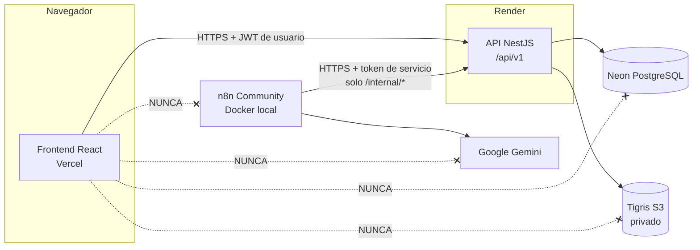
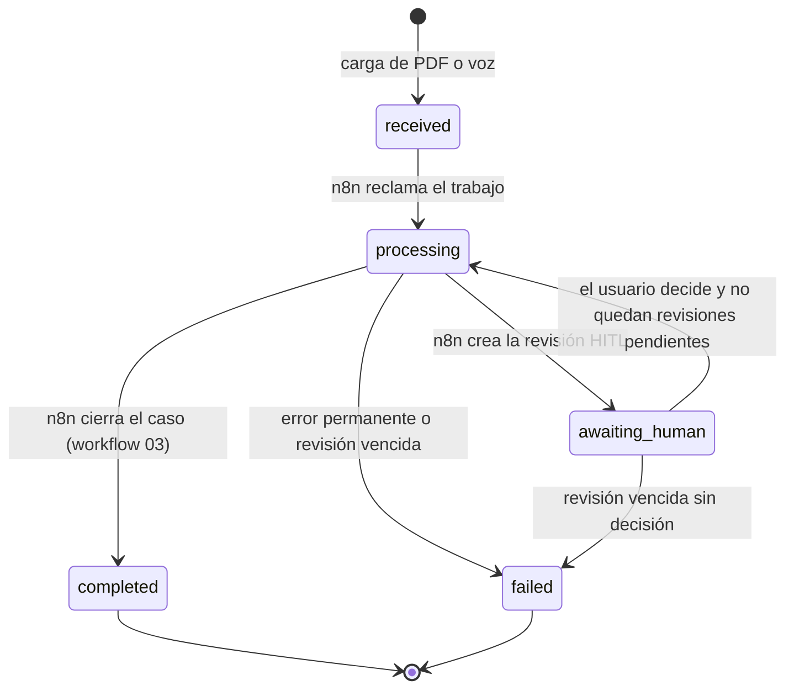
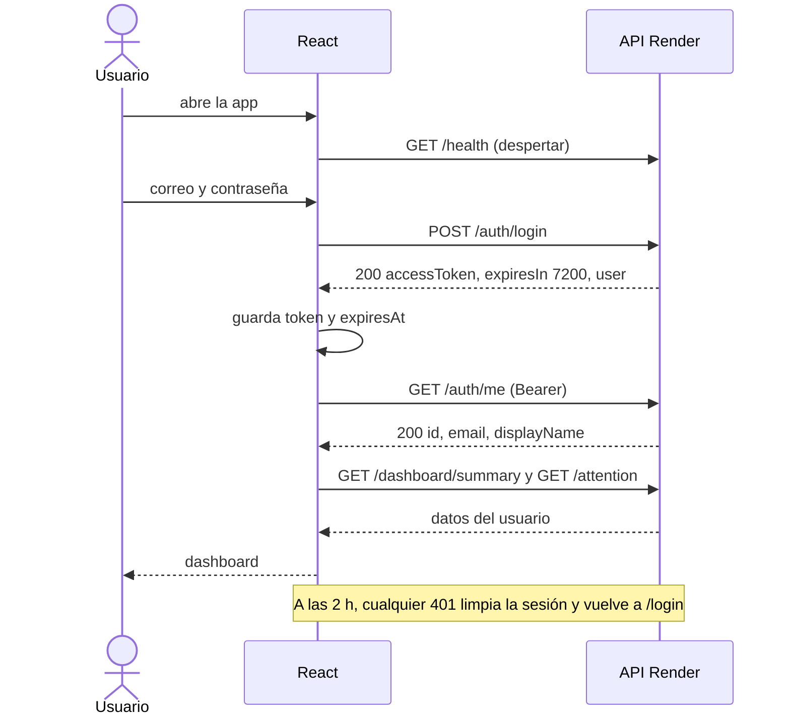
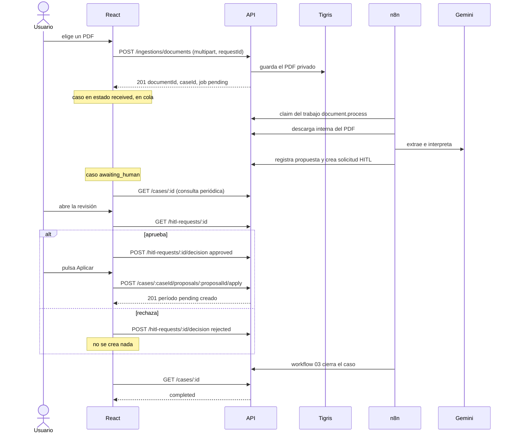
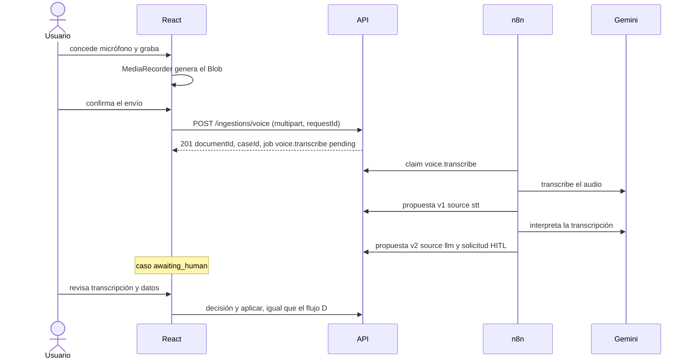
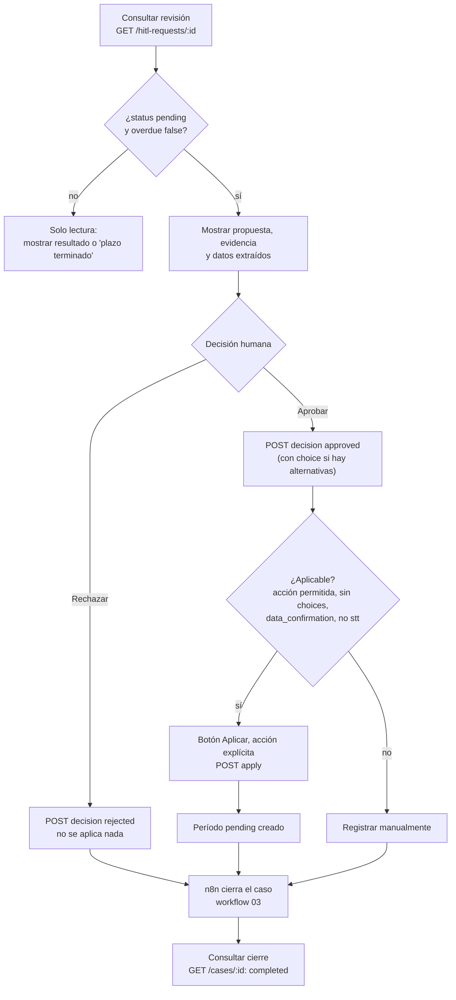
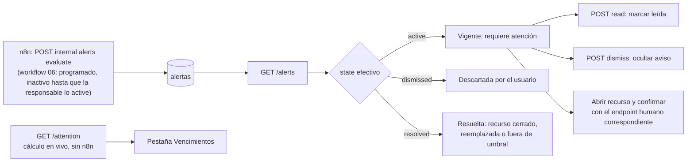

# NotiHouse-Pal — Auditoría del backend y guía de desarrollo del frontend

> **Escrita para:** el equipo que construirá el frontend (React + TypeScript + Vite) y para el asistente de programación que usen como apoyo.
> **Fecha de la auditoría:** 2026-11-04. **Base:** rama `develop`, último commit `3541965`, más los archivos aún sin versionar de `n8n/` e `infra/n8n/`.
> **Regla de oro de este documento:** todo lo que aquí figura como "existe" se comprobó leyendo el código del repositorio (rutas, DTO, guards, servicios) o, cuando se indica, con una lectura de solo lectura contra la API pública. Lo que no se pudo comprobar está marcado como **No verificado** o **Pendiente**. Si el código y este documento difieren, **manda el código**: avisa a quien mantiene el backend.

> **Fotografía del 4 de noviembre de 2026, con actualizaciones del 7 de noviembre.** Los contratos de endpoints, DTO y ejemplos de §4–§7 siguen vigentes. Las partes sobre el **estado** de n8n, Gmail, voz, alertas y del propio frontend se corrigieron (las Etapas 5, 6 y 7 terminaron; ver §13 y §17.1). **Ninguna función pendiente debe tratarse como terminada**: se puede trabajar con **mocks tipados en desarrollo**, pero **no se debe fingir que las integraciones funcionan en producción**.
>
> **Nuevo alcance aprobado (7-nov-2026):** asistente de **texto y voz**, **recurrencias automáticas** de períodos y cobros, **modificación supervisada** de recurrencias, **búsquedas** y dashboard por urgencia/inmueble. **Todo es *propuesto*: no existe aún en el backend.** Está en la **§19** de esta guía y, con el detalle técnico, en la [guía de integración](../integracion/GUIA_INTEGRACION_FRONTEND_BACKEND_MVP.md). El backend de esas funciones lo desarrolla el **integrador**; **los workflows de n8n los adapta solo la responsable del proyecto**. Al terminar, el equipo frontend entrega `docs/frontend/INFORME_FINAL_FRONTEND.md` (§20).
>
> **Decisiones cerradas y ramas:** las decisiones técnicas D1–D18 están **aprobadas** ([guía de integración §21](../integracion/GUIA_INTEGRACION_FRONTEND_BACKEND_MVP.md#21-decisiones-técnicas-cerradas-del-mvp-d1d18)). `develop` y `main` permanecen intactas; el código se consolida en la rama `integration/mvp-final` (§14.2). Sustentación: sábado 14-nov-2026 a primera hora.
>
> **Diseño visual:** el equipo ya cuenta con un diseño previo (demo o video) que la persona responsable entrega por separado. Esta guía **no define ni impone** paleta, tipografía, identidad ni disposición visual; sus requisitos de calidad (§10) se aplican **sobre ese diseño**.

---

## Inicio rápido para el equipo frontend

**API de Render:** **https://notihouse-pal-api.onrender.com** · Health: **https://notihouse-pal-api.onrender.com/api/v1/health** · Readiness: **https://notihouse-pal-api.onrender.com/api/v1/health/ready**

No necesitas Docker, n8n, Neon ni ejecutar el backend: basta Node.js y la API de Render (detalle en §12).

1. **Rama propia.** Con el directorio de trabajo limpio y tras `git fetch --all`, crea tu rama a partir de la más avanzada del frontend (`feature/login-transition`) salvo que su dueño continúe en ella (`git switch -c feature/frontend-app origin/feature/login-transition`). **`develop` y `main` no se tocan**; la entrega se consolida en `integration/mvp-final` (§14.2).
2. **No crees otro proyecto Vite.** Ya existe un scaffold (Vite + React + TS, capa de API y sesión) en `origin/feature/frontend-base`, y trabajo apilado en `origin/feature/frontend-landing` y `origin/feature/login-transition` (§12.2). Parte de esas ramas coordinándote con quien las mantiene.
3. **Instalar dependencias:** `npm install`. No asumas scripts que no existan: revisa el `package.json` generado.
4. **Definir la variable:** crea `frontend/.env.local` (no se versiona) con `VITE_API_BASE_URL=https://notihouse-pal-api.onrender.com/api/v1` (§12.3). Es una URL pública, no un secreto.
5. **Iniciar Vite en el puerto 5173** con `strictPort` (`npm run dev`, §12.4). Es el único origen que la API admite hoy.
6. **Despertar Render:** abre la URL de **Health** y espera hasta ~1 minuto (§12.5).
7. **Comprobar Readiness:** abre la URL de **Readiness**; `200` = Neon responde, `503` = reintenta en unos segundos.
8. **Credenciales demo:** solicítalas al responsable **por un canal privado**. Nunca las pongas en archivos, variables `VITE_*` ni en el repositorio (§12.8).
9. **Probar login y consultas sin modificar datos:** `POST /auth/login` y solo `GET` (clase A/B de §12.8).
10. **Antes de cualquier escritura** (crear, editar, confirmar, subir, decidir, aplicar) o de probar el procesamiento con n8n/Gemini, **pide coordinación al responsable** (clases C y D de §12.8).
11. **Funciones nuevas (asistente de texto/voz, recurrencias, búsquedas):** léelas en la §19. Son *propuestas*: hasta que el integrador publique cada contrato, usa mocks rotulados y no las presentes como integradas.
12. **Coordina con el integrador** (conecta y desarrolla el backend de §19) y **no toques n8n**: solo la responsable lo modifica (§14.3).

---


## Índice

0. [Inicio rápido para el equipo frontend](#inicio-rápido-para-el-equipo-frontend)
1. [Qué hay que saber antes de empezar](#1-qué-hay-que-saber-antes-de-empezar)
2. [Estado real del repositorio](#2-estado-real-del-repositorio)
3. [Arquitectura y fronteras de seguridad](#3-arquitectura-y-fronteras-de-seguridad)
4. [Convenciones de la API](#4-convenciones-de-la-api)
5. [Inventario de endpoints](#5-inventario-de-endpoints)
6. [Contratos y ejemplos](#6-contratos-y-ejemplos)
7. [Autenticación JWT](#7-autenticación-jwt)
8. [Pantallas del MVP](#8-pantallas-del-mvp)
9. [Flujos de usuario](#9-flujos-de-usuario)
10. [Calidad de la experiencia de usuario (aplicada al diseño existente)](#10-calidad-de-la-experiencia-de-usuario-aplicada-al-diseño-existente)
11. [Integración técnica desde React](#11-integración-técnica-desde-react)
12. [Entorno de desarrollo, pruebas seguras y despliegue](#12-entorno-de-desarrollo-pruebas-seguras-y-despliegue)
13. [Matriz de estado y dependencias](#13-matriz-de-estado-y-dependencias)
14. [Colaboración del equipo](#14-colaboración-del-equipo)
15. [Criterios de aceptación del MVP](#15-criterios-de-aceptación-del-mvp)
16. [Prompt recomendado para desarrollar el frontend con Claude](#16-prompt-recomendado-para-desarrollar-el-frontend-con-claude)
17. [Discrepancias, límites y puntos a coordinar](#17-discrepancias-límites-y-puntos-a-coordinar)
18. [Registro de validación](#18-registro-de-validación)
19. [Asistente de texto y voz, recurrencias, búsquedas y dashboard organizado](#19-asistente-de-texto-y-voz-recurrencias-búsquedas-y-dashboard-organizado-funcionalidades-nuevas-aprobadas)
20. [Informe final obligatorio del equipo frontend](#20-informe-final-obligatorio-del-equipo-frontend)

---

## 1. Qué hay que saber antes de empezar

| # | Hallazgo (verificado) | Consecuencia para el frontend |
|---|---|---|
| 1 | En `develop`, `frontend/` solo tiene `.gitkeep`, pero **existe un scaffold y trabajo en ramas remotas apiladas** (`feature/frontend-base` → `feature/frontend-landing` → `feature/login-transition`: cliente HTTP, sesión, landing y login). Ninguna pantalla de negocio está conectada y ninguna rama está fusionada en `develop`. | Parte de esas ramas (§12.2). Todavía no hay script `test`: se crea. |
| 2 | La API usa **un único JWT de acceso de 2 horas** (HS256). **No hay refresh token, ni cookies, ni endpoint de logout.** | La sesión caduca sola a las 2 h; el cliente debe guardar `expiresIn`, detectar el 401 y volver a pedir login (§7). |
| 3 | CORS permite **un solo origen** (`FRONTEND_URL`), solo `GET, POST, PATCH` y las cabeceras `Authorization`, `Content-Type`, `X-Correlation-Id`. Sin credenciales. | Al auditar, Render respondía con `Access-Control-Allow-Origin: http://localhost:5173`. El servidor local de Vite **debe usar el puerto 5173** (`strictPort`). El dominio de Vercel solo podrá llamar a la API cuando el responsable lo autorice; con un único origen admitido, convivir con `localhost` exige un cambio coordinado de backend (§12.4, §17.2). |
| 4 | Los **dinero van como texto** (`"145000.00"`), las **fechas de calendario como `YYYY-MM-DD`** y los instantes como ISO 8601. | Nunca convertir dinero a `number` para calcular; usar texto o una librería decimal (§4). |
| 5 | Los **filtros y cuerpos son estrictos**: cualquier campo o parámetro de query no declarado devuelve **400**. | No enviar `ownerId`, ni campos "extra", ni parámetros de query inventados (§4). |
| 6 | Las rutas `/internal/*` son **exclusivas de n8n** (token de servicio). Un JWT de usuario recibe 401 allí. | El navegador nunca las llama (§5.3). |
| 7 | Los workflows 02–06 de n8n tienen **disparador programado** (cada 5–15 min) pero están **versionados inactivos** y con sus interruptores en `false`; solo la responsable los activa, y corren en su equipo local. Sin ellos, un PDF o audio **permanece en cola**. | La interfaz debe explicarlo («En cola»), no mostrar un spinner eterno ni prometer tiempos (§8.11, §11.9, §19.2). |
| 8 | **Hoy no existe entrada de texto libre** (ni endpoint ni procesamiento): solo PDF, voz y formularios. **Está aprobada para desarrollo** (7-nov-2026): el integrador construirá `POST /ingestions/text` y la responsable adaptará n8n. | Construir la interfaz del asistente (§19) con mocks rotulados «propuesto»; **no simular** respuestas ni presentarla como funcionando hasta que exista el contrato. |
| 9 | La recepción de Gmail existe como **ingesta interna** (workflow 05, un buzón demo ligado a una cuenta, validada con servicios reales en la Etapa 6) y **no tiene pantalla** en el MVP. | Sin pantalla de Gmail. Los casos con `source: gmail` aparecen en «Casos» como cualquier otro. |
| 10 | Las **alertas** las genera el workflow 06 (≤ 1 vez por hora, cuando la responsable lo active) mediante `POST /internal/alerts/evaluate`; dashboard y bandeja se calculan en vivo sin n8n. Son **internas**: sin FCM, WebSockets ni tiempo real. Contrato vigente de la campana y del *polling*: [CONTRATO_ETAPA8](CONTRATO_ETAPA8_NOTIFICACIONES_HITL.md). | Construir la campana según ese contrato (§8.7); estado vacío honesto; la bandeja y el dashboard son la fuente fiable. |
| 11 | Una revisión HITL **vence a las 24 horas** (valor por defecto en la base). Vencida, ya no puede aprobarse ni rechazarse (409). | Mostrar cuenta regresiva y bloquear botones cuando `overdue = true` (§8.10). |
| 12 | Los workflows de voz solo aceptan audios de **hasta 13 MiB** aunque el backend admita 25 MiB. | Limitar la grabación en el cliente (§8.12). |
| 13 | En producción **Swagger está desactivado** (`/api/docs` devuelve 404 en Render, comprobado). | Este documento es el contrato de referencia; pedir al backend exportar un OpenAPI si se necesita (§17). |

---

## 2. Estado real del repositorio

### 2.1 Qué se inspeccionó

| Elemento | Ruta | Resultado |
|---|---|---|
| Frontend | [frontend/](../../frontend/) | En `develop`, solo `.gitkeep`. En `origin/feature/login-transition`: scaffold, `lib/api` (cliente, errores, tipos de autenticación), `lib/auth` (sesión en `sessionStorage`), landing y login; `DashboardPage` es un *placeholder*. |
| Controllers | `backend/src/**/*.controller.ts` y `kill-switch/kill-switch.controllers.ts` (19 archivos) | **66 rutas en total: 51 para navegador (3 públicas + 48 con JWT) y 15 internas** (§5). *(El 4-nov eran 62: 49 + 13; la Etapa 7 añadió `GET /alerts/summary`, `GET /system/status` y 2 rutas internas del kill switch.)* |
| DTO y validación | `backend/src/**/dto/*.ts`, `backend/src/common/*.ts` | `ValidationPipe` global con `whitelist`, `forbidNonWhitelisted`, `transform`. |
| Guard y autenticación | [jwt-auth.guard.ts](../../backend/src/auth/jwt-auth.guard.ts), [auth.constants.ts](../../backend/src/auth/auth.constants.ts) | Guard global: rutas de servicio, públicas y JWT de usuario. |
| CORS y prefijo | [app.setup.ts](../../backend/src/app.setup.ts) | Prefijo `api/v1`, un origen, sin credenciales. |
| Variables de entorno | [env.validation.ts](../../backend/src/config/env.validation.ts) | Solo variables de backend; el frontend necesita una (§12.3). |
| Ingesta | [ingestion.controller.ts](../../backend/src/ingestion/ingestion.controller.ts), [file-policy.ts](../../backend/src/ingestion/file-policy.ts) | PDF y audio, multipart. |
| Casos, propuestas y HITL | [cases.controller.ts](../../backend/src/cases/cases.controller.ts), [hitl.controller.ts](../../backend/src/cases/hitl.controller.ts) | Contratos completos. |
| Workflows de n8n | [n8n/workflows/](../../n8n/workflows/) | **6 JSON (01–06), todos con `active: false`.** El 01 es la prueba de conexión (solo manual); el 02, 03, 04, 05 y 06 incorporan un **disparador programado** (5–15 min) protegido por interruptores en `false` (`AUTORIZAR_*` y `AUTOMATIZACION_PROGRAMADA`). Por defecto **no se ejecutan solos**: solo la responsable los activa o ejecuta. |
| Documentación previa | [docs/api/](../api/), [docs/architecture/authentication.md](../architecture/authentication.md) | Útil, pero con partes desactualizadas (§17.1). |

### 2.2 API pública verificada (solo lectura, 2026-11-05 00:42 UTC)

| Comprobación | Resultado |
|---|---|
| `GET /api/v1/health` | 200 `{ "status": "ok", "service": "notihouse-pal-api", … }` |
| Preflight `OPTIONS /api/v1/auth/login` con `Origin: http://localhost:5173` | 204; permite `GET,POST,PATCH`; cabeceras `Authorization,Content-Type,x-correlation-id`; `max-age=600` |
| `GET /api/docs` | 404 (Swagger deshabilitado en producción) |

No se hizo login, ni se leyeron datos privados, ni se escribió nada.

---

## 3. Arquitectura y fronteras de seguridad



**Reglas que no se negocian**

- El frontend habla **solo** con la API de NotiHouse-Pal. Nunca con Neon, Tigris, Gemini, n8n ni Google.
- El navegador **nunca** contiene ni usa: `N8N_SERVICE_TOKEN`, contraseñas de Neon, claves de Tigris, API Key de Gemini, Client Secret de Google, `JWT_SECRET`.
- Las únicas credenciales en el navegador son el **JWT del usuario** (devuelto por el login) y su correo/contraseña mientras escribe en el formulario.
- La única variable de entorno del frontend es la URL base de la API (`VITE_API_BASE_URL`). Todo lo que empiece con `VITE_` queda **público** en el bundle.
- El backend decide a quién pertenece cada dato: toma el propietario del JWT. El frontend **no envía** `ownerId` (si lo envía, 400) y no filtra por usuario: la API ya devuelve solo lo propio; un recurso ajeno responde **404**, no 403.

---

## 4. Convenciones de la API

| Tema | Regla (con referencia) |
|---|---|
| Base | `https://notihouse-pal-api.onrender.com/api/v1` (prefijo en [app.setup.ts](../../backend/src/app.setup.ts)) |
| Formato | JSON (`Content-Type: application/json`), salvo cargas (`multipart/form-data`) y descarga (binario) |
| Métodos usados | `GET`, `POST`, `PATCH`. **No existen `PUT` ni `DELETE`** (CORS tampoco los permite). El "borrado" es un cambio de estado (`inactive`, `archived`, `cancelled`, `paused`…) |
| Paginación | Query `page` (≥ 1, por defecto 1) y `pageSize` (1–100, por defecto 20). Respuesta: `{ items, page, pageSize, total }` ([pagination.ts](../../backend/src/common/pagination.ts)). La bandeja de atención añade `referenceDate` |
| Dinero | Texto decimal no negativo, hasta 12 enteros y 2 decimales: `"145000.00"`, `"0"`. Cánones y cobros de arriendo: mayor que cero. Patrón: `^(0\|[1-9]\d{0,11})(\.\d{1,2})?$` ([validators.ts](../../backend/src/common/validators.ts)) |
| Moneda | `^[A-Z]{3}$` (ISO 4217). Por defecto `COP`. Los totales del dashboard van **por moneda**; nunca se suman monedas distintas |
| Fechas de calendario | `YYYY-MM-DD` válida de verdad (rechaza `2026-02-30`). Zona de referencia del negocio: `America/Bogota` |
| Instantes | ISO 8601 UTC (`createdAt`, `dueAt`…). Mostrar en hora local del usuario |
| Textos | Los campos de texto se recortan (`trim`) en el servidor. Los límites de longitud están en cada DTO |
| Validación estricta | Campos o query no declarados → **400**. En `PATCH`, `undefined` = "no modificar"; `null` solo borra campos marcados como anulables; un `PATCH` sin ningún campo → 400 |
| UUID en rutas | Un `:id` que no sea UUID → 400 (`ParseUUIDPipe`) |
| Errores | Formato estándar de NestJS: `{ "statusCode": 400, "message": "texto" \| ["texto", …], "error": "Bad Request" }`. `message` puede ser **texto o lista**. Los mensajes están en español y son mostrables |
| `X-Correlation-Id` | Opcional en peticiones (UUID). La API lo devuelve en la respuesta (expuesto a CORS). Útil para soporte; no es obligatorio |
| Códigos de error de base de datos | `409` por duplicado o conflicto de concurrencia ("reintenta"), `400` por datos que violan reglas, `503` por base de datos no disponible (filtro [database-exception.filter.ts](../../backend/src/common/database-exception.filter.ts)) |
| Límite de intentos | Solo `POST /auth/login`: 5 intentos por minuto por IP → **429** ([auth.constants.ts](../../backend/src/auth/auth.constants.ts)) |

### Etiquetas sugeridas para estados (valores reales del backend → texto de interfaz)

Los valores de la izquierda son los únicos que devuelve la API ([enums.ts](../../backend/src/database/schema/enums.ts)). Las etiquetas de la derecha son una propuesta.

| Dominio | Valores → etiqueta |
|---|---|
| Estado de registro (inmueble) | `active` Activo · `inactive` Inactivo · `archived` Archivado |
| Categoría de obligación | `water` Agua · `electricity` Energía · `gas` Gas · `internet` Internet · `mobile` Celular · `administration` Administración · `other` Otra |
| Frecuencia | `monthly` Mensual · `bimonthly` Bimestral · `quarterly` Trimestral · `semiannual` Semestral · `annual` Anual |
| Estado de obligación | `active` Activa · `paused` Pausada · `archived` Archivada (final) |
| Estado de período | `pending` Pendiente · `overdue` Vencido · `paid` Pagado · `attended` Atendido · `cancelled` Anulado |
| Estado de arriendo | `active` Vigente · `suspended` Suspendido · `ended` Terminado (final) |
| Estado de cobro | `expected` Esperado · `pending` Pendiente · `overdue` Vencido · `received` Recibido · `cancelled` Anulado |
| Estado de contrato | `active` Vigente · `expired` Vencido · `terminated` Terminado |
| Tipo de caso | `household_obligation` Obligación del hogar · `rent_collection` Cobro de arriendo · `contract_review` Revisión de contrato |
| Origen | `form` Formulario · `document` Documento · `gmail` Correo · `voice` Voz |
| Estado de caso | `received` Recibido (en cola) · `processing` En proceso · `awaiting_human` Esperando tu decisión · `completed` Completado · `failed` Fallido · `cancelled` Cancelado |
| Tipo de documento | `invoice` Factura · `contract` Contrato · `payment_receipt` Comprobante de pago · `voice_note` Nota de voz · `other` Otro |
| Revisión de propuesta | `pending_review` Por revisar · `accepted` Aceptada · `rejected` Rechazada · `superseded` Reemplazada |
| Tipo de decisión HITL | `data_confirmation` Confirmar datos · `conflict_resolution` Resolver conflicto · `reminder_approval` Aprobar recordatorio · `contract_review` Revisar contrato · `other` Otra decisión |
| Estado HITL | `pending` Pendiente · `approved` Aprobada · `rejected` Rechazada · `expired` Vencida (nunca equivale a aprobación) · `cancelled` Anulada |
| Alertas: tipo | `obligation_due_soon/overdue`, `rent_charge_due_soon/overdue`, `contract_ending_soon`, `contract_end_passed`, `hitl_pending/due_soon/overdue` |
| Alertas: severidad | `info` · `warning` · `critical` |
| Alertas: estado | `active` Vigente · `dismissed` Descartada · `resolved` Resuelta |
| Alertas: motivo de resolución | `resource_closed` · `superseded` · `no_longer_applicable` |

> Mostrar siempre estado **con texto y con ícono**, no solo con color (accesibilidad, §10.3).

---

## 5. Inventario de endpoints

Prefijo común: `/api/v1`. En las tablas, la ruta se escribe sin prefijo. **"JWT"** = cabecera `Authorization: Bearer <accessToken>`.

Conteo verificado contra los controllers (actualizado el 7-nov-2026, tras la Etapa 7): **51 rutas de navegador (3 públicas + 48 con JWT) y 15 internas**. Respecto al 4-nov se añadieron `GET /alerts/summary` y `GET /system/status` (navegador) y las dos rutas internas del kill switch. Las rutas **propuestas** (texto, generación recurrente, etc.) están en §5.4 y **no** se incluyen en ese conteo.

### 5.1 Rutas públicas (sin autenticación)

| Método | Ruta | Pantalla | Respuestas |
|---|---|---|---|
| GET | `/health` | Arranque de la app (despertar Render) | 200 |
| GET | `/health/ready` | Diagnóstico (¿Neon despierto?) | 200 · 503 `unavailable` |
| POST | `/auth/login` | Inicio de sesión | 200 · 400 · 401 · 429 |

### 5.2 Rutas con JWT de usuario

Todas devuelven **401** si el token falta, es inválido o expiró, y **503** si la API no puede validar la sesión por un fallo de base de datos. Todas filtran por el propietario del token.

| Método | Ruta | Función | Éxito | Otros códigos | Pantalla |
|---|---|---|---|---|---|
| GET | `/auth/me` | Perfil autenticado | 200 | 401 | Arranque / menú de usuario |
| GET | `/dashboard/summary` | Indicadores agregados | 200 | — | Dashboard |
| GET | `/attention` | Bandeja unificada de atención | 200 | 400 | Dashboard, Bandeja |
| GET | `/properties` | Listar inmuebles | 200 | 400 | Inmuebles |
| GET | `/properties/:id` | Detalle de inmueble | 200 | 404 | Inmuebles |
| POST | `/properties` | Crear inmueble | 201 | 400 · 409 nombre duplicado | Inmuebles |
| PATCH | `/properties/:id` | Editar / desactivar | 200 | 400 · 404 · 409 | Inmuebles |
| GET | `/obligations` | Listar obligaciones | 200 | 400 | Obligaciones |
| GET | `/obligations/:id` | Detalle de obligación | 200 | 404 | Obligaciones |
| POST | `/obligations` | Crear obligación | 201 | 400 · 404 inmueble ajeno · 409 inmueble inactivo | Obligaciones |
| PATCH | `/obligations/:id` | Editar definición | 200 | 400 · 404 · 409 archivada/inmueble inactivo | Obligaciones |
| GET | `/obligations/:id/occurrences` | Listar períodos | 200 | 404 | Obligaciones |
| GET | `/obligations/:id/occurrences/:occurrenceId` | Detalle de período | 200 | 404 | Obligaciones |
| POST | `/obligations/:id/occurrences` | Crear período (siempre `pending`) | 201 | 400 · 404 · 409 duplicado/archivada | Obligaciones |
| PATCH | `/obligations/:id/occurrences/:occurrenceId` | Editar o anular período | 200 | 400 · 404 · 409 | Obligaciones |
| POST | `/obligations/:id/occurrences/:occurrenceId/confirm` | Confirmar pago/atención (humana) | **200** | 400 · 404 · 409 | Obligaciones, Bandeja |
| GET | `/rentals` | Listar arriendos | 200 | 400 | Arriendos |
| GET | `/rentals/:id` | Detalle de arriendo | 200 | 404 | Arriendos |
| POST | `/rentals` | Crear arriendo | 201 | 400 · 404 · 409 inmueble inactivo | Arriendos |
| PATCH | `/rentals/:id` | Editar arriendo | 200 | 400 · 404 · 409 terminado | Arriendos |
| GET | `/rentals/:id/charges` | Listar cobros | 200 | 404 | Arriendos |
| GET | `/rentals/:id/charges/:chargeId` | Detalle de cobro | 200 | 404 | Arriendos |
| POST | `/rentals/:id/charges` | Crear cobro (siempre `expected`) | 201 | 400 · 404 · 409 duplicado/terminado | Arriendos |
| PATCH | `/rentals/:id/charges/:chargeId` | Editar o anular cobro | 200 | 400 · 404 · 409 | Arriendos |
| POST | `/rentals/:id/charges/:chargeId/confirm` | Confirmar recepción (humana, con evidencia) | **200** | 400 · 404 · 409 | Arriendos, Bandeja |
| GET | `/contracts` | Listar contratos | 200 | 400 | Contratos |
| GET | `/contracts/:id` | Detalle de contrato | 200 | 404 | Contratos |
| POST | `/contracts` | Registrar metadatos (siempre `active`) | 201 | 400 · 404 · 409 inmueble inactivo | Contratos |
| PATCH | `/contracts/:id` | Corregir metadatos | 200 | 400 · 404 · 409 vencido/terminado | Contratos |
| GET | `/alerts` | Listar alertas | 200 | 400 | Alertas |
| GET | `/alerts/:id` | Detalle de alerta | 200 | 404 | Alertas |
| POST | `/alerts/:id/read` | Marcar leída (idempotente) | **200** | 404 | Alertas |
| POST | `/alerts/:id/dismiss` | Descartar aviso (idempotente) | **200** | 404 · 409 ya resuelta | Alertas |
| GET | `/alerts/summary` | **Contador de la campana** (ligero, para *polling*; Etapa 7; 404 si Render es anterior) | 200 | 401 | Campana |
| GET | `/system/status` | Funciones limitadas por el kill switch (Etapa 7; 404 si Render es anterior) | 200 | 401 | Aviso global |
| GET | `/cases` | Listar casos | 200 | 400 | Casos |
| GET | `/cases/:id` | Detalle / estado de procesamiento | 200 | 404 | Casos, Documentos |
| POST | `/cases` | Crear caso manual (⚠ sin workflow que lo procese, ver nota) | 201 / 200 repetido | 400 · 404 · 409 | **No exponer en el MVP** |
| GET | `/cases/:id/proposals` | Propuestas del caso | 200 | 404 | Casos, HITL |
| POST | `/cases/:caseId/proposals/:proposalId/apply` | Aplicar propuesta aprobada (cuerpo vacío) | 201 / 200 ya aplicada | 400 · 404 · 409 | HITL |
| GET | `/hitl-requests` | Listar revisiones | 200 | 400 | Bandeja, HITL |
| GET | `/hitl-requests/:id` | Revisión con su propuesta | 200 | 404 | HITL |
| POST | `/hitl-requests/:id/decision` | Aprobar o rechazar | **200** | 400 · 404 · 409 | HITL |
| POST | `/ingestions/documents` | Subir PDF (multipart) | 201 / 200 repetido | 400 · 404 · 409 · 413 · 415 · 429 · 503 | Documentos |
| POST | `/ingestions/voice` | Subir nota de voz (multipart) | 201 / 200 repetido | 400 · 404 · 409 · 413 · 415 · 429 · 503 | Voz |
| GET | `/documents` | Listar documentos | 200 | 400 | Documentos |
| GET | `/documents/:id` | Metadatos de documento | 200 | 404 | Documentos |
| GET | `/documents/:id/content` | Descargar archivo (binario, como adjunto) | 200 | 404 · 503 | Documentos |

> **Nota sobre `POST /cases`:** crea un caso de origen `form` y un trabajo `case.<tipo>`. Ningún workflow de n8n existente reclama ese tipo de trabajo (los workflows reclaman `document.process`, `voice.transcribe` y `hitl.decision`). Un caso creado así quedaría en cola indefinidamente. **No construir esa pantalla** hasta que el backend lo defina.

> **Nota sobre `POST` que devuelven 200 y no 201:** `confirm`, `read`, `dismiss` y `decision` devuelven **200**, no 201 (`@HttpCode(200)`). `login` también devuelve 200.

### 5.3 Rutas internas de n8n — el navegador NO las usa

Estas rutas están marcadas `@ServiceRoute()`: solo aceptan `Authorization: Bearer <N8N_SERVICE_TOKEN>`. Con un JWT de usuario responden 401, y con el token de servicio las rutas de usuario responden 401 ([jwt-auth.guard.ts](../../backend/src/auth/jwt-auth.guard.ts)). **No las llames, no las mockees en producción y no las uses para "atajos".**

| Método | Ruta | Para qué la usa n8n |
|---|---|---|
| POST | `/internal/workflow-jobs/claim` | Reclamar trabajos pendientes |
| GET | `/internal/workflow-jobs/:id` | Consultar un trabajo reclamado |
| POST | `/internal/workflow-jobs/:id/heartbeat` | Renovar la reclamación |
| POST | `/internal/workflow-jobs/:id/complete` | Cerrar un trabajo |
| POST | `/internal/workflow-jobs/:id/fail` | Registrar fallo del trabajo |
| POST | `/internal/cases/:id/proposals` | Registrar propuesta (transcripción, interpretación) |
| POST | `/internal/cases/:id/hitl-requests` | Crear la solicitud de revisión humana |
| POST | `/internal/cases/:id/complete` | Cerrar el caso como completado |
| POST | `/internal/cases/:id/fail` | Cerrar el caso como fallido |
| POST | `/internal/hitl-requests/expire` | Materializar revisiones vencidas |
| POST | `/internal/alerts/evaluate` | Evaluar vencimientos y generar alertas |
| GET | `/internal/documents/:id/content` | Leer el archivo de un trabajo reclamado |
| POST | `/internal/gmail/attachments` | Ingesta de adjuntos de Gmail (workflow 05; operativa desde la Etapa 6) |

**Consecuencia práctica:** el usuario nunca puede crear propuestas de IA, crear solicitudes HITL ni cerrar casos desde la aplicación. Esos pasos los hace n8n; la aplicación **muestra** su resultado y registra la **decisión humana**.


### 5.4 Contratos propuestos (NO existen todavía)

> Etiqueta obligatoria en el código y las pantallas que los usen: **propuesto**. Detalle: [guía de integración §20](../integracion/GUIA_INTEGRACION_FRONTEND_BACKEND_MVP.md#20-contratos-nuevos-propuestos).

| ID | Contrato | Para qué | Pantalla |
|---|---|---|---|
| N1 | `POST /ingestions/text` (JWT, JSON) | Enviar un mensaje escrito al asistente | Asistente |
| N2 *(opcional)* | `GET /ingestions/text/:caseId` | Recuperar el texto enviado | Asistente / Casos |
| N3 *(obligatoria)* | `q` en `GET /properties` (nombre) y `GET /obligations` (proveedor y concepto) | Búsqueda de texto | Inmuebles, Obligaciones |
| N3b *(opcional)* | `q` en `GET /rentals` y `GET /contracts` | Búsqueda adicional; **no bloquea la entrega** | Arriendos, Contratos |
| N4 *(recomendada)* | `unassigned=true` en `GET /obligations` | «Sin inmueble asignado» | Obligaciones, Dashboard |
| N5 *(DESCARTADA, D13)* | `propertyId` en `GET /attention` y `GET /dashboard/summary` | **No se implementa**: el dashboard y los pendientes por inmueble se organizan en el frontend con las APIs existentes | Dashboard |
| N6 | `autoGenerate` en obligaciones y arriendos | Generación automática de períodos/cobros | Formularios |
| N7 | Acciones aplicables nuevas en `POST …/apply`: `create_recurring_obligation`, `update_obligation_schedule`, `update_occurrence_details`, `create_recurring_rental` | Crear/modificar recurrencias con HITL | Revisión HITL |
| N8 *(recomendado)* | `GET /obligations/:id/upcoming`, `GET /rentals/:id/upcoming` | «Próximos períodos» calculados por el backend | Obligaciones, Arriendos |
| N9 *(OPCIONAL, ampliación D17; no bloquea)* | `POST /cases/:caseId/continuations` (JWT) | Continuar tras elegir entre obligaciones ambiguas | Asistente / Revisión HITL |

Las rutas internas propuestas (`POST /internal/recurrence/generate`, `POST /internal/cases/:id/assistant/resolve`) son de n8n/servicio: **el navegador no las usa**.

---

## 6. Contratos y ejemplos

Todos los identificadores de ejemplo son **ficticios** (`00000000-0000-4000-8000-0000000000NN`) y los datos son sintéticos. Sustitúyelos por los reales de tu sesión.

### 6.1 Autenticación

**`POST /auth/login`** ([login.dto.ts](../../backend/src/auth/dto/login.dto.ts))

| Campo | Regla |
|---|---|
| `email` | Correo válido, máx. 254; se normaliza a minúsculas y sin espacios |
| `password` | Texto no vacío, máx. 256 |

```json
// Petición
{ "email": "laura.martinez@notihouse.com", "password": "<contraseña-del-usuario>" }
```

```json
// 200 — LoginResponseDto
{
  "accessToken": "<JWT>",
  "tokenType": "Bearer",
  "expiresIn": 7200,
  "user": {
    "id": "00000000-0000-4000-8000-000000000001",
    "email": "laura.martinez@notihouse.com",
    "displayName": "Laura Martínez"
  }
}
```

Errores: `400` (correo mal formado, contraseña vacía), `401` `"Credenciales inválidas"` (mensaje único: no revela si la cuenta existe; tampoco si está inactiva), `429` (más de 5 intentos por minuto desde la misma IP).

**`GET /auth/me`** → `200 { "id", "email", "displayName" }` (el `id` es el id de perfil).

### 6.2 Inmuebles

`GET /properties?page=1&pageSize=20&status=active`

```json
{
  "items": [{
    "id": "00000000-0000-4000-8000-000000000010",
    "name": "Apartamento Demo Hogar",
    "address": null,
    "description": null,
    "status": "active",
    "createdAt": "2026-10-24T19:00:00.000Z",
    "updatedAt": "2026-10-24T19:00:00.000Z"
  }],
  "page": 1, "pageSize": 20, "total": 1
}
```

`POST /properties` — `name` (obligatorio, ≤ 120), `address` (≤ 300, opcional/nulo), `description` (≤ 1000, opcional/nulo). `PATCH /properties/:id` — esos campos más `status` (`active`/`inactive`/`archived`). Nombre repetido → `409 "Ya existe un inmueble con ese nombre"`.

### 6.3 Obligaciones y períodos

`POST /obligations` ([obligation.dto.ts](../../backend/src/obligations/dto/obligation.dto.ts))

| Campo | Obligatorio | Regla |
|---|---|---|
| `providerName` | Sí | Texto ≤ 120 |
| `concept` | Sí | Texto ≤ 160 |
| `category` | Sí | `water`, `electricity`, `gas`, `internet`, `mobile`, `administration`, `other` |
| `propertyId` | No | UUID de un inmueble propio **activo** |
| `expectedAmount` | No | Dinero (texto) |
| `currency` | No | ISO 4217, por defecto `COP` |
| `frequency` | No | `monthly` (por defecto)… `annual` |
| `dueDay` | No | Entero 1–31 |
| `reminderDaysBefore` | No | Entero 0–60 (por defecto 3) |
| `startsOn` | No | Fecha `YYYY-MM-DD` |
| `status` | No | Solo `active` (defecto) o `paused` al crear |

```json
{
  "providerName": "Empresa de energía (ficticia)",
  "concept": "Energía eléctrica",
  "category": "electricity",
  "expectedAmount": "145000.00",
  "frequency": "monthly",
  "dueDay": 18,
  "reminderDaysBefore": 3,
  "startsOn": "2026-01-01"
}
```

La respuesta añade `id`, `propertyId` (nulo si no hay), `currency`, `status`, `createdAt`, `updatedAt`. `PATCH` **no** permite cambiar la moneda; `status: "archived"` es final. Las `PATCH` aceptan `null` para `propertyId`, `expectedAmount`, `dueDay`, `startsOn`.

**Períodos** — `POST /obligations/:id/occurrences`

```json
{ "periodStart": "2026-11-01", "periodEnd": "2026-11-30", "dueDate": "2026-11-18", "amount": "145000.00" }
```

`amount` es opcional (si falta, copia el valor esperado de la obligación). Respuesta:

```json
{
  "id": "00000000-0000-4000-8000-000000000020",
  "obligationId": "00000000-0000-4000-8000-000000000011",
  "periodStart": "2026-11-01", "periodEnd": "2026-11-30",
  "amount": "145000.00", "currency": "COP",
  "dueDate": "2026-11-18",
  "status": "pending",
  "confirmedAt": null, "confirmedBy": null, "confirmationReference": null,
  "createdAt": "2026-11-04T15:00:00.000Z", "updatedAt": "2026-11-04T15:00:00.000Z"
}
```

- `PATCH` solo edita períodos `pending` u `overdue`. `status` solo admite `"cancelled"` (anular). El pago **no** se marca por `PATCH`.
- **`POST …/confirm`** — cuerpo `{ "result": "paid" | "attended", "reference": "…" }` (`reference` opcional, ≤ 200). Es una **declaración del usuario**: NotiHouse-Pal no ejecuta ni verifica pagos. Repetir la misma confirmación devuelve el período sin cambios; un resultado distinto o un período anulado → `409`.
- Un mismo `periodStart` repetido en una obligación → `409 "Ya existe un período con esa fecha de inicio para esta obligación"`.
- No existe generación automática de períodos: el usuario (o una propuesta aplicada) los crea.
- El estado `overdue` almacenado puede estar desactualizado: la API calcula "vencido" por fecha en dashboard y bandeja. En listados, **calcula la insignia "Vencido" en el cliente** comparando `dueDate` con la fecha de hoy en `America/Bogota` cuando `status` sea `pending`/`overdue`.

### 6.4 Arriendos y cobros

`POST /rentals` ([rental.dto.ts](../../backend/src/rentals/dto/rental.dto.ts))

```json
{
  "propertyId": "00000000-0000-4000-8000-000000000012",
  "tenantAlias": "Arrendatario ficticio A",
  "expectedAmount": "950000.00",
  "dueDay": 5,
  "startsOn": "2026-11-01",
  "endsOn": "2027-10-31"
}
```

Obligatorios: `propertyId`, `expectedAmount` (> 0), `dueDay` (1–31), `startsOn`. Opcionales: `tenantAlias` (≤ 120; **usar alias, no datos personales**), `currency`, `endsOn`, `status` (`active`/`suspended`). `PATCH` no cambia inmueble ni moneda; `ended` es final; `endsOn: null` quita la fecha final.

**Cobros** — `POST /rentals/:id/charges`: `periodStart`, `periodEnd`, `dueDate` (obligatorios) y `expectedAmount` (opcional, > 0). Respuesta con `expectedAmount`, `currency`, `status` (`expected` al crear), `confirmedAt`, `confirmedBy`, `confirmationEvidence`. Filtros de listado: `status`, `periodFrom`, `periodTo`.

**`POST …/charges/:chargeId/confirm`** — cuerpo `{ "evidence": "Recibido en efectivo el 5 de noviembre" }`. **`evidence` es obligatoria** (≤ 500) y `400` si falta. Es una declaración del propietario; no se verifican transferencias.

### 6.5 Contratos

`POST /contracts` ([contract.dto.ts](../../backend/src/contracts/dto/contract.dto.ts))

```json
{
  "propertyId": "00000000-0000-4000-8000-000000000013",
  "rentalId": "00000000-0000-4000-8000-000000000014",
  "startsOn": "2025-12-16",
  "endsOn": "2026-12-15",
  "noticePeriodDays": 30,
  "documentId": "00000000-0000-4000-8000-000000000030"
}
```

Obligatorios: `propertyId`, `startsOn`, **`endsOn`** (sin fecha final no hay vigilancia de vencimiento). Opcionales: `rentalId` (del **mismo** inmueble), `noticePeriodDays` (0–365), `documentId` (documento propio de tipo `contract`). Solo **metadatos**: la API no genera, firma ni renueva contratos. `PATCH` no cambia inmueble ni arriendo; `status` admite `expired` o `terminated` y un contrato ya vencido/terminado no admite cambios (409). Filtros: `propertyId`, `rentalId`, `status`, `endsFrom`, `endsTo`.

### 6.6 Dashboard — `GET /dashboard/summary`

Una sola llamada. Solo lectura. Sin caché del lado del servidor.

```json
{
  "referenceDate": "2026-11-04",
  "timeZone": "America/Bogota",
  "properties": { "total": 1, "active": 1 },
  "obligations": { "active": 3, "periodsPending": 2, "periodsOverdue": 0, "periodsDueSoon": 2, "periodsConfirmed": 1 },
  "rentCharges": { "pending": 0, "overdue": 0, "dueSoon": 0, "received": 0 },
  "contracts": { "active": 0, "endingSoon": 0, "endPassed": 0 },
  "hitl": { "pending": 0 },
  "alerts": { "active": 0, "unread": 0 },
  "cases": { "open": 0 },
  "money": {
    "note": "Valores esperados y confirmaciones declaradas por el usuario. No son saldos bancarios ni pagos verificados.",
    "obligationsOpen": [{ "currency": "COP", "total": "290000.00", "count": 2, "withoutAmount": 0 }],
    "rentOpen": [],
    "month": { "start": "2026-11-01", "end": "2026-12-01" },
    "obligationsThisMonth": [{ "currency": "COP", "expected": "290000.00", "confirmed": "0.00" }],
    "rentThisMonth": []
  }
}
```

- `money.month.end` es **exclusivo**.
- Los arreglos de dinero tienen **una fila por moneda** y pueden venir **vacíos**.
- **Obligatorio mostrar el texto de `money.note`** (o equivalente): ningún monto es saldo bancario. Distinguir visualmente "esperado" de "confirmado/recibido".
- `withoutAmount` = registros sin valor conocido (no suman).

### 6.7 Bandeja de atención — `GET /attention?page=&pageSize=&kind=`

`kind` (opcional): `obligation_occurrence`, `rent_charge`, `contract`, `hitl_request`. Orden determinístico por prioridad (1 = más urgente), fecha, hora límite, tipo e id.

```json
{
  "referenceDate": "2026-11-04",
  "items": [{
    "kind": "obligation_occurrence",
    "id": "00000000-0000-4000-8000-000000000020",
    "title": "Energía eléctrica — Empresa de energía (ficticia)",
    "description": "Vence en 14 días",
    "relevantDate": "2026-11-18",
    "dueAt": null,
    "status": "pending",
    "condition": "upcoming",
    "priority": 4,
    "daysUntil": 14,
    "amount": "145000.00",
    "currency": "COP",
    "suggestedAction": "confirm_payment",
    "resource": {
      "type": "obligation_occurrence",
      "id": "00000000-0000-4000-8000-000000000020",
      "path": "/obligations/00000000-0000-4000-8000-000000000011/occurrences/00000000-0000-4000-8000-000000000020"
    },
    "alert": null
  }],
  "page": 1, "pageSize": 20, "total": 1
}
```

| Campo | Valores |
|---|---|
| `condition` | `upcoming` (próximo), `due_today` (vence hoy), `overdue` (vencido), `pending` (HITL pendiente), `due_soon` (HITL por vencer) |
| `priority` | 1 (HITL por vencer o vencido) · 2 vencido · 3 vence hoy · 4 próximo / HITL pendiente |
| `suggestedAction` | `confirm_payment`, `confirm_receipt`, `review_contract`, `decide_review`, `view_review` |
| `resource.path` | Ruta **de la API** del recurso (p. ej. `/hitl-requests/:id`), **no** una ruta de React. Se usa como referencia para construir la navegación: mapea `kind` + `id` + (id padre dentro de `path`) a tus rutas de pantalla |
| `alert` | `{ id, read }` si hay alerta vigente; si no, `null` |

La bandeja usa los umbrales del backend (por defecto: 7 días para obligaciones y cobros, 30 para contratos, 6 h para HITL). Las HITL de la bandeja traen `title: "Revisión: confirmación de datos"` y `dueAt` con hora.

### 6.8 Alertas — `GET /alerts`

Filtros: `state` (`active`/`dismissed`/`resolved`), `read` (`true`/`false`), `type`, `severity`, `requiresAttention` (`true`/`false`), `order` (`asc`/`desc`, por defecto `desc`). Los booleanos de query son **solo** los textos `true`/`false`.

```json
{
  "items": [{
    "id": "00000000-0000-4000-8000-000000000040",
    "type": "obligation_due_soon",
    "severity": "warning",
    "title": "Obligación próxima a vencer",
    "message": "…",
    "relevantDate": "2026-11-18",
    "state": "active",
    "requiresAttention": true,
    "read": false,
    "readAt": null, "dismissedAt": null, "resolvedAt": null, "resolutionReason": null,
    "resource": { "type": "obligation_occurrence", "id": "…", "path": "/obligations/…/occurrences/…" },
    "createdAt": "2026-11-04T12:00:00.000Z", "updatedAt": "2026-11-04T12:00:00.000Z"
  }],
  "page": 1, "pageSize": 20, "total": 1
}
```

- `state` es el **estado efectivo** (calculado al consultar): una alerta cuyo recurso ya se cerró aparece `resolved` aunque aún no se haya ejecutado una evaluación.
- `POST /alerts/:id/read` (marcar leída) y `POST /alerts/:id/dismiss` (descartar) **solo cambian la alerta**: no confirman pagos, ni cobros, ni revisiones, ni contratos. Ambas son idempotentes. `dismiss` sobre una alerta ya resuelta → `409`.
- Las alertas son **avisos internos**: no son notificaciones push (FCM, **no implementadas**), correos ni mensajes. El requisito de la experiencia de notificaciones del frontend está en §8.7.
- **Dependencia:** las alertas se crean al ejecutar `POST /internal/alerts/evaluate` (n8n). Hasta que esté programado, `GET /alerts` puede devolver lista vacía aunque haya cosas por vencer. La bandeja `/attention` **sí** muestra esos vencimientos.

### 6.9 Casos — `GET /cases`, `GET /cases/:id`

Filtros de listado: `status`, `type`. Más recientes primero.

```json
{
  "id": "00000000-0000-4000-8000-000000000050",
  "correlationId": "00000000-0000-4000-8000-000000000051",
  "type": "household_obligation",
  "source": "document",
  "status": "awaiting_human",
  "obligationId": null, "rentalId": null, "contractId": null,
  "statusReason": null,
  "closedAt": null,
  "createdAt": "2026-11-04T15:00:00.000Z",
  "updatedAt": "2026-11-04T15:10:00.000Z"
}
```

Transiciones reales ([case-lifecycle.ts](../../backend/src/cases/case-lifecycle.ts)); no hay `PATCH` de estado, cada una la provoca una acción:



`cancelled` existe en el esquema pero **no hay transición que lo produzca** hoy. Estados terminales: `completed`, `failed`, `cancelled`. `failed` trae un motivo legible en `statusReason`.

### 6.10 Propuestas — `GET /cases/:id/proposals?reviewStatus=`

```json
{
  "items": [{
    "id": "00000000-0000-4000-8000-000000000060",
    "caseId": "00000000-0000-4000-8000-000000000050",
    "version": 1,
    "source": "llm",
    "proposedData": {
      "action": "create_obligation_with_occurrence",
      "data": {
        "obligation": { "providerName": "Empresa de energía (ficticia)", "concept": "Energía eléctrica", "category": "electricity", "expectedAmount": "98500.00", "currency": "COP" },
        "occurrence": { "periodStart": "2026-10-01", "periodEnd": "2026-10-31", "dueDate": "2026-11-18", "amount": "98500.00" }
      }
    },
    "evidence": { "model": "<modelo>", "fragments": [{ "field": "amount", "text": "Total a pagar 98.500" }] },
    "confidence": null,
    "documentId": "00000000-0000-4000-8000-000000000030",
    "reviewStatus": "pending_review",
    "reviewedAt": null, "reviewedBy": null,
    "createdAt": "2026-11-04T15:05:00.000Z", "updatedAt": "2026-11-04T15:05:00.000Z"
  }],
  "page": 1, "pageSize": 20, "total": 1
}
```

**`proposedData` y `evidence` son JSON libres** (el DTO los declara `object`/`unknown`). Hoy los llenan los workflows de n8n con estas formas (leídas de los nodos "Construir propuesta"; el backend solo las valida al **aplicar**):

| Caso | Forma de `proposedData` | ¿Aplicable? |
|---|---|---|
| Factura o voz interpretada correctamente, **sin** obligación asociada al caso | `{ action: "create_obligation_with_occurrence", data: { obligation: {…}, occurrence: {…} } }` | Sí |
| Ídem, **con** obligación asociada al caso | `{ action: "create_obligation_occurrence", data: { obligationId, periodStart, periodEnd, dueDate, amount, currency } }` | Sí |
| No se pudo interpretar completo | `{ interpretacion: {…}, camposProblematicos: ["valor", …], requiereRevisionManual: true }` | **No** |
| Transcripción de voz (`source: "stt"`) | `{ transcript, language, uncertainFragments }` | **Nunca** (el backend rechaza aplicar `stt`) |

Reglas para el cliente:

- Trátalos como `unknown` y **valida en el cliente con un esquema** (p. ej. Zod) antes de mostrar campos; si no encaja, muestra el JSON de forma legible y marca "requiere revisión manual".
- Una voz genera dos propuestas: la versión 1 (`stt`, transcripción) y la versión 2 (`llm`, interpretación). Las versiones anteriores pendientes pasan a `superseded`. Mostrar por defecto la **versión más alta**; ofrecer ver las demás.
- `confidence` es texto `"0.870"` (0–1, 3 decimales) o `null`.
- **Una propuesta nunca es información definitiva.** Etiquétala como "Sugerencia de IA — requiere tu confirmación".

### 6.11 Revisión humana (HITL)

`GET /hitl-requests?status=&caseId=` → página de:

```json
{
  "id": "00000000-0000-4000-8000-000000000070",
  "caseId": "00000000-0000-4000-8000-000000000050",
  "proposalId": "00000000-0000-4000-8000-000000000060",
  "decisionType": "data_confirmation",
  "status": "pending",
  "overdue": false,
  "options": { "summary": "Factura de Empresa de energía (ficticia): 98500.00 COP, vence el 2026-11-18. Confirma que los datos son correctos." },
  "decision": null,
  "createdAt": "2026-11-04T15:06:00.000Z",
  "dueAt": "2026-11-05T15:06:00.000Z",
  "respondedAt": null,
  "updatedAt": "2026-11-04T15:06:00.000Z"
}
```

`GET /hitl-requests/:id` añade `proposal` (la propuesta vinculada o `null`).

- **`options`**: `{ summary, choices?: [{ key, label }], context?: object }`. Los workflows de voz incluyen `context.transcripcion` (texto transcrito, ≤ 1500 caracteres).
- **`decision`** (cuando ya hay): `{ outcome: "approved"|"rejected", choice?, comment? }`.
- **`overdue: true`** = sigue `pending` pero pasó `dueAt`: **ya no puede decidirse**. El plazo por defecto es de **24 horas** desde la creación.
- Solo ve y decide quien tiene asignada la revisión (siempre el dueño del caso). Otra persona → `404`.

**`POST /hitl-requests/:id/decision`** ([process.dto.ts](../../backend/src/cases/dto/process.dto.ts))

```json
{ "decision": "approved", "comment": "Los datos coinciden con la factura" }
```

| Campo | Regla |
|---|---|
| `decision` | `"approved"` o `"rejected"` |
| `choice` | Clave de una alternativa (`^[a-z0-9_-]{1,40}$`). **Obligatoria al aprobar si `options.choices` tiene elementos**; **no admitida al rechazar**; debe ser una de las claves existentes (400 si no) |
| `comment` | Opcional, ≤ 500 |

| Resultado | Código |
|---|---|
| Decisión registrada | 200 con el detalle (`HitlDetailDto`) |
| Repetir **la misma** decisión (y misma `choice`) | 200 sin cambios (idempotente) |
| Decisión **distinta** a una ya registrada | 409 `La solicitud ya fue decidida como "approved"` |
| Plazo vencido | 409 `La solicitud venció sin decisión…` (la solicitud pasa a `expired`; **vencer nunca es aprobar**) |
| Propuesta ya reemplazada al aprobar | 409 `La propuesta ya no está pendiente de revisión; no puede aprobarse` |
| `choice` ausente/ inválida / presente en rechazo | 400 |

**Aprobar NO aplica nada** a obligaciones, cobros ni contratos: solo registra la decisión, acepta la propuesta vinculada (`reviewStatus: accepted`) y encola un trabajo `hitl.decision` para n8n.

### 6.12 Aplicar una propuesta aprobada

`POST /cases/:caseId/proposals/:proposalId/apply` — **cuerpo vacío** (`{}` o sin cuerpo; cualquier campo → 400). Ver [proposal-application.md](../api/proposal-application.md).

Acciones permitidas (lista cerrada): `create_obligation_occurrence` y `create_obligation_with_occurrence`. Aplicar **crea un período `pending`**; nunca registra pagos, cobros recibidos ni renovaciones.

**Condiciones que el backend exige** (de [proposal-application.service.ts](../../backend/src/cases/proposal-application.service.ts)); el frontend debe habilitar el botón "Aplicar" **solo** si se cumplen las que puede conocer:

| # | Condición | ¿La conoce el cliente? |
|---|---|---|
| 1 | La revisión vinculada está `approved` y se decidió **a tiempo** | Sí (`status`, `respondedAt` ≤ `dueAt`) |
| 2 | `decisionType === "data_confirmation"` | Sí |
| 3 | La revisión **no** tenía alternativas (`options.choices` vacío) | Sí |
| 4 | La propuesta está `accepted`, es la **última versión** y no es `stt` | Sí |
| 5 | `proposedData` es `{ action, data }` con una acción permitida y datos válidos | Sí (validar con Zod) |
| 6 | El caso es `household_obligation` y **no** está `failed`/`cancelled` | Sí |
| 7 | No hay una obligación duplicada (mismo proveedor y concepto) ni un período duplicado | **No**: lo informa un 409 |

```json
// 201 — ProposalApplicationResponseDto (200 con alreadyApplied: true si ya estaba aplicada)
{
  "caseId": "00000000-0000-4000-8000-000000000050",
  "proposalId": "00000000-0000-4000-8000-000000000060",
  "proposalVersion": 2,
  "hitlRequestId": "00000000-0000-4000-8000-000000000070",
  "action": "create_obligation_with_occurrence",
  "status": "applied",
  "alreadyApplied": false,
  "appliedAt": "2026-11-04T15:20:00.000Z",
  "resource": {
    "type": "obligation_occurrence",
    "id": "00000000-0000-4000-8000-000000000020",
    "obligationId": "00000000-0000-4000-8000-000000000011",
    "status": "pending"
  },
  "createdObligationId": "00000000-0000-4000-8000-000000000011",
  "correlationId": "00000000-0000-4000-8000-000000000051"
}
```

**No existe un `GET` de la aplicación**: el cliente no puede saber de antemano si una propuesta ya se aplicó. Si el usuario pulsa "Aplicar" sobre una ya aplicada, la API responde **200 con `alreadyApplied: true`** (no es error: mostrar "Ya estaba aplicada"). Ver §17.3.

### 6.13 Carga de documentos y voz (multipart)

**`POST /ingestions/documents`** — `multipart/form-data`

| Campo | Tipo | Notas |
|---|---|---|
| `file` | archivo (obligatorio) | Solo **un** archivo. Nombre de campo exacto: `file` |
| `documentType` | texto | `invoice` (por defecto), `payment_receipt`, `contract` |
| `obligationId` | UUID | Obligación propia (facturas y comprobantes) |
| `contractId` | UUID | Contrato propio (`documentType=contract`) |
| `requestId` | UUID | Clave de idempotencia generada por el cliente |

**`POST /ingestions/voice`** — campos: `file`, `caseType` (`household_obligation` por defecto, `rent_collection`, `contract_review`), `obligationId`, `rentalId`, `contractId`, `requestId`.

Límites multipart ([upload-receiver.ts](../../backend/src/ingestion/upload-receiver.ts)): 1 archivo, ≤ 8 campos de texto, cada campo ≤ 256 bytes. **Tamaño máximo: 10 MiB para PDF y 25 MiB para audio por defecto** (configurables en Render; el valor de producción **no se pudo verificar**: lee el error `413` en lugar de asumirlo). **Como los workflows de voz solo procesan audios ≤ 13 MiB, limita la grabación en el cliente a ese tamaño.**

Reglas de aceptación ([file-policy.ts](../../backend/src/ingestion/file-policy.ts)): **extensión, `Content-Type` declarado y contenido real deben coincidir**.

| Formato | Extensión | `Content-Type` aceptado (parámetros como `;codecs=opus` se ignoran) |
|---|---|---|
| PDF | `.pdf` | `application/pdf` |
| WebM | `.webm` | `audio/webm` |
| Ogg (Opus/Vorbis) | `.ogg` | `audio/ogg` |
| MP4 / M4A (solo pistas de audio) | `.m4a` | `audio/mp4`, `audio/x-m4a`, `audio/m4a` |
| MP3 | `.mp3` | `audio/mpeg`, `audio/mp3` |
| WAV | `.wav` | `audio/wav`, `audio/x-wav`, `audio/wave`, `audio/vnd.wave` |

El PDF debe tener `%%EOF` al final y **no** contener JavaScript, acciones ni archivos incrustados (415/400).

```json
// 201 (200 si se repite el mismo requestId) — IngestionResponseDto
{
  "documentId": "00000000-0000-4000-8000-000000000030",
  "caseId": "00000000-0000-4000-8000-000000000050",
  "correlationId": "00000000-0000-4000-8000-000000000051",
  "caseStatus": "received",
  "source": "document",
  "documentType": "invoice",
  "mimeType": "application/pdf",
  "sha256": "<64 caracteres hexadecimales>",
  "sizeBytes": 12345,
  "job": { "type": "document.process", "status": "pending" },
  "processing": "pending",
  "duplicateContent": false
}
```

> **`processing: "pending"` significa "recibido y en cola", no "leído" ni "interpretado".** El usuario no puede consultar el estado del trabajo (esas rutas son internas); se sigue el progreso con `GET /cases/:id`.

| Código | Causa | Mensaje al usuario sugerido |
|---|---|---|
| 400 | Archivo ausente o vacío; PDF incompleto; campo inválido; multipart fuera de límites | Mostrar `message` |
| 401 | Sesión vencida | Volver a iniciar sesión |
| 404 | `obligationId`/`contractId`… inexistente o ajeno | "No encontramos esa obligación" |
| 409 | `requestId` reutilizado con **otro** archivo o datos | Generar un `requestId` nuevo |
| 413 | Archivo mayor que el máximo | "El archivo supera el tamaño permitido" |
| 415 | Extensión, tipo o contenido no coinciden / formato no admitido / PDF con contenido activo | "Formato no admitido" |
| 429 | Demasiadas subidas simultáneas (máx. 2 por usuario, 10 en total) | "Espera a que termine la carga anterior" |
| 503 | Almacenamiento no disponible | "Servicio temporal no disponible, reintenta" |

`duplicateContent: true` = el usuario ya había subido un archivo con el mismo contenido (se crea de todos modos un caso nuevo): **avisar** "Ya subiste este archivo antes".

### 6.14 Documentos

`GET /documents?type=&source=&caseId=&page=&pageSize=` → `{ id, caseId, type, source, mimeType, fileName, sha256, createdAt, updatedAt }`. Sin clave de almacenamiento ni URLs de Tigris.

`GET /documents/:id/content` devuelve el binario **como adjunto** (`Content-Disposition: attachment`, `Cache-Control: private, no-store`, CSP restrictiva). Exige el JWT en la cabecera, así que **no sirve un `<a href>` ni un `<iframe src>` directos**: se descarga con `fetch` y se crea un `Blob` (§11.7).

---

## 7. Autenticación JWT

### 7.1 Qué implementa hoy el backend (y qué no)

| Mecanismo | Estado |
|---|---|
| Login con correo y contraseña → JWT HS256 | ✅ Implementado |
| Duración del token | ✅ **2 horas**, fija (`expiresIn: 7200`) |
| Cabecera `Authorization: Bearer <token>` | ✅ Único medio de sesión |
| Refresh token / renovación | ❌ **No existe.** No inventar un endpoint |
| Cookies de sesión | ❌ No existen (CORS sin credenciales) |
| Logout en el servidor | ❌ **No existe.** El cierre de sesión es descartar el token en el cliente |
| Registro público / recuperar contraseña | ❌ No existen. Las cuentas las crea el equipo |
| Revocación | Cambiar la contraseña de una cuenta invalida sus tokens anteriores (claim `sv`) |
| Perfil | ✅ `GET /auth/me` |

Contenido del JWT (para entender, **no para decodificarlo en el cliente con fines de seguridad**): `sub` (id de perfil), `sv` (versión de sesión), `iat`, `exp`, `iss: notihouse-pal-api`, `aud: notihouse-pal-web`.

### 7.2 Cómo iniciar sesión desde React

1. Formulario con correo y contraseña (validación local: correo válido, contraseña no vacía).
2. `POST {BASE}/auth/login` con JSON.
3. En `200`: guardar `accessToken`, calcular `expiresAt = Date.now() + expiresIn * 1000` y guardar `user`.
4. Redirigir al dashboard.
5. En `401`: "Correo o contraseña incorrectos" (**no** es sesión vencida). En `429`: "Demasiados intentos, espera un minuto". En red/`503`: ver §11.

### 7.3 Adjuntar el JWT y proteger rutas

```ts
// src/lib/api/client.ts (ilustrativo)
const BASE = import.meta.env.VITE_API_BASE_URL; // https://notihouse-pal-api.onrender.com/api/v1

export async function api<T>(path: string, init: RequestInit = {}): Promise<T> {
  const token = session.getToken();
  const headers = new Headers(init.headers);
  if (token) headers.set('Authorization', `Bearer ${token}`);
  if (init.body && !(init.body instanceof FormData)) headers.set('Content-Type', 'application/json');
  // NUNCA fijar Content-Type a mano con FormData: el navegador añade el boundary.

  const res = await fetch(`${BASE}${path}`, { ...init, headers });
  if (res.status === 401 && token) session.expire();   // sesión vencida (no aplica al login)
  if (!res.ok) throw await ApiError.from(res);
  return res.status === 204 ? (undefined as T) : res.json();
}
```

- **Ruta privada:** un componente `RequireAuth` que, sin sesión válida (`token` presente y `Date.now() < expiresAt`), redirige a `/login` guardando la ruta de destino.
- **Al arrancar:** si hay token guardado y no ha vencido, llamar `GET /auth/me` para confirmar que sigue siendo válido (puede haber sido invalidado por cambio de contraseña). Mientras responde, mostrar un estado de carga, no el login.
- **Dónde guardar el token (recomendación, el backend no la impone):** en memoria (módulo) **más** `sessionStorage` para sobrevivir a recargas de la pestaña. Evitar `localStorage` (persiste entre sesiones) y no escribirlo en la URL ni en logs. Envolver el acceso en `try/catch` (puede lanzar en modo privado).
- **Temporizador de expiración:** avisar "Tu sesión vence en 2 minutos" y, al vencer, limpiar sesión y redirigir. Como no hay refresh, la única renovación es volver a iniciar sesión.

### 7.4 Manejo del 401

| Situación | Cómo distinguirla | Acción |
|---|---|---|
| Credenciales mal en el login | `401` en `POST /auth/login` | Mensaje en el formulario |
| Sesión vencida o invalidada | `401` en cualquier otra ruta, con token enviado | Limpiar sesión, guardar la ruta actual, ir a `/login` con aviso "Tu sesión venció" |
| Una petición en vuelo cuando vence | Varias respuestas `401` seguidas | Procesar la expiración **una sola vez** (bandera) y cancelar las demás |
| Borrador sin enviar | — | Conservar los datos del formulario (en memoria) para no perderlos al reingresar |

No reintentar automáticamente una petición tras un 401: no hay forma de renovar el token.

### 7.5 Cerrar sesión

Borrar token, `expiresAt` y usuario de memoria y `sessionStorage`; **vaciar la caché de datos** (TanStack Query: `queryClient.clear()`), cancelar peticiones y polling en curso y redirigir a `/login`. No hay llamada al servidor. Vaciar la caché es imprescindible: si otra persona inicia sesión en el mismo navegador no debe ver datos del usuario anterior.

### 7.6 Aislamiento: cada usuario ve solo lo suyo

- Lo garantiza el **backend** (el propietario sale del JWT; recursos ajenos → 404). El frontend **no** debe enviar `ownerId` ni intentar filtrar por usuario.
- Incluir el `user.id` en las **claves de caché** (`['dashboard', userId]`) y limpiar la caché al cambiar de sesión.
- Un `404` sobre un id que "debería existir" puede ser un recurso ajeno: mostrar "No encontrado", sin pistas.
- Probar con dos cuentas distintas (§15).

### 7.7 Buenas prácticas del cliente HTTP

1. Un único cliente (`api()`), un único lugar donde se añade `Authorization`.
2. `AbortController` en las consultas que cambian de parámetros (búsquedas, filtros) y al desmontar pantallas.
3. Tiempo de espera largo para el **primer** acceso (Render dormido, §11.8); corto (~15 s) para el resto.
4. Clasificar errores: red/timeout · 401 · 4xx de validación (mostrar `message`) · 409 (conflicto de negocio) · 429 · 5xx. **No tratar todo como "sin conexión"** (§11.6).
5. Nunca registrar en consola el token, la contraseña ni los cuerpos de login.
6. No poner el token en la URL ni en `localStorage`.
7. `message` puede ser lista: unir con saltos de línea o mostrar por campo.
8. No enviar campos que el DTO no declara (400 por `forbidNonWhitelisted`).

---

## 8. Pantallas del MVP

Rutas de React sugeridas (propias del frontend; no existen en el backend): `/login`, `/`, `/inmuebles`, `/obligaciones`, `/arriendos`, `/contratos`, `/alertas`, `/atencion`, `/casos`, `/revisiones/:id`, `/documentos`, `/voz`.

Convenciones comunes a todas:

- **Carga:** indicador de carga (con el estilo de la referencia visual) que respete la forma del contenido; nunca pantalla en blanco.
- **Error:** mensaje en lenguaje claro + acción "Reintentar" + (si hay `X-Correlation-Id`) un identificador copiable para soporte.
- **Vacío:** explicar qué es la sección y ofrecer la acción siguiente. Distinguir "no hay datos" de "los filtros no devuelven resultados".
- **Diseño y responsive:** la apariencia y la disposición las define la **referencia visual externa** (§10); aquí solo se indica el comportamiento funcional. Requisitos de adaptación en §10.7.
- **Etiquetas:** usar la tabla de §4.

### 8.1 Inicio de sesión

| | |
|---|---|
| Objetivo | Entrar con correo y contraseña |
| Muestra | Marca, formulario, mensaje de error, indicador "Conectando con el servidor…" |
| Acciones | Iniciar sesión; mostrar/ocultar contraseña |
| Endpoints | `GET /health` (precalentar al montar), `POST /auth/login` |
| Carga | Botón deshabilitado con texto "Entrando…"; si Render está dormido, mostrar "Despertando el servidor, puede tardar hasta un minuto" tras ~4 s |
| Errores | 400 (formato), 401 ("Correo o contraseña incorrectos"), 429 (esperar), red/503 |
| Vacío | No aplica |
| Responsive | Según la referencia visual; el formulario debe ser utilizable con una mano y con el teclado virtual abierto |
| Validación | Correo con formato válido (≤ 254), contraseña no vacía (≤ 256). **No** imponer reglas de complejidad ni registrar usuarios |
| Dependencias | Ninguna |

### 8.2 Dashboard personal

| | |
|---|---|
| Objetivo | Resumen de "qué necesita mi atención y cuánto dinero está pendiente" |
| Muestra | KPIs: obligaciones vencidas / por vencer, cobros vencidos / por vencer, contratos por vencer, revisiones pendientes, alertas sin leer, casos abiertos; dinero abierto y del mes **por moneda** (esperado vs confirmado); primeros ítems de la bandeja |
| Acciones | Ir a la bandeja, a una revisión, a una obligación/cobro/contrato |
| Endpoints | `GET /dashboard/summary`, `GET /attention?pageSize=5` |
| Carga | Indicador de carga por bloque; cargar ambas peticiones en paralelo |
| Errores | Cada bloque falla de forma independiente (un KPI roto no tumba la pantalla) |
| Vacío | Usuario sin datos: ceros y listas vacías ("Aún no tienes obligaciones. Crea la primera o sube una factura") |
| Responsive | Según la referencia visual; en celular lo más urgente debe verse primero y los indicadores no deben exigir scroll horizontal |
| Validación | No aplica |
| Dependencias | Ninguna de n8n para los KPI. `alerts` se llena cuando el workflow 06 (responsable) evalúa; hasta entonces valdrá 0 |
| Nota | Mostrar `money.note`. No presentar totales como saldo bancario. Mostrar cada moneda por separado. **Organización por urgencia, casos en procesamiento y vista por inmueble:** §19.7 |

### 8.3 Inmuebles

| | |
|---|---|
| Objetivo | Administrar los inmuebles propios |
| Muestra | Lista (nombre, dirección, estado), detalle con obligaciones, arriendos y contratos asociados |
| Acciones | Crear, editar, desactivar/archivar (`PATCH status`) |
| Endpoints | `GET/POST /properties`, `GET/PATCH /properties/:id`; para el detalle: `GET /obligations?propertyId=`, `GET /rentals?propertyId=`, `GET /contracts?propertyId=` |
| Errores | 409 "Ya existe un inmueble con ese nombre" junto al campo |
| Vacío | "Registra tu primer inmueble" |
| Responsive | Según la referencia visual; en celular la lista debe ser legible sin scroll horizontal |
| Validación | `name` obligatorio ≤ 120; `address` ≤ 300; `description` ≤ 1000 |
| Búsqueda *(propuesta N3, **obligatoria**)* | Barra «Buscar por nombre» (`q`), con debounce y paginación del servidor (§19.6) |
| Nota | No hay borrado. Confirmar con modal antes de archivar: "Un inmueble inactivo no admite nuevas obligaciones ni arriendos" |

### 8.4 Obligaciones y períodos

| | |
|---|---|
| Objetivo | Gestionar obligaciones recurrentes, sus períodos y confirmar pagos |
| Muestra | Lista filtrable (`status`, `category`, `propertyId`); detalle con períodos ordenados por vencimiento |
| Acciones | Crear/editar obligación; pausar/archivar; crear período; editar/anular período; **confirmar pago/atención** |
| Endpoints | `GET/POST /obligations`, `GET/PATCH /obligations/:id`, `GET/POST /obligations/:id/occurrences`, `GET/PATCH …/:occurrenceId`, `POST …/:occurrenceId/confirm` |
| Errores | 409 período duplicado; 409 período ya confirmado/anulado; 400 fechas o monto |
| Vacío | "Sin obligaciones" / "Esta obligación aún no tiene períodos" |
| Responsive | Según la referencia visual; los períodos deben ser legibles y accionables en celular |
| Validación | `providerName` ≤ 120, `concept` ≤ 160, `category` de la lista, dinero con patrón, `dueDay` 1–31, `reminderDaysBefore` 0–60; períodos: `periodEnd ≥ periodStart` (validar en el cliente: el servidor también lo rechaza) |
| Confirmación | Modal: "Declaras que **pagaste** esta obligación. NotiHouse-Pal no realiza ni verifica pagos." con campo `reference` opcional (≤ 200). Botón deshabilitado durante el envío |
| Notas | No hay lista global de períodos: se consultan **por obligación**. Para "qué vence pronto" usar la bandeja. Cambiar la moneda no es posible tras crear |
| Recurrencia *(propuesta)* | Frecuencia, día, anticipación e interruptor «Generar períodos automáticamente» (N6); «Próximos períodos» (N8). Hoy los períodos **no se generan solos**: se crean a mano (O7) o aplicando una propuesta. Ver §19.5 |
| Búsqueda y filtros | Existentes: inmueble, categoría, estado. *Propuestos:* `q` por proveedor/concepto (N3, **obligatoria**) y «Sin inmueble asignado» (N4, recomendada). Ver §19.6 |

### 8.5 Arriendos y cobros

| | |
|---|---|
| Objetivo | Gestionar arriendos, cobros esperados y confirmar recepción |
| Muestra | Lista de arriendos (inmueble, alias, canon, día de cobro, estado); detalle con cobros |
| Acciones | Crear/editar arriendo, suspender/terminar, crear/editar/anular cobro, **confirmar recepción** |
| Endpoints | `GET/POST /rentals`, `GET/PATCH /rentals/:id`, `GET/POST /rentals/:id/charges`, `GET/PATCH …/:chargeId`, `POST …/:chargeId/confirm` |
| Errores | 409 cobro duplicado / arriendo terminado; 400 período fuera de vigencia |
| Vacío | "Sin arriendos" / "Sin cobros registrados" |
| Responsive | Según la referencia visual; el estado de cada cobro debe ser visible de un vistazo en celular |
| Validación | `expectedAmount` > 0; `dueDay` 1–31; `startsOn` obligatorio; `endsOn ≥ startsOn`; `tenantAlias` ≤ 120 (sugerir alias, no nombres reales) |
| Confirmación | Modal con campo **obligatorio** `evidence` (≤ 500): "Declaras que recibiste este pago…" |
| Nota | `ended` es final: confirmar con modal |
| Recurrencia *(propuesta)* | `autoGenerate` para generar cobros **esperados** del ciclo; no se cobra ni se envía ningún mensaje al arrendatario (§19.5) |

### 8.6 Contratos

| | |
|---|---|
| Objetivo | Registrar metadatos de contratos y vigilar su vencimiento |
| Muestra | Lista ordenada por vencimiento, con días restantes y estado; detalle con inmueble, arriendo y documento vinculado |
| Acciones | Registrar, corregir, marcar `expired`/`terminated`, abrir el PDF vinculado |
| Endpoints | `GET/POST /contracts`, `GET/PATCH /contracts/:id`, `GET /documents/:id/content` (si hay `documentId`) |
| Errores | 400 `endsOn` ausente o fechas contradictorias o arriendo de otro inmueble; 409 contrato cerrado |
| Vacío | "Sin contratos registrados" |
| Validación | `endsOn` obligatoria y ≥ `startsOn`; `noticePeriodDays` 0–365 |
| Dependencias | Subir un contrato como PDF (`documentType=contract`) crea un caso `contract_review`, pero **no está verificado** que ningún workflow lo procese: no prometerlo. Vincular `documentId` requiere un documento ya existente |
| Nota | Dejar claro: "NotiHouse-Pal no genera, firma ni renueva contratos" |

### 8.7 Alertas, vencimientos y notificaciones internas (requisito obligatorio del MVP)

**Requisito:** el equipo debe implementar una **experiencia de notificaciones internas completa, funcional, responsive y coherente con la referencia visual** entregada por la persona responsable. Cómo se ve (forma de la campana, panel, lista, insignia, aviso) lo define esa referencia; esta guía fija **qué debe hacer y con qué datos reales**.

> **Alertas internas ≠ notificaciones push.** Lo que existe en el backend son **alertas internas**: filas que el usuario ve **dentro de la aplicación** al consultarla. **No existen notificaciones push (FCM)**: no hay envío al dispositivo, ni al correo, ni con la aplicación cerrada, ni WebSockets, ni *server-sent events*. Es una función **todavía no implementada** y no debe simularse: no usar la API `Notification` del navegador, *service workers* ni *Web Push* para aparentar push, ni prometer en la interfaz "te avisaremos". Una alerta solo se entera el usuario cuando abre o refresca la aplicación.

| | |
|---|---|
| Objetivo | Que la persona vea de un vistazo qué requiere su atención (alertas, vencimientos próximos y vencidos, revisiones HITL pendientes) y pueda actuar |
| Endpoints (todos existentes, §5.2) | `GET /dashboard/summary` (contadores), `GET /alerts`, `GET /alerts/:id`, `POST /alerts/:id/read`, `POST /alerts/:id/dismiss`, `GET /attention`, `GET /hitl-requests` |
| Errores | 409 al descartar una alerta ya resuelta; 401 (sesión vencida, §7.4); red/503 (§11.8) |
| Dependencias | **Las alertas las crea el workflow 06** (≤ 1 vez por hora, cuando la responsable lo active). La bandeja (`/attention`) y el dashboard **no** dependen de n8n. Contrato vigente de campana, *polling* y kill switch: [CONTRATO_ETAPA8](CONTRATO_ETAPA8_NOTIFICACIONES_HITL.md) (`GET /alerts/summary`, `GET /system/status`) |

#### 8.7.1 Elementos que deben existir

1. **Campana o acceso equivalente** a notificaciones, **según el diseño existente**: visible en la navegación global (escritorio y celular), alcanzable con teclado y con nombre accesible (p. ej. "Notificaciones, 3 sin leer").
2. **Indicador de no leídas con datos reales.** Fuente: `GET /dashboard/summary` → `alerts.unread` (alertas vigentes sin leer; `alerts.active` = vigentes) y, para revisiones, `hitl.pending`. También sirve `GET /alerts?state=active&read=false&pageSize=1` y leer `total`. **No** contar en el cliente ni inventar cifras; si la consulta falla, mostrar el indicador en estado desconocido, no "0". Con 0 no mostrar el número (según la referencia). Anunciar los cambios con `aria-live` discreto.
3. **Listado de alertas** (`GET /alerts`, paginado) con, por cada alerta: **tipo** (`type`), **severidad** (`severity`), **fecha** (`relevantDate`, fecha de calendario sin desfase de zona; `createdAt` como instante), **mensaje** (`title` y `message`) y **estado** (`state` efectivo, `read`, `requiresAttention`). Filtros: `state`, `read`, `type`, `severity`; orden `desc` por defecto.
4. **Acciones reales**, solo las que soporta la API:
   - **Marcar como leída:** `POST /alerts/:id/read` (idempotente, responde 200 con la alerta actualizada).
   - **Descartar:** `POST /alerts/:id/dismiss` (idempotente; **409** si la alerta ya fue resuelta → refrescar y mostrar "Ya no requiere atención"). Descartar **solo oculta el aviso**: no confirma pagos, cobros, revisiones ni contratos; el texto de la acción debe decirlo ("Descartar aviso").
   - **Acceder al recurso relacionado:** a partir de `resource` (`type`, `id`, `path`). `path` es una **ruta de la API**, no de React (`/obligations/:obligationId/occurrences/:id`, `/rentals/:rentalId/charges/:id`, `/contracts/:id`, `/hitl-requests/:id`): convertirla a la pantalla correspondiente (período, cobro, contrato, revisión). Desde allí, la persona confirma con los endpoints humanos existentes.
   - No existe "marcar todas como leídas" ni "des-descartar": no ofrecerlos.
5. **Vencimientos próximos, vencidos y HITL pendientes** presentados con claridad. Fuente: `GET /attention` (cálculo en vivo; incluye períodos, cobros, contratos y revisiones HITL) con `condition` (`upcoming`, `due_today`, `overdue`, `pending`, `due_soon`), `priority`, `daysUntil`, `description` y `suggestedAction`. Agrupar o rotular por **Vencido**, **Vence hoy**, **Próximo** y **Revisión pendiente / por vencer** (con cuenta regresiva hasta `dueAt`), siempre con texto e ícono, no solo color. Cada ítem de atención trae `alert: { id, read } | null`: **usar ese vínculo para no mostrar dos veces** el mismo asunto (alerta + ítem de bandeja) ni contarlo doble.
6. **Adaptación funcional** a celular y escritorio (§10.7): el acceso a notificaciones, la lista y las acciones deben poder usarse con una mano en celular y con teclado en escritorio, sin scroll horizontal; el contenedor (panel, página, hoja) lo define la referencia.
7. **Estados** de carga, vacío y error (§10.6):
   - *Carga:* indicador mientras llega la lista; el indicador de la campana no debe parpadear con cada refresco.
   - *Vacío:* "Todavía no hay alertas. Aparecerán cuando se evalúen tus vencimientos." **No** afirmar "todo está en orden" si la bandeja de atención tiene ítems.
   - *Error:* mensaje claro, "Reintentar" e id de correlación; un fallo de alertas no debe ocultar la bandeja ni el dashboard (bloques independientes).
8. **Aviso visual discreto de alerta nueva — solo si la API realmente la devuelve.**
   - Al cargar por primera vez se guarda una **línea base** (ids ya vistos) y **no** se avisa.
   - En consultas posteriores (al volver a la pestaña, al refrescar manualmente o en el refresco de baja frecuencia de §11.10), si aparece un `id` de alerta **no leída y vigente** que no estaba en la línea base, mostrar un aviso breve y no intrusivo (según la referencia), sin sonido ni modal bloqueante, que lleve a la alerta.
   - **No** simular tiempo real: sin WebSockets, sin *server-sent events*, sin consultas agresivas, sin avisos inventados. Si la persona no consulta, no se entera; es el comportamiento real del sistema.
   - Aislar la línea base por usuario y borrarla al cerrar sesión o cambiar de usuario (§7.5, §7.6).

**Lógica de datos sugerida (resumen):** contador de la campana = `dashboard.alerts.unread`; panel "Alertas" = `GET /alerts`; panel "Vencimientos y revisiones" = `GET /attention`; tras `read`/`dismiss`/`confirm`/`decision`, invalidar `alerts`, `attention` y `dashboard` (§11.5).

#### 8.7.2 Etiquetas funcionales

Tipos de alerta (`type`) y severidad (`severity`) con texto de apoyo, a adaptar al tono de la referencia:

| `type` | Texto sugerido |
|---|---|
| `obligation_due_soon` / `obligation_overdue` | Obligación próxima a vencer / vencida |
| `rent_charge_due_soon` / `rent_charge_overdue` | Cobro de arriendo próximo / vencido |
| `contract_ending_soon` / `contract_end_passed` | Contrato próximo a terminar / con fecha de fin superada |
| `hitl_pending` / `hitl_due_soon` / `hitl_overdue` | Revisión pendiente / por vencer / vencida |

| `severity` | Texto |
|---|---|
| `info` | Información |
| `warning` | Aviso |
| `critical` | Crítica |

| `state` (efectivo) | Texto |
|---|---|
| `active` | Vigente |
| `dismissed` | Descartada |
| `resolved` | Resuelta (el recurso ya se cerró, fue reemplazada o salió del umbral) |

#### 8.7.3 Cómo probar la experiencia de notificaciones

1. **Ahora, con mocks locales tipados** (clase A, §12.8): fixtures de `GET /alerts`, `GET /attention` y `GET /dashboard/summary` que cubran los 9 tipos, las 3 severidades, los 3 estados, leídas y no leídas, `alert: null` y `alert: {…}` en la bandeja, lista vacía, error 401/503, y una segunda respuesta con una alerta nueva para probar el aviso (y la ausencia de aviso en la primera carga). Pruebas unitarias de: contador, deduplicación alerta/bandeja, detección de alerta nueva, conversión de `resource.path` a ruta de pantalla, y efecto de `read`/`dismiss` (incluido el 409). Los mocks se marcan como tales, no llegan al *build* de producción y no se presentan como integración.
2. **Lecturas reales** (clase B): con una cuenta demo autorizada, `GET /dashboard/summary`, `GET /alerts` y `GET /attention` pueden devolver listas vacías si nunca se evaluó nada; es un resultado correcto, no un error.
3. **Más adelante, con alertas ficticias generadas por coordinación** (clase C/D): el frontend **no** ejecuta evaluaciones ni escribe datos para fabricar alertas. El responsable del backend, tras comprobar que n8n y la base de datos estén listos, ejecuta la evaluación interna sobre datos ficticios acordados y avisa a qué cuenta pertenecen. Solo entonces se prueban `read` y `dismiss` reales (que escriben en Neon compartida, por lo que requieren su autorización previa).

### 8.8 Bandeja de atención

| | |
|---|---|
| Objetivo | Una sola lista priorizada de lo que requiere acción |
| Muestra | Ítems ordenados por prioridad: título, descripción ("Vence en 3 días"), fecha, monto esperado, condición con color + ícono + texto |
| Acciones | Según `suggestedAction`: `confirm_payment` → confirmar pago; `confirm_receipt` → confirmar recepción; `review_contract` → abrir contrato; `decide_review` → abrir revisión; `view_review` → ver revisión vencida (solo lectura) |
| Endpoints | `GET /attention?kind=&page=&pageSize=` + las de confirmación |
| Errores / vacío | "No tienes nada pendiente de atención" |
| Responsive | Según la referencia visual; la acción principal de cada ítem debe ser alcanzable con una mano |
| Nota | Si `condition` es `overdue` en una HITL, la descripción del backend es "El plazo terminó sin decisión; no se aplicará nada" |

### 8.9 Casos y propuestas de IA

| | |
|---|---|
| Objetivo | Seguir lo que se envió a procesar y ver qué propuso la IA |
| Muestra | Lista de casos (tipo, origen, estado, fecha); detalle con línea de tiempo del estado, documento de origen, propuestas por versión y revisión asociada |
| Acciones | Abrir revisión pendiente, descargar el documento de origen |
| Endpoints | `GET /cases`, `GET /cases/:id`, `GET /cases/:id/proposals`, `GET /hitl-requests?caseId=`, `GET /documents?caseId=` |
| Estados | `received` "En cola de procesamiento"; `processing` "Procesando"; `awaiting_human` "Esperando tu decisión"; `completed`; `failed` (+ `statusReason`) |
| Vacío | "Aún no has enviado documentos ni notas de voz" |
| Dependencias | Que n8n procese los trabajos (workflows 02/04/03, activados por la responsable). Un caso en `received` puede permanecer así mucho tiempo |
| Nota | Rotular toda propuesta como "Sugerencia de IA — no es información definitiva" y mostrar `confidence` solo si no es `null` |

### 8.10 Aprobación y rechazo HITL

| | |
|---|---|
| Objetivo | Que la persona revise lo extraído y decida con información suficiente |
| Muestra | Resumen (`options.summary`), datos propuestos de forma legible (proveedor, concepto, categoría, período, vencimiento, monto + moneda), evidencia (`evidence.fragments`), transcripción si es voz (`options.context.transcripcion`), cuenta regresiva hasta `dueAt`, alternativas (`options.choices`) si existen |
| Acciones | **Aprobar**, **Rechazar** (con comentario opcional), **Aplicar propuesta** (solo si cumple §6.12) |
| Endpoints | `GET /hitl-requests/:id`, `POST /hitl-requests/:id/decision`, `POST /cases/:caseId/proposals/:proposalId/apply` |
| Carga / error | Botones deshabilitados durante el envío (evitar doble clic); 409 con mensaje claro (vencida, ya decidida distinto, propuesta reemplazada) y refrescar la revisión |
| Vacío | "No tienes revisiones pendientes" |
| Responsive | Según la referencia visual; en celular y escritorio los datos, la evidencia y los botones Aprobar/Rechazar deben ser alcanzables sin perder de vista lo que se decide |
| Validación | Con `choices`: aprobar exige elegir una (radio obligatorio); rechazar **oculta** la elección; `comment` ≤ 500 |
| Reglas | **No aplicar automáticamente.** Aprobar y aplicar son dos acciones explícitas, separadas. Mostrar tras aprobar: "Aprobada. Aún no se ha creado nada: pulsa Aplicar para registrar la obligación". Rechazar: "Rechazada: no se registró nada" |
| Aplicabilidad | Si la propuesta es `requiereRevisionManual`, `stt`, tiene `choices` o es de `decisionType` distinto de `data_confirmation`: **no mostrar "Aplicar"**; mostrar "Debes registrarlo manualmente" con enlace al formulario correspondiente |
| Vencida | `overdue: true` o `status: expired` → botones deshabilitados y texto: "El plazo terminó. Una revisión vencida nunca se aprueba sola" |
| Cierre | Tras decidir, la revisión pasa a `approved`/`rejected`; el **cierre del caso** lo hace n8n (workflow 03): mostrar "En cierre" mientras el caso siga `processing` |

### 8.11 Documentos PDF

| | |
|---|---|
| Objetivo | Subir facturas PDF, ver su estado y descargarlas |
| Muestra | Zona de carga (arrastrar o elegir), lista de documentos (nombre, tipo, fecha, caso) |
| Acciones | Subir PDF (opcionalmente vinculado a una obligación propia), ver el caso, descargar |
| Endpoints | `POST /ingestions/documents`, `GET /documents`, `GET /documents/:id`, `GET /documents/:id/content`, `GET /cases/:id` (progreso) |
| Estados | Subiendo → Recibido y en cola → Procesando → Esperando tu decisión → … |
| Errores | 413/415/400/429/503 con mensajes de §6.13 |
| Vacío | "Aún no has subido facturas" |
| Responsive | Según la referencia visual; selector de archivo con objetivo táctil amplio y acceso al sistema de archivos en celular y tableta |
| Validación en cliente | Solo `.pdf`, tipo `application/pdf`, tamaño ≤ 10 MiB (aviso, no garantía: manda el servidor), un archivo a la vez |
| Reglas | Generar `requestId = crypto.randomUUID()` por **envío**, reutilizarlo si el usuario reintenta el mismo envío, y crear uno nuevo para otro archivo. Para el MVP ofrecer solo `documentType = invoice` (los workflows actuales están pensados para facturas; no está verificado el resto) |
| Dependencias | El procesamiento requiere n8n encendido y el workflow 02 activo (lo activa la responsable). La carga, el almacenamiento y la descarga **no** dependen de n8n |

### 8.12 Grabación y carga de notas de voz

| | |
|---|---|
| Objetivo | Registrar una obligación hablando ("Agua de Prueba, 43 mil, vence el 20") |
| Muestra | Botón de grabar, temporizador, nivel de audio, previsualización con reproductor, opción de regrabar o subir un archivo |
| Acciones | Grabar, detener, reproducir, regrabar, **enviar**, o elegir un archivo de audio |
| Endpoints | `POST /ingestions/voice`, `GET /cases/:id` |
| Errores | Permiso de micrófono denegado, navegador sin soporte, 413/415/429/503 |
| Responsive | Según la referencia visual, **pensada para celular**: grabar debe poder hacerse con un solo gesto y con estados claros (§10.8) |
| Validación | Máx. ~13 MiB y duración sugerida de 2 minutos; formato según el navegador (§10.8) |
| Dependencias | Procesar la nota (transcripción e interpretación) lo hace el workflow 04 (validado con servicios reales en la Etapa 5; activación a cargo de la responsable) y consume la cuota diaria de Gemini. La carga siempre funciona. La grabación comparte pantalla con el mensaje de texto: ver §19.2 |
| Nota | Decir al usuario qué se hará: "Se transcribirá y se te pedirá confirmar antes de registrar nada" |

### 8.13 Asistente de texto y voz — **PROPUESTO (aprobado; no existe aún en el backend)**

Antes esta sección decía «no implementar». **Esa instrucción quedó sin efecto** (decisión del 7-nov-2026). El asistente (campo de texto + micrófono) es ahora parte del alcance: especificación completa en la **§19**; contratos y arquitectura en la [guía de integración](../integracion/GUIA_INTEGRACION_FRONTEND_BACKEND_MVP.md) (§19–§20).

- Hoy **no existe** el endpoint de texto ni el procesamiento de texto en n8n: trabajar con **mocks rotulados «propuesto»** y no presentarlo como integrado.
- No es un chatbot ni una conversación en tiempo real: cada mensaje es una **solicitud asincrónica** que produce una propuesta, una aclaración o un rechazo.
- El backend lo desarrolla el integrador; la adaptación de n8n es de la responsable.

---

## 9. Flujos de usuario

### Flujo A — Login



### Flujo B — Factura PDF



### Flujo C — Nota de voz



> **Estado de la voz:** el ciclo real de voz (workflow 04) se validó con servicios reales en la Etapa 5 (2026-11-07) y su automatización programada se demostró en laboratorio (Etapa 7); en el n8n operativo sigue **inactivo** hasta que la responsable lo active y está sujeto a la cuota diaria del nivel gratuito de Gemini. El frontend construye la grabación y la **carga** ahora; "transcribir → proponer → revisar" depende de que n8n esté activo.

### Flujo D — HITL



**Orden obligatorio para una propuesta aplicable: aprobar → aplicar → cierre del workflow HITL.** El frontend cubre los dos primeros pasos, siempre por acción del usuario; el tercero lo ejecuta n8n. Razón (comprobada en pruebas locales): si el trabajo `hitl.decision` agota sus intentos el caso pasa a `failed` y aplicar responde 409. Por eso **aplicar se ofrece inmediatamente después de aprobar**, sin esperar el cierre. El frontend **nunca** aplica solo.

### Flujo E — Alertas



- Leer o descartar **no** confirma nada. Para cerrar un vencimiento, el usuario usa `confirm` sobre el período o cobro.
- **Parte dependiente de automatizaciones en implementación:** la generación de filas en `/alerts`. La bandeja `/attention` y el dashboard no dependen de ellas.

---

## 10. Calidad de la experiencia de usuario (aplicada al diseño existente)

> **El diseño visual ya existe.** El equipo frontend cuenta con un diseño previo (demo o video) que la persona responsable del proyecto entrega **por separado**. Esta guía **no propone ni impone** paleta, códigos de color, tipografía, nombre o concepto visual, sombras, radios, identidad gráfica ni una disposición de tarjetas, menús o navegación. **La referencia visual manda**: ante cualquier duda sobre cómo se ve algo, se consulta esa referencia o se pregunta a la persona responsable.
>
> Lo que sigue son **requisitos de calidad** que se aplican **sobre ese diseño**, no para reemplazarlo. Si un requisito choca con la referencia (por ejemplo, un contraste insuficiente), no se rediseña por cuenta propia: se registra el hallazgo y se coordina el ajuste con quien entregó el diseño.

### 10.1 Cómo usar este apartado

1. Implementar la referencia visual tal como fue entregada.
2. Verificar sobre ella los requisitos de §10.2 a §10.7.
3. Documentar las diferencias o carencias (estados que la referencia no muestra: error, vacío, carga, vencida, sin permiso de micrófono…) y proponerlas **en el estilo de la referencia**, para su aprobación.
4. Lo que la referencia no cubra y el backend sí exija (p. ej. textos legales sobre pagos, §10.9) es **contenido obligatorio**; su apariencia se resuelve con los componentes de la referencia.

### 10.2 Heurísticas de usabilidad de Nielsen aplicadas a NotiHouse-Pal

| Heurística | Aplicación concreta |
|---|---|
| Visibilidad del estado | Estado del caso siempre visible ("En cola", "Esperando tu decisión"); progreso de carga; aviso "Despertando el servidor…"; indicar cuándo un dato es una **sugerencia de IA** |
| Coincidencia con el mundo real | Lenguaje cotidiano ("Vence en 3 días", "Declaras que pagaste"), no términos internos (`occurrence`, `HITL`) |
| Control y libertad | Cancelar una carga, regrabar una nota, rechazar una propuesta; salida clara en cada flujo |
| Consistencia y estándares | Un único mapa estado → texto/ícono (§4), un único formato de dinero y de fecha en toda la app |
| Prevención de errores | Botones deshabilitados durante el envío; no mostrar "Aplicar" si no es aplicable; validar formato y tamaño antes de subir; confirmación en acciones irreversibles (`archived`, `ended`, `terminated`, confirmar pago o recepción, aprobar, aplicar) |
| Reconocer antes que recordar | Mostrar el dato propuesto junto a su evidencia; recordar filtros; mostrar nombres, no ids |
| Flexibilidad y eficiencia | Acciones frecuentes a un toque; atajos de teclado en escritorio cuando la referencia lo permita |
| Diseño estético y minimalista | Un solo llamado a la acción principal por pantalla; ocultar lo irrelevante (p. ej. `choice` al rechazar) |
| Ayudar a reconocer y corregir errores | Mostrar el `message` del backend convertido en una acción ("El archivo supera el tamaño permitido") |
| Ayuda y documentación | Textos breves de contexto en cada sección y en los estados vacíos |

### 10.3 Accesibilidad (objetivo WCAG 2.1 nivel AA)

- **Contraste:** ≥ 4.5:1 para texto normal y ≥ 3:1 para texto grande, controles e íconos. **Medirlo sobre los colores de la referencia visual**; no sustituirlos: si alguno no cumple, informarlo.
- **No transmitir información solo con color:** todo estado semántico (vencido, pagado, pendiente, error) lleva también **texto** y/o **ícono**.
- **Teclado:** todo operable sin ratón; orden de tabulación lógico; foco **visible**; diálogos con foco atrapado y cierre con `Esc`.
- **Formularios:** `<label>` real asociado a cada campo; ayuda y error enlazados con `aria-describedby`; errores anunciados con `role="alert"` o `aria-live`; no depender solo del color para marcar un error.
- **Objetivos táctiles:** ≥ 44×44 px en móvil.
- **Semántica:** `lang="es"`, encabezados jerárquicos, regiones (`main`, `nav`), textos alternativos, tablas con cabeceras.
- **Movimiento:** respetar `prefers-reduced-motion`; sin animaciones que distraigan de los montos.
- **Texto:** permitir ampliar al 200 % sin pérdida de contenido ni scroll horizontal (salvo tablas amplias con alternativa).
- **Estados dinámicos:** anunciar con `aria-live` los cambios que ocurren sin acción del usuario (p. ej. el caso pasó a "Esperando tu decisión").

### 10.4 Jerarquía visual, consistencia y legibilidad

- **Jerarquía:** el dato que importa (monto, días restantes, estado) debe ser lo primero que se lee; el contexto, secundario. Cómo se logra (tamaño, peso, posición) lo define la referencia.
- **Consistencia:** el mismo concepto se muestra siempre igual (un estado, un monto, una fecha, una acción destructiva). Reutilizar los componentes de la referencia en lugar de crear variantes.
- **Legibilidad:** montos y fechas alineables y fáciles de comparar (cifras tabulares si la tipografía de la referencia las ofrece); líneas de texto de longitud razonable; lenguaje claro en español de Colombia.
- **Dinero y fechas (requisito técnico, no estético):** ver `MoneyText` y `DateText` en §10.5.

### 10.5 Componentes funcionales necesarios (sin prescribir su aspecto)

Catálogo de **responsabilidades**; la apariencia de cada uno la define la referencia visual.

| Componente | Responsabilidad |
|---|---|
| `StatusBadge` | Un único mapa estado → texto + ícono (§4); nunca solo color |
| `MoneyText` | Formatea el **texto decimal** sin convertirlo a `number` (ver abajo) |
| `DateText` / `RelativeDue` | Muestra fechas `YYYY-MM-DD` **sin desfase de zona**: no usar `new Date('2026-11-18')` (se interpreta como UTC y puede mostrar el día anterior) |
| `DataList` | Lista con paginación del backend (`page`, `pageSize`, `total`) y sus tres estados |
| `FormField` | Etiqueta, ayuda, error asociado, contador de longitud |
| `ConfirmDialog` | Confirmación de acciones sensibles (§10.9) |
| `EmptyState`, `ErrorPanel` | Estado vacío y error con "Reintentar" e id de correlación copiable |
| `FileDropzone` | Elegir/arrastrar, validar formato y tamaño, mostrar estado de envío |
| `AudioRecorder` | Estados de §10.8 |
| `ProposalCard` | Datos propuestos + evidencia + rótulo "Sugerencia de IA" |
| `Countdown` | Tiempo restante de una revisión HITL |

**Formato de dinero sin errores de precisión.** El backend envía y espera dinero como **texto** (`"145000.00"`). Convertir a `number` introduce errores de coma flotante en montos grandes (hasta 12 enteros). Regla: **no usar `Number()`, `parseFloat` ni operaciones aritméticas sobre dinero**; formatear partiendo del texto.

```ts
// Formatea "145000.00" -> "$145.000,00" sin pasar por number (ilustrativo; la presentación la fija la referencia)
export function formatMoney(value: string, currency = 'COP'): string {
  const m = /^(\d+)(?:\.(\d{1,2}))?$/.exec(value);
  if (!m) return value;                                   // nunca inventar un valor
  const whole = new Intl.NumberFormat('es-CO').format(BigInt(m[1]));  // BigInt: exacto
  const cents = (m[2] ?? '').padEnd(2, '0');
  return `${currency} ${whole},${cents}`;
}
```

Si hay que sumar o comparar montos, usar una librería decimal (p. ej. `decimal.js`) o hacerlo en el servidor (el dashboard ya devuelve totales por moneda). **Nunca sumar monedas distintas.** En los formularios, capturar el monto como texto y validarlo con el patrón de §4.

**Librerías (opcionales, solo si aportan valor y son compatibles con la referencia):** React Router, TanStack Query (caché, polling), React Hook Form + Zod (formularios y validación de `proposedData`), una biblioteca de componentes accesibles que se ajuste a la referencia. Evitar dependencias innecesarias.

### 10.6 Estados de carga, vacío y error; retroalimentación

- **Carga:** indicar siempre que algo está cargando, preferiblemente con marcadores de posición que respeten la forma del contenido final; nunca pantalla en blanco.
- **Vacío:** explicar qué es la sección y ofrecer la acción siguiente; distinguir "no hay datos" de "los filtros no devuelven resultados".
- **Error:** mensaje claro + acción "Reintentar" + identificador de correlación copiable (`X-Correlation-Id`) cuando exista.
- **Retroalimentación inmediata:** confirmar visualmente cada acción (guardado, enviado, aplicado) y cada cambio de estado. Los errores que exigen acción se muestran junto al campo o en un panel persistente, **no** en un aviso que desaparece solo.
- **Estados semánticos** (éxito, advertencia, error, información): consistentes en toda la app y siempre acompañados de texto o ícono.
- **Microinteracciones:** discretas y breves; sin animaciones que compitan con los datos.

### 10.7 Responsive: celular, tableta y escritorio

La referencia visual define cómo se ve cada tamaño. Esta guía solo exige que **funcione y sea legible y operable** en los cuatro contextos (celular, tableta, portátil, escritorio) y que la versión móvil **no sea simplemente la de escritorio reducida**:

| Tema | Requisito |
|---|---|
| Navegación | Debe poder usarse con una mano en celular y mantenerse comprensible en escritorio; alcanzar todas las pantallas del MVP sin depender de pasar el cursor por encima |
| Listas y tablas | Reorganizar en celular para que cada elemento sea legible sin scroll horizontal (por ejemplo, apilando la información), manteniendo orden, filtros y paginación |
| Formularios | Una sola columna en celular; teclado adecuado por campo (`inputmode="decimal"`, `type="date"`); etiquetas siempre visibles |
| Carga de PDF | Selector de archivo con objetivo táctil amplio; estado de envío visible; en celular, permitir elegir desde el sistema de archivos |
| Revisión HITL | Los datos propuestos, la evidencia y los botones **Aprobar/Rechazar** deben ser alcanzables sin perder de vista la información que se está decidiendo |
| Diálogos | Utilizables y cerrables en pantallas pequeñas, sin quedar cortados por el teclado virtual |
| Tablas amplias | Si alguna tabla debe conservarse, desplazamiento horizontal contenido **solo** en esa tabla, no en la página |

**Anchos de comprobación:** 360 px, 390 px, 768 px, 1024 px y 1440 px, en vertical y horizontal. **Sin scroll horizontal de página** en ninguno.

### 10.8 Grabación de notas de voz en el celular

**Permisos y contexto seguro**

- `navigator.mediaDevices.getUserMedia({ audio: true })` solo funciona en **HTTPS** (o `localhost`). Vercel sirve HTTPS; para probar en un celular contra el servidor local de Vite se necesita un túnel HTTPS **y** que el origen resultante esté autorizado en CORS (ver §12.4: no se modifica sin coordinarlo).
- Pedir el permiso **después de un gesto del usuario** (tocar "Grabar"), con una explicación previa: "Usaremos el micrófono solo para grabar tu nota".
- Estados a contemplar: *sin permiso aún*, *permiso denegado* (instrucciones para habilitarlo en los ajustes del navegador), *sin micrófono*, *navegador sin soporte* (ofrecer **subir un archivo de audio**), *grabando*, *detenido (previsualización)*, *enviando*, *enviado*, *error*.
- Liberar el micrófono: `stream.getTracks().forEach(t => t.stop())` al terminar o desmontar.
- Manejar interrupciones (llamada entrante, cambio de pestaña): detener y conservar lo grabado.

**Formato: elegir el que el navegador soporte y que el backend acepte**

```ts
// Orden de preferencia (todos aceptados por el backend; ver §6.13)
const CANDIDATES = [
  { mime: 'audio/webm;codecs=opus', ext: 'webm' }, // Chrome, Edge, Firefox (escritorio y Android)
  { mime: 'audio/mp4',               ext: 'm4a'  }, // Safari / iOS
  { mime: 'audio/ogg;codecs=opus',   ext: 'ogg'  }, // Firefox
];
const pick = CANDIDATES.find(c => MediaRecorder.isTypeSupported(c.mime));
if (!pick) { /* ofrecer subir archivo */ }

const recorder = new MediaRecorder(stream, { mimeType: pick.mime });
// Al terminar: new Blob(chunks, { type: recorder.mimeType }) y archivo "nota-voz.<ext>"
const form = new FormData();
form.append('file', blob, `nota-voz.${pick.ext}`);   // extensión COHERENTE con el tipo
form.append('requestId', requestId);
form.append('caseType', 'household_obligation');
```

- La **extensión del nombre, el `Content-Type` y el contenido deben coincidir**; si no, 415. Los parámetros como `;codecs=opus` se ignoran.
- **No verificado en este repositorio:** el comportamiento real de `MediaRecorder` en iOS/Safari y en cada navegador móvil, y que su salida `audio/mp4` pase la validación estructural del backend (solo pistas de audio). **Probar en dispositivos reales** (Android Chrome, iPhone Safari) y registrar el resultado.
- **Duración y tamaño:** limitar a ~2 minutos y ≤ 13 MiB (límite efectivo de los workflows de voz). Mostrar el tiempo y avisar al acercarse al límite.
- Ofrecer **previsualización** (`<audio controls>` con `URL.createObjectURL`, revocándola al terminar) para regrabar antes de enviar.
- Cada nota procesada consume llamadas de Gemini del nivel gratuito (límite diario bajo). **No** habilitar envíos masivos ni reintentos automáticos de voz.

### 10.9 Confirmaciones y mensajes obligatorios

- **Diálogos de confirmación** en acciones sensibles: confirmar pago o recepción, aprobar, rechazar, aplicar, archivar inmueble u obligación, terminar arriendo o contrato. Deben indicar la consecuencia en una frase y nombrar la acción con un verbo ("Declarar pagado"), con una salida clara ("Cancelar").
- **Texto honesto sobre pagos (obligatorio):** "NotiHouse-Pal no realiza ni verifica pagos: tú declaras que pagaste".
- **Propuestas de IA:** siempre rotuladas como sugerencia que requiere confirmación; nunca como dato definitivo.

### 10.10 Textos sugeridos para estados vacíos

Texto funcional de apoyo; **adaptar al tono y al formato de la referencia visual**.

| Pantalla | Texto |
|---|---|
| Dashboard | "Aún no hay nada por mostrar. Registra un inmueble o sube tu primera factura." |
| Atención | "No tienes nada pendiente." |
| Alertas | "Todavía no hay alertas. Aparecerán cuando se evalúen tus vencimientos." |
| Revisiones | "No tienes revisiones pendientes." |
| Documentos | "Sube una factura en PDF y te ayudamos a registrarla." |
| Voz | "Graba una nota y te ayudamos a convertirla en una obligación." |

---


## 11. Integración técnica desde React

### 11.1 Estructura sugerida

```
frontend/
├─ .env.example                 # solo VITE_API_BASE_URL
├─ index.html
├─ vite.config.ts               # server.port 5173 + strictPort
└─ src/
   ├─ main.tsx
   ├─ app/
   │  ├─ router.tsx             # rutas + RequireAuth
   │  └─ providers.tsx          # QueryClient, sesión, toasts
   ├─ lib/
   │  ├─ api/
   │  │  ├─ client.ts           # fetch + Authorization + errores
   │  │  ├─ errors.ts           # ApiError y clasificación
   │  │  └─ types.ts            # tipos del contrato (§6)
   │  ├─ auth/
   │  │  ├─ session.ts          # token, expiresAt, user
   │  │  └─ useAuth.ts
   │  └─ format/                # money.ts, dates.ts, labels.ts (§4)
   ├─ features/
   │  ├─ auth/  dashboard/  properties/  obligations/  rentals/
   │  ├─ contracts/  alerts/  attention/  cases/  hitl/  documents/  voice/
   │  │   └─ (api.ts, hooks.ts, components/, schemas.ts, Page.tsx)
   └─ components/               # AppShell, StatusBadge, MoneyText, …
```

### 11.2 URL base

```ts
// .env.local (no versionar)           VITE_API_BASE_URL=https://notihouse-pal-api.onrender.com/api/v1
// src/vite-env.d.ts
interface ImportMetaEnv { readonly VITE_API_BASE_URL: string }
```

Validar al iniciar que la variable existe y empieza por `https://` (o `http://localhost` en desarrollo); si no, mostrar un error de configuración claro. **Sin barra final.**

### 11.3 Tipos TypeScript

Define los tipos a partir de §6 (no copies de memoria). Ejemplo del núcleo:

```ts
export interface Page<T> { items: T[]; page: number; pageSize: number; total: number }
export type MoneyString = string;      // "145000.00"
export type CalendarDate = string;     // "YYYY-MM-DD"
export type IsoInstant = string;       // ISO 8601

export interface LoginResponse {
  accessToken: string; tokenType: 'Bearer'; expiresIn: number;
  user: { id: string; email: string; displayName: string | null };
}

export type CaseStatus = 'received'|'processing'|'awaiting_human'|'completed'|'failed'|'cancelled';
export type HitlStatus = 'pending'|'approved'|'rejected'|'expired'|'cancelled';

export interface HitlRequest {
  id: string; caseId: string; proposalId: string | null;
  decisionType: 'data_confirmation'|'conflict_resolution'|'reminder_approval'|'contract_review'|'other';
  status: HitlStatus; overdue: boolean;
  options: { summary?: string; choices?: { key: string; label: string }[]; context?: Record<string, unknown> };
  decision: { outcome: 'approved'|'rejected'; choice?: string; comment?: string } | null;
  createdAt: IsoInstant; dueAt: IsoInstant; respondedAt: IsoInstant | null; updatedAt: IsoInstant;
}
```

Para `proposedData` usa un **esquema Zod** con unión discriminada por `action` y un caso "desconocido".

### 11.4 Módulo de sesión y rutas protegidas

Ver §7. Resumen: `session.ts` (memoria + `sessionStorage` con `try/catch`), `useAuth()` con `login`, `logout`, `user`, `isAuthenticated`, `expiresAt`; `RequireAuth` que redirige a `/login`; `logout()` limpia la caché de datos. **La caché también se limpia al detectar un usuario distinto** (`user.id` del login/`/auth/me` diferente del anterior) y al vencer la sesión, y las claves de caché incluyen el `user.id` (§7.6). La sesión dura **2 horas** desde el login (`expiresIn`), sin renovación: conforme al backend.

### 11.5 Hooks de consulta y actualización de estados

Con TanStack Query:

```ts
// claves con el usuario para aislar la caché
const key = (userId: string, ...rest: unknown[]) => [userId, ...rest] as const;

useQuery({ queryKey: key(userId, 'dashboard'), queryFn: () => api('/dashboard/summary'), staleTime: 30_000 });

const decide = useMutation({
  mutationFn: (v: { id: string; body: DecideBody }) =>
    api(`/hitl-requests/${v.id}/decision`, { method: 'POST', body: JSON.stringify(v.body) }),
  retry: false,                                  // NUNCA reintentar escrituras en automático
  onSuccess: (_d, v) => {
    qc.invalidateQueries({ queryKey: key(userId, 'hitl') });
    qc.invalidateQueries({ queryKey: key(userId, 'attention') });
    qc.invalidateQueries({ queryKey: key(userId, 'dashboard') });
    qc.invalidateQueries({ queryKey: key(userId, 'cases') });
  },
});
```

**Tras cada acción, invalida lo que cambió:**

| Acción | Invalidar |
|---|---|
| Confirmar período | período, obligación (listado de períodos), `attention`, `dashboard`, `alerts` |
| Confirmar cobro | cobro, arriendo, `attention`, `dashboard`, `alerts` |
| Decidir HITL | revisión, `hitl`, `cases`, `attention`, `dashboard` |
| Aplicar propuesta | período/obligación creados, `cases`, `dashboard`, `attention` |
| Subir PDF/voz | `documents`, `cases`, `dashboard` |
| Leer/descartar alerta | `alerts`, `attention`, `dashboard` |

### 11.6 Manejo global de errores

```ts
export class ApiError extends Error {
  constructor(public status: number, public messages: string[], public correlationId?: string) { super(messages.join('\n')); }
  static async from(res: Response) {
    let body: any = null; try { body = await res.json(); } catch {}
    const m = body?.message; const messages = Array.isArray(m) ? m : m ? [m] : [res.statusText];
    return new ApiError(res.status, messages, res.headers.get('x-correlation-id') ?? undefined);
  }
}
export const isNetworkError = (e: unknown) => e instanceof TypeError;       // fetch sin respuesta (red/CORS/proxy)
```

| Clase | Cómo detectarla | Tratamiento |
|---|---|---|
| Sin respuesta | `TypeError` de `fetch` / timeout | "No pudimos conectar con el servidor". Lecturas: reintento con espera. Escrituras: **no** reintentar solas |
| 401 | `status === 401` | §7.4 |
| 400 / 415 / 413 | validación | Mostrar `messages` junto a los campos o en el formulario |
| 404 | recurso inexistente **o ajeno** | "No encontrado" |
| 409 | regla de negocio o concurrencia | Mostrar `message`; refrescar el recurso; **no** reintentar a ciegas |
| 429 | límites | Mostrar espera; en login, ~1 minuto |
| 5xx / 503 | servidor / base de datos no disponible | Ver §11.8; lecturas con reintento limitado |

Un `ErrorBoundary` global para errores de render, y un manejador central (`QueryCache.onError`) que no duplique avisos.

### 11.7 Formularios, subidas y descargas

**Formularios:** React Hook Form + Zod con las **mismas reglas del DTO** (§6): longitudes, patrón de dinero, fechas reales, orden de fechas, enteros en rango. Enviar solo los campos que el DTO declara. En `PATCH`, enviar **solo lo cambiado**; no enviar `""` donde se espera `null` (borrar un campo anulable = enviar `null`). Dinero: capturar como texto y validar con el patrón, sin `parseFloat`.

**Subida multipart:**

```ts
export async function uploadPdf(file: File, requestId: string, obligationId?: string) {
  const form = new FormData();
  form.append('file', file, file.name);          // campo EXACTO: "file"
  form.append('documentType', 'invoice');
  form.append('requestId', requestId);
  if (obligationId) form.append('obligationId', obligationId);
  return api<IngestionResponse>('/ingestions/documents', { method: 'POST', body: form }); // sin Content-Type manual
}
```

El progreso por bytes requiere `XMLHttpRequest` (o la API de *streams*): `fetch` no lo ofrece de forma sencilla. Para el MVP basta con un indicador "Subiendo…" indeterminado.

**Descarga autenticada:**

```ts
// El nombre sale de GET /documents/:id (fileName): Content-Disposition NO está expuesto a CORS (§17.2).
export async function downloadDocument(id: string, fileName: string, signal?: AbortSignal) {
  const res = await fetch(`${BASE}/documents/${id}/content`, {
    headers: { Authorization: `Bearer ${session.getToken()}` },
    signal,
  });
  if (res.status === 401) session.expire();          // misma regla que el cliente general (§7.4)
  if (!res.ok) throw await ApiError.from(res);
  const blob = await res.blob();
  const url = URL.createObjectURL(blob);
  try {
    const a = document.createElement('a');
    a.href = url;
    a.download = fileName;
    a.rel = 'noopener';
    document.body.appendChild(a);                    // Firefox exige el enlace dentro del DOM
    a.click();
    a.remove();
  } finally {
    // No revocar de inmediato: algunos navegadores aún no iniciaron la descarga.
    setTimeout(() => URL.revokeObjectURL(url), 60_000);
  }
}
```

Puntos de compatibilidad y limpieza:

- **Liberar recursos:** toda URL creada con `URL.createObjectURL` debe revocarse (`URL.revokeObjectURL`) cuando ya no se necesite; el `Blob` queda en memoria hasta entonces. Con una previsualización en pantalla, revocar al cerrarla o al desmontar el componente.
- **Safari/iOS y algunos navegadores móviles** pueden ignorar el atributo `download` y abrir el archivo en la misma pestaña: ofrecer como alternativa "Abrir en una pestaña nueva" (`window.open(url, '_blank')`, iniciado por un gesto del usuario) y **probar en dispositivos reales**.
- **Archivos grandes:** `res.blob()` carga todo el contenido en memoria; con el límite actual (10 MiB PDF, 25 MiB audio por defecto) es aceptable.
- Para **visualizar** un PDF: abrir el `Blob` en una pestaña nueva con `URL.createObjectURL`. La API envía una CSP restrictiva y `attachment`; no incrustes la URL de la API en un `<iframe>` ni en un `<a href>` (no llevaría el JWT).
- `Content-Disposition` **no se expone a CORS** (hoy solo se expone `x-correlation-id`): nombrar el archivo con `fileName` de `GET /documents/:id`. Registrado en §17.2.
- Una descarga que responde 401 sigue las reglas de sesión de §7.4.

### 11.8 Render Free: arranque en frío y `503`

Render Free **duerme el servicio tras ~15 minutos sin tráfico** y tarda cerca de **un minuto** en despertar (fuente: [mvp-demo-setup.md](../deployment/mvp-demo-setup.md)). Neon también puede tardar al despertar.

| Situación | Qué ocurre | Qué hacer |
|---|---|---|
| Primera petición tras inactividad | Tarda hasta ~1 min; puede fallar por tiempo de espera o por respuesta de proxy | Al cargar la app, `GET /health` en segundo plano; mostrar "Despertando el servidor…" si pasa de ~4 s |
| `GET /health` = 200 pero `GET /health/ready` = 503 | La API vive, Neon aún despierta | Reintentar `/health/ready` cada 2–3 s hasta ~30 s y luego permitir continuar |
| `503` en una petición normal | `"La base de datos no está disponible. Intenta más tarde."` o `"No fue posible validar la sesión"` (el guard no pudo consultar la base) | **No es "sin internet".** Mensaje: "El servicio está iniciando, reintenta en unos segundos". Lecturas: hasta 3 reintentos con espera creciente (2 s, 5 s, 10 s). Escrituras: **no** reintentar solas |
| Error de red sin respuesta (`TypeError`) | Servidor dormido o sin conexión del usuario | Comprobar `navigator.onLine`; si hay red, tratar como arranque en frío |
| Respuestas de proxy (502/504) | **No verificado** en este repositorio | Tratarlas como 5xx transitorios en lecturas |

> Un `503` con sesión válida **no** debe cerrar la sesión ni redirigir a login.

### 11.9 Reintentos, idempotencia y duplicados

| Operación | ¿Idempotente? | Política |
|---|---|---|
| Todos los `GET` | Sí | Reintento limitado con espera (red/5xx) |
| `POST /ingestions/documents` y `/voice` | **Sí, con `requestId`** (mismo archivo y datos → 200 con el registro existente; otro archivo con el mismo `requestId` → 409) | Generar `requestId` por envío; **se puede** reintentar el mismo envío con **el mismo** `requestId` |
| `POST /cases` | Sí, con `requestId` | No se expone en el MVP |
| `POST …/confirm` (período y cobro) | Sí (misma confirmación → sin cambios; distinta → 409) | Sin reintento automático; botón deshabilitado |
| `POST /hitl-requests/:id/decision` | Sí (misma decisión → sin cambios; distinta → 409) | Sin reintento automático |
| `POST …/apply` | Sí (200 `alreadyApplied: true`) | Sin reintento automático |
| `POST /alerts/:id/read`, `/dismiss` | Sí | Se pueden repetir sin riesgo |
| `POST /properties`, `/obligations`, `/rentals`, `/contracts`, `…/occurrences`, `…/charges` | **No hay clave de idempotencia** (algunas tienen una restricción de unicidad que da 409: nombre de inmueble, `periodStart`; obligaciones, arriendos y contratos **no**: un doble envío puede duplicarlos) | **Nunca** reintentar solas; deshabilitar el botón desde el primer clic; si la respuesta se pierde, **consultar el listado** antes de volver a enviar |
| `PATCH` | Aplicar el mismo parche es inocuo, pero puede chocar con otra edición | Sin reintento automático |

**`alreadyApplied` en `apply`:** `POST …/apply` devuelve **201** la primera vez (`alreadyApplied: false`, se crea el período) y **200 con `alreadyApplied: true`** si esa propuesta ya se había aplicado; en ese segundo caso **no se crea nada nuevo** (el backend devuelve la aplicación existente). No es un error: mostrar "Esta propuesta ya estaba aplicada" con el recurso devuelto. No ofrecer reintentar ni ejecutar un segundo `apply` por cuenta propia; cada `apply` lo inicia una acción explícita del usuario. Un `409` indica que la propuesta no es aplicable (no aprobada, reemplazada, duplicada…): mostrar el `message`.

**Prevención de duplicados:** (1) botón deshabilitado y `isPending` durante el envío; (2) un solo envío en vuelo por formulario; (3) `requestId` por intento en cargas; (4) en `409` con mensaje de concurrencia ("entró en conflicto con otra simultánea; reintenta"), **refrescar** y dejar que la persona decida.

### 11.10 Consultar periódicamente el estado de procesamiento (sin tiempo real)

No hay WebSocket ni notificaciones. Tras una carga, consultar `GET /cases/:id`:

```ts
useQuery({
  queryKey: key(userId, 'case', caseId),
  queryFn: () => api<Case>(`/cases/${caseId}`),
  refetchInterval: (q) => {
    const s = q.state.data?.status;
    if (!s || ['completed', 'failed', 'cancelled'].includes(s)) return false;   // detener
    const age = Date.now() - startedAt;
    return age < 60_000 ? 5_000 : age < 300_000 ? 15_000 : 60_000;             // 5 s → 15 s → 60 s
  },
  refetchIntervalInBackground: false,                                           // pausa con la pestaña oculta
});
```

- Detener en estado terminal. `awaiting_human` también es un buen punto de parada: mostrar el botón "Revisar" y consultar `GET /hitl-requests?caseId=&status=pending`.
- Pausar con la pestaña oculta (`document.visibilityState`) y al cerrar sesión.
- **Tope:** tras ~5 minutos sin cambio, dejar de consultar de forma agresiva y mostrar: "Tu archivo está en cola. Se procesará cuando se ejecute el procesamiento automático." + botón "Actualizar" manual. Los workflows están **inactivos por defecto** (los activa o ejecuta la responsable, y solo funcionan mientras su equipo y Docker estén encendidos), así que esta espera puede ser larga.
- En listados y dashboard no hacer polling: refrescar al volver a la pestaña (`refetchOnWindowFocus`) o con botón.
- **Única excepción: el indicador de notificaciones (§8.7).** Puede refrescarse al volver a la pestaña, con botón y, opcionalmente, con una consulta de **baja frecuencia** (intervalo largo, p. ej. ≥ 60 s) a `GET /alerts/summary` (contrato vigente: [CONTRATO_ETAPA8 §2.3](CONTRATO_ETAPA8_NOTIFICACIONES_HITL.md); si responde 404 porque Render es anterior a la Etapa 7, usar `GET /dashboard/summary`) **solo mientras la pestaña esté visible y la sesión vigente**; se detiene con un 401, al cerrar sesión y al ocultar la pestaña, y nunca acumula peticiones en vuelo. Esto **no es tiempo real** ni sustituye a push: el aviso de "alerta nueva" aparece únicamente cuando una consulta realmente devuelve una alerta que no estaba antes. Mantener el costo bajo: Render Free y Neon son compartidos.
- Con varias cargas, no abrir un intervalo por cada una sin límite: consultar el listado `GET /cases?status=received` / `processing` en una sola petición.
- Una sola petición en vuelo por recurso; sin acumulación si la anterior no terminó.

### 11.11 Lo que el frontend NO debe hacer

- No conectar a Neon, Tigris, Gemini, n8n ni Gmail. No incluir SDK de AWS/S3.
- No generar URLs prefirmadas ni leer el bucket.
- No llamar `/internal/*`.
- No guardar secretos en `VITE_*`, ni en el repositorio. Las variables `VITE_*` son públicas.
- No ejecutar seeds, migraciones ni limpiezas contra la Neon compartida, ni escrituras reales sin autorización (§12.8).
- No incluir mocks en el build de producción ni presentarlos como una integración funcionando.
- No calcular saldos bancarios ni mostrar montos como pagos verificados.
- No aplicar propuestas de forma automática ni decidir HITL en nombre del usuario.

---

## 12. Entorno de desarrollo, pruebas seguras y despliegue

### Servicios y direcciones

| Qué | Dirección |
|---|---|
| **API pública (Render)** | **https://notihouse-pal-api.onrender.com** |
| Base de la API (la que va en `VITE_API_BASE_URL`) | `https://notihouse-pal-api.onrender.com/api/v1` |
| **Health** (¿vive la API?) | **https://notihouse-pal-api.onrender.com/api/v1/health** |
| **Readiness** (¿responde Neon?) | **https://notihouse-pal-api.onrender.com/api/v1/health/ready** |
| Frontend local | `http://localhost:5173` (único origen autorizado hoy, §12.4) |

### 12.1 Qué necesitas (y qué no)

**Los integrantes del frontend NO necesitan** Docker, n8n, Neon, Tigris, Gemini, Google Cloud ni credenciales de Render, ni ejecutar el backend en su equipo. **Basta con Node.js y la API pública de Render.**

**Independencia del computador del responsable.** Render (API), Neon (base de datos) y Tigris (archivos) son servicios en la nube: el frontend puede trabajar y probarse **aunque el computador del responsable del backend esté apagado**. La única pieza que hoy depende de ese computador es **n8n**, que corre en Docker allí (ver §12.6): sin él, nada se procesa, pero todo lo demás funciona.

| Requisito | Detalle |
|---|---|
| Node.js y npm | El backend declara Node 24 en Render (`NODE_VERSION=24`); el entorno auditado usa v24.22.1 con npm 11.19.1. Usa una versión LTS reciente compatible con Vite |
| Editor | VS Code con ESLint y Prettier (o equivalentes) |
| Cuenta demo | Credenciales de una cuenta demo **autorizada**, entregadas **por un canal privado** (§12.8) |

### 12.2 Estado de `frontend/` y cómo crearlo

En `develop`, `frontend/` solo contiene `.gitkeep`, pero **ya existe un scaffold** (Vite + React + TypeScript, capa de API y sesión) en `origin/feature/frontend-base`, con landing y login apilados en `origin/feature/frontend-landing` y `origin/feature/login-transition`. **No crear otro proyecto Vite**: partir de esas ramas, coordinando con quien las mantiene (`git fetch --all`, `git branch -r --no-merged develop`). Scripts verificados en el `package.json` de la rama de login: `dev`, `build` (`tsc -b && vite build`), `lint` (oxlint) y `preview`; **no existe `test`**. Solo si esas ramas no estuvieran disponibles, crear el proyecto con la plantilla oficial **en tu propia rama** (§14.2), revisando la versión vigente de Vite:

```bash
# Parte de un directorio de trabajo limpio y de develop actualizado (ver §14.2)
git switch develop
git pull origin develop
git switch -c feature/frontend-base
cd frontend
npm create vite@latest . -- --template react-ts
npm install
```

Los scripts que genera la plantilla suelen ser `dev`, `build`, `lint` y `preview`; **confirmarlos en el `package.json` creado y no asumirlos**. Añadir una herramienta de pruebas (por ejemplo Vitest + Testing Library) y su script `test` es decisión del equipo; hasta entonces ese script no existe.

### 12.3 Variables de entorno

| Variable | Dónde | Valor |
|---|---|---|
| `VITE_API_BASE_URL` | `frontend/.env.local` (no se versiona) | `https://notihouse-pal-api.onrender.com/api/v1` |

**Propuesta de `frontend/.env.example`** (documental; no contiene secretos y es la única variable que necesita React):

```dotenv
# URL base de la API de NotiHouse-Pal (con prefijo /api/v1, SIN barra final).
# Es una URL PUBLICA, no un secreto.
VITE_API_BASE_URL=https://notihouse-pal-api.onrender.com/api/v1

# ATENCION: todo lo que empiece por VITE_ queda PUBLICO en el navegador.
# NUNCA pongas aqui JWT, contrasenas, claves de Gemini/Neon/Tigris/Google
# ni tokens de n8n.
```

El `.gitignore` de la raíz ya ignora `.env`, `.env.*` y `*.env` y deja versionable solo `.env.example` (verificado). Aun así, comprobar con `git status` antes de cualquier confirmación que no aparezca ningún `.env`.

### 12.4 Servidor local, URL y CORS

- Iniciar: `npm run dev` (en `frontend/`).
- **URL del frontend: `http://localhost:5173`.** Mientras esa sea la configuración autorizada, **es obligatorio** usar exactamente ese origen: la API responde hoy con `Access-Control-Allow-Origin: http://localhost:5173`. Con `127.0.0.1:5173`, otro puerto u otro host, el navegador bloqueará las respuestas.
- Fijar el puerto para que Vite no salte a 5174 sin avisar:

```ts
// vite.config.ts
export default defineConfig({ plugins: [react()], server: { port: 5173, strictPort: true } });
```

- **El frontend no necesita ejecutar el backend local** y **no debe modificar CORS**. CORS lo configura el responsable del backend.
- Solo `GET`, `POST` y `PATCH` están permitidos; las cabeceras permitidas son `Authorization`, `Content-Type` y `X-Correlation-Id`. Una cabecera personalizada adicional fallará el preflight.

**Qué hay que saber del límite actual de CORS (verificado en [app.setup.ts](../../backend/src/app.setup.ts) y [env.validation.ts](../../backend/src/config/env.validation.ts)):**

- El backend acepta **un único origen** (`FRONTEND_URL`, un solo valor, sin ruta ni barra final) y **no hay comodín**. Por eso, hoy, **no es posible autorizar a la vez `http://localhost:5173` y el dominio de Vercel con solo cambiar la configuración**: cambiar `FRONTEND_URL` al dominio de Vercel dejaría de autorizar `localhost`.
- Admitir varios orígenes (local + Vercel + previews autorizados) exige una **modificación coordinada del backend** (que acepte una lista explícita de orígenes). Es decisión y trabajo del responsable, no del equipo frontend (ver §17.2).
- **Prohibido** como atajo: pedir un comodín (`*`), usar proxies para esquivar CORS, desactivar la seguridad del navegador o publicar credenciales.

**Probar desde un celular o desde Vercel** requiere tres cosas, ninguna de las cuales el frontend resuelve por su cuenta:

1. **HTTPS** (Vercel lo da; en desarrollo, un túnel HTTPS).
2. **Micrófono:** el navegador solo permite `getUserMedia` en HTTPS o `localhost`, tras un gesto del usuario y con permiso explícito (§10.8).
3. **Origen autorizado en CORS:** el origen real desde el que se carga la app (dominio de Vercel, URL del túnel o IP del equipo) **debe estar autorizado por el responsable del backend**. Sin eso, el navegador mostrará errores de CORS aunque la API funcione.

**Comprobación obligatoria de CORS para el dominio definitivo de Vercel (decisión D18, aprobada).** El backend admitirá **orígenes explícitos** —el frontend local autorizado (`http://localhost:5173`) y el dominio definitivo de Vercel—, **sin comodines**, sin desactivar restricciones y sin exponer credenciales; el integrador desarrolla y prueba el cambio de código si hace falta, y **la responsable autoriza y ejecuta** la configuración y el despliegue reales en Render. Antes de la entrega se verifican el preflight, el bloqueo de un origen ajeno y un flujo real en el navegador (login, consulta, carga de PDF, descarga). Procedimiento y pruebas: [guía de integración §14.6](../integracion/GUIA_INTEGRACION_FRONTEND_BACKEND_MVP.md#146-comprobación-obligatoria-de-cors-para-el-dominio-definitivo-de-vercel-d18). El equipo frontend **no** modifica CORS y registra el resultado en `INFORME_FINAL_FRONTEND.md`.

### 12.5 Render Free: cómo despertarlo

Render Free **duerme el servicio tras ~15 minutos sin tráfico** y tarda cerca de **un minuto** en despertar (fuente: [mvp-demo-setup.md](../deployment/mvp-demo-setup.md)).

1. Abrir **https://notihouse-pal-api.onrender.com/api/v1/health** en el navegador y esperar hasta ~1 minuto. Cuando responda `{"status":"ok","service":"notihouse-pal-api",…}`, la API está despierta.
2. Abrir **https://notihouse-pal-api.onrender.com/api/v1/health/ready**: `200` con `"status":"ready"` indica que Neon también responde. Un `503` suele significar que Neon aún despierta: reintentar a los pocos segundos.
3. Refrescar la app.
4. Si tras 2–3 minutos no responde, avisar al responsable del backend (puede ser un problema de despliegue, no del frontend).
5. Para demos, pedir que el servicio esté despierto antes (se duerme tras 15 minutos de inactividad).

Ambas rutas son públicas y de solo lectura; consultarlas es seguro (usarlas con moderación: no consultarlas en bucle).

### 12.6 Qué se puede probar sin n8n y qué no

n8n corre hoy en **Docker en el computador de la responsable**; sus workflows están **versionados inactivos** (con disparadores programados que ella activa cuando lo decide). Nadie más ejecuta ni modifica workflows. Render/Neon/Tigris no dependen de ese computador.

| Funcionalidad | ¿Requiere n8n encendido? |
|---|---|
| Login, perfil, cierre de sesión | No |
| Dashboard, bandeja de atención | No (se calculan en vivo) |
| Consultas (GET) de inmuebles, obligaciones, períodos, arriendos, cobros, contratos | No |
| Crear/editar/confirmar sobre esos recursos | No usa n8n, pero **escribe en Neon compartida: requiere coordinación (§12.8, clase C)** |
| Subir PDF o audio; listar y descargar documentos | No usa n8n, pero **escribe en Neon y Tigris y deja un trabajo en cola: clase C** |
| Ver casos en estado `received` | No |
| Alertas con contenido | **Sí** (alguien ejecuta la evaluación): clase D |
| Que un caso pase a `processing` / aparezca propuesta y revisión HITL | **Sí** (workflow 02 o 04 ejecutado, con Gemini): clase D |
| Aplicar una propuesta | Necesita una revisión `approved`, que solo existe tras el procesamiento de n8n: clase C/D |
| Cierre del caso (`completed`) | **Sí** (workflow 03): clase D |

**Para desarrollar las pantallas de casos, propuestas y HITL sin esperar a n8n**, construir con **mocks locales tipados** con los contratos de §6, claramente marcados como `mock`, detrás de una bandera exclusiva de desarrollo, **sin enviarse a la API real**, y **sin presentarlos como integración funcionando** (ni en demostraciones ni en producción). El código de mocks no debe llegar al bundle de producción.

### 12.7 Datos existentes y datos que hay que crear

- **Cuatro cuentas demo ficticias** (correos `…@notihouse.com`): Laura Martínez, Andrés Gómez, Camila Torres, Daniel Rojas. Su seed incluye (resumen de `demo-data.ts`): inmuebles, obligaciones activas, períodos `pending`, un arriendo con cobros `expected` y un contrato vigente que vence el 2026-12-15. Sin pagos, cobros recibidos, alertas, documentos ni propuestas de IA presentados como ocurridos.
- **Ya existen en el entorno compartido** registros creados por las pruebas de integración (por ejemplo, una factura ficticia generó una obligación y un período permanentes). Pueden aparecer en esas cuentas.
- **Preferir cuentas y registros ficticios específicos para las pruebas del frontend.** Hoy esas cuentas dedicadas **no están definidas**: hay que solicitarlas (junto con un conjunto de datos de prueba) al responsable antes de cualquier escritura real (§12.8).
- Cualquier escritura (crear, editar, confirmar, decidir, aplicar, subir) contra Render **modifica la base de datos compartida** y puede generar trabajos para n8n o consumir cuota de Gemini. Usar siempre datos ficticios; **nunca documentos reales ni datos personales**.

### 12.8 Protocolo de desarrollo y pruebas seguras

**Contexto.** Render está conectado a la **base de datos compartida Neon**, y ese backend **se sigue usando para pruebas de integración** del responsable (workflows, HITL, aplicación de propuestas). Lo que hace el frontend desde un navegador **tiene efectos reales** en datos que otras personas están usando. Por eso las acciones se clasifican así:

| Clase | Acciones | Regla |
|---|---|---|
| **A. Sin coordinación** | Desarrollo de componentes React; pruebas unitarias; mocks locales; validaciones de formularios; pruebas de diseño responsive; compilación (`build`) y *lint* | Libres. No tocan la API |
| **B. Lecturas autorizadas** | `GET /health` y `GET /health/ready`; login con **cuentas demo facilitadas por canal privado**; `GET` de recursos propios; consultas moderadas para comprobar la integración | Permitidas. Moderación: sin bucles ni *polling* agresivo; recordar que el login tiene límite de 5 intentos por minuto por IP |
| **C. Avisar y coordinar con el responsable del backend** | `POST`, `PATCH` y cualquier escritura; crear inmuebles, obligaciones o arriendos; confirmar pagos o cobros; **subir PDF o audio**; **decisiones HITL**; **aplicar propuestas**; cualquier prueba que **genere trabajos para n8n** | **Prohibido sin autorización previa** del responsable, para una cuenta y un conjunto de datos acordados |
| **D. Requieren integraciones disponibles** | Procesamiento de PDF; transcripción de voz; generación de propuestas por Gemini; cierre de trabajos HITL; alertas programadas | **Avisar antes.** El responsable comprobará que **Docker y n8n estén encendidos** y que la **cuota gratuita de Gemini** permita la prueba (el límite diario es bajo; una prueba de voz gasta varias llamadas) |

**Prohibiciones expresas para todo el equipo y para el asistente de programación:**

- **No ejecutar scripts de seed, migraciones ni limpiezas contra la Neon compartida.** Esto incluye `npm run db:seed:demo`, `db:migrate`, `db:demo:*`, cualquier script de `backend/src/database/scripts` y cualquier SQL manual sobre la base. Ni siquiera "para dejar los datos limpios".
- No ejecutar workflows de n8n ni llamar rutas `/internal/*`.
- No cambiar estados de casos, propuestas, revisiones o alertas "artificialmente" (por ejemplo, con herramientas externas) para que una pantalla se vea bien.
- No aplicar propuestas automáticamente ni decidir revisiones en nombre de nadie.
- **No duplicar solicitudes de escritura**: sin reintentos automáticos, sin dobles envíos, con el botón deshabilitado desde el primer clic (§11.9).
- No usar datos personales ni documentos reales.
- **Las pruebas automatizadas (unitarias, de componentes) no deben escribir en la API real.** Una prueba que haga `POST`/`PATCH` contra Render **no es una prueba libre**: es clase C. Los tests de integración del frontend se escriben contra mocks (por ejemplo, un servidor simulado local) y no contra Neon.

**Solicitud de una prueba de escritura (clase C o D).** Antes de ejecutarla, escribir al responsable con: qué prueba, qué endpoints, qué cuenta y datos, si genera trabajo para n8n, cuándo. Esperar su confirmación. Registrar el resultado (§14).

**Credenciales y sesión de pruebas**

- El equipo usa **exclusivamente cuentas demo de NotiHouse-Pal autorizadas**. Sus credenciales se entregan por **un canal privado** (nunca en el repositorio, en esta guía, en capturas, en el chat de un asistente compartido ni en variables `VITE_*`).
- El inicio de sesión se hace **siempre** con `POST /auth/login`; cada usuario recibe **su propio JWT** del backend. **No compartir JWT manualmente ni guardarlos en el código**, en `.env`, en pruebas o en documentación. Un JWT dura 30 minutos y es personal.
- **No se necesitan ni se piden** credenciales de Render, Neon, Tigris, n8n, Gemini ni Google Cloud. Si alguien las ofrece, **no aceptarlas**.
- Esta guía **no documenta contraseñas**.

### 12.9 Despliegue del frontend en Vercel

> **Esta guía describe los pasos; no despliega nada.** Desplegar a producción **requiere autorización del responsable del proyecto**. El despliegue se hace cuando exista una versión integrada y revisada en `develop`.

El frontend se despliega como aplicación estática **React + TypeScript + Vite**, independiente del backend NestJS.

| Ajuste de Vercel | Valor previsto |
|---|---|
| Repositorio | `Eliza-05/notihouse-pal` |
| Root Directory | `frontend` |
| Framework Preset | Vite |
| Build Command | `npm run build` |
| Output Directory | `dist` |
| Install Command | por defecto (`npm install`) |
| Rama de producción | **La rama integrada y revisada que el responsable indique** (el flujo del proyecto integra en `develop` por Pull Request). **No** desplegar a producción desde una rama individual `feature/frontend-*` ni desde trabajo incompleto |

**Variable de entorno (Settings → Environment Variables):**

```text
VITE_API_BASE_URL=https://notihouse-pal-api.onrender.com/api/v1
```

- Es una **URL pública, no un secreto**; Vite la incorpora al *bundle* y cualquiera puede verla.
- **Jamás** añadir a variables `VITE_*`: JWT, contraseñas, claves de Gemini, Neon, Tigris o Google, ni tokens de n8n (`N8N_SERVICE_TOKEN`) ni `JWT_SECRET`.
- Definirla en los entornos que correspondan (Production y, si se usan previews, Preview; Development solo si se emplea `vercel dev`). Cambiarla exige un nuevo despliegue, porque se incrusta al compilar.

**Rutas de React al recargar (SPA).** Con React Router, recargar `/obligaciones` directamente pide ese camino al servidor, que no tiene un archivo con ese nombre. Hay que reescribir las rutas a `index.html`. Archivo propuesto `frontend/vercel.json` (confirmar contra la documentación vigente de Vercel):

```json
{ "rewrites": [{ "source": "/(.*)", "destination": "/index.html" }] }
```

Verificar que los archivos estáticos (JS, CSS, imágenes) se siguen sirviendo normalmente.

**Pasos concretos**

1. Confirmar con el responsable: versión integrada a desplegar y dominio.
2. En Vercel: *Add New → Project*, importar `Eliza-05/notihouse-pal`.
3. Fijar *Root Directory* = `frontend`, *Framework* = Vite, *Build Command* = `npm run build`, *Output Directory* = `dist`.
4. Añadir `VITE_API_BASE_URL` (solo ese valor).
5. Decidir con el responsable qué hacer con los **despliegues de vista previa** de ramas individuales: tendrán dominios distintos y **no podrán llamar a la API** mientras CORS no los autorice. Si no se autorizan, desactivarlos o no usarlos para pruebas contra Render.
6. Desplegar **solo con autorización**; esperar a que Vercel compile.
7. **Registrar el dominio final y comunicarlo al responsable** del proyecto.
8. Solicitar al responsable la **autorización de ese origen en CORS** (ver abajo). Hasta entonces el frontend desplegado no podrá consumir la API.
9. Ejecutar la lista de comprobación de §12.10.

**Coordinación de CORS entre Vercel y Render**

- Hoy el backend solo permite `http://localhost:5173`. **El dominio de Vercel no podrá consumir la API desde el navegador hasta que el responsable autorice ese origen.**
- Solicitar al responsable una modificación coordinada que admita **explícitamente**: (a) el origen local de desarrollo; (b) el **dominio final** de Vercel; (c) los **dominios de preview autorizados**, **solo si se decide usar previews**.
- Como el backend actual solo admite un origen (§12.4), esto implica un cambio de backend (lista explícita de orígenes) o, como alternativa temporal, **sustituir** el origen único —lo que dejaría de autorizar `localhost`—. La elección es del responsable.
- **Sin comodín**, sin proxies para esquivar CORS, sin publicar credenciales. El equipo frontend **no modifica el backend** ni su configuración en Render.

### 12.10 Lista de comprobación posterior al despliegue

Realizar desde la **URL de Vercel**, con una cuenta demo autorizada. Las pruebas que modifiquen Neon (clase C/D) **solo con autorización** del responsable.

**Compilación y configuración**
- [ ] Vercel compila el frontend sin errores y el despliegue usa la versión **integrada y revisada** (no una rama individual).
- [ ] El dominio final quedó registrado y comunicado al responsable.
- [ ] Las variables de entorno están definidas para los entornos correspondientes y solo existe `VITE_API_BASE_URL`.
- [ ] Sin errores de consola por configuración, importación o recursos faltantes.
- [ ] Sin errores de **CORS** (si aparecen, el origen aún no está autorizado: avisar al responsable, no "arreglarlo" en el cliente).
- [ ] La app se sirve por **HTTPS**.
- [ ] Recargar directamente una ruta interna (por ejemplo `/obligaciones`) funciona (reescritura SPA).
- [ ] **Sin secretos en el bundle de producción**: buscar en `dist/` cadenas de `N8N_SERVICE_TOKEN`, `JWT_SECRET`, claves de Gemini/Neon/Tigris/Google y tokens JWT; solo debe aparecer la URL pública de la API.

**Funcionalidad (lecturas, clase B)**
- [ ] Health y Readiness abiertos desde el navegador permiten recuperar Render de su suspensión; la app muestra "Despertando el servidor…" mientras tanto.
- [ ] **Login real** mediante `POST /auth/login` y JWT; errores 400/401/429 diferenciados.
- [ ] **Dashboard** con datos del usuario autenticado.
- [ ] Consultas privadas y navegación entre pantallas.
- [ ] **Sesión expirada** (a las 2 horas o con un token inválido): el `401` limpia la sesión, avisa y redirige a login conservando el borrador.
- [ ] **Logout local** borra token y caché de datos.
- [ ] **Cambio entre usuarios** (cerrar sesión y entrar con otra cuenta) sin rastro de los datos del anterior.
- [ ] **Descarga autenticada** de un documento existente (si hay uno) abre/descarga el archivo y libera los recursos.
- [ ] **Formularios** muestran los errores del backend (validación, 409, 429) sin perder lo escrito. *(Las pruebas que envían datos son clase C.)*
- [ ] **Responsive** en escritorio y en **celulares reales** (no solo en el emulador).
- [ ] **Micrófono en celular:** el navegador solicita permiso al pulsar "Grabar"; maneja permiso denegado y navegador sin soporte. *(Enviar la nota es clase C/D.)*
- [ ] Los **estados de casos que dependen de n8n** (`received`, `processing`, `awaiting_human`) se identifican claramente como tales, sin prometer tiempos ni presentarlos como integración terminada.

---


## 13. Matriz de estado y dependencias

Criterio: "probado" solo si hay evidencia (descrita por el responsable del backend o comprobable en el repositorio). Sin porcentajes de avance.

| Componente | Estado | Evidencia / observación |
|---|---|---|
| Login y consultas privadas (4 usuarios demo) | **Implementado y probado contra Render** | Informado por el responsable del backend; el preflight CORS y `/health` se comprobaron en esta auditoría |
| Render + Neon + Tigris trabajando juntos | **Implementado y probado contra Render** | Informado; `/health` responde 200 |
| API de negocio (inmuebles, obligaciones, períodos, arriendos, cobros, contratos) | **Implementado**; pruebas automatizadas en el repositorio | Suites de backend; contra Render solo se informó login y consultas |
| Dashboard, bandeja de atención, alertas (lectura) | **Implementado**; probado localmente | Documentado en [alerts-and-dashboard.md](../api/alerts-and-dashboard.md) |
| Alertas con contenido (evaluación) | **Implementado y probado en laboratorio** (workflow 06 con disparadores reales, Etapa 7) | Inactivo por defecto; activación a cargo de la responsable |
| Experiencia de notificaciones internas (campana, no leídas, lista, acciones, aviso de alerta nueva) | **Pendiente de frontend (requisito del MVP, §8.7)** | Toda la API necesaria existe; las alertas con contenido dependen de la evaluación interna |
| Notificaciones push (FCM), WebSockets, tiempo real | **No implementadas** (ni backend ni integración) | Fuera del MVP actual; no simular |
| Ingesta de PDF y voz (carga, almacenamiento) | **Implementado**; carga de PDF **probada contra Render** | Informado; sin evidencia propia de la carga de voz contra Render |
| Procesamiento de facturas PDF con Gemini | **Implementado y probado de extremo a extremo** | Informado; workflow 02 en el repositorio (inactivo por defecto; ejecución a cargo de la responsable) |
| HITL aprobado/rechazado y cierre de casos | **Implementado y probado de extremo a extremo** | Informado; workflow 03 en el repositorio |
| Aplicar propuesta (obligación + período) | **Implementado y probado** (ciclo completo de una factura ficticia) | Informado; ruta `apply` en el backend |
| Procesamiento de voz | **Implementado y validado con servicios reales** (Etapa 5) | Sujeto a la cuota de Gemini (20/día); falta la **pantalla** de grabación |
| Gmail (recepción de correos) | **Implementado y validado con servicios reales** (Etapa 6; un buzón demo) | Sin pantalla; OAuth en modo *Testing* (refresh token a 7 días) |
| Automatizaciones periódicas (alertas, vencimientos de HITL, polling) | **Implementadas y demostradas en laboratorio** (Etapa 7); **inactivas** en el n8n operativo | Las activa la responsable; kill switch implementado |
| Entrada de texto libre (asistente) | **Propuesto — aprobado para desarrollo** | Backend: integrador. n8n: responsable. Frontend: §19 |
| Recurrencias automáticas (períodos y cobros) | **Propuesto — aprobado** | Hoy solo se guardan los campos; nada genera registros |
| Modificar recurrencias por texto/voz con HITL | **Propuesto — aprobado** | Hoy la lista de acciones aplicables solo crea |
| Búsqueda de texto (`q`) | **Propuesto — aprobado** | Sin búsquedas textuales hoy |
| Frontend | **En desarrollo**: scaffold, sesión, landing y login en ramas remotas; ninguna pantalla de negocio conectada | Ver §12.2 y los informes finales (§20) |

**Lectura para el equipo**

- El procesamiento documental, el HITL, la voz y Gmail **ya se validaron con servicios reales** (Etapas 4–6); las automatizaciones programadas se demostraron en laboratorio (Etapa 7) y siguen **inactivas**.
- Gmail es una ingesta interna: **no hay pantalla** ni recepción desde la aplicación.
- Las **automatizaciones periódicas** existen pero las activa la responsable; **solo ella** modifica o ejecuta n8n.
- **El frontend no depende de que todo esté terminado para empezar**: hay trabajo útil y verificable para casi todas las pantallas (§12.6).

> **Esta matriz se actualizó el 7 de noviembre de 2026** (tras las Etapas 5, 6 y 7). Debe revisarse de nuevo cuando el integrador y el equipo frontend entreguen sus informes finales. Lo marcado como *propuesto* **no está implementado**.

---

## 14. Colaboración del equipo

### 14.1 Reglas generales

1. El trabajo del equipo es **principalmente `frontend/`**.
2. **No modificar contratos del backend** (DTO, controllers, guards, rutas, respuestas) sin coordinarlo: un cambio rompe al resto.
3. **No tocar migraciones** (`database/migrations`) ni esquemas.
4. **No alterar Neon** mediante scripts, seeds, limpiezas ni SQL manual (§12.8).
5. **No introducir secretos** en el repositorio (ni en `.env.example`, ejemplos, capturas o historial) ni en variables `VITE_*`.
6. **No modificar workflows de n8n** (`n8n/`) ni `infra/`, ni ejecutarlos sin coordinación.
7. **No asumir que un endpoint existe** porque aparece en una idea del MVP. Si no está en §5, no existe: preguntar.
8. **Comunicar los endpoints o campos que falten** con: pantalla afectada, dato necesario y ejemplo de respuesta deseada.
9. **Registrar las pruebas realizadas** (fecha, cuenta usada, navegador o dispositivo, resultado) en `docs/testing/` o en la descripción del Pull Request. Las pruebas de escritura se registran con la autorización recibida (§12.8).
10. **Evitar conflictos con backend e integraciones:** el equipo frontend no toca `backend/`, `database/`, `n8n/` ni `infra/`. El **backend de las funciones nuevas (§19) lo desarrolla el integrador**, en coordinación con el equipo; **n8n solo lo modifica la responsable**. Si necesitas un cambio allí, pídelo (campo, pantalla afectada y ejemplo de respuesta deseada).
11. **Datos de prueba:** solo ficticios; avisar antes de escribir en la API compartida; nunca documentos reales; no procesar con Gemini sin autorización (la cuota diaria es escasa).
12. **Esta guía no sustituye al código:** ante una diferencia, prevalece el backend; avisar para corregir la guía.
13. **Diseño:** se implementa la referencia visual entregada por la persona responsable; no se reemplaza ni se inventa otra (§10).
14. **Despliegue:** nada se despliega a producción sin autorización del responsable (§12.9).

### 14.2 Política definitiva de ramas Git (obligatoria; coincide con la [guía de integración §15.1](../integracion/GUIA_INTEGRACION_FRONTEND_BACKEND_MVP.md#151-política-definitiva-de-ramas-obligatoria-para-ambos-responsables))

- **`develop` y `main` permanecen intactas** durante el desarrollo y la integración. **Nadie** desarrolla en ellas, hace merge hacia ellas ni `push` directo, **sin autorización expresa de la responsable del proyecto**.
- El responsable frontend trabaja en **su propia rama**, teniendo en cuenta las ramas existentes (`feature/frontend-base` → `feature/frontend-landing` → `feature/login-transition`, apiladas): parte de la más avanzada (`feature/login-transition`) salvo que su dueño continúe en ella, **sin reescribir ni borrar** esas ramas. Nombre sugerido: `feature/frontend-app` o `feature/frontend-<módulo>`.
- El integrador trabaja en ramas **independientes** del backend; ambos se coordinan para evitar pérdidas de trabajo, sobrescrituras y conflictos.
- **Rama única de entrega: `integration/mvp-final`.** El integrador consolida allí el frontend integrado, el backend ampliado, los contratos, las migraciones, las pruebas y los informes, y resuelve los conflictos **en coordinación con el frontend**. Todavía no existe (7-nov-2026). Debe superar las pruebas y tener los informes finales completos; que compile no basta.
- **Se permite** `git add`, `git commit` y `git push` a la **rama de trabajo propia** y a `integration/mvp-final`. **Está prohibido** el merge a `develop`/`main` y el `push` directo a ellas sin autorización, y nunca `push --force`. El asistente de programación puede hacer commit y push a la rama de su dueño, nunca a `develop`/`main`.
- Antes de empezar: árbol de trabajo limpio (`git status`), `git fetch --all`, `git branch --show-current`. Si hay cambios que no son tuyos, **detente y consulta**; no los descartes ni los muevas.
- No modificar `backend/`, `database/`, `n8n/` ni `infra/` desde el frontend: lo que haga falta se pide al integrador; **n8n solo lo modifica la responsable**. No se despliega a producción sin autorización.

### 14.3 Roles: equipo frontend, integrador y responsable

- **Equipo frontend:** pantallas, componentes y experiencia fieles a la referencia visual.
- **Integrador:** conecta pantallas y endpoints, verifica que no haya botones muertos ni formularios incompatibles con los DTO, **desarrolla el backend de §19** y entrega `docs/integracion/INFORME_FINAL_INTEGRACION.md` y `docs/integracion/ADAPTACIONES_N8N_PENDIENTES.md`.
- **Responsable del proyecto:** única persona que crea, modifica, importa, activa y ejecuta workflows de n8n; despliega; hace las pruebas reales con Gemini, Gmail y celular; aprueba migraciones y decisiones.
- Coordinación detallada: [guía de integración §12 y §15](../integracion/GUIA_INTEGRACION_FRONTEND_BACKEND_MVP.md). Cada rol redacta su propio informe final y ambos se corresponden.

---


## 15. Criterios de aceptación del MVP

### 15.1 Se pueden probar **ahora** (sin esperar a n8n)

**Acceso y sesión**
- [ ] Login real contra Render con una cuenta demo; muestra errores 400/401/429 diferenciados.
- [ ] Tras iniciar sesión se llama a `GET /auth/me` y se muestra el nombre del usuario.
- [ ] Rutas privadas redirigen a `/login` sin sesión y vuelven a la ruta original tras entrar.
- [ ] Sesión vencida: un `401` limpia la sesión, muestra aviso y conserva el borrador del formulario.
- [ ] Cerrar sesión borra token, vacía la caché y cancela peticiones/consultas periódicas.
- [ ] **Aislamiento:** con dos cuentas distintas, cada una ve solo sus datos; al cambiar de cuenta no queda rastro de la anterior; un id ajeno muestra "No encontrado".

**Datos reales**
- [ ] Dashboard muestra datos reales (KPI y dinero por moneda), incluida `money.note`, y se comporta con usuario sin datos (ceros, listas vacías).
- [ ] Navegación funcional entre todas las pantallas, en escritorio y móvil.
- [ ] Inmuebles: listar, crear, editar, archivar (con confirmación); 409 de nombre duplicado visible.
- [ ] Obligaciones y períodos: listar con filtros, crear, editar, anular período, confirmar pago con modal.
- [ ] Arriendos y cobros: listar, crear, confirmar recepción con evidencia obligatoria.
- [ ] Contratos: listar por vencimiento, registrar con `endsOn`, corregir, marcar vencido/terminado.
- [ ] Bandeja de atención: ítems priorizados, con acción sugerida y navegación al recurso.
- [ ] Alertas: lista y filtros; marcar leída y descartar; estado vacío honesto.
- [ ] **Notificaciones internas (§8.7), con mocks locales:** campana o acceso equivalente según la referencia, visible en celular y escritorio y accesible con teclado; indicador de no leídas calculado desde datos de la API (en estado desconocido, no "0", si la consulta falla); lista con tipo, severidad, fecha, mensaje y estado; marcar leída y descartar (con el 409 manejado); acceso al recurso relacionado convirtiendo `resource.path` a la ruta de pantalla; vencidos, próximos y revisiones HITL pendientes diferenciados con texto e ícono; sin doble conteo entre alerta y bandeja; estados de carga, vacío y error; **aviso de alerta nueva solo si una consulta la devuelve** (sin aviso en la primera carga; línea base por usuario borrada al cerrar sesión).
- [ ] **Sin push simulado:** ninguna interfaz promete avisos fuera de la aplicación; no hay WebSockets, `Notification`, *service workers* ni consultas agresivas; las alertas internas y los FCM (no implementados) no se confunden en ningún texto.
- [ ] Lecturas reales: las listas vacías de alertas se presentan como estado normal.
- [ ] Documentos: subir PDF válido (201), ver respuesta "recibido y en cola", rechazar formato inválido (415), archivo vacío/enorme (400/413), repetir con el mismo `requestId` (200, sin duplicar), listar y **descargar con sesión**.
- [ ] Voz: pedir permiso de micrófono, grabar, previsualizar, regrabar, enviar (201); manejo de permiso denegado y navegador sin soporte (ofrece subir archivo).
- [ ] Casos: lista y detalle con estado y etiqueta correcta de cada estado, incluido `received` como "en cola".

**Calidad**
- [ ] Estados de carga (esqueletos), error (con "Reintentar") y vacío en cada pantalla.
- [ ] Errores de red distinguidos de 4xx/5xx; `503` no cierra sesión ni dice "sin internet".
- [ ] Render dormido: mensaje "Despertando el servidor…" y recuperación sin recargar.
- [ ] Ninguna escritura se reintenta sola; botones deshabilitados durante el envío (probar doble clic).
- [ ] Pantallas pequeñas (360–390 px) y tabletas: sin scroll horizontal de página; objetivos táctiles ≥ 44 px; navegación utilizable con una mano; sin que el móvil sea el escritorio reducido.
- [ ] **Fidelidad a la referencia visual** entregada por la persona responsable; cualquier estado que la referencia no contemple se propuso en su estilo y fue aprobado.
- [ ] Las pruebas automatizadas **no escriben en la API real** (usan mocks diferenciados, excluidos del build de producción); las pruebas de escritura se hicieron solo con autorización (§12.8).
- [ ] Lista de comprobación de §12.10 completada tras el despliegue.
- [ ] Accesibilidad básica: navegación completa con teclado, foco visible, etiquetas en formularios, errores anunciados, contraste AA, estados no solo por color, `prefers-reduced-motion` respetado.
- [ ] Sin secretos: búsqueda en el repositorio y en el bundle de producción (`dist/`) sin `N8N_SERVICE_TOKEN`, `JWT_SECRET`, claves de Tigris/Neon/Gemini/Google; solo `VITE_API_BASE_URL`.
- [ ] Compilación sin errores (`npm run build`), *lint* limpio, tipos estrictos y pruebas pasando (`npm test` cuando exista).

### 15.2 Requieren terminar integraciones (backend / n8n)

- [ ] Un PDF subido avanza de `received` a `processing` y a `awaiting_human` (requiere el workflow 02 activo o ejecutado por la responsable).
- [ ] Visualización de propuestas reales (con evidencia) y de la revisión vinculada.
- [ ] **Aprobar** y **rechazar** una revisión real; verificar 409 por plazo vencido (24 h) y por decisión distinta.
- [ ] **Aplicar** una propuesta aprobada: crea período `pending`; repetir devuelve `alreadyApplied: true`; **no aplica automáticamente**; no se ofrece si no es aplicable.
- [ ] Cierre del caso a `completed` tras el workflow 03, ejecutado por la responsable (orden aprobar → aplicar → cierre).
- [ ] Nota de voz real: transcripción visible en la revisión y propuesta v2 (depende de validar el workflow 04 y de la cuota de Gemini).
- [ ] Alertas con contenido real (depende de programar la evaluación o de que el responsable la ejecute sobre datos ficticios acordados): campana con no leídas reales, lista con alertas ficticias, `read` y `dismiss` reales (escriben en Neon: solo con autorización), acceso al recurso relacionado y aviso de alerta nueva tras una consulta que la devuelva. El frontend **no** ejecuta evaluaciones ni fabrica alertas.
- [ ] Notificaciones push (FCM): **no implementadas**; fuera del MVP actual.
- [ ] Origen Gmail: sin pantalla (ingesta interna). Notificaciones push (FCM): fuera del MVP.
- [ ] **Funciones nuevas (propuestas, §19):** asistente de texto y voz con los 7 estados diferenciados; propuestas de creación y de modificación (antes → después); formularios de recurrencia; «Próximos períodos»; búsquedas `q` con paginación del servidor; dashboard por urgencia y vista por inmueble. Criterios completos con evidencia: [guía de integración §17.2](../integracion/GUIA_INTEGRACION_FRONTEND_BACKEND_MVP.md#172-funcionalidades-nuevas-cada-una-exige-backend-probado-aisladamente-y-frontend-conectado). **No se declara el asistente funcionando de extremo a extremo hasta que la responsable adapte n8n.**
- [ ] **Informe final del frontend** (`docs/frontend/INFORME_FINAL_FRONTEND.md`, §20) entregado: sin él, la tarea no se considera entregada.

---

## 16. Prompt recomendado para desarrollar el frontend con Claude

Copia y pega este texto al iniciar la sesión con tu asistente, en la raíz del repositorio. **Adjunta también la referencia visual** (demo o video) que entregó la persona responsable.

````text
Eres un desarrollador senior de React + TypeScript con criterio de UX y accesibilidad. Vas a construir el frontend de NotiHouse-Pal en la carpeta `frontend/` de este repositorio.

PASO 0 — LEE PRIMERO
Lee completo `docs/frontend/GUIA_FRONTEND_NOTIHOUSE_PAL.md`. Es la fuente de verdad técnica (contratos, seguridad, flujos, pruebas seguras, despliegue). No avances sin haberlo leído. Si el código del backend y la guía difieren, manda el código: avísame de la diferencia. La guía se actualizó el 7 de noviembre de 2026. Las funciones marcadas como PROPUESTAS en la §19 (asistente de texto y voz, recurrencias automáticas, modificación supervisada, búsquedas) NO existen todavía en el backend: no las presentes como terminadas ni las simules.

DISEÑO — REFERENCIA VISUAL EXTERNA
Recibirás una referencia visual externa (demo o video) entregada por la persona responsable del proyecto. DEBES RESPETARLA. No inventes un diseño alternativo: ni paleta, ni tipografía, ni nombre o concepto visual, ni disposición de navegación o tarjetas propios. La guía no contiene tokens visuales ni paleta, y no debes inferir ninguno. Si la referencia no cubre un estado (carga, vacío, error, plazo vencido, permiso de micrófono denegado, etc.), propón la solución en el estilo de la referencia y pídeme aprobación. Sobre ese diseño aplica la sección 10 de la guía: heurísticas de Nielsen, accesibilidad WCAG AA (mide el contraste sobre los colores de la referencia y avísame si alguno no cumple; no los cambies), responsive en celular, tableta y escritorio, jerarquía, consistencia, retroalimentación, legibilidad, prevención de errores y formularios usables. Entrega una aplicación funcional, atractiva (fiel a la referencia) y responsive.

REGLAS DURAS (no negociables)
1. No inventes endpoints, campos, permisos, respuestas ni datos. Si algo no está en la guía (§5, §6 y los contratos PROPUESTOS de §5.4/§19) o en el código del backend, dímelo y detente en ese punto. Los contratos PROPUESTOS aún no existen: usa mocks tipados rotulados "propuesto" hasta que el integrador los publique.
2. No modifiques `backend/`, `database/`, `n8n/` ni `infra/` (ni Neon, ni migraciones, ni DTO, controllers, guards o contratos, ni CORS). Solo trabajas en `frontend/` y, si hace falta, documentación en `docs/frontend/`. El backend de las funciones nuevas lo desarrolla el integrador y los workflows de n8n SOLO los modifica la responsable del proyecto: si necesitas un cambio allí, pídemelo.
3. No incluyas secretos. El frontend solo usa `VITE_API_BASE_URL=https://notihouse-pal-api.onrender.com/api/v1` (una URL pública, no un secreto). Nunca pongas en variables `VITE_*`, código, pruebas o documentación: JWT, contraseñas, N8N_SERVICE_TOKEN, JWT_SECRET, claves de Neon, Tigris, Gemini o Google. No escribas contraseñas en ningún archivo. No pidas ni aceptes credenciales de Render, Neon, Tigris, n8n, Gemini ni Google Cloud.
4. No llames rutas `/internal/*`. No accedas a Neon, Tigris, Gemini, n8n ni Gmail. No cambies estados de casos, propuestas, revisiones o alertas de forma artificial.
5. PRUEBAS SEGURAS (§12.8). Render usa la base Neon compartida y el responsable sigue haciendo pruebas de integración. Clase A (libre): componentes, pruebas unitarias, mocks, validaciones, responsive, build y lint. Clase B (lectura autorizada): health, readiness, login con cuentas demo autorizadas entregadas por canal privado, GET de recursos propios, consultas moderadas. Clase C (requiere mi autorización previa): cualquier POST/PATCH, crear inmuebles/obligaciones/arriendos, confirmar pagos o cobros, subir PDF o audio, decisiones HITL, aplicar propuestas, cualquier cosa que genere trabajos para n8n. Clase D (requiere integraciones disponibles): procesamiento de PDF, transcripción de voz, propuestas de Gemini, cierre HITL, alertas programadas: avísame antes para que yo compruebe Docker/n8n y la cuota de Gemini. NUNCA ejecutes seeds, migraciones ni limpiezas contra la Neon compartida, ni scripts de `backend/src/database/scripts`. No hagas escrituras reales sin mi autorización explícita para esa prueba y esa cuenta; usa datos ficticios y nunca documentos reales ni datos personales. Tus pruebas automatizadas no deben escribir en la API real.
6. Los mocks locales son solo para desarrollo: tipados con los contratos de la guía, claramente diferenciados (nombre, carpeta y bandera de desarrollo), nunca enviados a la API real, excluidos del build de producción y jamás presentados como una integración funcionando.
7. Sesión JWT conforme al backend: login real con POST /auth/login, token de 2 horas, sin refresh token, sin cookies, sin endpoint de logout (cerrar sesión = descartar el token y vaciar la caché). Maneja un único 401 como sesión vencida (salvo en el login), limpia la caché al cerrar sesión o cambiar de usuario, y no guardes el token en localStorage ni en el código.
8. Escrituras: nunca las reintentes automáticamente; botón deshabilitado desde el primer clic; usa `requestId` (mismo valor al reintentar el mismo envío) en las cargas; entiende que `alreadyApplied: true` en apply es un 200 normal que significa que ya estaba aplicada, no un error ni una nueva aplicación. No distingas todos los errores como "sin conexión": separa red, 401, 4xx, 409, 429 y 5xx, y trata el 503 y el arranque en frío de Render Free (health y ready) como estados temporales.
9. Dinero siempre como texto: no uses Number ni parseFloat para operarlo; formatea desde el texto. Fechas `YYYY-MM-DD` sin desfase de zona. Descargas autenticadas con fetch + Blob, creando y liberando la URL de objeto correctamente.
10. Nunca apliques propuestas ni decidas revisiones HITL automáticamente. Aprobar y Aplicar son acciones explícitas y separadas del usuario; el orden es aprobar → aplicar → (n8n) cierre.
11. No simules funciones que el backend no soporta todavía: Gmail en pantalla, el POST /cases manual y las notificaciones push (FCM) NO están disponibles. El ASISTENTE DE TEXTO Y VOZ, las RECURRENCIAS AUTOMÁTICAS, la MODIFICACIÓN SUPERVISADA y las BÚSQUEDAS están APROBADOS para desarrollo pero sus contratos son PROPUESTOS (§19): constrúyelos con mocks rotulados, no los presentes como integrados, no fabriques respuestas de IA en el cliente y no marques nada como aplicado sin la respuesta real del backend. No inventes WebSockets, push, API Notification ni service workers, ni generación automática de alertas en el cliente.
12. NOTIFICACIONES INTERNAS (requisito, guía §8.7): implementa una experiencia completa, funcional y responsive, coherente con la referencia visual externa (campana o acceso equivalente según el diseño; sin proponer colores, tipografías ni diseño nuevo). Debe incluir: indicador de no leídas con datos reales (`GET /dashboard/summary` → `alerts.unread`; estado desconocido, no 0, si falla); lista de alertas (`GET /alerts`) con tipo, severidad, fecha, mensaje y estado; acciones reales marcar leída (`POST /alerts/:id/read`), descartar (`POST /alerts/:id/dismiss`, manejando el 409) y abrir el recurso relacionado (convierte `resource.path`, que es una ruta de la API, a la pantalla); vencimientos próximos, vencidos y revisiones HITL pendientes desde `GET /attention`, sin doble conteo con las alertas (`alert` en cada ítem); estados de carga, vacío y error; adaptación a celular y escritorio; y un aviso visual discreto de alerta nueva SOLO cuando una consulta realmente devuelva una alerta no vista antes (sin aviso en la primera carga; línea base por usuario). Diferencia alertas internas de push FCM (no implementado): no prometas avisos con la app cerrada. No ejecutes evaluaciones ni escribas en Neon para fabricar alertas; pruébalo con mocks locales tipados y, después, con alertas ficticias que genere el responsable. `read` y `dismiss` reales escriben en Neon: solo con mi autorización.
13. GIT (§14.2): `develop` y `main` permanecen intactas: nunca desarrolles, hagas merge ni push en ellas. Trabaja en tu rama propia, creada desde la más avanzada del frontend (`feature/login-transition`) sin reescribir ni borrar las ramas existentes, y coordina con el integrador, que consolida todo en `integration/mvp-final`. Puedes hacer `git add`, `git commit` y `git push` a tu rama de trabajo (y a `integration/mvp-final` si el integrador te lo indica); NUNCA `push --force`, NUNCA merge a `develop`/`main`. Si hay cambios locales sin confirmar que no son tuyos, no los descartes ni muevas. Verifica con `git branch --show-current` antes de modificar archivos.
14. DESPLIEGUE: no despliegues nada. Prepara el proyecto para Vercel según §12.9 (Root Directory `frontend`, Framework Vite, `npm run build`, salida `dist`, reescritura SPA, solo `VITE_API_BASE_URL`) y deja la lista de §12.10. Recuerda que el dominio de Vercel no podrá llamar a la API hasta que el responsable autorice ese origen en CORS (hoy solo se admite `http://localhost:5173`, un único origen): avísame para coordinarlo; no uses comodines ni proxies para evitarlo.
15. Independencia: para las consultas normales no se necesita el computador del responsable ni el backend local, porque Render, Neon y Tigris están en la nube. Solo las automatizaciones (procesamiento, propuestas, cierre, alertas) dependen de que n8n/Docker estén encendidos en el equipo del responsable.

PASOS
1. Inspecciona `frontend/` (puede estar vacía) y, para verificar los contratos que uses, `backend/src/**/dto` y `*.controller.ts`. Cita los archivos revisados. Comprueba con `git status` y `git branch --show-current` dónde estás.
2. Estudia la referencia visual que te entregue la persona responsable. Antes de escribir código, propón: estructura de carpetas y componentes (guía §11.1), dependencias mínimas justificadas y cómo mapearás la referencia a componentes. Espera mi visto bueno.
3. Crea el proyecto Vite React + TypeScript en `frontend/` si sigue vacío (puerto 5173 con `strictPort`, TypeScript estricto, `.env.example` con solo `VITE_API_BASE_URL`). No inventes scripts que no existan en el package.json resultante.
4. Implementa el cliente HTTP (guía §7.3 y §11.6): `Authorization` en un solo lugar, `ApiError` con `message` texto-o-lista, `AbortController`, sin reintentos en escrituras, reintento limitado en lecturas, manejo de Render dormido y 503 (§11.8).
5. Implementa JWT y rutas privadas: `expiresAt` desde `expiresIn`, `GET /auth/me` al arrancar, `RequireAuth`, manejo único del 401, logout que vacía la caché y claves de caché con el id del usuario.
6. Implementa con las APIs reales, en este orden: Login → Dashboard (`/dashboard/summary` + `/attention`) → Bandeja → Inmuebles → Obligaciones y períodos (con confirmación) → Arriendos y cobros → Contratos → Alertas y notificaciones internas (campana, no leídas, lista, acciones y aviso de alerta nueva, §8.7) → Documentos PDF (multipart + descarga autenticada) → Voz (MediaRecorder, §10.8) → Casos y propuestas → Revisión HITL (aprobar/rechazar/aplicar con las condiciones de §6.12) → búsquedas → formularios de recurrencia → asistente de texto y voz (§19, con mocks rotulados hasta que existan los contratos). Las lecturas contra Render solo son de clase B; para las pantallas que dependen de n8n (casos, propuestas, HITL) usa mocks tipados diferenciados.
7. Valida `proposedData` con Zod (unión por `action` y caso desconocido) y presenta las propuestas como "Sugerencia de IA — requiere tu confirmación".
8. Prueba: `tsc`, `npm run build`, lint y pruebas unitarias de los módulos críticos (cliente HTTP, sesión, formateo de dinero y fechas, validaciones, mapeo de estados, notificaciones: contador, deduplicación, alerta nueva y conversión de resource.path), con la API simulada. Revisa responsive y accesibilidad sobre la referencia. Indica qué probaste y qué quedó sin probar (por ejemplo, voz en iOS, integración real).
9. Al final entrégame: archivos creados, endpoints integrados, qué quedó pendiente y por qué, necesidades de coordinación con el backend (CORS para Vercel, campos faltantes), confirmación de que no tocaste backend, Neon, n8n ni infraestructura, no incluiste secretos, no hiciste escrituras reales sin autorización y no ejecutaste git add, commit, push, merge ni Pull Requests, y el informe final `docs/frontend/INFORME_FINAL_FRONTEND.md` (§20) con la matriz Funcionalidad | Implementado | Integrado localmente | Probado en entorno aislado | Probado con servicios reales | Pendiente / bloqueado y la sección "Qué debe hacer la responsable del proyecto después de recibir esta entrega".

Empieza por el PASO 0 y los puntos 1 y 2; no escribas código hasta presentarme la propuesta del punto 2.
````

---


## 17. Discrepancias, límites y puntos a coordinar

### 17.1 Diferencias entre documentación previa y código (prevalece el código)

| Dónde | Dice | Código / realidad |
|---|---|---|
| [README.md](../../README.md) (estado) | "Aún no hay … workflows de n8n, frontend, integraciones externas ni despliegues" | Hay 6 workflows de n8n versionados en `n8n/workflows/` (inactivos por defecto) y el backend **está desplegado** en Render (la Etapa 7 está en `develop`; su despliegue no se ha verificado) |
| [docs/deployment/mvp-demo-setup.md](../deployment/mvp-demo-setup.md) | "aún no hay nada desplegado. Render, el bucket, n8n y Vercel todavía no están configurados" | Render responde en producción (comprobado); Neon y Tigris se informan operativos |
| `README.md` (estructura) | `frontend/` "Aplicación React + Vite (pendiente)" | Correcto: solo `.gitkeep` |
| [business-api.md](../api/business-api.md) | "IA, voz, Gmail, FCM y workflows de n8n no están implementados" | La ingesta de voz y los workflows de IA existen; Gmail y FCM no son operativos |
| `alerts-and-dashboard.md`, `workflow-integration.md` | Describen rutas y comportamiento | Coinciden con el código revisado (rutas y DTO verificados) |
| Cabecera de documentación de `workflow-integration.md` | "En esta fase no hay n8n instalado" | Existen workflows 01–06 (01 manual; 02–06 con disparador programado, inactivos por defecto) |
| `etapa7-informe-final.md` y `CONTRATO_ETAPA8` | Etapa 7 «sin commit ni push» | Commiteada y publicada en `origin/develop` (commit `34ca4be`); el despliegue en Render sigue sin verificarse |
| Esta guía (versión del 4-nov), §1, §8.13, §13, §15.2 | Frontend vacío; workflows manuales; Gmail/voz pendientes; texto libre «no implementar» | Superado: ver §1, §13 y §19 |

### 17.2 Puntos que requieren coordinación con backend / integraciones

1. **CORS y Vercel (comprobación obligatoria antes de la entrega, decisión D18: [guía de integración §14.6](../integracion/GUIA_INTEGRACION_FRONTEND_BACKEND_MVP.md#146-comprobación-obligatoria-de-cors-para-el-dominio-definitivo-de-vercel-d18)):** hoy `FRONTEND_URL` admite **un solo origen** (`http://localhost:5173`) y no hay comodín. Para que el frontend desplegado llame a la API hay que autorizar el dominio final de Vercel, y para seguir desarrollando en local hay que conservar `localhost`: **admitir ambos exige un cambio de backend** (lista explícita de orígenes) o sustituir temporalmente el origen único. Decidir además si se usarán *preview deployments* (dominios distintos; autorizarlos solo si se decide usarlos). El responsable decide y ejecuta; el equipo frontend **no** modifica el backend, **no** usa comodines ni proxies para esquivar CORS y **no** publica credenciales (§12.4, §12.9).
2. **Entrada de texto libre:** **aprobada** (7-nov-2026). El contrato (`POST /ingestions/text`, N1) es *propuesto* y lo implementa el integrador; la adaptación de n8n es de la responsable. Ver §19 y la guía de integración §19–§24.
3. **Estado del procesamiento visible al usuario:** hoy el usuario solo ve el estado del **caso**; el estado/errores del **trabajo** (`workflow_jobs`) son internos. Como el estado del trabajo no se expone, no hay forma de distinguir "en cola" de "n8n caído". Proponer exponer un indicador de solo lectura (p. ej. intentos y último error saneado) si se necesita.
4. **Saber si una propuesta ya fue aplicada:** no existe `GET` de la aplicación ni un campo `appliedAt` en la propuesta/revisión (§6.12). Sugerir añadirlo para ocultar "Aplicar" cuando corresponda.
5. **Cabeceras expuestas por CORS:** solo `x-correlation-id`. Si se quiere leer `Content-Disposition` (nombre de archivo) en descargas, el backend debe exponerla; mientras tanto usar `fileName` de `GET /documents/:id`.
6. **Valores de producción no verificados:** tamaños máximos de carga (`STORAGE_MAX_*`), `TRUST_PROXY_HOPS` (con 0, todos los usuarios comparten el límite de 5 logins por minuto) y umbrales de vencimiento; confirmar con el responsable.
7. **Documentación de la API en producción:** Swagger está desactivado. Si el equipo quiere un contrato máquina-legible, pedir la exportación de un `openapi.json` desde un entorno no productivo.
8. **`POST /cases` manual:** definir si se quedará, y qué workflow procesará los trabajos `case.*`.
9. **Contratos como PDF y comprobantes de pago:** el backend los acepta (`documentType=contract|payment_receipt`) pero no está verificado que un workflow los procese; limitar el MVP a `invoice`.
10. **Límite de 13 MiB en voz** (workflow) frente a 25 MiB (backend): decidir si se alinean.
11. **Lista global de períodos y de cobros:** solo existe por obligación / por arriendo; la bandeja cubre los próximos vencimientos pero no un calendario completo. Pedir un listado global si se desea una vista de calendario.
12. **Idempotencia en altas:** `POST /obligations`, `/rentals`, `/contracts` no admiten `requestId`; considerar añadirlo si el doble envío es un riesgo real.

### 17.3 Limitaciones del backend vs. tareas del frontend

| Limitación del backend (no es tarea del frontend resolverla) | Tarea del frontend |
|---|---|
| Sin refresh token ni logout | Detectar vencimiento, avisar, pedir login; descartar token |
| Sin generación automática de períodos/cobros | Ofrecer formularios claros y, al aplicar una propuesta, mostrar lo creado |
| Estados `overdue` almacenados pueden retrasarse | Calcular "Vencido" por fecha en listados |
| Alertas sin evaluación periódica | Estados vacíos honestos; usar la bandeja |
| Workflows inactivos por defecto (los activa la responsable) | Comunicar "en cola" sin prometer tiempos |
| `proposedData` es JSON libre | Validar con Zod y degradar con elegancia |
| Un solo origen CORS | Respetar puerto 5173; coordinar dominios |

---

## 18. Registro de validación

Comprobaciones realizadas el 2026-11-04 (solo lectura; no se modificó código, base de datos, almacenamiento ni workflows; no se ejecutó n8n ni se consumió cuota de Gemini; no se hizo `git add`, `commit` ni `push`).

| # | Comprobación | Resultado |
|---|---|---|
| 1 | Cada endpoint de §5.1–§5.3 existe en los controllers | *(Registro del 4-nov; hoy 66 rutas: 51 de navegador + 15 internas, ver fila 14)* 62 de 62 rutas documentadas existían (49 de navegador + 13 internas), cotejadas por método y ruta contra los decoradores `@Controller`/`@Get`/`@Post`/`@Patch`; `ingestion.controller.ts` e `internal-cases.controller.ts` definen dos controllers cada uno y se revisaron a mano. No hay `PUT` ni `DELETE` en el backend |
| 2 | DTO citados | Leídos: auth, properties, obligations, occurrences, rentals, rent-charges, contracts, dashboard, attention, alerts, cases, process (propuestas/HITL), proposal-application, ingestion |
| 3 | Estados y transiciones | Contrastados con [enums.ts](../../backend/src/database/schema/enums.ts), [case-lifecycle.ts](../../backend/src/cases/case-lifecycle.ts) y [hitl.service.ts](../../backend/src/cases/hitl.service.ts) |
| 4 | Rutas privadas y cabeceras | Guard global ([jwt-auth.guard.ts](../../backend/src/auth/jwt-auth.guard.ts)); CORS ([app.setup.ts](../../backend/src/app.setup.ts)) y preflight en vivo |
| 5 | Variables de entorno | Frontend: solo `VITE_API_BASE_URL`; backend: [env.validation.ts](../../backend/src/config/env.validation.ts) |
| 6 | Ejemplos sin secretos | Identificadores ficticios; sin contraseñas, tokens ni claves |
| 7 | Rutas de archivos citados | Todos los enlaces relativos y anclas internas del documento resuelven a archivos/encabezados existentes (0 rotos) |
| 8 | Diseño visual | La guía **no** propone paleta, tipografía, identidad ni disposición visual: se aplica la referencia externa del equipo; se conservan solo los requisitos de calidad (Nielsen, WCAG AA, responsive) en §10 |
| 9 | Funcionalidad "terminada" solo con evidencia | (Estado al 4-nov; ver la fila 14) La voz, Gmail, alertas periódicas y texto libre se marcaban pendientes |
| 10 | Limitaciones vs. tareas | §17.3 |
| 11 | Revisión final (diseño existente, pruebas seguras, ramas, Vercel) | Secciones 10, 12, 14 y 16 reescritas; inicio rápido añadido; el resto del contenido técnico se conserva. Las 62 rutas de entonces y sus contratos no cambiaron (hoy 66, ver fila 14) |
| 12 | Límite de CORS | Verificado en código: un único origen; admitir local + Vercel requiere cambio de backend (§12.4, §17.2) |
| 13 | Notificaciones internas (§8.7) | Endpoints usados verificados (`/dashboard/summary` → `alerts.unread`, `/alerts`, `/alerts/:id/read`, `/alerts/:id/dismiss`, `/attention`, `/hitl-requests`); FCM, WebSockets y tiempo real confirmados como inexistentes; no se ejecutó ninguna evaluación ni se escribió en Neon |
| 14 | Actualización del 7-nov-2026 | Se re-inspeccionaron workflows 04 y 06, esquema (`obligations`, `rentals`, `proposal_applications`), acciones aplicables, filtros y ramas de frontend. Se corrigió el estado de n8n/Gmail/voz/frontend, se añadieron `GET /alerts/summary` y `GET /system/status`, y se incorporaron las funciones nuevas como **propuestas** (§5.4, §19) y el informe final (§20). No se ejecutó código ni se llamó a servicios externos |

**No verificado (declarado):** valores de configuración de producción en Render; comportamiento de `MediaRecorder` y de la validación estructural `audio/mp4` en dispositivos reales; respuestas del proxy de Render durante el arranque en frío; pruebas "contra Render" que el responsable del backend informó pero que no se repitieron aquí (login, HITL, ciclo de factura).

---

## 19. Asistente de texto y voz, recurrencias, búsquedas y dashboard organizado (funcionalidades nuevas aprobadas)

> **Estado: PROPUESTO. Nada de lo descrito en esta sección existe todavía en el backend.** El detalle técnico (arquitectura, contratos, decisiones, plan y pruebas) está en la [guía de integración](../integracion/GUIA_INTEGRACION_FRONTEND_BACKEND_MVP.md) (§19–§24). Esta sección dice **qué debe construir el equipo frontend** y cómo **no simularlo**. El backend de estas funciones lo desarrolla el **integrador**; **n8n lo adapta solo la responsable del proyecto**. Hasta que cada contrato exista, se trabaja con **mocks tipados rotulados «propuesto»** y se marca la pantalla como *no integrada*.

### 19.1 Estado de cada pieza (no mezclar)

| Pieza | Backend hoy | n8n hoy | Qué hace el frontend |
|---|---|---|---|
| Grabación de voz y envío (`POST /ingestions/voice`) | **Implementado** | Workflow 04 existe (inactivo por defecto) | Construir la grabación (§10.8) y el seguimiento del caso |
| Mensaje de texto (`POST /ingestions/text`, N1) | **Propuesto** | **No procesa texto** (adaptación pendiente de la responsable) | Construir el campo de texto; usar mock rotulado hasta que el endpoint exista |
| Propuestas de **crear** obligación/período | **Implementado** | Existe | Mostrarlas (§8.10) |
| Propuestas de **modificar** y de recurrencia | **Propuesto** | Pendiente | Preparar la vista antes/después; validar con Zod |
| Períodos y cobros **generados automáticamente** | **Propuesto** (solo se guardan los campos) | Pendiente (workflow 06) | Formularios y vista «Próximos períodos»; no calcular el calendario en el cliente |
| Búsqueda `q` (inmuebles y obligaciones: **obligatoria**; arriendos y contratos: opcional) | **Propuesto** | — | Barra de búsqueda con servidor |
| Filtro por inmueble en bandeja/alertas | **No existe**; solución de cliente válida | — | Resolver recurso → inmueble en el cliente |

### 19.2 Interfaz del asistente (un solo componente, dos entradas)

Inspirada en la caja de mensajes de WhatsApp, sin ser un chat:

- **Campo de texto** (máx. 1000 caracteres, contador visible) y botón **Enviar** (deshabilitado si está vacío o mientras se envía).
- Botón de **micrófono**: pide permiso tras el gesto del usuario (con explicación previa), **temporizador**, **detener**, **reproducir** (`<audio controls>`), **regrabar**, **eliminar** y **enviar**. Límite ~2 min y ≤ 13 MiB. Formato y `FormData` según §10.8; `POST /ingestions/voice` (existente). Alternativa de subir un archivo solo si no hay soporte de grabación.
- **No** hay respuesta «en vivo» ni indicador de «escribiendo…»: el procesamiento es asincrónico.
- **Historial:** solo existe persistencia real a través de la **lista de casos** (`GET /cases`) y, si se implementa el N2 opcional, `GET /ingestions/text/:caseId` para recuperar el texto. **No inventar un sistema de chat**: la pantalla muestra «Mis solicitudes» = casos recientes con su estado. El texto enviado se guarda solo en memoria durante la sesión si N2 no existe.
- El texto del usuario se muestra **siempre como texto** (nunca `dangerouslySetInnerHTML`).

#### Estados visibles (todos derivados de respuestas reales)

| Estado en pantalla | Cómo se sabe |
|---|---|
| **Mensaje recibido** | Respuesta 201/200 del envío |
| **Pendiente de procesar** | `GET /cases/:id` → `received` (en cola) o `processing` sin propuesta |
| **Interpretado** | Hay una propuesta en `GET /cases/:id/proposals` |
| **Requiere aclaración** | Propuesta no aplicable con `missing`/`camposProblematicos`, o revisión con `options.choices` |
| **Pendiente de confirmación** | Revisión HITL `pending` y no `overdue` |
| **Cambio aplicado** | Respuesta 201 (o 200 `alreadyApplied`) de `POST …/apply` |
| **Rechazado o fallido** | Revisión `rejected`/`expired`, o caso `failed` (mostrar `statusReason`) |

Reglas: no marcar nada como realizado hasta que la respuesta real lo confirme; un caso que sigue `received` mucho tiempo se muestra «En cola. Se procesará cuando la automatización esté disponible» **sin prometer tiempos**; consultar el caso con la política de §11.10 de esta guía y §10.7 de la guía de integración (intervalos espaciados, solo con la pestaña visible, detener en estado terminal o `awaiting_human`).

#### Contenido de una solicitud interpretada
1. «Tu mensaje» (o transcripción si fue voz). 2. «Qué entendimos»: tipo de acción en lenguaje claro (crear recordatorio recurrente, cambiar vencimiento, registrar factura…). 3. **Evidencia** (`evidence.fragments`) junto a cada dato. 4. Datos propuestos legibles (proveedor, inmueble, día, anticipación, importe en COP desde texto). 5. **Faltantes y ambigüedades** con la acción siguiente (elegir una alternativa o «Completar en el formulario» con lo ya extraído). 6. Botones **Aprobar / Rechazar** y luego **Aplicar** (separados, §8.10). 7. Etiqueta «Sugerencia de IA — requiere tu confirmación».

### 19.3 Contrato propuesto de ingesta de texto (N1)

> **Contrato nuevo propuesto — hasta que el integrador lo implemente, es un mock.** Detalle y errores en la guía de integración §20.

`POST /ingestions/text` — JWT, `application/json` (no multipart).

```json
// Petición
{
  "text": "Recuérdame pagar Claro el día 7 de cada mes",
  "requestId": "<UUID generado por envío>",
  "caseType": "household_obligation",
  "propertyId": "<UUID opcional del inmueble que se está viendo>"
}
```
```json
// 201 (200 si se repite el requestId con el mismo texto)
{
  "caseId": "…", "correlationId": "…", "caseStatus": "received", "source": "form",
  "job": { "type": "text.interpret", "status": "pending" },
  "processing": "pending", "textLength": 43
}
```
Reglas del cliente: `requestId = crypto.randomUUID()` **por mensaje**, reutilizado al reintentar el mismo envío; botón deshabilitado desde el primer clic; sin reintentos automáticos. Errores: 400 (vacío/largo/campos no permitidos como `ownerId`), 401, 404 (entidad ajena), 409 (`requestId` con otro texto), 429 (demasiados mensajes en curso: «Espera a que se procesen tus solicitudes anteriores»), 503. Con el kill switch activo el mensaje **se acepta** y queda en cola (`GET /system/status` informa «función limitada»).

### 19.4 Formas de propuesta que la interfaz debe saber leer (propuestas)

`proposedData` sigue siendo JSON libre: **unión discriminada por `action` validada con Zod; si no encaja, mostrar el contenido y «requiere revisión manual»**.

| `action` | Estado | Cómo se muestra |
|---|---|---|
| `create_obligation_occurrence`, `create_obligation_with_occurrence` | **Existe** | Como hoy (§8.10) |
| `create_recurring_obligation` | *Propuesto* | Obligación con frecuencia, día de vencimiento, anticipación e inmueble; «se generará el período de cada ciclo» |
| `update_obligation_schedule` | *Propuesto* | **Tabla antes → después** (`dueDay`, `reminderDaysBefore`, `expectedAmount`): valor actual leído de `GET /obligations/:id`, valor propuesto de `changes`; avisar si el actual ya no coincide con `expected` |
| `update_occurrence_details` | *Propuesto* | Importe/fecha real que completa un período ya generado |
| `create_recurring_rental` | *Propuesto* | Arriendo (inmueble, canon, día de cobro, vigencia) y «se generarán cobros esperados; no se cobra ni se envía ningún mensaje» |
| `guided` (pago/recepción) | *Propuesto*, **no aplicable** | Botón de navegación al diálogo existente de confirmación (O9/R9); **sin «Aplicar»** |

Ejemplo de `update_obligation_schedule` (ficticio):
```json
{ "action": "update_obligation_schedule",
  "data": { "obligationId": "<uuid>", "expected": { "dueDay": 7, "reminderDaysBefore": 3 },
            "changes": { "dueDay": 15 } } }
```

#### Varias obligaciones coincidentes (decisión D17)

**Obligatorio en el MVP.** Con **una sola** coincidencia, la edición por IA sigue el flujo completo (propuesta → aprobar → aplicar). Con **varias**, la interfaz **nunca elige una automáticamente**: muestra las alternativas reales con datos **leídos del servidor** (`GET /obligations/:id`, inmueble por `GET /properties/:id`) y ofrece **«Abrir y editar esta obligación»**, que lleva al formulario existente con el cambio sugerido **prellenado y sin guardar**. La persona revisa y guarda con el `PATCH` ya existente. En la revisión de selección **no hay botón «Aplicar»**.

**Ampliación opcional (no bloquea la entrega; no se declara funcionando de extremo a extremo hasta que la responsable adapte n8n, A-7):** flujo con continuación HITL (N9), descrito a continuación.

##### Flujo opcional con N9 (propuesto)

Ejemplo: «Cambia el vencimiento de Claro al día 15» y existen *Claro Hogar* y *Claro Móvil*. La regla vigente **no cambia**: una revisión con `options.choices` **no se aplica**. Por eso el recorrido se hace en **dos revisiones**, sin saltarse HITL (detalle técnico: [guía de integración §19.5](../integracion/GUIA_INTEGRACION_FRONTEND_BACKEND_MVP.md#195-modificar-una-recurrencia-por-texto-o-voz-con-hitl)):

1. **Revisión de selección** (`decisionType = conflict_resolution`, `options.context.kind = "target_selection"`): mostrar cada candidato con datos **leídos del servidor** (`GET /obligations/:id`, e inmueble por `GET /properties/:id`): proveedor, concepto, inmueble, día de vencimiento y aviso. **No** mostrar solo las etiquetas de la propuesta. Radio obligatorio; texto «Elige a cuál te refieres. Aún no se cambia nada». **Sin botón «Aplicar»** en esta revisión.
2. Al pulsar «Elegir y continuar»: `POST /hitl-requests/:id/decision` con `{ decision:"approved", choice }` (existente) y, **solo si responde 200**, `POST /cases/:caseId/continuations` con `{ hitlRequestId }` (N9, propuesto).
3. Mostrar «Preparando la propuesta…» y enlazar al **caso nuevo** (`caseId` de la respuesta). Consultarlo con la política de §11.10.
4. Cuando el caso nuevo llega a `awaiting_human`, la **revisión final** (`data_confirmation`, **sin alternativas**) muestra **antes → después** con el valor vigente leído de `GET /obligations/:id`. La persona **aprueba** y luego **aplica** (§8.10). Si la obligación cambió entretanto, `apply` responde 409: recargar y mostrar el motivo.

Casos a manejar: si el paso 2 aprobó pero N9 falló o se perdió la respuesta, mostrar «Falta continuar» con botón **Reintentar** (N9 es idempotente: devuelve 200 con el mismo caso) y volver a llamar a N9 al reabrir una selección ya aprobada; cero coincidencias → «No encontramos una obligación que coincida» con enlace al formulario de obligaciones (propuesta no aplicable); rechazar la selección → no ocurre nada; candidato archivado → 409 con mensaje. Hasta que existan N9 y la adaptación de n8n, esta pantalla se desarrolla con **mocks rotulados «propuesto»**.

### 19.5 Recurrencias en formularios y vistas

- **Formulario de obligación:** `frequency` (mensual, bimestral, trimestral, semestral, anual), `dueDay` (1–31, obligatorio si se activa la generación), `reminderDaysBefore` (0–60), `startsOn`, **interruptor «Generar períodos automáticamente»** (`autoGenerate`, propuesto N6). Texto de ayuda: «NotiHouse-Pal creará los registros de seguimiento; no paga ni envía mensajes». Si el día es 29–31: «En los meses más cortos se usará el último día del mes» (política D1 de la guía de integración; confirmar antes de publicar el texto).
- **Vencimiento y aviso son campos distintos.** `dueDay` es el día en que vence; `reminderDaysBefore` (0–60) es cuántos días antes se quiere el aviso. Mostrar el cálculo («Vence el 15 · aviso 3 días antes → 12»). **Decisión D6 aprobada:** el backend separará la *ventana general de próximos vencimientos* (bandeja y KPI, sin cambios) del *aviso personalizado*, que respeta el valor elegido incluso si es menor de 7 días. **Hasta que ese cambio esté desplegado en Render**, el backend avisa **al menos 7 días antes**: mostrar «El sistema avisa al menos 7 días antes del vencimiento» y **no prometer «avísame 3 días antes»** antes de confirmarlo. Detalle y pruebas: [guía de integración §19.6](../integracion/GUIA_INTEGRACION_FRONTEND_BACKEND_MVP.md#196-vencimiento-y-anticipación-son-cosas-distintas).
- **Formulario de arriendo:** canon, día de cobro, vigencia, `autoGenerate`. Cobros generados = **«esperados»**, nunca «cobrados».
- **Vista «Próximos períodos»** (propuesta N8): lista de solo lectura calculada por el backend; si no existe, mostrar únicamente los períodos ya generados. **No reimplementar el calendario en React.**
- Marcar claramente los registros generados solo si el backend lo informa (no inventar el origen).
- Editar la recurrencia manualmente = `PATCH` existente (O4/R4); por IA = propuesta con HITL (§19.4). El cambio no altera períodos pagados: el texto de confirmación lo dice.

### 19.6 Búsquedas y filtros

- **Inmuebles (obligatoria):** barra «Buscar por nombre» (`q`, propuesto N3), p. ej. «Casa 18».
- **Obligaciones (obligatoria):** `q` (proveedor **y** concepto; p. ej. «Claro», «Internet») + filtros **existentes** por inmueble, categoría y estado + «Sin inmueble asignado» (`unassigned=true`, recomendada N4; mientras no exista, recorrer todas las páginas con `pageSize=100` y filtrar `propertyId === null` en cliente).
- Reglas: debounce ~300 ms; `AbortController`; página 1 al cambiar el término; **la paginación y el total son del servidor** (nunca filtrar solo los 20 resultados cargados); mínimo 2 caracteres; **no distingue mayúsculas/minúsculas** (D11; las tildes son opcionales); estado vacío «Ningún resultado para “…”» distinto de «Aún no tienes obligaciones»; término reflejado en la URL.
- **Arriendos y contratos (opcional, N3b):** sin `q` hasta que el backend lo ofrezca; los filtros existentes bastan (`propertyId`, `status`, `endsFrom/To`). **No bloquean la entrega.**

### 19.7 Dashboard por urgencia y vista por inmueble

**Inicio** con datos reales, en este orden: (1) **vencido** (períodos, cobros, contratos con fecha superada); (2) **vence hoy / próximos**; (3) **revisiones HITL pendientes o por vencer**; (4) contratos próximos a terminar; (5) cobros de arriendo pendientes; (6) **casos en procesamiento** (`GET /cases?status=processing`); (7) alertas sin leer; (8) importes por moneda con `money.note`. Fuentes existentes: `GET /dashboard/summary`, `GET /attention`, `GET /alerts/summary`, `GET /system/status`, `GET /cases`, `GET /hitl-requests`. Cada tarjeta navega al detalle (convertir `resource.path`).

**Por inmueble:** lista de inmuebles → detalle con obligaciones (`GET /obligations?propertyId=`), arriendos y cobros (`GET /rentals?propertyId=` → `…/charges`), contratos (`GET /contracts?propertyId=`) y accesos a alertas/pendientes de ese inmueble resueltos en cliente. Sección **«Sin inmueble asignado»** para obligaciones con `propertyId = null`. **No atribuir al backend** campos o filtros que no devuelve (la bandeja no trae `propertyId`).

### 19.8 Confirmaciones manuales desde el asistente
«Ya pagué el agua» y «Recibí el arriendo de noviembre» **no cambian nada**. El asistente muestra el período/cobro candidato y un botón que abre el **modal de confirmación existente** (pago: `reference` opcional; recepción: `evidence` **obligatoria**). Texto fijo: «NotiHouse-Pal no realiza ni verifica pagos: tú declaras que pagaste/recibiste». No existe una ruta alternativa que se salte esta confirmación y la interfaz no debe sugerirla.

### 19.9 Restricciones para no simular funcionalidades
- Ningún mensaje del asistente se «responde» con texto generado en el cliente ni con un guion; ninguna propuesta se fabrica en el navegador; ningún estado «Aplicado» sin respuesta real.
- Los mocks de contratos **propuestos** se rotulan «propuesto», viven fuera del build de producción y no se presentan como integración (ni en demostraciones sin aviso).
- Sin Gemini, Gmail ni n8n desde el navegador; sin secretos en `VITE_*`.
- Sin chat general: el asistente rechaza o aclara lo que no sea del alcance del producto.
- Mientras la responsable no adapte n8n (guía de integración §24), el asistente **no se declara funcionando de extremo a extremo**: el mensaje queda «en cola».

### 19.10 Responsabilidades: equipo frontend vs. integrador vs. responsable

| Tema | Equipo frontend | Integrador | Responsable del proyecto |
|---|---|---|---|
| Pantallas, componentes, estilos fieles a la referencia, accesibilidad, responsive | **Sí** | Apoya | Revisa |
| Cliente HTTP, sesión, tipos, hooks de API | **Sí** (coordinado) | Revisa y corrige | — |
| Contratos HTTP nuevos y backend de §19 | Consume | **Desarrolla y publica** | Autoriza decisiones y migraciones |
| Conexión pantalla ↔ endpoint | Con el integrador | **Verifica** que no haya botones muertos ni DTO incompatibles | — |
| Workflows de n8n | **No** | **No** (solo documenta adaptaciones) | **Única** persona que los modifica y ejecuta |
| Pruebas con Gemini/Gmail/n8n reales, móvil real, sustentación | No | No | **Sí** |
| Informe final | `INFORME_FINAL_FRONTEND.md` | `INFORME_FINAL_INTEGRACION.md` + `ADAPTACIONES_N8N_PENDIENTES.md` | Recibe ambos |

### 19.11 Pruebas y criterios de entrega del frontend

Decisiones cerradas relevantes para esta interfaz (D1–D18, [guía de integración §21](../integracion/GUIA_INTEGRACION_FRONTEND_BACKEND_MVP.md#21-decisiones-técnicas-cerradas-del-mvp-d1d18)): el aviso personalizado respeta `reminderDaysBefore` (D6; hasta que se despliegue en Render no se promete menos de 7 días); el historial son los casos, sin chat (D10); búsqueda sin distinguir mayúsculas (D11); el dashboard y los pendientes por inmueble se organizan **en el frontend** con las APIs existentes (D13); máximo 3 mensajes de texto abiertos (D15); con varias obligaciones coincidentes **nunca se elige una automáticamente** (D17).

**Verificaciones del frontend antes de entregar:** navegación completa · formularios con **datos reales** · estados de carga, vacío y error · estados del asistente y de los casos (`received`, `processing`, `awaiting_human`, `completed`, `failed`) · *polling* sin solicitudes duplicadas · actualización de datos tras cada mutación · **aprobar no equivale a aplicar** (HITL) · responsive y accesibilidad · limpieza de sesión y caché al cerrar sesión o cambiar de usuario · el frontend **nunca** llama a n8n, Gemini, Neon ni rutas `/internal/*`. No se inventan cifras ni se declaran verificadas integraciones externas con mocks.

**Cronograma:** desarrollo y pruebas aisladas preferiblemente hasta el martes 10; integración real y despliegues el miércoles 11 y jueves 12 (a cargo de la responsable); viernes 13 pruebas finales y ensayo; sustentación el sábado 14 ([guía de integración §22.6](../integracion/GUIA_INTEGRACION_FRONTEND_BACKEND_MVP.md#226-cronograma-y-prioridades)).

---

## 20. Informe final obligatorio del equipo frontend

Al terminar el desarrollo de la interfaz, el equipo frontend **debe crear** `docs/frontend/INFORME_FINAL_FRONTEND.md`. **Sin este informe la tarea no se considera entregada.** Se escribe con el estado real del código al momento de la entrega (no antes) y es independiente del informe del integrador (`docs/integracion/INFORME_FINAL_INTEGRACION.md`); ambos reflejan de forma coherente lo pendiente indicando quién lo termina.

### 20.1 Contenido obligatorio
1. **Resumen ejecutivo:** pantallas y funcionalidades desarrolladas.
2. **Estado de Git:** ramas, commits y cambios pendientes de integración.
3. **Arquitectura frontend:** carpetas, componentes, rutas, hooks, servicios y librerías.
4. **Pantallas desarrolladas:** login, dashboard, inmuebles, obligaciones, períodos, arriendos, cobros, contratos, documentos, asistente, alertas, casos y HITL.
5. **Funcionalidades interactivas:** formularios, búsquedas, filtros, botones, navegación, carga de PDF y grabación de audio.
6. **Asistente de texto y voz:** interfaz implementada, comportamiento y conexión con los contratos del backend (indicando si es real o mock).
7. **Consumo de API:** tabla de endpoints conectados y estado de cada integración.
8. **Experiencia de usuario:** responsive, accesibilidad, estados de carga, errores y validaciones.
9. **Autenticación y seguridad:** login, JWT, rutas protegidas, cierre de sesión y expiración.
10. **Pruebas realizadas:** compilación, lint, pruebas unitarias y verificaciones reales, con resultados.
11. **Problemas encontrados:** errores corregidos y limitaciones conocidas.
12. **Funcionalidades pendientes:** pantallas incompletas, endpoints sin conectar o dependencias del backend.
13. **Instrucciones de ejecución:** iniciar el frontend, variables públicas, conectar la API.
14. **Conclusión:** qué está terminado, qué requiere integración y qué está pendiente de pruebas finales.

### 20.2 Requisitos del informe
Markdown en `docs/frontend/`; basado en el código y las pruebas reales; con referencias a archivos, rutas, módulos y endpoints; distinguir **implementado / integrado / probado / pendiente**; no afirmar que algo funciona de extremo a extremo si depende de n8n sin validar; no ocultar problemas; **sin contraseñas, tokens ni claves**; sin inventar resultados ni cifras; comprensible para quien no participó.

**Matriz de estado final (obligatoria):**

| Funcionalidad | Implementado | Integrado localmente | Probado en entorno aislado | Probado con servicios reales | Pendiente / bloqueado |
|---|---|---|---|---|---|

«Probado con servicios reales» significa Gemini, Gmail, n8n, Neon o Render **reales**; un mock no lo cumple.

y una sección titulada **«Qué debe hacer la responsable del proyecto después de recibir esta entrega»** con las acciones que le corresponden (desplegar, activar, adaptar n8n, pruebas con Gemini/Gmail, pruebas en celular), sin trasladarle desarrollo que el equipo debía terminar.

### 20.3 Entrega mínima
Código frontend desarrollado **en su rama de trabajo, consolidado por el integrador en `integration/mvp-final`** + `docs/frontend/INFORME_FINAL_FRONTEND.md`, que debe indicar **la rama y el commit de entrega**, las APIs realmente conectadas, el asistente de voz/texto, el polling y las alertas, las pruebas ejecutadas con sus resultados, los errores conocidos y los pasos necesarios para las pruebas finales de la responsable. Coordinar con el integrador para que ambos informes sean coherentes.
