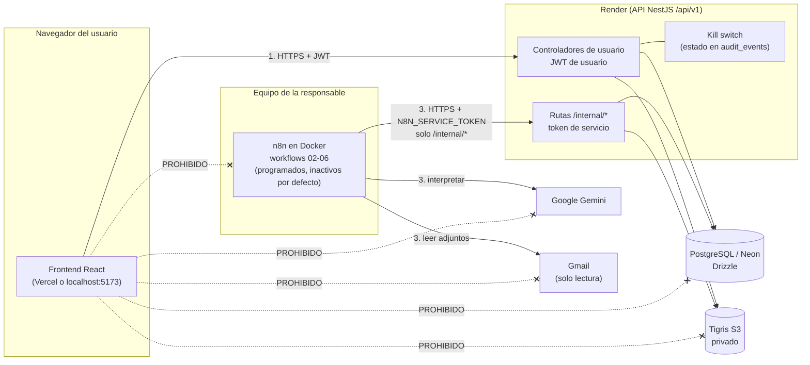
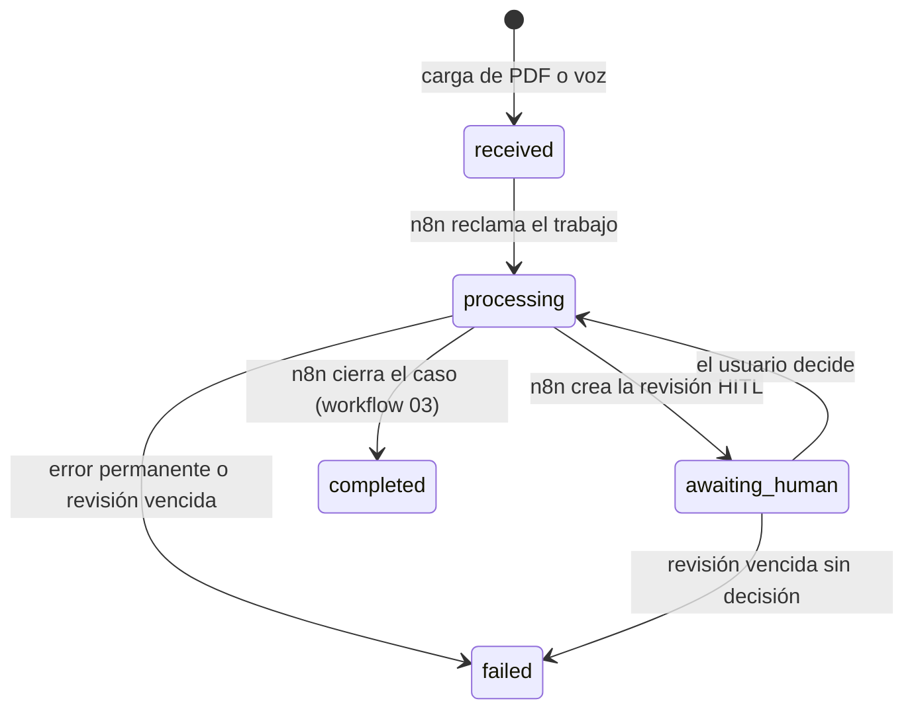

# NotiHouse-Pal · Guía definitiva de integración frontend–backend (MVP)

> **Para:** la persona (y su asistente de IA) responsable de **integrar el frontend con el backend y de desarrollar el backend de las funcionalidades adicionales acordadas**, y para el equipo frontend con el que se coordina.
> **Fecha de la inspección inicial:** 7 de noviembre de 2026. **Actualización de alcance:** 7 de noviembre de 2026 (asistente de texto y voz, recurrencias automáticas, modificación supervisada, búsquedas, dashboard por urgencia e informes finales). **Rama inspeccionada:** `develop`, commit `34ca4be` (igual a `origin/develop`).
> **Cómo leer esta guía:** las secciones 1–18 describen **lo que existe hoy** (inventario verificado) y cómo integrarlo. Las secciones 19–25 describen **lo que el integrador debe construir** (todo marcado como *propuesto*: **no existe todavía**). La sección 26 contiene las instrucciones para la IA. Si algo contradice el código, **manda el código** y debe registrarse la diferencia (§18).
> **Etiquetas de estado usadas en todo el documento:** **Implementado** (existe y tiene pruebas en el repositorio) · **Parcial** · **Propuesto** (contrato aprobado para desarrollo, no existe) · **Fuera del MVP**.
> **Decisiones:** las decisiones técnicas **D1–D18 están cerradas** (§21, 7-nov-2026). **Ramas:** `develop` y `main` quedan intactas; todo se consolida en `integration/mvp-final` (§15.1). **Fecha límite:** sustentación el sábado 14-nov-2026 a primera hora (§22.6).
> **Cómo se construyó:** lectura de controladores, DTO, esquema, workflows, pruebas y documentación. No se ejecutó código, no se llamó a la API de Render, a Gemini, a Gmail ni a n8n, y no se tocó ninguna base de datos.
---

## 0. Resumen de una página

| Pregunta | Respuesta verificada |
|---|---|
| ¿Qué hay que hacer? | **Objetivo A:** conectar cada pantalla React a los **51 endpoints de navegador que existen hoy** (3 públicos y 48 con JWT) y retirar datos o IA simulados. **Objetivo B:** desarrollar, en backend y frontend, las funcionalidades acordadas que **todavía no existen**: asistente de **texto** (y voz) con propuestas, **recurrencias automáticas** de períodos y cobros, **modificación supervisada** de recurrencias, **búsquedas** y dashboard por urgencia/inmueble (§19–§23). |
| ¿Puede modificar el backend? | **Sí, para las funcionalidades de §19** (código, DTO, servicios, pruebas y **migraciones mínimas desarrolladas y probadas en bases aisladas**, D8). **No** puede ejecutar migraciones ni conectarse a la Neon compartida, ni cambiar reglas de negocio existentes (salvo D6/D12), HITL, kill switch o seguridad (§12). |
| ¿Puede tocar n8n? | **No, en absoluto.** Solo la responsable crea, modifica, importa, configura, activa y ejecuta workflows. El integrador entrega backend y frontend y un documento aparte, `docs/integracion/ADAPTACIONES_N8N_PENDIENTES.md` (§24). |
| ¿El backend de la Etapa 7 está publicado? | **En Git, sí** (`origin/develop`, commit `34ca4be`). **En Render, no verificado** (`autoDeployTrigger: off`): ver §3.3 para comprobarlo en 10 segundos. |
| ¿Dónde está el frontend? | **No está en `develop`** (solo `frontend/.gitkeep`). Existe en tres ramas remotas apiladas; la más avanzada es `origin/feature/login-transition` (scaffold, capa de API/sesión, landing y login). **No hay ninguna pantalla de negocio conectada.** |
| ¿Qué es la fuente de verdad? | 1) Código y DTO, 2) pruebas, 3) docs de Etapa 7, 4) guías anteriores, 5) planes históricos (§1.4). |
| ¿Con qué se prueba? | Cuentas demo autorizadas contra Render y suites aisladas del repositorio (PGlite). **No** se necesita n8n, Docker para n8n, Gemini, Gmail, Neon ni Tigris. |
| ¿Quién valida Gemini/n8n/Gmail? | La responsable, en su entorno (§23.3). El integrador **no** puede dar por «completa de extremo a extremo» una función que dependa de n8n. |
| ¿Qué debe entregar al terminar? | Todo consolidado en la rama **`integration/mvp-final`**: código, migraciones SQL con su procedimiento, pruebas, `ADAPTACIONES_N8N_PENDIENTES.md` (versión preliminar anticipada) e `INFORME_FINAL_INTEGRACION.md` (§25). |
| ¿Qué decisiones están cerradas? | D1–D18 (§21). Reservado a la responsable: migraciones reales en Neon, Render, Vercel/CORS en producción, n8n, Gemini/Gmail reales, pruebas finales y merge a `develop` (§21.2). |

Estado de las funcionalidades nuevas (todas **Propuestas**; detalle en §19):

| Funcionalidad | Estado hoy | Backend | Frontend | n8n |
|---|---|---|---|---|
| Asistente de texto | No existe | Integrador | Equipo + integrador | Responsable (A-1…A-3) |
| Asistente de voz (grabación en el navegador) | Backend y n8n existen; falta pantalla | Existente | Equipo + integrador | Existente (ampliar con A-2/A-3) |
| Recurrencias automáticas | No existe (solo se guardan los campos) | Integrador | Equipo + integrador | Responsable (A-4) |
| Modificar recurrencias con IA | No existe | Integrador | Equipo + integrador | Responsable (A-2/A-3) |
| Búsquedas (`q`) | No existe | Integrador (obligatorias: inmuebles y obligaciones; opcionales: arriendos y contratos) | Equipo + integrador | — |
| Dashboard por urgencia / por inmueble | Datos parciales | Opcional | Equipo | — |

Documentos que deben leerse junto con este (rutas reales):

| Documento | Para qué |
|---|---|
| [docs/frontend/GUIA_FRONTEND_NOTIHOUSE_PAL.md](../frontend/GUIA_FRONTEND_NOTIHOUSE_PAL.md) | Contratos con ejemplos JSON (§6), pantallas (§8), flujos (§9), UX (§10) y la **interfaz del asistente** (§8.13 y §19 de esa guía). Actualizada con esta guía. |
| [docs/frontend/CONTRATO_ETAPA8_NOTIFICACIONES_HITL.md](../frontend/CONTRATO_ETAPA8_NOTIFICACIONES_HITL.md) | Contrato **vigente** de campana, `GET /alerts/summary`, `GET /system/status`, kill switch, pantalla HITL, códigos 503/409. No se altera. |
| [docs/api/business-api.md](../api/business-api.md) | Reglas de inmuebles, obligaciones, períodos, arriendos, cobros, contratos (409, estados). |
| [docs/api/alerts-and-dashboard.md](../api/alerts-and-dashboard.md) | Motor de vencimientos, alertas, bandeja `/attention`, dashboard. |
| [docs/api/ingestion-api.md](../api/ingestion-api.md) | PDF, voz, formatos, límites, idempotencia, descarga. |
| [docs/api/proposal-application.md](../api/proposal-application.md) | `POST …/apply`: condiciones y errores. |
| [docs/api/workflow-integration.md](../api/workflow-integration.md) | Contrato de las rutas internas que usa n8n. |
| [docs/architecture/authentication.md](../architecture/authentication.md) | JWT, sesión, cuentas demo. |
| [docs/security/gobierno-agente-y-kill-switch.md](../security/gobierno-agente-y-kill-switch.md) | Autonomía A0–A4, kill switch, credenciales demo. |
| [docs/deployment/operacion-y-sustentacion.md](../deployment/operacion-y-sustentacion.md) | Cómo opera la responsable la demo. |
| [docs/testing/etapa7-informe-final.md](../testing/etapa7-informe-final.md) | Resultado de la Etapa 7 (GO CONDICIONADO) y reglas R1–R17 / E1–E15. |

---

## 1. Qué es NotiHouse-Pal

### 1.1 Producto
**NotiHouse-Pal** es una plataforma de **hiperautomatización** para organizar obligaciones recurrentes del hogar (agua, luz, gas, internet, administración…), administrar **varios inmuebles**, hacer seguimiento a **arriendos, cobros, contratos y vencimientos**, e **interpretar información (facturas PDF, notas de voz, correos) mediante IA con supervisión humana**.

**Problema que resuelve:** centraliza información financiera y administrativa que normalmente está dispersa entre facturas, correos, documentos, recordatorios y registros manuales.

### 1.2 Lo que NO hace (y la interfaz no debe insinuar lo contrario)
- No paga facturas ni mueve dinero.
- No verifica transferencias bancarias: el propietario **declara** que recibió o pagó.
- No modifica contratos de forma autónoma ni los renueva.
- No envía recordatorios ni mensajes a arrendatarios (no existe el canal en v1).
- No genera ni envía notificaciones push (FCM), WebSockets ni correos.
- No hace OCR de PDF escaneados.

Texto obligatorio sobre pagos (de la guía frontend §10.9): *«NotiHouse-Pal no realiza ni verifica pagos: tú declaras que pagaste».*

### 1.3 Modelo de autonomía
**Gemini interpreta y propone. El backend aplica reglas determinísticas. La persona conserva las decisiones sensibles (HITL).**

- Una *propuesta* de IA nunca es un dato definitivo. Se etiqueta «Sugerencia de IA — requiere tu confirmación».
- *Aprobar* una revisión **no aplica** nada. *Aplicar* es una acción explícita, aparte, y solo crea un período `pending` (nunca un pago).
- El silencio **nunca** es aprobación: una revisión vencida pasa a `expired` y no se aplica nada.
- Montos, fechas y proveedor deben aparecer en la fuente; con dos montos el sistema **no elige uno**: ofrece alternativas.

### 1.4 Naturaleza del MVP y jerarquía de fuentes
Es un **MVP académico**: el objetivo es una demostración funcional convincente, no una plataforma comercial. Se trata de **terminar lo existente, no de ampliar el alcance**.

Jerarquía cuando dos fuentes se contradicen: **(1)** código y contratos realmente implementados → **(2)** pruebas existentes → **(3)** documentación de Etapa 7 → **(4)** guías anteriores → **(5)** planes históricos.

---

## 2. Arquitectura real

### 2.1 Componentes y responsabilidades

| Componente | Tecnología verificada | Responsabilidad |
|---|---|---|
| **Frontend** | React 19, Vite 8, TypeScript, React Router 7, TanStack Query 5, React Hook Form, Zod 4, lucide-react (según `package.json` de `origin/feature/login-transition`) | Pantallas, formularios, estado de UI. Habla **solo** con la API HTTP de NotiHouse-Pal. |
| **Backend** | NestJS (`backend/src/<módulo>/`), `ValidationPipe` global estricto, prefijo `/api/v1` | Autenticación, reglas de negocio, aislamiento por usuario, auditoría, cola de trabajos, kill switch. |
| **Base de datos** | PostgreSQL (Neon en producción) con **Drizzle ORM**; esquema en `backend/src/database/schema/`, migraciones en `database/migrations/` | Fuente única de datos. |
| **Almacenamiento** | `FileStorage`: S3-compatible (Tigris) en producción, disco local solo en desarrollo | PDF y audios privados. Sin URLs públicas ni firmadas: solo se descargan por la API autenticada. |
| **Despliegue backend** | Render Free, `infra/render/render.yaml` (`branch: develop`, `rootDir: backend`, `autoDeployTrigger: off`, health `/api/v1/health`) | API pública. Se duerme tras ~15 min y tarda cerca de 1 min en despertar. |
| **Despliegue frontend** | Vercel (previsto en la guía §12.9) | **Sin evidencia en el repositorio de que exista un despliegue.** No asumirlo. |
| **Orquestación** | n8n Community en Docker local de la responsable; workflows en `n8n/workflows/01…06` | Reclama trabajos, llama a Gemini, crea propuestas/HITL, cierra casos, vence revisiones, evalúa alertas. **Independiente de la sesión del navegador.** |
| **IA** | Google Gemini (`gemini-2.5-flash`, nivel gratuito, 20 peticiones/día) llamado **solo desde n8n** | Interpretar PDF y voz. Propone; no decide. |
| **Gmail** | OAuth de solo lectura en n8n (workflow 05), un buzón ligado a una cuenta demo | Ingesta automática de facturas. **Sin pantalla en el MVP.** |
| **Asistente de texto/voz y recurrencias automáticas** | *Propuesto* (§19): backend NestJS nuevo (ruta de texto, resolución, generación recurrente); interpretación y programación en n8n | **No existen hoy.** Backend y frontend: integrador. n8n: **solo la responsable** (§24) |
| **Autenticación** | JWT HS256, 30 min, sin refresh ni cookies ni logout de servidor | Ver §5. |

### 2.2 Diagrama



### 2.3 Cuatro tipos de comunicación (no mezclarlos)

1. **Frontend → backend (API HTTP).** Único canal del navegador. JWT de usuario en `Authorization: Bearer`.
2. **Backend → PostgreSQL y almacenamiento.** Todo filtrado por `owner_id` tomado del JWT.
3. **n8n → backend y servicios de IA.** n8n usa el token de servicio contra `/internal/*` y llama a Gemini/Gmail. El navegador **no** conoce ni usa estas rutas (un JWT de usuario recibe 401 allí).
4. **Procesamiento automatizado independiente de la sesión.** Los workflows programados (cada 5–15 min, cuando se activen) procesan trabajos y crean alertas **aunque nadie tenga la app abierta**. Al volver, el usuario encuentra el resultado por API.

> **Objetivos pendientes en la arquitectura (no existen todavía):** (1) *entrada dual*: el texto escrito entra por `POST /ingestions/text` y comparte con la voz la extracción, la resolución determinística del backend, las propuestas y el HITL (§19.2); (2) *recurrencias automáticas*: una ruta interna del backend (`POST /internal/recurrence/generate`) que el workflow 06 —adaptado por la responsable— llamará antes de evaluar alertas (§19.4). El frontend sigue hablando solo con la API; ambas funciones usan los mismos canales 1–4.

> **Regla de oro:** el frontend **no llama directamente a Gemini, Gmail ni a ninguna ruta interna de n8n**, y ninguna variable `VITE_*` puede contener secretos.

---

## 3. Estado real del repositorio (7-nov-2026)

### 3.1 Git

| Elemento | Hallazgo verificado |
|---|---|
| Rama actual / commit | `develop` @ `34ca4be` («add scheduled maintenance workflow…»), **igual a `origin/develop`**, árbol limpio |
| Etapa 7 en Git | **Ya está commiteada y publicada en `origin/develop`** (`backend/src/kill-switch/**`, `alerts/summary`, E12, workflows 02–06, pruebas, docs). Incluye `docs/testing/etapa7-informe-final.md` |
| `main` | Está en `70dcef8` («Initial commit»), muy por detrás de `develop`. No contiene nada de esto |
| Rama de entrega | `integration/mvp-final` **no existe todavía** (`git ls-remote`, 7-nov-2026); la crea el integrador desde `develop` actualizado (§15.1). Tampoco existen aún ramas del integrador |
| Frontend en `develop` | Solo `frontend/.gitkeep` |
| Ramas de frontend (remotas) | `feature/frontend-base` (`783002c`: scaffold Vite + capa de API/sesión) → `feature/frontend-landing` (`0e18467`: + landing) → `feature/login-transition` (`5d5e4a4`: + pantalla de login con transición). Están **apiladas**; la última contiene a las anteriores. **Ninguna está fusionada en `develop`** |

> ⚠️ **Discrepancia a corregir en documentación:** `docs/testing/etapa7-informe-final.md` (§2 y §29) y `CONTRATO_ETAPA8…` dicen que la Etapa 7 está «sin commit, sin push y sin despliegue». Eso quedó desactualizado: **el commit y el push ya ocurrieron**. Lo que sigue pendiente es el **despliegue en Render** (no verificable desde el repo) y la activación de los disparadores.

### 3.2 Qué hay realmente en el frontend (rama `origin/feature/login-transition`)

| Archivo | Contenido real |
|---|---|
| `src/lib/api/client.ts` | Cliente `api<T>(path, options)`: adjunta `Bearer`, serializa JSON, deja pasar `FormData`, convierte errores en `ApiError`, invoca `onUnauthorized()` ante 401 (salvo `skipAuth`). **Una sola petición por llamada; reintentos van en los hooks.** |
| `src/lib/api/errors.ts` | `ApiError` (`status`, `messages[]`, `correlationId`) e `isNetworkError`. |
| `src/lib/api/types.ts` | Solo tipos de **autenticación**, paginación y error. **Faltan los tipos de todos los módulos de negocio.** |
| `src/lib/auth/session.ts`, `useAuth.ts` | Sesión con `expiresAt`, persistida en **`sessionStorage`**, con `version: 1`. |
| `src/app/router.tsx` | Solo `/login` y `/`. |
| `src/features/auth/LoginPage.tsx` | Login. |
| `src/features/dashboard/DashboardPage.tsx` | **Placeholder** («aquí vivirá el Resumen real»). |
| `.env.example` | Solo `VITE_API_BASE_URL`. |
| Scripts | `dev`, `build` (`tsc -b && vite build`), `lint` (oxlint), `preview`. **No hay script `test`.** |

Conclusión: **la capa de transporte y sesión existe; ninguna pantalla de negocio está conectada.** No dar por terminado nada del frontend sin revisar el estado de las ramas de las demás personas del equipo (§15).

### 3.3 Cómo saber si Render tiene la Etapa 7 (y no culpar al frontend)

Render **no despliega solo** (`autoDeployTrigger: "off"`, rama `develop`). Prueba de solo lectura, sin credenciales:

```
GET https://notihouse-pal-api.onrender.com/api/v1/alerts/summary      (sin Authorization)
```

| Respuesta | Significado |
|---|---|
| **401** | La ruta existe → Render **ya tiene** la Etapa 7. |
| **404** | La ruta no existe → Render tiene un **backend anterior**. `GET /alerts/summary` y `GET /system/status` fallarán con 404: **no es un bug del frontend.** |
| Tarda ~1 min o 502/503 | Render dormido: reintentar con `GET /api/v1/health`. |

Las rutas y funciones de la **§19–§20** (texto, recurrencias, `q`…) son posteriores y todavía no existen en ninguna parte. Rutas que existen **solo desde la Etapa 7** (por tanto, 404 en un Render antiguo): `GET /alerts/summary`, `GET /system/status`, el código `KILL_SWITCH_ACTIVE` (503), el código `CONTRADICTING_SOURCE` (409) y el campo `duplicateOfDocumentId`/contexto de HITL ampliado. Todo lo demás es anterior. Si el integrador ve 404 en esas dos rutas: **degradar con elegancia** (ocultar el contador / aviso) y avisar a la responsable, no inventar datos.

---

## 4. Convenciones de la API (resumen operativo)

Prefijo: `/api/v1`. Base de pruebas: `https://notihouse-pal-api.onrender.com/api/v1` (variable `VITE_API_BASE_URL`, sin barra final). Detalle completo en la [guía frontend §4](../frontend/GUIA_FRONTEND_NOTIHOUSE_PAL.md#4-convenciones-de-la-api).

| Tema | Regla |
|---|---|
| Métodos | Solo **GET, POST, PATCH**. **No existen PUT ni DELETE** (CORS tampoco los permite). «Borrar» = cambiar estado (`inactive`, `archived`, `cancelled`, `paused`…). |
| Validación | `whitelist` + `forbidNonWhitelisted`: **cualquier campo de cuerpo o query no declarado → 400**. Un PATCH vacío → 400. `ownerId` jamás se envía. UUID malformado en la ruta → 400. |
| PATCH | `undefined` = no modificar; `null` solo en campos anulables. |
| Paginación | `page` (≥1, def. 1), `pageSize` (1–100, def. 20) → `{ items, page, pageSize, total }`. Bandeja añade `referenceDate`. |
| Dinero | **Texto** decimal: `"145000.00"`. Patrón `^(0\|[1-9]\d{0,11})(\.\d{1,2})?$`. Canon y cobros de arriendo: **> 0**. Moneda `^[A-Z]{3}$`, def. `COP`. **Nunca `Number`/`parseFloat` para operar.** |
| Fechas | De calendario `YYYY-MM-DD` (rechaza `2026-02-30`), zona de negocio `America/Bogota`. Instantes en ISO 8601 UTC (`createdAt`, `dueAt`…). **No usar `new Date('YYYY-MM-DD')`** (se interpreta en UTC y puede mostrar el día anterior). |
| Errores | `{ statusCode, message: string \| string[], error }`; los mensajes están en español y son mostrables. Códigos funcionales adicionales: `KILL_SWITCH_ACTIVE`, `CONTRADICTING_SOURCE`. |
| Caché | **Todas** las respuestas llevan `Cache-Control: no-store` (Etapa 7). Las descargas usan `private, no-store`. |
| `X-Correlation-Id` | Opcional en la petición (UUID); la API lo devuelve (expuesto a CORS). Útil para soporte. |
| Aislamiento | El propietario sale del JWT. Un recurso ajeno responde **404** (no 403). Filtrar por el `propertyId` de otro usuario devuelve lista vacía. |
| Códigos «200 en POST» | `login`, `confirm`, `read`, `dismiss`, `decision` y las repeticiones idempotentes devuelven **200**, no 201. |

### 4.1 Tabla de códigos HTTP y qué hacer en la UI

| HTTP | Cuándo ocurre en este backend | Qué hace la UI |
|---|---|---|
| **400** | Validación (`message` puede ser lista), campo no permitido, cuerpo de `apply` no vacío, PATCH vacío, `choice` inválida | Mostrar los mensajes junto al campo/formulario. No reintentar. |
| **401** | Sin token, token inválido/vencido, contraseña rotada (`sv` distinto). En `/auth/login`: «Credenciales inválidas» | Fuera del login: limpiar sesión + caché y redirigir a `/login` conservando el borrador. En el login: mostrar error del formulario. |
| **403** | En rutas de navegador **no se espera** (la autorización devuelve 404). Solo aparece en rutas internas (tipo de trabajo no autorizado, buzón Gmail) | Tratar como error genérico; no construir flujos sobre 403. |
| **404** | Recurso inexistente **o ajeno**; entidad referida (`obligationId`, etc.) inexistente | «No encontrado». No distinguir «ajeno» de «inexistente». |
| **409** | Nombre de inmueble duplicado; período/cobro duplicado; recurso archivado/terminado/inactivo; confirmación contradictoria; `requestId` reutilizado con otros datos; HITL vencida o ya decidida distinto; `apply` con duplicado; `CONTRADICTING_SOURCE`; alerta ya resuelta | Mensaje específico y recargar el recurso. Nunca reintento automático. |
| **413** | Archivo mayor que el máximo (PDF 10 MiB, audio 25 MiB por defecto) | «El archivo supera el tamaño permitido». |
| **415** | Extensión, `Content-Type` y firma real no coinciden; formato no admitido; PDF con contenido activo; audio con pista de video | «Formato no admitido». |
| **429** | `/auth/login`: 5 intentos/min por IP. Cargas: máx. 2 simultáneas por usuario y 10 globales | «Espera un momento». No reintentar en bucle. |
| **503** | Base de datos o almacenamiento no disponibles; **`KILL_SWITCH_ACTIVE`** (`code` + `scope`); a veces Render/Neon despertando | **No cerrar sesión ni decir «sin internet».** Si hay `code: KILL_SWITCH_ACTIVE`, mostrar el `message` del backend y no reintentar. Si no, «Servicio temporal no disponible», reintento manual o en el siguiente ciclo. |
| Error de red (`TypeError` de `fetch`) | Sin respuesta (red caída, CORS bloqueado, Render durmiendo) | «No pudimos conectar». Distinguirlo de 4xx/5xx. |

---

## 5. Autenticación y seguridad del frontend

### 5.1 Qué implementa el backend (verificado en `backend/src/auth/`)

- `POST /auth/login` (público, 5 intentos/min/IP): devuelve `{ accessToken, tokenType: "Bearer", expiresIn: 1800, user: { id, email, displayName } }`. El correo se normaliza (trim + minúsculas). Error único `401 «Credenciales inválidas»` (no revela si la cuenta existe).
- `GET /auth/me` → `{ id, email, displayName }`.
- JWT HS256, emisor `notihouse-pal-api`, audiencia `notihouse-pal-web`, **30 minutos** (`ACCESS_TOKEN_TTL_SECONDS`). Lleva un claim `sv` (versión de sesión): **rotar la contraseña invalida todos los JWT al instante**.
- **No hay refresh token, ni cookies, ni endpoint de logout.** Cerrar sesión = descartar el token en el cliente y vaciar la caché.
- Guard global: toda ruta exige JWT salvo `@Public()` (`/health`, `/health/ready`, `/auth/login`). Si la API no puede validar la sesión por un fallo de BD, responde **503** (no 401).

### 5.2 Qué debe hacer el cliente

| Aspecto | Requisito | Estado en la rama de login |
|---|---|---|
| Inicio de sesión | `POST /auth/login`; guardar `accessToken`, `user`, `expiresAt = ahora + expiresIn·1000` | Implementado (`session.ts`) — verificar contra la API real |
| Rutas protegidas | `RequireAuth` que redirige a `/login` y vuelve a la ruta original | Existe `RequireAuth.tsx` — falta probarlo con pantallas reales |
| Validación al arrancar | `GET /auth/me` con el token guardado | Pendiente de confirmar |
| Expiración | Detectar `expiresAt` y **un único** manejo de 401 → sesión vencida (salvo en el login) | `onUnauthorized` existe en el cliente |
| Cierre de sesión | Borrar token + `queryClient.clear()` + abortar peticiones y *polling* | Pendiente de confirmar |
| Cambio de usuario | Limpiar **todo** el estado antes de pedir datos del nuevo usuario; claves de caché con el `user.id` | Pendiente |
| Almacenamiento | La rama usa `sessionStorage` (sobrevive a recargas de la pestaña, se borra al cerrarla). La guía previa recomendaba no usar `localStorage`. No guardar el JWT en variables globales ni en `VITE_*` | Decisión ya tomada; no cambiar sin acordar |
| Doble envío | Botón deshabilitado desde el primer clic; `requestId` en cargas; escrituras **nunca** se reintentan solas | Pendiente por módulo |

### 5.3 Otros puntos de seguridad

- **CORS:** el backend admite **un único origen** (`FRONTEND_URL`), solo `GET, POST, PATCH`, cabeceras `Authorization`, `Content-Type`, `X-Correlation-Id`, **sin credenciales**. No hay comodín. Una cabecera personalizada extra fallará el preflight. Si se ve un error CORS con la API viva, casi nunca es culpa del código del componente: es el **origen** (puerto distinto de 5173, `127.0.0.1` en vez de `localhost`, dominio de Vercel no autorizado). **No pedir comodines, proxies ni deshabilitar la seguridad del navegador**; avisar a la responsable.
- **Descarga autenticada de documentos:** `GET /documents/:id/content` exige `Authorization`, así que **no sirve `<a href>` ni `<iframe src>`**. Usar `fetch` + `Blob` + `URL.createObjectURL` y revocar la URL. El nombre del archivo se toma de `GET /documents/:id` (`fileName`), porque `Content-Disposition` no está expuesto por CORS.
- **Secretos:** solo `VITE_API_BASE_URL` (y, opcionalmente, `VITE_ALERTS_POLL_MS`, ver §10.5, que no es secreto). **Nunca** en `VITE_*`: JWT, contraseñas, `N8N_SERVICE_TOKEN`, `JWT_SECRET`, claves de Neon/Tigris/Gemini/Google.
- **Cuentas demo:** el seed (`backend/src/database/seed/demo-data.ts`) define **cuatro** cuentas ficticias, todas `@notihouse.com`: **Laura Martínez** (`laura.martinez@…`), **Andrés Gómez** (`andres.gomez@…`), **Camila Torres** (`camila.torres@…`) y **Daniel Rojas** (`daniel.rojas@…`). Comparten una contraseña que **no está en Git ni en este documento**; la responsable la entrega por canal privado. **No** abrir `backend/.local/demo-credentials.txt` con `cat`/`sed`/`grep`; para inspeccionarlo existe `npm run demo:credentials:check` (salida enmascarada). **No rotar** contraseñas (invalida JWT y hay que coordinarlo).

---

## 6. Matriz de integración (51 endpoints de navegador implementados)

> Esta matriz lista **solo lo que existe hoy**. Los contratos que el integrador debe construir están separados y etiquetados como *propuestos* en la **§20**; no se suman a este número.

**Leyenda de «Estado de implementación»**: ✅ *Implementado en backend y cubierto por pruebas del repositorio* · ⚠️ *Implementado, con condición especial* · ⛔ *No exponer en el MVP*.
**«Estado en frontend»** de todas las filas: *por conectar* salvo `POST /auth/login` y `GET /auth/me` (capa de sesión existente en `feature/login-transition`, **no verificada end-to-end por esta guía**). Nada se marca «conectado y verificado» sin evidencia (§16).

Convenciones: *JWT* = `Authorization: Bearer <accessToken>`. Los archivos de código están bajo `backend/src/`. Los DTO tienen la regla completa; aquí se resumen los campos. Cuerpo y query **estrictos** (§4).

### 6.1 Autenticación y sesión

| # | Método y ruta | Auth | Función / pantalla | Entrada | Respuesta | Errores | Código |
|---|---|---|---|---|---|---|---|
| A1 | `POST /auth/login` | Pública | Login · `LoginPage` | Body `{ email (≤254), password (≤256) }` | 200 `LoginResponseDto` | 400, 401, 429 | `auth/auth.controller.ts`, `auth/dto/login.dto.ts` |
| A2 | `GET /auth/me` | JWT | Validar sesión al arrancar / menú de usuario | — | 200 `{ id, email, displayName }` | 401, 503 | `auth/auth.controller.ts` |
| A3 | `GET /health` | Pública | Despertar Render (pantalla de arranque) | — | 200 `{ status:"ok", service:"notihouse-pal-api", … }` | — | `health/health.controller.ts` |
| A4 | `GET /health/ready` | Pública | Diagnóstico de Neon | — | 200 `status:"ready"` | 503 | idem |

Condiciones: no existe logout en el servidor (§5). Usar A3/A4 con moderación, nunca en bucle.

### 6.2 Dashboard, bandeja de atención y estado del sistema

| # | Método y ruta | Función / pantalla | Entrada | Respuesta | Errores | Código |
|---|---|---|---|---|---|---|
| D1 | `GET /dashboard/summary` | KPIs y dinero · Dashboard | — | 200: `properties{total,active}`, `obligations{active,periodsPending,periodsOverdue,periodsDueSoon,periodsConfirmed}`, `rentCharges{pending,overdue,dueSoon,received}`, `contracts{active,endingSoon,endPassed}`, `hitl{pending}`, `alerts{active,unread}`, `cases{open}`, `money{note, obligationsOpen[], rentOpen[], month, obligationsThisMonth[], rentThisMonth[]}` (una fila **por moneda**, importes como texto) | 401 | `dashboard/dashboard.controller.ts`, `dashboard/dto/dashboard.dto.ts` |
| D2 | `GET /attention` | Bandeja priorizada · Dashboard / Bandeja | Query `kind` (`obligation_occurrence`\|`rent_charge`\|`contract`\|`hitl_request`), `page`, `pageSize` | 200 `{ items[], page, pageSize, total, referenceDate }`. Cada ítem: `kind,id,title,description,relevantDate,dueAt,status,condition,priority,daysUntil,amount,currency,suggestedAction,resource{type,id,path},alert{id,read}\|null` | 400, 401 | `attention/attention.controller.ts`, `attention/dto/attention.dto.ts` |
| D3 | `GET /system/status` ⚠️ **(Etapa 7; 404 si Render es anterior)** | Aviso de «función limitada» | — | 200 `{ limited, limitedFunctions[{scope,label,since}], serverTime }` | 401 | `kill-switch/kill-switch.controllers.ts` |

Notas: `money.*` es «valores esperados y confirmaciones declaradas», **no saldos bancarios**; mostrar `money.note`. Prioridad 1 = HITL por vencer/vencida; 2 = vencidos; 3 = hoy; 4 = dentro del umbral. El ítem de bandeja **no incluye `propertyId`** (ver §8.4). Los umbrales son del servidor; no recalcularlos en el cliente.

### 6.3 Inmuebles

| # | Método y ruta | Función | Entrada | Respuesta | Errores |
|---|---|---|---|---|---|
| P1 | `GET /properties` | Listar | Query `status` (`active`\|`inactive`\|`archived`), `page`, `pageSize` | 200 página de `{ id, name, address\|null, description\|null, status, createdAt, updatedAt }` | 400 |
| P2 | `GET /properties/:id` | Detalle | — | 200 | 404 |
| P3 | `POST /properties` | Crear (siempre `active`) | `name` (1–120, obligatorio), `address` (≤300), `description` (≤1000) | 201 | 400, 409 (nombre duplicado del mismo propietario) |
| P4 | `PATCH /properties/:id` | Editar / desactivar | `name`, `address`(null), `description`(null), `status` | 200 | 400, 404, 409 |

Código: `properties/properties.controller.ts`, `properties/dto/property.dto.ts`. No hay borrado (FK `RESTRICT`): «eliminar» = `status: "archived"` con diálogo de confirmación.

### 6.4 Obligaciones y períodos

| # | Método y ruta | Función | Entrada | Respuesta | Errores |
|---|---|---|---|---|---|
| O1 | `GET /obligations` | Listar | Query `propertyId`, `status` (`active`\|`paused`\|`archived`), `category`, paginación | 200 página de `ObligationResponseDto`: `id, propertyId\|null, providerName, concept, category, expectedAmount\|null, currency, frequency, dueDay\|null, reminderDaysBefore, startsOn\|null, status, createdAt, updatedAt` | 400 |
| O2 | `GET /obligations/:id` | Detalle | — | 200 | 404 |
| O3 | `POST /obligations` | Crear | `providerName`(≤120)*, `concept`(≤160)*, `category`*, `propertyId`, `expectedAmount`, `currency`, `frequency`, `dueDay`(1–31), `reminderDaysBefore`(0–60), `startsOn`, `status` (`active`\|`paused`) | 201 | 400, 404 (inmueble ajeno/inexistente), 409 (inmueble no activo) |
| O4 | `PATCH /obligations/:id` | Editar definición (no toca períodos) | los mismos, con `null` donde es anulable; `status` completo; **no** `currency` | 200 | 400, 404, 409 (archivada, inmueble inactivo) |
| O5 | `GET /obligations/:id/occurrences` | Períodos | Query `status` (`pending`\|`overdue`\|`paid`\|`attended`\|`cancelled`), paginación | 200 página de `{ id, obligationId, periodStart, periodEnd, amount\|null, currency, dueDate, status, confirmedAt, confirmedBy, confirmationReference, createdAt, updatedAt }` | 404 |
| O6 | `GET /obligations/:id/occurrences/:occurrenceId` | Detalle de período | — | 200 | 404 |
| O7 | `POST /obligations/:id/occurrences` | Crear período (siempre `pending`) | `periodStart`*, `periodEnd`*, `dueDate`*, `amount` (si falta, copia el esperado) | 201 | 400 (`periodEnd<periodStart`), 404, 409 (`periodStart` repetido, obligación archivada) |
| O8 | `PATCH /obligations/:id/occurrences/:occurrenceId` | Editar o anular | `periodStart`, `periodEnd`, `dueDate`, `amount`, `status` (**solo** `"cancelled"`) | 200 | 400, 404, 409 (pagado/anulado es inmutable) |
| O9 | `POST /obligations/:id/occurrences/:occurrenceId/confirm` | **Confirmación humana** de pago/atención | `result` (`paid`\|`attended`)*, `reference` (≤200) | **200** | 400, 404, 409 (otro resultado/otra referencia/anulado) |

Código: `obligations/obligations.controller.ts`, `obligations/occurrences.controller.ts`, `obligations/dto/*.ts`. Reglas: doble clic con el mismo resultado y referencia = 200 sin efectos; el servidor asigna `confirmedBy/At`. **No existe listado global de períodos**, solo por obligación (§18). El estado `overdue` almacenado puede ir retrasado: la UI debe calcular «Vencido» por fecha (`dueDate < hoy` y abierto) o apoyarse en `/attention` y `periodsOverdue`.

### 6.5 Arriendos y cobros

| # | Método y ruta | Función | Entrada | Respuesta | Errores |
|---|---|---|---|---|---|
| R1 | `GET /rentals` | Listar | Query `propertyId`, `status` (`active`\|`suspended`\|`ended`), paginación | 200 página de `{ id, propertyId, tenantAlias\|null, expectedAmount, currency, dueDay, startsOn, endsOn\|null, status, createdAt, updatedAt }` | 400 |
| R2 | `GET /rentals/:id` | Detalle | — | 200 | 404 |
| R3 | `POST /rentals` | Registrar arriendo | `propertyId`*, `expectedAmount`* (**>0**), `dueDay`*(1–31), `startsOn`*, `tenantAlias` (≤120, un alias, no datos personales), `currency`, `endsOn`, `status` (`active`\|`suspended`) | 201 | 400, 404 (inmueble ajeno), 409 (inmueble inactivo o **solapamiento** con otro arriendo `active/suspended` del mismo inmueble) |
| R4 | `PATCH /rentals/:id` | Editar | `tenantAlias`(null), `expectedAmount`, `dueDay`, `startsOn`, `endsOn`(null), `status`; **no** `propertyId` ni `currency` | 200 | 400, 404, 409 (terminado, solapamiento) |
| R5 | `GET /rentals/:id/charges` | Cobros | Query `status` (`expected`\|`pending`\|`overdue`\|`received`\|`cancelled`), `periodFrom`, `periodTo`, paginación | 200 página de `{ id, rentalId, periodStart, periodEnd, expectedAmount, currency, dueDate, status, confirmedAt, confirmedBy, confirmationEvidence, createdAt, updatedAt }` | 404 |
| R6 | `GET /rentals/:id/charges/:chargeId` | Detalle | — | 200 | 404 |
| R7 | `POST /rentals/:id/charges` | Crear cobro (siempre `expected`) | `periodStart`*, `periodEnd`*, `dueDate`*, `expectedAmount` (>0; si falta, copia el canon) | 201 | 400 (`periodStart` fuera de la vigencia), 404, 409 (duplicado, arriendo terminado) |
| R8 | `PATCH /rentals/:id/charges/:chargeId` | Editar o anular | `periodStart`, `periodEnd`, `dueDate`, `expectedAmount`, `status` (**solo** `"cancelled"`) | 200 | 400, 404, 409 |
| R9 | `POST /rentals/:id/charges/:chargeId/confirm` | **Confirmación humana de recepción** | `evidence`* (1–500, **obligatoria**) | **200** | 400, 404, 409 (otra evidencia o anulado) |

Código: `rentals/rentals.controller.ts`, `rentals/rent-charges.controller.ts`, `rentals/dto/*.ts`. La API nunca marca `received` ni `overdue` por fecha. No hay listado global de cobros, solo por arriendo.

### 6.6 Contratos

| # | Método y ruta | Función | Entrada | Respuesta | Errores |
|---|---|---|---|---|---|
| C1 | `GET /contracts` | Listar por vencimiento | Query `propertyId`, `rentalId`, `status` (`active`\|`expired`\|`terminated`), `endsFrom`, `endsTo`, paginación | 200 página de `{ id, propertyId, rentalId\|null, startsOn, endsOn, noticePeriodDays\|null, status, documentId\|null, createdAt, updatedAt }` | 400 |
| C2 | `GET /contracts/:id` | Detalle | — | 200 | 404 |
| C3 | `POST /contracts` | Registrar **metadatos** (siempre `active`) | `propertyId`*, `startsOn`*, **`endsOn`*** (obligatoria), `rentalId` (del mismo inmueble), `noticePeriodDays`(0–365), `documentId` (documento propio de tipo `contract`) | 201 | 400 (falta `endsOn`, `endsOn<startsOn`, arriendo de otro inmueble, documento que no es contrato), 404, 409 (inmueble inactivo) |
| C4 | `PATCH /contracts/:id` | Corregir metadatos | `startsOn`, `endsOn`, `noticePeriodDays`(null), `documentId`(null), `status`; **no** `propertyId`/`rentalId` | 200 | 400, 404, 409 (vencido/terminado) |

Código: `contracts/contracts.controller.ts`, `contracts/dto/contract.dto.ts`. **Alcance real:** solo metadatos y vigilancia de fecha. No hay renovación, firma ni generación; no se sube el PDF del contrato desde este formulario (se carga por ingesta, §6.9, y se enlaza con `documentId`).

### 6.7 Alertas y notificaciones

| # | Método y ruta | Función | Entrada | Respuesta | Errores |
|---|---|---|---|---|---|
| L1 | `GET /alerts/summary` ⚠️ **(Etapa 7)** | **Contador de la campana** (polling) | — | 200 `{ active, unread, criticalUnread, latestCreatedAt, serverTime }`; no escribe ni audita | 401 (404 en Render anterior) |
| L2 | `GET /alerts` | Lista de la campana / historial | Query `state` (`active`\|`dismissed`\|`resolved`), `read` (`true`\|`false`), `type`, `severity`, `requiresAttention`, `order` (`asc`\|`desc`), `page`, `pageSize` | 200 página de alertas: `id,type,severity,title,message,relevantDate,state,requiresAttention,read,readAt,dismissedAt,resolvedAt,resolutionReason,resource{type,id,path},createdAt,updatedAt` | 400 |
| L3 | `GET /alerts/:id` | Detalle | — | 200 | 404 |
| L4 | `POST /alerts/:id/read` | Marcar leída (idempotente) | — | **200** | 404 |
| L5 | `POST /alerts/:id/dismiss` | Descartar (idempotente) | — | **200** | 404, 409 (ya resuelta) |

Código: `alerts/alerts.controller.ts`, `alerts/dto/alert.dto.ts`. Leer o descartar **no** confirma pagos, decide revisiones ni modifica contratos. `resource.path` es una **ruta de la API** (p. ej. `/obligations/…/occurrences/…`): **se traduce a la ruta de pantalla**, no se navega a ella. Contrato completo del polling: [CONTRATO_ETAPA8 §2](../frontend/CONTRATO_ETAPA8_NOTIFICACIONES_HITL.md#2-campana-de-alertas) y §10.5 de esta guía. Alternativa de contador si `summary` da 404: `D1 → alerts.unread`.

### 6.8 Casos, propuestas y HITL

| # | Método y ruta | Función | Entrada | Respuesta | Errores |
|---|---|---|---|---|---|
| H1 | `GET /cases` | Lista de casos | Query `status` (`received`\|`processing`\|`awaiting_human`\|`completed`\|`failed`\|`cancelled`), `type` (`household_obligation`\|`rent_collection`\|`contract_review`), paginación | 200 página de `{ id, correlationId, type, source, status, obligationId, rentalId, contractId, statusReason, closedAt, createdAt, updatedAt }` | 400 |
| H2 | `GET /cases/:id` | **Estado de procesamiento** de un caso | — | 200 | 404 |
| H3 | `GET /cases/:id/proposals` | Propuestas del caso | Query `reviewStatus` (`pending_review`\|`accepted`\|`rejected`\|`superseded`) | 200 página de `{ id, caseId, version, source (llm\|ocr\|stt\|user), proposedData, evidence, confidence ("0.870"\|null), documentId, reviewStatus, reviewedAt, reviewedBy, createdAt, updatedAt }` | 404 |
| H4 | `GET /hitl-requests` | Revisiones propias | Query `status` (`pending`\|`approved`\|`rejected`\|`expired`\|`cancelled`), `caseId` | 200 página de `{ id, caseId, proposalId, decisionType, status, overdue, options, decision, createdAt, dueAt, respondedAt, updatedAt }` | 400 |
| H5 | `GET /hitl-requests/:id` | **Pantalla de revisión** | — | 200 = H4 + `proposal` | 404 |
| H6 | `POST /hitl-requests/:id/decision` | Aprobar o rechazar | `decision`* (`approved`\|`rejected`), `choice` (clave de alternativa; **obligatoria al aprobar si hay `choices`, no admitida al rechazar**), `comment` (≤500) | **200** `HitlDetailDto` | 400, 404, 409 (vencida, decidida distinto, propuesta reemplazada) |
| H7 | `POST /cases/:caseId/proposals/:proposalId/apply` ⚠️ | **Aplicar** una propuesta aprobada | **Cuerpo vacío** (cualquier campo → 400) | 201 aplicada / **200** `alreadyApplied:true` | 400, 404, 409 (incl. `CONTRADICTING_SOURCE`, duplicado), **503 `KILL_SWITCH_ACTIVE`** |
| H8 | `POST /cases` ⛔ | Crear caso manual | `type`*, `obligationId`\|`rentalId`\|`contractId`, `requestId` | 201/200 | 400, 404, 409 |

Código: `cases/cases.controller.ts`, `cases/hitl.controller.ts`, `cases/dto/{case,process,proposal-application}.dto.ts`, `cases/proposal-application.service.ts`.

- **H8 no se debe construir** (para mensajes de texto se usa el contrato propuesto N1, §20). Crea un caso `form` y un trabajo `case.<tipo>`, pero los workflows de n8n solo reclaman `document.process`, `voice.transcribe` y `hitl.decision` (verificado con `grep jobTypes n8n/workflows/*.json`). Quedaría en cola para siempre.
- **H7:** `proposedData` es JSON libre. Para ser aplicable debe ser `{ action, data }` con `action ∈ {create_obligation_occurrence, create_obligation_with_occurrence}`. No existe `GET` para saber si ya fue aplicada; el 200 `alreadyApplied:true` es normal («Ya estaba aplicada»), no un error.
- Los usuarios **no** crean propuestas ni revisiones: eso lo hace n8n. La app las **muestra** y registra la **decisión humana**.

### 6.9 Documentos y notas de voz (ingesta)

| # | Método y ruta | Función | Entrada | Respuesta | Errores |
|---|---|---|---|---|---|
| I1 | `POST /ingestions/documents` | Subir PDF (multipart) | `file`* (un PDF), `documentType` (`invoice` por defecto\|`payment_receipt`\|`contract`), `obligationId`, `contractId`, `requestId` (UUID) | 201 (200 si se repite el `requestId`) `{ documentId, caseId, correlationId, caseStatus:"received", source, documentType, mimeType, sha256, sizeBytes, job{type,status:"pending"}, processing:"pending", duplicateContent }` | 400, 401, 404, 409, 413, 415, 429, 503 |
| I2 | `POST /ingestions/voice` | Subir nota de voz (multipart) | `file`*, `caseType` (def. `household_obligation`), `obligationId`\|`rentalId`\|`contractId`, `requestId` | idéntica forma (documento `voice_note`, trabajo `voice.transcribe`) | idem |
| I3 | `GET /documents` | Lista de documentos | Query `type`, `source` (`form`\|`document`\|`gmail`\|`voice`), `caseId`, paginación | 200 página de `{ id, caseId, type, source, mimeType, fileName, sha256, createdAt, updatedAt }` (sin ruta de almacenamiento) | 400 |
| I4 | `GET /documents/:id` | Metadatos | — | 200 | 404 |
| I5 | `GET /documents/:id/content` | **Descarga autenticada** (binario) | — | 200 binario como adjunto | 404, 503 |

Código: `ingestion/ingestion.controller.ts`, `ingestion/dto/ingestion.dto.ts`, `ingestion/file-policy.ts`, `ingestion/upload-receiver.ts`. Campos rechazados con 400: `ownerId`, `caseId`, `storageKey`, **`propertyId`** (ni `cases` ni `documents` tienen esa columna).
**«Recibido» ≠ «procesado»**: `processing:"pending"` significa almacenado y en cola; no hay interpretación todavía (§10.1).

### 6.10 Rutas que el frontend NO consume

Las 13 `/internal/*` (`workflow-jobs/*`, `cases/:id/{proposals,hitl-requests,complete,fail}`, `hitl-requests/expire`, `alerts/evaluate`, `documents/:id/content`, `gmail/attachments`) y, desde la Etapa 7, `GET /internal/kill-switch` y `POST /internal/kill-switch/activate`. Son del token de servicio de n8n. **Llamarlas está prohibido**, igual que mockearlas «para que algo funcione». Tampoco hay ruta HTTP para reanudar el kill switch (solo script de operación).

### 6.11 Lo documentado pero no implementado, y lo aprobado para desarrollo

| Elemento | Estado | Dónde se resuelve |
|---|---|---|
| Entrada de texto libre («Recuérdame pagar Claro el día 7…») | **No existe** hoy (ni controlador, DTO ni workflow). **Aprobada para desarrollo** | §19.2, contrato N1 (§20) |
| Generación automática de períodos y cobros | **No existe** hoy (solo se guardan `frequency`, `dueDay`…). **Aprobada** | §19.4, contrato I1 |
| Modificar una obligación mediante IA | **No existe** (las acciones aplicables solo crean). **Aprobada** | §19.5, §20.2 |
| Búsqueda de texto (`q`) | **No existe**. **Aprobada** | §19.8, N3 |
| Filtro por inmueble en `/attention`, `/alerts`, `/dashboard/summary` | No existe. Solución de cliente válida; ampliación mínima **opcional** | §19.9, N5 |
| Pantalla/endpoint de Gmail | Backend y workflow 05 existen como ingesta interna; **sin pantalla** | Fuera del MVP |
| `GET` de la aplicación de una propuesta / `appliedAt` | No existe | §18 (brecha; opcional) |
| Listado global de períodos y cobros (calendario) | No existe; solo por obligación/arriendo | §18; N8 muestra próximos ciclos |
| `requestId` en altas de obligaciones/arriendos/contratos | No admitido | §18 |
| Estado del *trabajo* (`workflow_jobs`) visible al usuario | No existe; solo el estado del caso | §10.1 |
| FCM, WebSockets, push | **Fuera del MVP** | §13 |
| Swagger en producción | Desactivado (`/api/docs` → 404). Este documento y los DTO son el contrato | — |
| Pruebas contra Render de los endpoints de negocio | Las suites del repo corren sobre PGlite/PostgreSQL desechable; contra Render solo se informó login y consultas | — |

---

## 7. Recorridos de usuario por módulo

Para cada módulo: **qué ve → qué introduce → qué acción → endpoint → resultado → cómo se refleja → cargas / errores / vacíos / acciones no permitidas.**
Regla común: skeleton mientras carga; vacío con texto honesto; error con «Reintentar» (solo lecturas); mutaciones con botón deshabilitado, sin reintento automático, y **invalidar las consultas afectadas** al terminar (p. ej. tras confirmar un pago: período, lista, `dashboard/summary`, `attention`, `alerts/summary`).

### 7.1 Login y sesión
1. **Ve:** formulario correo + contraseña. 2. **Introduce:** correo (se normaliza en servidor), contraseña. 3. **Acción:** Entrar. 4. **A1.** 5. **200** con token y usuario. 6. Se guarda sesión, se limpia caché de React Query, se navega a la ruta original o al dashboard. 7. **400** → mensajes de campo; **401** → «Credenciales inválidas» (único); **429** → «Demasiados intentos, espera un minuto»; red/503 → mensaje de servidor no disponible con opción de despertar (A3/A4). Sin sesión, toda ruta privada redirige a `/login`.

### 7.2 Dashboard y bandeja
**Ve:** KPIs (D1), dinero por moneda con `money.note`, bandeja priorizada (D2) con acción sugerida (`confirm_payment`, `confirm_receipt`, `review_contract`, `decide_review`, `view_review`), campana (L1) y, si procede, aviso de función limitada (D3). **Acción:** abrir un ítem → navegar al recurso (convertir `resource.path` a ruta de pantalla). **Estados:** usuario sin datos → ceros y listas vacías (es normal); `summary` o `system/status` con 404 → ocultar ese elemento y no inventar valores. No mezclar monedas ni sumar importes en el cliente. Un HITL pendiente aparece en bandeja y en alertas: **un solo aviso emergente**.

### 7.3 Inmuebles
**Ve:** lista de inmuebles con estado; detalle con sus obligaciones, arriendos y contratos (§8). **Introduce:** nombre, dirección, descripción. **Acciones:** crear (P3), editar (P4), archivar (P4 con confirmación). **Errores:** 409 «nombre duplicado» junto al campo; 400 con la lista de mensajes. Tras archivar, el inmueble deja de ofrecerse en los selectores de nuevas obligaciones/arriendos/contratos (el backend responde 409 si se fuerza).

### 7.4 Obligaciones y períodos
**Ve:** obligaciones filtrables por inmueble/estado/categoría; al abrir una, sus períodos con estado. **Introduce:** proveedor, concepto, categoría, importe esperado (texto), frecuencia, día de vencimiento, recordatorio. **Acciones:** crear/editar obligación (O3/O4), **crear períodos a mano** (O7: el backend **no** los genera por frecuencia), anular período (O8), **confirmar pago** (O9) con diálogo («Declarar pagado»). **Resultado:** el período pasa a `paid`/`attended` con `confirmedAt/By`. **No permitido:** editar un período pagado/anulado (409), crear períodos en obligación archivada (409), repetir `periodStart` (409). El pago **lo declara la persona**; la UI no verifica ni ejecuta pagos.

### 7.5 Arriendos y cobros
**Ve:** arriendos por inmueble; cobros del arriendo con vencimiento. **Introduce:** alias del arrendatario (no datos personales), canon, día de cobro, vigencia. **Acciones:** crear/editar arriendo (R3/R4), crear cobro (R7), **confirmar recepción** (R9) con **evidencia obligatoria**. **Errores:** 409 por solapamiento de arriendos en el mismo inmueble (un inmueble = una unidad arrendable); `propertyId` y `currency` no se editan: «termina el arriendo y registra otro». Ningún botón envía recordatorios al arrendatario (no existe el canal).

### 7.6 Contratos
**Ve:** contratos ordenados por vencimiento, con aviso de «por vencer». **Introduce:** inmueble, vigencia (**`endsOn` obligatoria**), preaviso, arriendo y documento opcionales. **Acciones:** registrar (C3), corregir fechas (C4) o marcar vencido/terminado (C4). La UI no «renueva». Cambiar `endsOn` edita el mismo contrato.

### 7.7 Documentos (PDF)
**Ve:** zona de carga, lista de documentos (I3) y estado del caso asociado. **Introduce:** archivo PDF, tipo (`invoice` por defecto), obligación/contrato opcional. **Acción:** Subir (I1) con `requestId` generado **una vez por intento** y reutilizado al reintentar el mismo envío. **Resultado:** 201 `processing:"pending"` → mostrar «Recibido, en cola». Luego seguir el caso con H2. `duplicateContent:true` → aviso «Ya subiste este archivo antes». **Descarga:** I5 con `fetch`+Blob. **Errores:** 413, 415, 429, 503 (§4.1). Usar solo documentos **ficticios**.

### 7.8 Casos, propuestas y revisión humana
Ver §10: lista de casos (H1) → detalle (H2) → propuestas (H3) → revisión (H5) → decisión (H6) → aplicar (H7).

### 7.8 Recorridos nuevos (propuestos; estados detallados en §19)

#### a) Registrar un compromiso recurrente por texto
1. **Ve:** el asistente (campo de texto, enviar, micrófono). 2. **Escribe:** «Recuérdame pagar Claro el día 7 de cada mes». 3. **Envía:** `N1`. 4. **Resultado:** 201 con `caseId`; la UI muestra **«Mensaje recibido · en cola»**. 5. **Seguimiento:** `GET /cases/:id` (§10.7). 6. **Propuesta:** cuando el caso llega a `awaiting_human` aparecen los datos interpretados con la evidencia (fragmentos del mensaje). 7. **Faltantes:** si falta el inmueble o el día, la propuesta es *no aplicable* y la UI ofrece **«Completar en el formulario»** con lo ya extraído (no hay conversación de varios turnos). 8. **Decide:** Aprobar/Rechazar (`H6`), luego **Aplicar** (`H7`). 9. **Efecto:** se crea la obligación recurrente y su período actual; aparecen en dashboard y bandeja. Nada se marca «aplicado» hasta que `H7` responda 201/200.

#### b) Editar una recurrencia por texto o voz
«Cambia el vencimiento de Claro de la Casa 17 al día 15». La propuesta muestra **antes → después** (`dueDay: 7 → 15`), con elección si hay varias «Claro». Aprobar no cambia nada; **Aplicar** ejecuta. La UI muestra el efecto: «Se actualizarán los períodos pendientes; los pagados no cambian».

#### c) Aviso anticipado
«Claro vence el día 15 y avísame el día 7» → `dueDay 15`, `reminderDaysBefore 8`. La UI muestra el resultado calculado («Aviso: 8 días antes») y, mientras no se resuelva D6, la nota «El sistema avisa al menos 7 días antes».

#### d) Cobros de arriendo recurrentes
«Debo cobrar $950.000 por la Casa 18 el día 5 de cada mes». Propuesta `create_recurring_rental`; al aplicar se crea el arriendo y su cobro `expected` del ciclo actual. **No se cobra ni se envía ningún mensaje**: son registros de seguimiento y alertas internas.

#### e) «Ya recibí el arriendo de noviembre de la Casa 18»
Propuesta **guiada** (no aplicable): muestra el cobro abierto y el botón «Ir a confirmar recepción» que abre el diálogo de `R9` (evidencia obligatoria).

---

## 8. Caso fundamental: varios inmuebles

### 8.1 Escenario
Un usuario administra **Casa 17, Casa 18, Casa 19 y su vivienda personal**, todo **en una misma cuenta**. Debe poder ver, **por separado**: obligaciones y servicios de cada propiedad, estados y vencimientos, arriendos y cobros, contratos, alertas y acciones pendientes; y además una **vista general** con todos los pendientes.

Nota: el seed demo trae **un inmueble por cuenta** (p. ej. «Apartamento Demo Hogar», «Apartaestudio Demo Arriendos»). El escenario de cuatro inmuebles **no está sembrado**: se crea con P3, y cualquier escritura en Render es de **clase C** (requiere autorización de la responsable, §12.2).

### 8.2 Cómo se modela `propertyId`

| Recurso | Relación con el inmueble | Filtrar por inmueble en el servidor |
|---|---|---|
| Obligación | `propertyId` **opcional** (puede ser `null`: obligación sin inmueble) | ✅ `GET /obligations?propertyId=` |
| Período de obligación | Por la obligación | Indirecto: `GET /obligations?propertyId=` → `…/:id/occurrences` |
| Arriendo | `propertyId` obligatorio (inmutable) | ✅ `GET /rentals?propertyId=` |
| Cobro | Por el arriendo | Indirecto: `GET /rentals?propertyId=` → `…/:id/charges` |
| Contrato | `propertyId` obligatorio (inmutable); `rentalId` opcional del mismo inmueble | ✅ `GET /contracts?propertyId=` |
| Alerta | Por el recurso (`resource.path`) | ❌ sin filtro |
| Ítem de bandeja | `resource` | ❌ sin filtro |
| Caso / documento | **No tienen** `propertyId` | ❌ |
| Dashboard | Totales globales del usuario | ❌ sin desglose por inmueble |

### 8.3 Implementación recomendada (sin cambiar el backend)
- **Vista por inmueble** (`/properties/:id`): tres consultas en paralelo con `propertyId` (obligaciones, arriendos, contratos); períodos y cobros se piden **por obligación/arriendo** (cargarlos al expandir o solo los abiertos relevantes, para evitar un N+1 masivo). Mostrar el estado calculado por fecha.
- **Vista general:** `GET /attention` (priorizada, ya cubre períodos, cobros, contratos y HITL de **todos** los inmuebles) + `GET /dashboard/summary` + campana.
- **Alertas y acciones pendientes por inmueble:** como no hay filtro en servidor, la UI puede **filtrar en el cliente** resolviendo el recurso de cada ítem a su inmueble (obligación → `propertyId`; cobro → arriendo → `propertyId`; contrato → `propertyId`). Es un cálculo de presentación sobre datos ya autorizados, no un riesgo de aislamiento. Si resulta costoso o confuso, **registrarlo como brecha** (§18) en lugar de inventar un endpoint.
- Obligaciones con `propertyId = null`: mostrarlas en la vista general o bajo «Sin inmueble asignado».
- Un inmueble `inactive/archived` no admite nuevas obligaciones, arriendos ni contratos (409), pero conserva su historial.

### 8.4 Aislamiento entre usuarios
`owner_id` sale del JWT en cada consulta (en SQL, nunca en memoria). Las claves foráneas compuestas `(…, owner_id)` refuerzan en base de datos que un inmueble solo se asocia a recursos del mismo dueño. Un `propertyId` ajeno: 404 al crear, lista vacía al filtrar. El informe de Etapa 7 documenta 404 ante cualquier recurso ajeno en más de 25 pruebas e2e y cuatro usuarios aislados.

### 8.5 Varias cuentas ≠ permisos delegados
**Sí existe:** administrar **varios inmuebles dentro de una misma cuenta** (todo lo anterior).
**No existe:** que otra cuenta (familiar, administrador, copropietario) vea o gestione inmuebles de otra, ni roles o equipos, ni modo multiempresa. Cada recurso pertenece a **un** `owner_id`. La «delegación formal de acceso» es una mejora futura: **no se implementa ni se simula** (por ejemplo, no hay selector «cambiar a la cuenta de mi madre»).

### 8.6 Búsquedas y filtros en la vista multi-inmueble (propuestas)
- Barra de búsqueda en **Inmuebles** (nombre, p. ej. «Casa 18») y en **Obligaciones** (proveedor y concepto: «Claro», «Internet»), con `q` (N3), **debounce** de ~300 ms, `AbortController`, y paginación del servidor (no filtrar solo la página cargada).
- Filtros combinables en obligaciones: inmueble, categoría, estado, y «Sin inmueble asignado» (`unassigned=true`, N4).
- Arriendos/contratos: `q` es **opcional** (N3b) y no bloquea la entrega.
- El estado de la búsqueda se refleja en la URL (query de React Router) para poder volver y compartir.

---

## 9. Notas de voz: experiencia tipo WhatsApp

### 9.1 Experiencia deseada y reparto de responsabilidades

| Paso | Qué ocurre | Responsable |
|---|---|---|
| 1. Toca el micrófono | Se inicia el flujo (gesto del usuario) | **Frontend** |
| 2. El navegador pide permiso | `navigator.mediaDevices.getUserMedia({ audio: true })` | **Frontend** |
| 3. Habla | `MediaRecorder` captura | **Frontend** |
| 4. Detiene | Se obtiene un `Blob` | **Frontend** |
| 5. Escucha, elimina o regraba | `<audio controls>` + `URL.createObjectURL` (revocar) | **Frontend** |
| 6. Envía desde la misma interfaz | `POST /ingestions/voice` (I2) | **Frontend → Backend** |
| 7. El backend recibe el audio | Valida, guarda privado, crea documento + caso `received` + trabajo `voice.transcribe` | **Backend** (ya hecho) |
| 8. n8n y Gemini procesan «cuando corresponda» | Reclama el trabajo, transcribe, interpreta, crea propuesta v1 (`stt`) y v2 (`llm`) + HITL | **Automatización — no es tarea del integrador** |
| 9. El frontend consulta el estado del caso | `GET /cases/:id` cada pocos segundos mientras esté en `received`/`processing` | **Frontend** |
| 10. El usuario revisa y confirma | HITL (§10.3) | **Frontend → Backend** |

**No se obliga al usuario a grabar un MP3 fuera de la aplicación.** Subir un archivo de audio puede ofrecerse **solo como alternativa** cuando el navegador no soporta grabación o se deniega el micrófono.

> **No es una conversación de voz en tiempo real.** Es grabación → envío → procesamiento **asíncrono** → revisión humana. La UI no debe prometer respuesta inmediata ni «el asistente te responde hablando».

### 9.2 Contrato de `POST /ingestions/voice`
- `multipart/form-data` con campo de archivo **exactamente `file`** (uno solo) y campos de texto opcionales: `caseType` (`household_obligation` por defecto), **una** de `obligationId`/`rentalId`/`contractId` acorde al tipo, `requestId` (UUID de idempotencia). Máx. 8 campos de texto de ≤256 bytes. `propertyId`, `ownerId`, `caseId`: 400.
- **No fijar `Content-Type` a mano** (el navegador añade el *boundary*); sí construir el `File`/`Blob` con tipo y nombre coherentes.
- **Formatos aceptados** (la **extensión, el `Content-Type` y la firma real deben coincidir**; parámetros como `;codecs=opus` se ignoran):

| Formato | Extensión | `Content-Type` aceptado | Navegadores típicos |
|---|---|---|---|
| WebM (Opus/Vorbis) | `.webm` | `audio/webm` | Chrome, Edge, Firefox, Android |
| MP4/M4A (solo audio) | `.m4a` | `audio/mp4`, `audio/x-m4a`, `audio/m4a` | Safari / iOS |
| Ogg (Opus/Vorbis) | `.ogg` | `audio/ogg` | Firefox |
| MP3 / WAV | `.mp3` / `.wav` | `audio/mpeg`,`audio/mp3` / `audio/wav`,`audio/x-wav`,`audio/wave`,`audio/vnd.wave` | (subida de archivo) |

- **Validación estructural** (sin decodificar): rechaza pistas de video (415), archivos truncados o incoherentes (400). Un WebM de `MediaRecorder` cortado a mitad de un *cluster* no se detecta.
- **Límites:** backend 25 MiB por defecto (configurable); **los workflows de voz solo procesan audios ≤ 13 MiB** (`13 * 1024 * 1024` en `n8n/workflows/04-procesamiento-voz.json`). **Limitar la grabación del cliente a ≤ 13 MiB y ~2 minutos.**
- **Concurrencia:** máx. 2 subidas simultáneas por usuario (429).
- **Idempotencia:** generar `requestId = crypto.randomUUID()` al empezar el envío y **reutilizarlo** si se reintenta el mismo envío (mismo archivo → 200 con el registro existente; otro archivo con el mismo `requestId` → 409).

### 9.3 Recomendación de grabación (de la guía §10.8)
```ts
const CANDIDATES = [
  { mime: 'audio/webm;codecs=opus', ext: 'webm' },
  { mime: 'audio/mp4',              ext: 'm4a'  },
  { mime: 'audio/ogg;codecs=opus',  ext: 'ogg'  },
];
const pick = CANDIDATES.find(c => MediaRecorder.isTypeSupported(c.mime));
// sin soporte -> ofrecer subir un archivo de audio
const form = new FormData();
form.append('file', blob, `nota-voz.${pick.ext}`);  // extensión coherente con el tipo real
form.append('requestId', requestId);
form.append('caseType', 'household_obligation');
```
Estados de la interfaz: *sin permiso aún · permiso denegado (instrucciones) · sin micrófono · navegador sin soporte · grabando · detenido (previsualización) · enviando · enviado · error*. Liberar el micrófono (`stream.getTracks().forEach(t => t.stop())`) al terminar y al desmontar; conservar lo grabado ante interrupciones. `getUserMedia` solo funciona en **HTTPS o `localhost`** y tras un gesto del usuario.

### 9.4 Compatibilidad móvil — **no verificada**
Nadie ha comprobado en este repositorio el comportamiento real de `MediaRecorder` en iOS/Safari ni en navegadores móviles, ni que la salida `audio/mp4` pase la validación estructural del backend. **Probar en dispositivos reales (Android Chrome, iPhone Safari) y registrar el resultado.** Probar desde un celular exige además HTTPS y que el origen esté autorizado en CORS (la responsable lo gestiona).

### 9.5 Después del envío (mostrar, sin prometer)
Mensaje: «Recibimos tu nota. Se transcribirá y se te pedirá confirmar antes de registrar nada.» El caso pasa por `received` (en cola) → `processing` → `awaiting_human`; en la revisión, `options.context.transcripcion` trae el texto transcrito (≤1500 caracteres). Si la nota es incierta, cortada, con fecha relativa («el viernes») o dice «ya pagué», la propuesta **no es aplicable** y se pide revisión manual (reglas R15/E5/E6). Cada nota consume 2–3 llamadas del nivel gratuito de Gemini (límite 20/día): **no habilitar envíos masivos ni reintentos automáticos**.

### 9.6 La voz y el texto comparten interpretación (propuesto)
La grabación del navegador (§9.1–§9.3) y el mensaje escrito desembocan en **la misma extracción, la misma resolución y las mismas propuestas** (§19.2). Para el frontend: **un solo componente de asistente** con dos entradas (campo de texto y micrófono), un solo listado de estados y una sola pantalla de revisión. La voz sigue siendo `POST /ingestions/voice` (existente); el texto es `POST /ingestions/text` (propuesto, N1). Las diferencias visibles: la voz muestra además la **transcripción**; el texto muestra «tu mensaje».

---

## 10. Alertas, HITL y estados asincrónicos

### 10.1 Recibir ≠ procesar
- Tras `POST /ingestions/*` el archivo está **almacenado y encolado**; no interpretado. `caseStatus` es `received`; `processing` es `"pending"`.
- Quien procesa es n8n, que **solo corre mientras el equipo de la responsable y Docker estén encendidos y los disparadores activados**. Con n8n apagado el trabajo espera (`pending`) y se procesa al volver (probado en laboratorio, Etapa 7).
- **No existe una consulta del estado del trabajo**; la UI solo ve el estado del **caso**. No se puede distinguir «en cola» de «n8n caído»: redactar sin prometer tiempos («En cola. Te avisaremos cuando haya algo que revisar.»).

### 10.2 Estados reales

**Caso** (`cases.status`, sin `PATCH`; cada transición la provoca una acción):


`cancelled` existe en el esquema pero nada lo produce. `failed` trae un motivo legible en `statusReason` (p. ej. contenido fuera de dominio). Etiquetas sugeridas: `received` «En cola», `processing` «En proceso», `awaiting_human` «Esperando tu decisión», `completed` «Completado», `failed` «Fallido».

**Propuesta** (`reviewStatus`): `pending_review`, `accepted`, `rejected`, `superseded`. Una voz genera v1 (`stt`, transcripción; **nunca aplicable**) y v2 (`llm`; la v1 queda `superseded`). Mostrar por defecto la **versión más alta**.
**Revisión HITL** (`status`): `pending`, `approved`, `rejected`, `expired`, `cancelled`; el campo calculado `overdue:true` = sigue `pending` pero pasó `dueAt` (plazo por defecto **24 h**): **ya no se puede decidir**.

### 10.3 Pantalla de revisión (HITL real, no decorativa)
Datos de H5 (`GET /hitl-requests/:id`); detalle completo en [CONTRATO_ETAPA8 §4](../frontend/CONTRATO_ETAPA8_NOTIFICACIONES_HITL.md#4-pantalla-de-revisión-humana-hitl-real-no-decorativo):

| Elemento | Origen |
|---|---|
| Documento/audio fuente | `proposal.documentId` → I5 (descarga autenticada) |
| Datos propuestos | `proposal.proposedData` (`{action,data}` si es aplicable) |
| Evidencia | `proposal.evidence.fragments[] {field,text}` |
| Alternativas | `options.choices[] {key,label}` |
| Inconsistencias/advertencias | `proposedData.camposProblematicos[]`, `evidence.advertencias[]`, `options.context.advertencias[]` |
| Alerta de seguridad | `proposedData.alertaSeguridad` (el documento traía instrucciones; **se ignoraron**) |
| Posible duplicado | `options.context.documentoDuplicado` |
| Consecuencias | `options.context.consecuencias` |
| Plazo | `dueAt`, `overdue` |

Tratar `proposedData` y `evidence` como `unknown` y **validar con Zod** (unión por `action`; caso desconocido → mostrar el JSON legible y «requiere revisión manual»). Rotular siempre «Sugerencia de IA — requiere tu confirmación».

### 10.4 Aprobar, rechazar, aplicar — reglas de interacción
1. **Nunca preseleccionar «Aprobar»**; el silencio no aprueba.
2. **Orden: aprobar → aplicar → (n8n) cierre.** «Aprobar» (H6) registra la decisión y **no** crea nada. «Aplicar» (H7) es un botón **aparte y explícito**; crea un período **`pending`** (nunca un pago).
3. **Habilitar «Aplicar»** solo si la UI puede saber que se cumple: revisión `approved` decidida a tiempo; `decisionType = data_confirmation`; **sin** `options.choices`; propuesta `accepted`, última versión y no `stt`; `proposedData` con acción permitida; caso `household_obligation` no `failed/cancelled`. Lo que la UI no puede saber (duplicado de obligación/período) lo informa un **409**.
4. **Con alternativas** (p. ej. `conflict_resolution` por dos montos): se aprueba eligiendo `choice`, pero **no hay aplicación automática**; la persona registra o corrige manualmente en el formulario de obligaciones. No ofrecer «Aplicar».
5. **Contradicciones (E12):** `409 CONTRADICTING_SOURCE` al aplicar → mostrar ambas versiones (`proposed` y `conflicts[] {caseId,source,amount,dueDate}`) y enlazar a la otra revisión para rechazar la incorrecta. Tras resolver, se aplica la otra.
6. **Duplicados (E3/E7):** 409 al aplicar → «Ya existe; revisa si es la misma factura o regístrala sobre la obligación correcta». No crear segundo registro.
7. **Propuestas no aplicables** (`requiereRevisionManual`, `camposProblematicos`, `stt`, `other` con `alertaSeguridad`): mostrar los problemas y ofrecer solo registro manual.
8. **HITL vencida** (`status = expired` u `overdue`): mensaje «Venció sin decisión; no se aplicó nada», **sin botones de decisión**; el caso queda detenido y, si hace falta, se vuelve a cargar el documento. Decidir una vencida → 409.
9. **Doble clic / repetición:** repetir la misma decisión = 200 sin cambios; una decisión **distinta** a la registrada = 409 → recargar y mostrar el estado.
10. **Cierre del caso** a `completed` lo hace el workflow 03: la UI no lo fuerza. Tras aplicar, el caso puede seguir en `processing` unos minutos: mostrarlo así.
11. **Nunca afirmar que algo terminó si sigue pendiente:** «Aplicado» solo con la respuesta 201/200 de H7; «Completado» solo si `GET /cases/:id` lo dice.

### 10.5 Polling de notificaciones (contrato vigente)
Resumen de [CONTRATO_ETAPA8 §2.3](../frontend/CONTRATO_ETAPA8_NOTIFICACIONES_HITL.md#23-polling-comportamiento-obligatorio):

- Intervalo inicial **60 s**, configurable (`VITE_ALERTS_POLL_MS`, 30–120 s razonable).
- Consultar **L1** al iniciar sesión, mientras la pestaña esté visible, y al recuperar foco/visibilidad. **Pausar** con `document.visibilityState === 'hidden'`.
- **Sin solicitudes duplicadas:** si hay una en curso, no lanzar otra; `AbortController` al desmontar.
- Si `latestCreatedAt` cambió respecto a la consulta anterior → pedir la lista (L2).
- **Toast una sola vez por alerta:** guardar los `id` ya notificados (memoria o `sessionStorage`, **por usuario**); sin aviso en la primera carga. Al abrir una alerta → `POST /alerts/:id/read` (solo esa, no todas).
- **Cerrar sesión / cambiar de usuario:** detener el intervalo, abortar la petición, borrar contadores, listas y **toda** la caché (React Query incluida) **antes** de la primera consulta del nuevo usuario. El backend responde `no-store`, pero la caché de la app sí debe limpiarse.
- **Errores:** 401 → login; 503/red → conservar el último contador con un indicador discreto de «desactualizado», reintentar en el siguiente ciclo, sin bucles; **si falla el contador mostrar «desconocido», no «0»**.
- **Qué prometer (tiempos):** la evaluación de vencimientos la hace el workflow 06 (≤ 1 vez por hora **mientras n8n esté encendido**) y la campana consulta cada ≤60 s. No prometer un tiempo máximo de aviso. Una obligación confirmada como pagada deja de contar **de inmediato** (cálculo en vivo).
- Diferenciar siempre **alertas internas** (persistentes en PostgreSQL) de **push** (no existe): ningún texto debe prometer avisos con la app cerrada.
- Tipos y recursos de alerta: ver [CONTRATO_ETAPA8 §2.2](../frontend/CONTRATO_ETAPA8_NOTIFICACIONES_HITL.md#22-tipos-de-alerta).

### 10.6 Kill switch y «función limitada»
`GET /system/status` (D3): consultar al iniciar sesión y junto con el resumen de alertas (o cada ~5 min). Si `limited:true`, mostrar un aviso **no bloqueante** con las `label`, p. ej. «Algunas funciones automáticas están temporalmente limitadas: Interpretación automática de documentos PDF. Tus datos siguen disponibles.»

- **Siguen funcionando:** lecturas y acciones manuales (registrar, confirmar pagos, decidir revisiones). **Las cargas de archivos se siguen aceptando** y quedan en cola.
- **Se detiene:** el procesamiento automático y, en `proposal_application`/`global`, `POST …/apply` → **503 `KILL_SWITCH_ACTIVE`** (`code` + `scope`): mostrar el `message` del backend y **no reintentar en bucle**.
- Alcances: `global`, `gmail_ingestion`, `document_processing`, `voice_processing`, `case_processing`, `hitl_closure`, `hitl_expiry`, `alert_evaluation`, `proposal_application`.
- **El integrador no desactiva ni reanuda el kill switch** (no hay ruta HTTP de reanudación; solo script de operación de la responsable).

### 10.7 Refrescar sin duplicar
Usar claves de caché por usuario y tipo (`['user', id, 'cases']`…), `staleTime` razonable, *polling* de caso solo mientras esté en `received`/`processing` y solo con la pestaña visible (cada 5–10 s al inicio, espaciando), detenerlo al llegar a un estado terminal o `awaiting_human`. Invalidar tras cada mutación; nunca reintentar escrituras.

### 10.8 HITL de modificaciones y creaciones recurrentes (propuesto)
La pantalla de revisión (§10.3) se amplía **sin afirmar que ya existe**:
- **Antes → después:** para `update_obligation_schedule` mostrar una tabla `campo · valor actual · valor propuesto`, tomando el valor actual de `GET /obligations/:id` (no solo de la propuesta). Si el valor actual ya difiere de `expected` de la propuesta, avisar «Esto cambió desde que se propuso» (el backend responderá 409 al aplicar).
- **Alternativas (varias obligaciones coincidentes, D17):** nunca se elige una automáticamente. *Obligatorio en el MVP:* mostrar las alternativas reales (con datos leídos del servidor) y ofrecer **edición manual guiada** (abrir la obligación con el cambio sugerido prellenado, sin guardar). *Ampliación opcional:* revisión `conflict_resolution` con `options.context.kind = "target_selection"` + N9; en esa revisión **no se ofrece «Aplicar»** (§19.5).
- **Faltantes (`missing`)** → propuesta no aplicable con el botón «Completar en el formulario».
- **Acción guiada** (`declare_payment`/`declare_rent_received`) → botón de navegación, sin «Aplicar».
- **Efecto declarado:** «Los períodos pagados no cambian. Los pendientes se recalculan».
- Se mantiene la separación **Aprobar ≠ Aplicar**, la caducidad de 24 h y todas las reglas de §10.4.

### 10.9 Alertas y períodos generados automáticamente
Cada período o cobro generado (§19.4) entra en el motor de vencimientos como cualquier otro: **alertas internas** (`obligation_due_soon`/`obligation_overdue`, etc.), conteos del dashboard y bandeja. Las alertas se crean cuando el workflow 06 (≤ 1 vez por hora) evalúa; la generación debe ejecutarse **antes** (D14). Un cambio de `dueDay` crea otra clave de alerta y resuelve la anterior (`superseded`). La UI no debe prometer avisos fuera de la aplicación.

---

## 11. Estados, validaciones y experiencia visual (checklist de coordinación)

El integrador asegura **junto con el equipo frontend** (sin cambiar el diseño acordado salvo incompatibilidad funcional demostrable):

- [ ] **Formularios con datos reales** y validación que **refleje los DTO** (longitudes, `dueDay` 1–31, `reminderDaysBefore` 0–60, `noticePeriodDays` 0–365, `endsOn` obligatoria en contratos, `evidence` obligatoria al confirmar cobro, `choice` al aprobar con alternativas). Mostrar los `message[]` del backend.
- [ ] **Importes COP sin pérdida de precisión:** texto en todo el flujo; formatear desde el texto (p. ej. `Intl.NumberFormat('es-CO', …)` aplicado a una librería decimal o separación de enteros/decimales), nunca `Number` ni `parseFloat` para sumar o comparar. Enviar `"145000.00"`/`"145000"`, no `145000`.
- [ ] **Fechas y zona horaria:** fechas de calendario como cadenas `YYYY-MM-DD` sin pasar por `Date` en UTC; instantes (`createdAt`, `dueAt`) en hora local del usuario; «hoy» para vencimientos = día civil en `America/Bogota`.
- [ ] **Paginación y filtros reales** con los nombres de query exactos (§6); un filtro no declarado produce 400.
- [ ] **Actualización tras mutaciones:** invalidar lista, detalle, `dashboard/summary`, `attention` y `alerts/summary`.
- [ ] **Estados de carga (skeleton), éxito, error recuperable, vacío** en cada pantalla; el 503 no cierra sesión.
- [ ] **Diálogos de confirmación** en acciones sensibles: confirmar pago/recepción, aprobar, rechazar, **aplicar**, archivar inmueble/obligación, terminar arriendo/contrato. Verbo claro («Declarar pagado») y salida clara.
- [ ] **Sin botones decorativos** que parezcan funcionales: los no soportados (Gmail, recordatorio al arrendatario, FCM, `POST /cases`; y, hasta que exista el backend correspondiente, el asistente de texto, las búsquedas `q` y la generación automática, que se desarrollan con mocks rotulados) se ocultan o se rotulan «Próximamente» **sin lógica**, solo si el diseño lo contempla.
- [ ] **Sin funciones de IA simuladas** como resultados reales: ni resúmenes narrativos, ni borradores de mensajes, ni «categorización inteligente» de relleno. Los mocks son solo para desarrollo (§12.3).
- [ ] **Responsive** (celular 360–390 px, tableta, escritorio), sin scroll horizontal de página, objetivos táctiles ≥ 44 px; voz pensada para celular.
- [ ] **Accesibilidad:** teclado completo, foco visible, etiquetas en formularios, errores anunciados, contraste AA, estados con **texto e ícono** (no solo color), `prefers-reduced-motion`.
- [ ] **Estados con etiquetas** de la tabla de la guía frontend §4; mostrar «Vencido» calculado por fecha cuando el estado almacenado va retrasado.

- [ ] **Asistente (texto y voz):** un solo componente con campo de texto, enviar, micrófono, temporizador, previsualización y regrabación; estados *Mensaje recibido · Pendiente de procesar · Interpretado · Requiere aclaración · Pendiente de confirmación · Cambio aplicado · Rechazado o fallido*; sin chat simulado ni respuestas «en vivo»; texto del usuario renderizado como texto.
- [ ] **Recurrencias:** formulario con frecuencia, día, anticipación e interruptor de generación automática; vista de próximos períodos; textos honestos («no cobra ni envía mensajes»).
- [ ] **Búsquedas:** `q` con debounce y paginación real; sin filtrar páginas parciales.

---

## 12. Alcance y restricciones del integrador

El integrador tiene **dos objetivos** (§0): **A)** integrar completamente lo que ya existe y **B)** desarrollar las funcionalidades adicionales acordadas (§19) en backend y frontend. La prioridad es **reutilizar y extender el código actual con cambios mínimos y seguros**, no reescribir módulos. Las decisiones técnicas D1–D18 están **cerradas** (§21): no se necesita una autorización nueva para cada detalle que ellas cubren.

### 12.1 Sí puede (y debe)
- Leer backend y frontend; integrar endpoints reales en React; corregir errores de conexión, sesión y errores; ajustar componentes al contrato de la API.
- **Desarrollar en el backend** lo descrito en §19–§22: entrada de texto (N1/N2), `resolve` (I2), generación recurrente (I1), nuevas acciones aplicables, modificación segura, búsquedas (`q`, `unassigned`), campos `auto_generate`, aviso personalizado (D6), lectura de orígenes CORS explícitos (D18) y, opcionalmente, N8/N9.
- Crear/ampliar esquemas Drizzle, DTO, servicios, validadores, **migraciones SQL mínimas** (D8), pruebas unitarias y e2e aisladas y la documentación de API.
- **Ejecutar frontend y backend localmente**, con una base **aislada propia** y datos ficticios, para probar su comunicación.
- Hacer commit y publicar en GitHub **sus ramas de trabajo y `integration/mvp-final`** (§15.1).
- Coordinar con el equipo frontend; consolidar y resolver conflictos en `integration/mvp-final`.

### 12.2 Sigue requiriendo revisión
Todo cambio **fuera de §19 y de las decisiones D1–D18**: reglas de negocio vigentes no mencionadas, rutas existentes más allá de añadir parámetros opcionales, seguridad/autenticación, auditoría, esquema no listado en D8, reglas de HITL, kill switch. Un cambio de esquema «estrictamente indispensable» que no esté en D8 se justifica por escrito en el informe y espera revisión antes de darse por aceptado.

### 12.3 No debe, en ningún caso
- **Tocar n8n (§24):** crear workflows; modificar los seis existentes; editar `n8n/workflows/*.json`; importar, exportar o activar workflows; instalar o configurar una instancia alternativa; modificar nodos, conexiones, disparadores, credenciales, prompts o interruptores; ejecutar automatizaciones reales; tocar Docker, volúmenes o configuración de n8n; crear otro agente o scheduler.
- **Conectarse a la Neon compartida** para desarrollar o probar; ejecutar migraciones o scripts (`db:seed:demo`, `db:migrate`, `db:demo:*`, `backend/src/database/scripts`) contra ella; modificar, reinicializar o eliminar los datos demo; usar credenciales de producción.
- **Desplegar o modificar Render, Vercel o su configuración**, ni aplicar cambios de esquema reales.
- Llamar a Gemini o Gmail reales, ni consumir cuota de servicios externos.
- Hacer **merge o `push` a `develop` o `main`** sin autorización expresa de la responsable; usar `push --force`.
- Rediseñar la arquitectura; añadir otro framework, backend, base de datos o proveedor de IA; crear un chatbot general o un segundo agente; eliminar controles de seguridad o auditoría; desactivar el kill switch; implementar pagos o mensajes automáticos; añadir funciones fuera de §19.
- Sobrescribir el trabajo de otras personas.

### 12.4 Protocolo de pruebas y de datos
- **Lecturas y login contra Render** con cuentas demo autorizadas (clase B) siguen permitidas con moderación; **cualquier escritura** contra Render o Neon (clase C) y el **procesamiento por n8n/Gemini** (clase D) son de la responsable.
- Las funciones nuevas **no existen en Render**: se prueban en el entorno aislado del integrador, nunca escribiendo en la base compartida.
- Reglas de bases de datos y migraciones: §23.4 y §23.5.

### 12.5 Mocks
Solo para desarrollo, tipados con los contratos de esta guía, rotulados, fuera del build de producción, nunca enviados a la API real y **nunca presentados como integración funcionando**. Un contrato **propuesto** puede mockearse hasta que el backend esté en una rama integrada; **un mock no cuenta como «probado con servicios reales»**.

---

## 13. Funcionalidades fuera del MVP, y límites del alcance

### 13.1 Aprobadas para desarrollo (antes figuraban como «no implementar»)
| Funcionalidad | Estado | Dónde |
|---|---|---|
| Entrada de texto libre mediante IA (asistente) | **Propuesto** — no existe hoy | §19.2 |
| Generación automática de períodos y cobros recurrentes | **Propuesto** — no existe hoy | §19.4 |
| Modificación supervisada de recurrencias por texto/voz | **Propuesto** | §19.5 |
| Búsquedas textuales y filtros adicionales | **Propuesto** | §19.8 |

### 13.2 Siguen fuera del MVP (no implementar aunque aparezcan en documentos históricos)
| Funcionalidad | Estado | Nota |
|---|---|---|
| Resúmenes narrativos / priorización por IA | No implementada | La bandeja es determinística (brecha formal del PDD) |
| Borradores de IA de mensajes de cobro | No implementada | |
| Envío de recordatorios a arrendatarios | **No existe el canal** (R8) | Los cobros recurrentes son solo seguimiento interno |
| FCM / push / WebSockets / correos automáticos | **Pospuesto** formalmente | [Ajuste del PDD](../architecture/ajuste-pdd-alertas-internas-web.md): alertas internas con polling |
| OCR de PDF escaneados | No disponible | E2: rechazo controlado |
| Pagos y transacciones; cobros automáticos | **Prohibidos por diseño** (R12) | Una propuesta de pago activa el kill switch |
| Delegación de acceso entre cuentas | No existe | §8.5 |
| Recepción de Gmail desde la app | Sin pantalla | Ingesta interna por n8n |
| Renovación automática de contratos | No existe | R11 |
| Chatbot conversacional general; memoria de conversaciones | No | El asistente es de **solicitudes puntuales** |

### 13.3 Límites para no ampliar el proyecto
No introducir otro framework, backend, base de datos o proveedor de IA; ni un segundo agente con reglas duplicadas; ni un sistema nuevo de colas o scheduler si lo existente sirve; ni nuevos workflows (de todos modos prohibidos al integrador). No cambiar el diseño visual por gusto ni reconstruir lo que ya funciona.

---

## 14. Entornos y configuración

### 14.1 Variables (solo nombres, sin valores)

| Variable | Dónde | Pública | Para qué |
|---|---|---|---|
| `VITE_API_BASE_URL` | `frontend/.env.local` (no se versiona; ejemplo en `frontend/.env.example`) | Sí | URL base **con** `/api/v1`, sin barra final |
| `VITE_ALERTS_POLL_MS` | `frontend/.env.local` (opcional) | Sí | Intervalo del polling; 60000 por defecto |

El backend usa muchas variables (`DATABASE_URL`, `JWT_SECRET`, `N8N_SERVICE_TOKEN`, `STORAGE_*`, `GMAIL_MAILBOX_LINKS`, `FRONTEND_URL`, `TRUST_PROXY_HOPS`, `DUE_DATES_*`…; lista en `infra/render/render.yaml` y `backend/.env.example`). **El integrador no las necesita ni debe pedirlas.** No pedir ni copiar el `.env` completo; no imprimir secretos.

### 14.2 Conectar según escenario

| Escenario | Cómo | Condiciones |
|---|---|---|
| **Frontend local → Render** (recomendado) | `VITE_API_BASE_URL=https://notihouse-pal-api.onrender.com/api/v1`; Vite en `http://localhost:5173` con `strictPort` | El origen autorizado debe ser **exactamente** ese. `127.0.0.1` o puerto distinto = bloqueo CORS. Estado actual de `FRONTEND_URL` en Render: **no verificado hoy** (en la auditoría del 5-nov era `http://localhost:5173`). |
| **Frontend local → backend local** | Backend local con **base aislada propia** (PostgreSQL local; PGlite solo en pruebas automatizadas), `JWT_SECRET` de desarrollo y datos ficticios | **Camino habitual del integrador** para probar la comunicación: `FRONTEND_URL=http://localhost:5173`. Nunca Neon ni credenciales de producción (§23.4) |
| **Frontend desplegado (Vercel) → Render** | `VITE_API_BASE_URL` configurado en Vercel; Root Directory `frontend`, build `npm run build`, salida `dist`, reescritura SPA | **Solo funciona cuando la responsable autorice el dominio de Vercel en `FRONTEND_URL`** (un solo origen: autorizar Vercel retira `localhost` hasta que el backend admita una lista). No hay evidencia en el repo de que Vercel esté desplegado. |

### 14.3 Qué NO necesita el integrador
Docker ni una instancia de n8n (aunque puede usar PostgreSQL local o Docker propio para una base aislada, §23.4), Neon, Tigris, credenciales de Gemini/Gmail/Google Cloud/Render, ni conectarse a Neon. Para desarrollar y probar backend usa las suites con PGlite (`npm test`, `npm run test:e2e`), que no necesitan base de datos ni secretos; un servidor local con base real usando una base **aislada propia**, con datos ficticios y credenciales de desarrollo (nunca la Neon compartida). Para pruebas de autenticación usa **cuentas demo autorizadas** entregadas por canal privado. Solo Node.js (LTS compatible con Vite; el backend declara Node 24).

### 14.4 Render dormido
Render Free duerme tras ~15 min y tarda cerca de **un minuto** en despertar. Mostrar «Despertando el servidor…», llamar `GET /health` (y `/health/ready` si hay 503) con reintentos espaciados, y recuperarse sin recargar. Si pasados 2–3 minutos no responde: avisar (puede ser un problema de despliegue).

### 14.5 Backend local vs Render
Las funcionalidades de §19 **no existirán en Render** hasta que la responsable despliegue una rama que las contenga: no son defectos de Render ni del frontend, y no deben «probarse» escribiendo en la Neon compartida.
Antes de depurar un «fallo»: aplicar la prueba de §3.3 (`/alerts/summary` sin token: 401 = Etapa 7 desplegada, 404 = backend anterior). Si Render es anterior, **no tratar como defecto** la ausencia de `alerts/summary`, `system/status`, `KILL_SWITCH_ACTIVE`, `CONTRADICTING_SOURCE` ni el contexto ampliado de HITL (`consecuencias`, `documentoDuplicado`, `alertaSeguridad`).


### 14.6 Comprobación obligatoria de CORS para el dominio definitivo de Vercel (D18)

**Requisito:** el dominio **definitivo** del frontend debe poder consumir la API de Render. Es una condición de cierre; ninguna entrega se da por terminada sin la evidencia de abajo.

**Estado verificado en el código:** `app.setup.ts` llama `enableCors` con **un solo origen** (`FRONTEND_URL`, validado por `isHttpOrigin`: esquema + host + puerto, sin ruta), métodos `GET, POST, PATCH`, cabeceras `Authorization, Content-Type, X-Correlation-Id`, `credentials: false`. No hay comodín. El 5-nov Render respondía `Access-Control-Allow-Origin: http://localhost:5173` (valor actual **no verificado**).

**Cambio mínimo y seguro (APROBADO en D18: el integrador desarrolla y prueba el código; la responsable autoriza y ejecuta la configuración y el despliegue real en Render, que no despliega solo):**
1. **Sin código, para la entrega final:** definir `FRONTEND_URL` = origen exacto de Vercel (`https://<dominio-definitivo>`, sin barra ni ruta) y **redesplegar manualmente**. Desventaja: deja de autorizarse `http://localhost:5173` contra ese Render.
2. **Con un cambio pequeño de backend (**aprobado en D18; es el que se implementa**: admite el frontend local autorizado y el dominio definitivo de Vercel):** que `FRONTEND_URL` admita una **lista explícita separada por comas** (máximo 5 orígenes). Cada elemento pasa por la misma validación de origen; se rechaza `*`, cualquier comodín, rutas, `null`, y `http` salvo `http://localhost:<puerto>`; en producción se exige `https` para todo lo que no sea `localhost`. El `origin` de `enableCors` pasa a ser una función que devuelve el origen de la solicitud **solo si coincide exactamente** con un elemento de la lista (si no, no se emite `Access-Control-Allow-Origin`). Se conservan métodos, cabeceras, `credentials: false`, `exposedHeaders` y `maxAge`. Sin expresiones regulares, sin sufijos de dominio y **sin CORS abierto**.
3. **Despliegues de vista previa de Vercel:** no se autorizan por defecto (cada uno tiene un dominio distinto); solo se añaden de forma explícita si la responsable lo decide.

**Pruebas del integrador (opción 2, aprobada; sin servicios externos):** unitarias de `env.validation` (lista válida; rechaza `*`, ruta, esquema `http` no local en producción, más de 5, duplicados, vacío) y e2e de `app.setup` (preflight desde cada origen listado → 204 con `Access-Control-Allow-Origin` **igual al origen solicitado**; origen no listado → sin esa cabecera; ninguna respuesta contiene `*`; `Access-Control-Allow-Methods` solo `GET,POST,PATCH`; `Access-Control-Expose-Headers` incluye `x-correlation-id`; sin `Access-Control-Allow-Credentials`).

**Verificación obligatoria con el dominio real (la ejecuta la responsable tras desplegar):**
1. Confirmar el dominio definitivo y que `FRONTEND_URL` en Render lo contiene.
2. Preflight de solo lectura (no escribe nada):
   `curl -i -X OPTIONS https://notihouse-pal-api.onrender.com/api/v1/auth/login -H "Origin: https://<dominio>" -H "Access-Control-Request-Method: POST" -H "Access-Control-Request-Headers: authorization,content-type"`
   → esperado: **204**, `Access-Control-Allow-Origin: https://<dominio>` (no `*`) y `Allow-Methods` con `GET,POST,PATCH`.
3. Repetir con un origen **no autorizado** (p. ej. `https://ejemplo.invalid`) → **sin** `Access-Control-Allow-Origin`.
4. En el navegador, sobre el frontend desplegado: login, una consulta (`GET /dashboard/summary`), una carga de PDF ficticia y la descarga autenticada; sin errores de CORS en consola.
5. Registrar el resultado (fecha, dominio, capturas o salida de `curl`) en `INFORME_FINAL_INTEGRACION.md` y en `INFORME_FINAL_FRONTEND.md`.

---

## 15. Coordinación con el equipo frontend

1. **Revisar el avance real.** `git fetch --all` y comparar `origin/feature/frontend-base`, `…landing`, `…login-transition` y cualquier rama nueva (`git branch -r --no-merged develop`). **No asumir que el frontend está terminado ni que está en `develop`.**
2. **Identificar pantallas y componentes** construidos y quién los trabaja.
3. **Mapear cada componente** con los endpoints de §6 (existentes) y §20 (propuestos); usar la checklist de §16 como tablero.
4. **Dividir el trabajo:** el equipo frontend construye las pantallas; el integrador conecta, construye el backend de §19 y publica los contratos **antes** de que el frontend dependa de ellos (rama de backend propia, contratos y ejemplos JSON en `docs/api/`, mocks tipados para avanzar en paralelo).
5. **Orden sugerido:** Login/sesión → Dashboard + Bandeja → Inmuebles → Obligaciones y períodos → Arriendos y cobros → Contratos → Alertas/campana + `system/status` → Documentos → Voz → Casos/propuestas → HITL → **búsquedas → recurrencias → asistente de texto → edición por IA**.
6. **Registrar incompatibilidades** (pantalla, endpoint, esperado vs real, ejemplo) en el PR o en `docs/testing/`.
7. **Cambios de backend:** los de §19 están autorizados; el resto se propone por escrito y se espera revisión.
8. **Ramas:** ver la política definitiva en §15.1 (propias por persona, consolidación en `integration/mvp-final`, `develop` y `main` intactas).
9. **Cambios pequeños y revisables**; no sobrescribir trabajo ajeno; si hay cambios locales que no son tuyos, detente y consulta.
10. **Preparar la validación final** de la responsable y dejar al terminar los dos informes (§25): el del integrador y el del equipo frontend (cada uno redacta el suyo y reflejan de forma coherente lo pendiente, indicando quién lo termina).

### 15.1 Política definitiva de ramas (obligatoria para ambos responsables)

| Rama | Regla |
|---|---|
| `develop` | **Intacta** durante el desarrollo y la integración. Sin merge, sin `push` directo, sin commits, **sin autorización expresa de la responsable**. |
| `main` | **Intacta**. Mismas reglas. |
| `feature/frontend-base` → `feature/frontend-landing` → `feature/login-transition` | Ramas **existentes** (apiladas) del frontend. No se reescriben ni se borran. El responsable frontend trabaja en **su propia rama**, creada a partir de la más avanzada (`feature/login-transition`) salvo que su dueño continúe en ella, y la coordina con el integrador. |
| Ramas de trabajo del frontend | Propias del responsable frontend (p. ej. `feature/frontend-app`). Se pueden commitear y publicar. |
| Ramas de trabajo del integrador | Independientes de las del frontend (p. ej. `feature/integracion-backend`, `feature/integracion-<módulo>`), creadas desde `develop` actualizado. Se pueden commitear y publicar. |
| **`integration/mvp-final`** | **Rama única de entrega.** Todo el código desarrollado y probado se consolida aquí: frontend integrado, backend ampliado, DTO y contratos nuevos, migraciones SQL, pruebas automatizadas, documentación e informes finales. **No existe todavía** (verificado con `git ls-remote` el 7-nov-2026); la crea el integrador desde `develop` actualizado. Se puede commitear y publicar. |

Reglas:
1. **Consolidación:** corresponde al **integrador**, en coordinación con el frontend (merge o rebase de las ramas de trabajo hacia `integration/mvp-final`, resolviendo conflictos sin perder trabajo ajeno). Nadie sobrescribe una rama que no es suya.
2. **No basta con que compile.** La rama se considera lista solo cuando supera las pruebas de §23, los defectos críticos (login, persistencia, integridad, permisos, HITL y funciones centrales) están resueltos y los **informes finales están completos** (§25).
3. Está **prohibido** el merge hacia `develop` o `main` y el `push` directo a ellas sin autorización expresa. La responsable decide el merge a `develop` después de sus pruebas.
4. Se permite `git add`, `git commit` y `git push` **a ramas de trabajo propias y a `integration/mvp-final`**; nunca `push --force`, nunca descartar cambios ajenos.
5. Antes de empezar: `git fetch --all`, `git branch --show-current` y comprobar que el árbol de trabajo está limpio; si hay cambios que no son suyos, detenerse y consultar.
6. **Las migraciones viajan en la misma rama** y se aplican en Neon solo por decisión de la responsable (§23.5).

---

## 16. Checklist de integración por pantalla

Estados: **🟢 Conectado y verificado** · **🟡 Implementado en backend, por conectar** · **🟣 Propuesto (backend y frontend por desarrollar)** · **🟠 Pendiente de confirmar** · **⚪ Fuera del alcance**.
*Estado inicial de esta guía.* **Nada está en 🟢**: no hay evidencia de que alguna pantalla de negocio esté conectada. Pasar a 🟢 exige evidencia (§17).

| Pantalla / componente | Endpoints | Estado inicial | Observación |
|---|---|---|---|
| Landing pública | — | 🟠 | Existe en `feature/landing`; sin API |
| Login | A1 | 🟠 | En `feature/login-transition`; falta evidencia contra Render |
| Sesión persistente / guardia de rutas / logout | A2 | 🟠 | `session.ts`, `RequireAuth` existen; probar expiración, 401, limpieza de caché |
| Pantalla de arranque / Render dormido | A3, A4 | 🟡 | |
| Dashboard por urgencia (KPIs, dinero, bandeja) | D1, D2, L1, D3, H1, H4 | 🟡 | Hoy es *placeholder*; organización en §19.9 |
| Aviso de función limitada | D3 | 🟡 | 404 si Render es anterior a Etapa 7 |
| Inmuebles (lista, alta, edición, archivar, detalle) | P1–P4 | 🟡 | |
| Búsqueda de inmuebles por nombre | P1 + `q` (N3, **obligatoria**) | 🟣 | |
| Vista por inmueble (obligaciones, arriendos, contratos) | O1, R1, C1 (+O5, R5) | 🟡 | N+1 por períodos/cobros; §8.3 |
| Obligaciones sin inmueble asignado | O1 + N4 | 🟣 | Alternativa de cliente paginando todo |
| Obligaciones (lista, alta, edición) con filtros | O1–O4 | 🟡 | Filtros existentes por inmueble/categoría/estado |
| Búsqueda por proveedor y concepto | O1 + `q` (N3, **obligatoria**) | 🟣 | |
| Búsqueda en arriendos y contratos | R1 / C1 + `q` (N3b, **opcional**) | 🟣 | No bloquea la entrega |
| Recurrencia: frecuencia, día, anticipación, generación automática | O3, O4 + N6 | 🟣 | |
| Períodos (lista, alta, edición, anular) y «Próximos períodos» | O5–O8 + N8 | 🟡/🟣 | N8 opcional |
| Confirmación de pago | O9 | 🟡 | Clase C |
| Arriendos y cobros recurrentes | R1–R9 + N6, N8 | 🟡/🟣 | |
| Confirmación de recepción | R9 | 🟡 | `evidence` obligatoria |
| Contratos | C1–C4 | 🟡 | `endsOn` obligatoria |
| Campana (contador y polling) | L1 (o D1 `alerts.unread`) | 🟡 | CONTRATO_ETAPA8 |
| Lista de alertas, leer, descartar | L2–L5 | 🟡 | `read`/`dismiss` escriben: clase C |
| Carga de PDF | I1 | 🟡 | Clase C; documentos ficticios |
| Lista/descarga de documentos | I3–I5 | 🟡 | `fetch`+Blob |
| Grabación y envío de voz | I2 + H2 | 🟡 | Compatibilidad móvil **no verificada** |
| **Asistente — mensaje escrito** | N1 (+N2), H1–H3 | 🟣 | Requiere A-1…A-3 en n8n |
| **Asistente — propuestas, aclaraciones, antes/después** | H3, H5, H6, H7 + acciones nuevas | 🟣 | |
| Edición manual guiada con varias coincidencias (obligatoria, D17) | O2, O4 + H5 | 🟣 | Nunca elegir una automáticamente |
| Selección guiada con continuación HITL (**opcional**) | N9 + H6 | 🟣 | No bloquea; requiere A-7 de n8n |
| Casos (lista, detalle, estado) | H1, H2 | 🟡 | |
| Propuestas | H3 | 🟡 | Validar con Zod |
| Revisión HITL (ver, aprobar, rechazar) | H4–H6 | 🟡 | Datos generados por n8n |
| Aplicar propuesta | H7 | 🟡 | 409/503 manejados |
| Manejo global de errores | todos | 🟠 | |
| Aislamiento entre usuarios (dos cuentas) | todos | 🟠 | |
| Responsive y accesibilidad | — | 🟠 | |
| Pantalla de Gmail | — | ⚪ | Fuera del MVP |
| Crear caso manual (`POST /cases`) | H8 | ⚪ | No exponer; para texto se usa N1 |
| Push / FCM / recordatorios a arrendatarios / delegación | — | ⚪ | Fuera del MVP |

---

## 17. Criterios de aceptación de la integración

**No se exige al integrador probar a fondo Gemini, n8n, Gmail ni los workflows programados** (§23.3). Cada criterio indica qué debe estar conectado, cómo se verifica y la evidencia que permite declararlo terminado.

### 17.1 Integración de lo existente

| # | Criterio | Qué debe estar conectado | Verificación desde la interfaz | Evidencia mínima |
|---|---|---|---|---|
| 1 | **Login real** | A1 (+A2) | Entrar con una cuenta demo; nombre real; 401 legible; 6 intentos → 429 | Registro con cuenta y fecha |
| 2 | **Sesión persistente y cierre** | Sesión + A2 | Recargar mantiene sesión; cerrar borra token y caché; `/login` sin sesión; token vencido → aviso y vuelta al login | Registro + prueba unitaria de sesión |
| 3 | **Dashboard real** | D1 | KPIs coinciden con las listas; usuario sin datos → ceros; `money.note`; monedas separadas | Comparación con la API |
| 4 | **Bandeja de atención** | D2 | Ítems priorizados, acción sugerida, navegación correcta | Captura + mapeo de `resource.path` |
| 5 | **Inmuebles** | P1–P4 | Crear, editar, archivar (confirmación); 409 visible | Registro + PR |
| 6 | **Obligaciones y períodos** | O1–O9 | CRUD, filtros, confirmar pago (modal); 409 visibles | Registro (clase C) |
| 7 | **Arriendos y cobros** | R1–R9 | Crear, confirmar recepción con evidencia; 409 por solapamiento | Registro (clase C) |
| 8 | **Contratos** | C1–C4 | Registrar con `endsOn`; ver por vencimiento; corregir | Registro |
| 9 | **Documentos** | I1, I3–I5 | Subir PDF ficticio (201, «en cola»); mismo `requestId` → 200; 415/413; descarga con sesión | Registro (clase C) |
| 10 | **Voz (interfaz)** | I2, H2 | Permiso, grabar, previsualizar, regrabar, enviar (201); alternativas; ≤13 MiB / 2 min | Registro en Android e iPhone (o anotar que falta) |
| 11 | **Casos y propuestas** | H1–H3 | Etiquetas correctas, `received` como «En cola», «Sugerencia de IA» | Capturas con datos reales o mocks rotulados |
| 12 | **HITL** | H4–H7 | Revisión completa; aprobar/rechazar; **Aplicar** separado; 409/503 manejados; vencida sin botones | Registro + pruebas con mocks de H6/H7 |
| 13 | **Alertas y campana** | L1–L5 (+D3) | Contador real; lista; leer/descartar; polling con pausa/foco; sin toasts duplicados; limpieza al salir | Prueba del polling + registro |
| 14 | **Errores** | cliente | 400/401/404/409/413/415/429/503 y red diferenciados; 503 no cierra sesión | Tabla de pruebas |
| 15 | **Navegación** | router | Todo alcanzable; rutas protegidas; enlaces desde alertas/bandeja | Recorrido escritorio y móvil |
| 16 | **Aislamiento** | todos | Con dos cuentas cada una ve solo lo suyo; id ajeno → «No encontrado» | Registro con 2 cuentas |
| 17 | **Responsive** | todas | 360–390 px, tableta, escritorio; sin scroll horizontal; objetivos ≥ 44 px | Capturas |
| 18 | **Vacíos y asincronía** | todas | Vacíos honestos; «en cola/en proceso» sin promesas de tiempo | Capturas |
| 19 | **Sin simulación ni secretos** | repo + `dist/` | Sin `N8N_SERVICE_TOKEN`, `JWT_SECRET`, claves; mocks fuera del build; `build` y `lint` limpios | Salida de comandos y búsqueda |

### 17.2 Funcionalidades nuevas (cada una exige backend probado aisladamente **y** frontend conectado)

| # | Funcionalidad | Criterio de aceptación | Evidencia |
|---|---|---|---|
| 20 | **Entrada de texto (N1)** | Con JWT: 201/200 idempotente por `requestId`; mismo `requestId` con otro texto → 409; texto vacío/largo → 400; `ownerId` → 400; entidad ajena → 404; sin Gemini; el trabajo queda `pending`; auditoría sin contenido; límite de mensajes abiertos → 429; kill switch no impide encolar | Pruebas e2e del backend + informe |
| 21 | **Resolución (I2)** | Con extracciones simuladas: una coincidencia → propuesta aplicable; varias → `needs_choice`; ninguna → `needs_completion`; propietario ajeno invisible; intenciones de pago → `guided_manual`; token de servicio obligatorio; JWT de usuario → 401; no escribe | Pruebas unitarias/e2e |
| 22 | **Recurrencia (I1 + servicio)** | Genera el ciclo correcto para las 5 frecuencias; día 31 recortado; idempotente (repetir y dos barridos simultáneos no duplican); solo `auto_generate` + vigentes; no toca históricos; reloj inyectado simula apagado; sin Gemini; aislado por propietario; auditado; kill switch | Pruebas con reloj fijo en PGlite |
| 23 | **Cobros recurrentes** | Igual para arriendos `active` dentro de la vigencia; `periodStart` válido; se detiene en `endsOn`; `suspended`/`ended` no generan | Ídem |
| 24 | **Modificación (`update_obligation_schedule`)** | Aprobar no cambia nada; aplicar sí; revalida propiedad/estado/valores esperados (409 si cambiaron); pagados intactos; futuros recalculados; segunda aplicación idempotente; auditoría | Pruebas e2e |
| 25 | **Factura sobre período generado** | `update_occurrence_details` completa importe/fecha de un período `pending`; sin duplicar; no toca confirmados | Prueba e2e |
| 26 | **Búsquedas obligatorias (N3)** | `q` insensible a mayúsculas, parametrizada y con comodines escapados, **solo** en inmuebles (nombre) y obligaciones (proveedor y concepto); paginación y `total` sobre el conjunto filtrado; propietario ajeno invisible; `unassigned` si se implementa N4. *(Arriendos/contratos: N3b es opcional y no se exige.)* | Pruebas e2e + captura |
| 27 | **Asistente en la interfaz** | Texto y voz en un componente; 7 estados diferenciados; propuesta con evidencia; antes/después; elección de alternativas; faltantes → formulario; nada «aplicado» sin respuesta real; errores recuperables | Capturas + registro (con mocks rotulados si n8n no está adaptado) |
| 28 | **Recurrencia en la interfaz** | Formularios con frecuencia/día/anticipación/generación; próximos períodos; textos honestos | Capturas |
| 29 | **Dashboard organizado** | Secciones por urgencia con datos reales, importes por moneda, navegación al detalle; vista por inmueble + «Sin inmueble asignado» | Capturas |
| 30 | **Seguridad de rutas nuevas** | Cada ruta nueva con 401 sin sesión, 404 ajeno, campos extra → 400, tokens cruzados rechazados, sin secretos en front | Pruebas e2e |
| 31 | **Varias coincidencias (D17)** | *Obligatorio:* nunca se elige una automáticamente; se muestran las alternativas reales con datos del servidor; la edición manual guiada abre la obligación elegida con el cambio prellenado y no guarda sin acción del usuario; sin Gemini. *Opcional (N9, solo con A-7):* la UI muestra ambas, elegir + aprobar registra la decisión; N9 crea el caso nuevo y es idempotente (200); revisión no aprobada/ajena/vencida → 409; candidato archivado → 409; la propuesta resultante no tiene alternativas | Pruebas e2e del backend + capturas con mocks rotulados |
| 32 | **Aviso personalizado (D6, aprobado)** | Matriz de regresión de §19.6 completa: unitarias, equivalencia TS↔SQL, e2e y actualización de alertas. Ejemplo: vence el 15 con aviso 3 → alerta el **día 12**; la clasificación general de bandeja y KPI no cambia | Pruebas unitarias y e2e |


### 17.3 Comprobaciones obligatorias de cierre

| # | Comprobación | Evidencia |
|---|---|---|
| 33 | **CORS del dominio definitivo de Vercel** (§14.6): preflight autorizado, origen ajeno bloqueado, flujo real en navegador, sin comodín | Salida de `curl`/capturas, fecha y dominio |
| 34 | Etapa 7 desplegada en Render (prueba de §3.3) y, después, la versión con las funciones nuevas | Respuesta 401 de `GET /alerts/summary` |
| 35 | Ninguna funcionalidad declarada «de extremo a extremo» que dependa de n8n sin validación de la responsable | Informes finales |
| 36 | **Migraciones** desarrolladas y probadas **en base aislada**, distinguiendo PGlite de PostgreSQL real, con el procedimiento de §23.5 y compatibilidad declarada por migración | Sección «Migraciones» del informe |
| 37 | **Nada contra la Neon compartida** (ni desarrollo, ni pruebas, ni migraciones) y `develop`/`main` intactas | `git log`/`git ls-remote` y declaración en el informe |
| 38 | **Consolidación en `integration/mvp-final`**, con pruebas superadas e informes completos | Commit de entrega citado en ambos informes |
| 39 | `ADAPTACIONES_N8N_PENDIENTES.md` entregado (preliminar apenas los contratos estén probados) y **ningún** archivo de `n8n/` modificado | `git diff --stat` sin `n8n/` |

---

## 18. Hallazgos, riesgos y pendientes

Clasificación: **[H]** hecho confirmado · **[R]** riesgo · **[P]** pendiente de comprobar. No se inventa nada. Al final se separan las brechas que **cierra el integrador** de las **dependencias operativas** de la responsable.

### 18.1 Hechos confirmados
- **[H1] Etapa 7 publicada en Git** (`origin/develop` = `34ca4be`), contra lo que dicen el informe final y el contrato de Etapa 8 («sin commit»). El despliegue en Render sigue sin verificarse.
- **[H2] El frontend de negocio no existe todavía.** `develop` solo tiene `.gitkeep`; las ramas llevan scaffold, API/sesión, landing y login; `DashboardPage` es placeholder; `types.ts` solo trae tipos de autenticación.
- **[H3] `main` está en el commit inicial.**
- **[H4] 51 endpoints de navegador implementados** (3 públicos + 48 JWT) y 15 internos.
- **[H5] CORS admite un solo origen** y solo `GET/POST/PATCH`.
- **[H6] Sin filtro por `propertyId`** en `/attention`, `/alerts`, `/cases`, `/documents`, `/dashboard/summary`; casos y documentos no tienen `propertyId`.
- **[H7] Sin listado global de períodos ni cobros.**
- **[H8] Sin `GET` de la aplicación de una propuesta ni `appliedAt`.**
- **[H9] `POST /cases` crea trabajos `case.*` que ningún workflow reclama** (los workflows piden `document.process`, `hitl.decision`, `voice.transcribe`). Para texto **no** se reutiliza: se usa N1.
- **[H10] Los períodos y cobros no se generan automáticamente**: `frequency`/`dueDay`/`startsOn` solo se almacenan; ningún código del backend ni de los workflows los usa para crear registros. Existen claves únicas por `(obligación, periodStart)` y `(arriendo, periodStart)`.
- **[H11] Límite de voz:** backend 25 MiB vs workflow 13 MiB.
- **[H12] Contraseña demo compartida** presente en 4 transcripciones locales (no en Git); rotación preparada y no ejecutada.
- **[H13] Todos los workflows versionados están inactivos** y con `AUTOMATIZACION_PROGRAMADA=false`; n8n solo corre en el equipo de la responsable.
- **[H14] La interpretación vive en n8n** (nodos *Code* duplicados en 02 y 04) y está limitada a «registrar una obligación»: sin intención, frecuencia, `dueDay`, `reminderDaysBefore`, inmueble ni modificación. El workflow 04 no acepta texto.
- **[H15] La lista cerrada de acciones aplicables** (`create_obligation_occurrence`, `create_obligation_with_occurrence`) solo crea; es un enum de PostgreSQL y `proposal_applications` exige `obligation_id` y `occurrence_id` no nulos y únicos. La aplicación exige `case.type = household_obligation`.
- **[H16] No existe búsqueda textual** en el backend (ni `q` ni `ILIKE`).
- **[H17] El motor de alertas usa `max(7 días, reminder_days_before)`** como ventana de obligaciones: un aviso más corto que 7 días no es posible hoy (D6).
- **[H18] `GET /obligations` no puede listar obligaciones sin inmueble** (`propertyId = null`) en el servidor.
- **[H19] La regla de HITL vigente** (revisión con `options.choices` ⇒ no aplicable) impide que un selector «Claro Hogar / Claro Móvil» complete la operación por sí solo; se resuelve con el flujo de selección + N9 (§19.5) sin cambiar esa regla.

### 18.2 Contratos contradictorios entre documentos (prevalece el código)

| Documento | Dice | Realidad |
|---|---|---|
| `etapa7-informe-final.md` §2, §29; `CONTRATO_ETAPA8` (cabecera) | Etapa 7 «sin commit, sin push» | Commiteada y en `origin/develop` |
| `GUIA_FRONTEND` §1 (hallazgos 1, 7, 9, 10), §13, §15.2 (versión del 4-nov) | `frontend/` vacía; workflows manuales; Gmail 403; alertas sin evaluación; voz sin validar; «texto libre no existe» como pendiente sin responsable | Corregidos en la guía actualizada; texto libre y recurrencias ahora **aprobados** (§19) |
| `GUIA_FRONTEND` §5 | «49 rutas de navegador / 13 internas» | 51 de navegador; 15 internas |
| `GUIA_FRONTEND` §6.11, §8.10 | Contexto de HITL básico | Etapa 7 añade `consecuencias`, `documentoDuplicado`, `alertaSeguridad` y alternativas |
| `GUIA_FRONTEND` §8.7 | Contador desde `dashboard/summary → alerts.unread` | Etapa 7 añade `GET /alerts/summary` |
| `docs/api/ingestion-api.md` §11 | Workflow 05 «manual e inactivo» | Sigue inactivo, ahora con ruta programada e interruptor |
| `docs/api/business-api.md` §1, §9 | «IA, voz, Gmail, FCM y n8n no están implementados» | Desactualizado (voz, Gmail y n8n existen) |
| `business-api.md` §4 | `overdue` «lo asignarán en el futuro reglas o n8n» | El motor lo calcula en vivo; el estado almacenado nunca cambia por tiempo |

### 18.3 Riesgos
- **[R1] Render antiguo:** `alerts/summary`/`system/status` darán 404 hasta el despliegue (prueba de §3.3).
- **[R2] CORS de un solo origen:** autorizar Vercel retira `localhost`; admitir ambos requiere cambio de backend. Decide la responsable.
- **[R3] Datos compartidos:** toda escritura contra Render afecta la Neon compartida; **las funciones nuevas no existen en Render hasta que se despliegue** y no deben «probarse» ahí.
- **[R4] Procesamiento dependiente de un equipo local** (n8n/Docker): sin él, los casos se quedan en `received`; la UI no lo presenta como error ni éxito.
- **[R5] Cuota de Gemini (20/día)** y redirección anunciada de `gemini-2.5-flash` (1-dic-2026, a verificar). Cada texto cuesta 1 llamada.
- **[R6] Gmail OAuth en modo *Testing*:** el refresh token vence a los 7 días.
- **[R7] Vistas por inmueble con N+1** y filtrado de alertas en cliente.
- **[R8] `proposedData` es JSON libre:** validar con Zod y degradar.
- **[R9] Polling de 60 s × pestañas** en Render Free.
- **[R10] Rotar la contraseña demo invalida todos los JWT.**
- **[R11] Estado `overdue` almacenado puede retrasarse:** calcular por fecha o usar `/attention`.
- **[R12] Generar períodos sin opt-in** (D2) afectaría datos existentes.
- **[R13] Migraciones:** se desarrollan y prueban solo en bases aisladas (D8); aplicarlas en la Neon compartida es decisión y acción de la responsable, tras revisar su compatibilidad hacia atrás (§23.5).
- **[R14] Duplicar reglas de interpretación** entre n8n y backend: por eso la extracción/grounding queda en n8n y solo la resolución en backend (§19.2).
- **[R15] Un texto adversarial** (inyección en el mensaje) es el caso más barato de atacar: exige las mismas defensas que PDF y voz (§19.10).

### 18.4 Pendientes de comprobar
- **[P1]** ¿Está desplegada la Etapa 7 en Render? (§3.3). **[P2]** Valor actual de `FRONTEND_URL` y si hay despliegue de Vercel. **[P3]** `MediaRecorder` en iOS/Android reales. **[P4]** `STORAGE_MAX_*` y `TRUST_PROXY_HOPS` de producción. **[P5]** Ramas de frontend de otras personas. **[P6]** Cuentas y datos de prueba dedicados. **[P7]** Contratos/comprobantes en PDF de extremo a extremo. **[P8]** Si `unaccent` está disponible en Neon y PGlite (D11).

### 18.5 Brechas que cierra el integrador vs. dependencias de la responsable

| Brecha | Cierra el integrador | Depende de la responsable |
|---|---|---|
| Entrada de texto, `resolve`, nuevas acciones, modificación, `q`, `unassigned`, generación recurrente, `autoGenerate`, próximos períodos | **Sí** (backend + frontend + pruebas aisladas) | — |
| Pantallas y conexión de todo lo existente | **Sí**, junto al equipo frontend | — |
| Migraciones (D2, D8) | **Las desarrolla y prueba en bases aisladas** (autorizado) | **Las aplica en Neon** |
| Decisiones D1–D18 | Las cumple; documenta discrepancias | Cerradas (§21); decide solo la ejecución de §21.2 |
| Adaptación de n8n (A-1…A-6) | Documenta en `ADAPTACIONES_N8N_PENDIENTES.md` | **Ejecuta** |
| Despliegue en Render; activación de disparadores | — | **Sí** |
| Gemini real, Gmail real, n8n programado, adversariales, móvil/navegador, sustentación | — | **Sí** (§23.3) |
| CORS para Vercel (D18) | Desarrolla y prueba la lista de orígenes explícitos | **Autoriza y ejecuta** la configuración y el despliegue en Render |

### 18.6 Bloqueos a comunicar al equipo
1) Migraciones reales en Neon y despliegue de la Etapa 7 y de lo nuevo (responsable). 2) Configuración de Render/Vercel y **CORS del dominio definitivo** (D18, §14.6, comprobación obligatoria). 3) Cuentas y datos de prueba dedicados. 4) Adaptación de n8n (A-1…A-7; el integrador comparte la versión preliminar apenas sus contratos estén probados). 5) Autorización de clase C/D para pruebas de escritura reales.

---

## 19. Funcionalidades nuevas autorizadas (alcance de desarrollo)

> **Estado de toda esta sección: PROPUESTO. Nada de esto existe hoy en el código.** Se describe lo que el integrador debe construir, apoyado en lo que sí se verificó. Los contratos nuevos están en §20 y las decisiones que faltan en §21. Principio rector: **inspeccionar → reutilizar → extender mínimamente → probar aisladamente → integrar**.

Funcionalidades aprobadas para el MVP (antes «fuera de alcance»):

| # | Funcionalidad | Hoy en el código | Responsable de construir |
|---|---|---|---|
| F1 | Asistente de **texto** (y voz) que propone acciones | Existe voz (PDF y audio); **no existe entrada de texto** | Integrador (backend y frontend). Orquestación n8n: la responsable (§24) |
| F2 | **Recurrencias automáticas** de períodos y cobros | `frequency`, `dueDay`, `startsOn` se guardan pero **nada genera períodos ni cobros** | Integrador (servicio y ruta interna). Programación en el workflow 06: la responsable |
| F3 | **Modificar** una recurrencia por texto/voz, con HITL | La lista de acciones aplicables solo **crea**; no edita | Integrador (backend y frontend) |
| F4 | Vencimiento y **anticipación** del aviso como cosas distintas | Existen `dueDay` y `reminderDaysBefore`; el motor aplica un piso de 7 días (§19.6) | Integrador (+ decisión D6) |
| F5 | Declaraciones de **pago/cobro** como acción manual guiada | La confirmación humana existe; la IA no puede aplicarla | Integrador (frontend; propuesta no aplicable) |
| F6 | **Búsquedas** (proveedor, concepto, inmueble) y filtros | **No existe ninguna búsqueda textual** (verificado: sin `ilike` ni `q` en el backend) | Integrador (backend y frontend) |
| F7 | Dashboard por urgencia y vista por inmueble | KPIs y bandeja existen; sin filtro por inmueble | Frontend (+ ampliaciones mínimas opcionales) |

### 19.1 Mapa de reutilización (verificado)

| Necesidad | Componente existente a reutilizar | Qué falta |
|---|---|---|
| Crear caso + trabajo + auditoría de forma idempotente | `ingestion.service.ts` (`ingest()`, clave `ingest:<fuente>:<owner>:<requestId>`) | Variante sin archivo (texto) |
| Cola de trabajos, reclamación, fencing, reintentos | `integrations/workflow-jobs.service.ts` | Un tipo de trabajo nuevo; hoy `claim` filtra por `jobTypes` y los tres workflows piden `document.process`, `hitl.decision` y `voice.transcribe` |
| Propuestas, HITL, decisión, caducidad, cierre | `cases/*`, workflow 03 | Nada para crear/aprobar; sí **nuevas acciones aplicables** |
| Aplicar con validación | `proposal-actions.ts` (`parseProposalAction`, lista cerrada) y `proposal-application.service.ts` | Nuevas acciones, validadas con DTO; ampliar la tabla de aplicaciones (§21 D8) |
| Contradicciones, duplicados, kill switch | `source-contradictions.ts`, `assertNewPeriod`, `@Suspendable` | Nuevos alcances (`text_processing`, `recurrence_generation`) |
| Calendario y zona `America/Bogota` | `due-dates/calendar.ts`, `clock.ts` | Aritmética de meses y recorte de días 29–31 |
| Evaluación periódica por token de servicio con cursor | `alerts/internal-alerts.controller.ts` + `alert-evaluation.service.ts` (lotes, bloqueo consultivo, `complete/nextCursor`) | Patrón a copiar para la generación recurrente |
| Programación | Workflow 06 (`Vencer revisiones` → `Evaluar alertas`) | Una llamada más: la hace la responsable (§24) |
| Alertas al cambiar fechas | Claves `tipo:recurso:fecha`; el cambio de fecha **resuelve** la anterior (`superseded`) | Nada |
| Idempotencia de períodos | `UNIQUE (obligation_id, period_start)` y `UNIQUE (rental_id, period_start)` | Usar `ON CONFLICT DO NOTHING` |
| Interpretación con Gemini | **Solo dentro de n8n** (workflows 02 y 04, nodos *Code*) | Todo el cambio de interpretación es de la responsable (§24) |

### 19.2 Asistente de texto y voz

#### Qué existe hoy (comprobado en `n8n/workflows/04-procesamiento-voz.json`)
Cadena de voz: `Reclamar` (solo `voice.transcribe`) → `Preparar trabajo` (rechaza cualquier otro tipo con «PERMANENTE») → `Descargar audio` → `Transcribir con Gemini` → `Validar transcripcion` → `Registrar transcripcion` (propuesta `stt`, nunca aplicable) → `Interpretar con Gemini` → `Construir propuesta` → `Registrar propuesta` → `Solicitar revision humana` → `Completar trabajo`.

Hallazgos que condicionan el diseño:
1. La interpretación es **solo de obligaciones** («registrar una obligación de pago»): el esquema de salida tiene `isObligationInstruction`, proveedor, concepto, categoría, período, vencimiento, monto, moneda y `paymentStatus`. **No hay intención, frecuencia, `dueDay`, `reminderDaysBefore`, inmueble, ni modificación.**
2. Las reglas de grounding, ambigüedad, fechas relativas, enlaces e inyección (`amountGrounded`, `dateGrounded`, `providerGrounded`, `injectionSignals`, `relativeDateOnly`, `stripLinks`) son **código dentro de nodos de n8n** (duplicado entre los workflows 02 y 04 y verificado por `n8n/tests/agent-eval.test.mjs`). El backend **no** tiene intérprete.
3. El workflow 04 **no acepta texto**: `Preparar trabajo` exige `documentType = voice_note` y un MIME de audio.
4. Un trabajo de tipo nuevo **quedaría `pending` indefinidamente** hasta que la responsable adapte un workflow (ningún workflow lo reclama).
5. La propuesta aplicable de hoy solo puede ser `create_obligation_occurrence` o `create_obligation_with_occurrence`, y **solo para casos `household_obligation`** (`proposal-application.service.ts`).

#### Arquitectura propuesta (una sola interpretación para voz y texto)

```
Voz:   audio ─▶ transcripción (Gemini) ─┐
                                          ├─▶ EXTRACCIÓN (Gemini, esquema único) ─▶ grounding / inyección / ambigüedad (n8n, código compartido)
Texto: mensaje escrito ─────────────────┘                                           │
                                                                                     ▼
                                    RESOLUCIÓN determinística en backend  ◀── extracción estructurada
                                    (busca obligaciones/arriendos del dueño, calcula antes/después,
                                     elige acción, detecta faltantes y alternativas)
                                                                                     ▼
                              propuesta + HITL (rutas internas existentes) ─▶ el usuario aprueba ─▶ aplica (backend revalida)
```

Reparto, para no tener «dos intérpretes con reglas distintas»:

| Capa | Dónde vive | Quién la construye |
|---|---|---|
| Transcripción de audio | n8n (solo voz) | Existente |
| **Extracción** de intención y datos (esquema único para voz y texto) + grounding, inyección, fechas relativas | n8n (código compartido) | **La responsable** (§24) |
| **Resolución** contra los datos del usuario (¿qué «Claro» es? ¿qué cambia?), validación de DTO, elección de acción, faltantes y alternativas | **Backend, TypeScript, unitariamente probable** | **Integrador** |
| Aplicación, revalidación, auditoría, idempotencia, kill switch | Backend | **Integrador** (extiende lo existente) |
| Pantallas | Frontend | Equipo frontend + integrador |

Por qué la resolución va en el backend: es determinística, necesita datos del usuario (no se envían a Gemini: se evita filtrar datos y reducir superficie de inyección) y el integrador **no puede ejecutar n8n**, así que solo puede **probar aislado** lo que esté en el backend. Gemini solo ve el texto del mensaje.

Contratos propuestos (§20): `POST /ingestions/text` (usuario), `POST /internal/cases/:id/assistant/resolve` (token de servicio, **solo lectura**) y nuevas acciones en `POST …/apply`.

Flujo de estados (no hay tiempo real): mensaje enviado → caso `received` (trabajo `text.interpret` `pending`) → *n8n* lo reclama (`processing`) → propuesta + HITL (`awaiting_human`) → el usuario decide y aplica → *n8n* cierra (`completed`).

> **No se puede declarar el asistente «integrado de extremo a extremo»** hasta que la responsable haya adaptado el workflow (§24). El integrador entrega backend y frontend completos y probados con simulaciones.

#### Qué NO es
No es un chatbot: no conversa, no recuerda turnos, no responde preguntas generales y no ejecuta nada por sí mismo. Cada mensaje es **un caso independiente** que produce una propuesta, una aclaración o un rechazo controlado.

### 19.3 Intenciones y qué puede aplicarse

Conjunto cerrado propuesto de intenciones (esquema de extracción único):

| Intención | Ejemplo | Resultado | Acción aplicable (propuesta) |
|---|---|---|---|
| `create_recurring_obligation` | «Recuérdame pagar Claro el día 7 de cada mes» | Propuesta aplicable | `create_recurring_obligation` |
| `register_invoice` | «El agua de la Casa 17 llegó por $85.000 y vence el 20» | Propuesta aplicable | Existentes (`create_obligation_occurrence` / `…_with_occurrence`) o `update_occurrence_details` si ya hay un período generado para ese ciclo |
| `update_obligation_schedule` | «Cambia el vencimiento de Claro al 15»; «Ahora avísame ocho días antes» | Propuesta aplicable con antes/después | `update_obligation_schedule` |
| `create_recurring_rental` | «Debo cobrar $950.000 por la Casa 18 el día 5 de cada mes» | Propuesta aplicable | `create_recurring_rental` |
| `declare_payment` | «Ya pagué el recibo del agua» | **No aplicable.** Acción manual guiada | Ninguna: lleva al diálogo de confirmación existente (O9) |
| `declare_rent_received` | «Recibí el arriendo de noviembre de Casa 18» | **No aplicable.** Acción manual guiada (pide evidencia) | Ninguna: lleva a R9 |
| `report_rent_unpaid` | «El arrendatario todavía no me ha pagado» | Informativa (muestra el cobro abierto) | Ninguna |
| `unsupported` | cualquier otro tema, inyección, fecha relativa sin mes… | Rechazo controlado o aclaración; sin escritura | Ninguna |

Reglas inamovibles: **nunca** se marca `paid`/`attended`/`received`; no se modifican contratos (R11); no hay acción de pago (R12); las instrucciones dentro del texto son datos (R16); sin enlaces (R17); montos y fechas no inventados (R1/R2); si falta un dato (inmueble, día, monto necesario) se **pide** y no se asume. Tabla de acciones aplicables y su estado: §20.2.

### 19.4 Recurrencias automáticas (obligaciones y arriendos)

#### Brecha comprobada
- `obligations.frequency` (def. `monthly`), `due_day`, `reminder_days_before`, `starts_on` existen, pero **no hay código que cree períodos** a partir de ellos. `due-dates/*` y `alerts/*` solo **evalúan registros existentes**.
- Lo mismo con `rentals.due_day`/`starts_on`/`ends_on` y `rent_charges`.
- Las claves únicas `(obligation_id, period_start)` y `(rental_id, period_start)` ya garantizan que un ciclo no se duplique.

#### Requisitos (todos obligatorios)
Determinística · idempotente · segura ante concurrencia · independiente de que haya una sesión abierta · compatible con el workflow 06 · resistente a reinicios y repeticiones · aislada por propietario · limitada a lo vigente · sin duplicar ni modificar históricos · **sin Gemini**.

#### Diseño propuesto (mínimo, copiando un patrón existente)
1. **Servicio** `RecurrenceService` (módulo nuevo `backend/src/recurrence/`) con funciones **puras** de calendario (siguiente ciclo, día recortado) en `due-dates/calendar.ts` o un archivo hermano, y reloj inyectable (`CLOCK`), igual que el motor de vencimientos.
2. **Ruta interna** `POST /internal/recurrence/generate` (token de servicio, `@Suspendable('recurrence_generation')`), con la misma forma que `POST /internal/alerts/evaluate`: `{ workerId, batchSize, maxBatches, cursor? }`, lotes con transacción corta, `pg_advisory_xact_lock`, `nextCursor/complete`. Responde contadores (`scanned`, `obligationPeriodsCreated`, `rentChargesCreated`, `unchanged`, `skipped{reason}`).
3. **Idempotencia:** `INSERT … ON CONFLICT (obligation_id, period_start) DO NOTHING` (y el equivalente para cobros). Repetir la llamada no cambia nada.
4. **Opt-in por registro (aprobado, D2; migración desarrollada y probada en base aislada):** columna `auto_generate boolean NOT NULL DEFAULT false` en `obligations` y `rentals`. **Sin ella**, desplegar el generador crearía períodos para **todas** las obligaciones activas existentes (incluidos los datos permanentes de pruebas en la Neon compartida).
5. **Solo vigentes:** obligación `active` (no `paused`/`archived`); inmueble no relevante para generar; arriendo `active` (no `suspended`/`ended`), dentro de `startsOn..endsOn`. Obligaciones sin `dueDay` se **omiten** y se reportan.
6. **Se invoca también en la aplicación** de `create_recurring_obligation` / `create_recurring_rental`, con la misma función, para que el primer período exista de inmediato.
7. **Auditoría:** un evento por período/cobro creado (`obligation_occurrence.generate`, `rent_charge.generate`; actor `workflow`) con el `correlation_id` de la solicitud; si la auditoría falla, el lote se revierte.
8. **Aislamiento:** cada fila lleva su `owner_id`; el barrido es de servicio, pero nunca mezcla propietarios.

#### Política de calendario (APROBADA: D1, D3, D4 y D5; ver §21)

| Tema | Propuesta |
|---|---|
| Frecuencias | `monthly` (cada mes), `bimonthly` (cada 2), `quarterly` (3), `semiannual` (6), `annual` (12) |
| Ancla del ciclo | Mes de `starts_on`; si es `null`, el mes de `created_at` del registro (estable, sin guardar nada más) |
| Período generado | `periodStart` = día 1 del mes inicial del ciclo; `periodEnd` = último día del último mes del ciclo; `dueDate` = `dueDay` dentro del **primer mes del ciclo** (mensual: mismo mes) |
| Días 29, 30, 31 | **Último día del mes** (D1): día 31 → 28-feb-2027, 29-feb-2028, 30-abr. Nunca se salta un mes ni se mueve al siguiente |
| Horizonte | **Ciclo actual y siguiente** (D4), respetando `starts_on`, `ends_on`, estado y vigencia; nunca indefinido |
| Apagado varios días o meses | El primer barrido tras el apagado genera **desde el ciclo actual hacia adelante**; **no rellena** ciclos pasados completos (un mes sin pago registrado no se fabrica como pendiente) y lo informa en `skipped` (D3). Un ciclo actual ya vencido queda `pending` y el motor lo mostrará como vencido |
| Primer ciclo | No antes de `max(starts_on, fecha de activación)`: nunca hacia atrás |
| Importe | `amount` = `expectedAmount` de la obligación **si existe**, o `null` (desconocido). **Nunca se inventa**; una factura posterior aporta el real |
| Cobros de arriendo | Primer `periodStart` = `max(startsOn, día 1 del mes)` (el backend exige que `periodStart` esté dentro de la vigencia); `expectedAmount` = canon; se detiene cuando `periodStart > endsOn`; solo con arriendo `active` |
| Pagos históricos | Los períodos `paid/attended/cancelled` y los cobros `received/cancelled` **nunca** se tocan |
| Cierre de un período | Solo cuando el usuario lo confirma (O9/R9); la recurrencia continúa con el ciclo siguiente |

#### Llegada posterior de una factura (sin duplicar)
Si el período del ciclo ya fue generado (`pending`, importe `null` o estimado) y llega la factura (PDF, Gmail, voz o texto), la propuesta de n8n hoy usaría `create_obligation_occurrence`, que responde **409** (período repetido) o crearía otra obligación (409 por E7). Solución propuesta: la acción **`update_occurrence_details`** (aporta `amount`/`dueDate` reales a un período `pending` existente), que n8n usará cuando `resolve` indique que ya existe el ciclo. **Es una adaptación de n8n (§24)**: hasta entonces seguirá el 409 existente, que el usuario resuelve a mano.

#### Qué muestra el frontend
Interruptor «Generar períodos automáticamente» en el formulario de obligación y de arriendo (con texto: *«NotiHouse-Pal creará los registros de seguimiento; no cobra ni envía mensajes»*); lista de períodos con marca «generado automáticamente» solo si el backend lo expone (no inventarla); vista **«Próximos períodos»** (lectura, §20 N8); recurrencia visible en el detalle (frecuencia, día, anticipación). Los períodos generados aparecen sin intervención en dashboard, obligaciones y bandeja.

#### Responsabilidades
| Parte | Quién |
|---|---|
| Servicio, ruta interna, DTO, migración, pruebas aisladas, kill switch | Integrador |
| Llamar a la ruta desde el workflow 06 y activarlo | **Responsable** (§24, A-4) |
| Pantallas y formularios | Frontend |
| Validación real programada | Responsable |

No crear otro scheduler. **No** generar al abrir el dashboard (no cumpliría el seguimiento autónomo).

### 19.5 Modificar una recurrencia por texto o voz (con HITL)

Edición **manual** (existe): formulario → `PATCH /obligations/:id` (O4). Edición **por IA** (nueva): el usuario escribe o habla; Gemini **extrae**; el backend **resuelve y propone**; la persona **aprueba**; luego **aplica**; el backend **revalida y ejecuta**. La IA no llama a `PATCH` ni toca SQL.

Pasos esperados para «Cambia el vencimiento de Claro de la Casa 17 al día 15 de cada mes»:
1. Extracción: intención `update_obligation_schedule`, proveedor «Claro», inmueble «Casa 17», `dueDay = 15`.
2. `resolve` busca obligaciones **propias** que coincidan (proveedor, concepto, inmueble). Cero → «no encontré»; **varias** (Claro Hogar y Claro Móvil) → no se elige ninguna automáticamente: se muestran las alternativas reales y se sigue el comportamiento obligatorio del MVP (siguiente subsección); una → continúa.
3. Recupera la definición actual y arma `{ before, after }` (el frontend **también** compara con `GET /obligations/:id`: no confiar solo en lo que diga la propuesta).
4. HITL (`data_confirmation`) muestra qué cambia (§10.8).
5. Aprobar no aplica. **Aplicar** → `update_obligation_schedule`: el backend vuelve a comprobar propiedad, estado (`active`/`paused`, no `archived`), campos permitidos y que los valores *anteriores* sigan vigentes (control optimista; si cambiaron → 409 y se pide revisar).
6. Efecto (D12): ver tabla. Se audita; repetir la aplicación es idempotente (una aplicación por propuesta).

**Campos modificables por IA** (lista cerrada propuesta): `dueDay`, `reminderDaysBefore`, `expectedAmount`. **Quedan solo manuales:** frecuencia, proveedor/concepto/categoría, inmueble, pausar/archivar, moneda.

| Elemento | Efecto del cambio de `dueDay` / `reminderDaysBefore` |
|---|---|
| Períodos `paid`, `attended`, `cancelled` | **Intactos** |
| Períodos `overdue` | Intactos (se conserva la fecha incumplida) |
| Período `pending` actual o futuro | Se recalcula `dueDate` con el nuevo día **si el nuevo vencimiento no queda en el pasado**; si ya pasó este mes, se conserva el actual y rige desde el ciclo siguiente |
| Períodos aún no generados | Usarán el nuevo día automáticamente |
| Alertas | El motor trata el cambio de fecha como otra clave: la alerta anterior se resuelve (`superseded`) y se crea la nueva en la siguiente evaluación; las consultas ya muestran el estado efectivo |
| Recurrencia | Se conserva |
| Doble intento | Idempotente |

#### Varias obligaciones coincidentes: comportamiento obligatorio del MVP y ampliación opcional (D17)

**Obligatorio en el MVP.** (1) La edición por IA de una obligación **identificada inequívocamente** (una sola coincidencia) sigue el flujo completo: propuesta `update_obligation_schedule` → aprobar → aplicar. (2) Si hay **varias coincidencias**, *nunca* se elige una: `resolve` devuelve `needs_choice` y la propuesta es **no aplicable**, con las **alternativas reales**. La interfaz las muestra con datos leídos del servidor y ofrece **resolución guiada y edición manual segura**: el botón «Abrir y editar esta obligación» lleva al formulario existente (`PATCH /obligations/:id`, O4) con el cambio sugerido **prellenado y sin guardar**; la persona lo revisa y guarda. Nada se modifica sin esa acción explícita, y la regla vigente de HITL (con `choices` no se aplica) no cambia.

**Ampliación opcional documentada (N9).** No bloquea la entrega y **no se declara funcionando de extremo a extremo mientras la adaptación A-7 de n8n no exista**. Es lo que describe el resto de esta subsección:

**El problema.** La regla vigente dice: una revisión con `options.choices` **no se aplica** (se verificó en `proposal-application.service.ts`: exige `data_confirmation` sin alternativas; el caso de uso original son los dos montos de E1). Un selector que solo guarde la elección dejaría la operación sin forma de completarse. **Se mantiene esa regla sin excepciones**: la ambigüedad se resuelve *antes* de construir la propuesta aplicable, y la propuesta aplicable final **no lleva alternativas**.

**Solución en dos decisiones humanas y cero cambios a las reglas de HITL.**
1. *(n8n, A-3)* Con `resolve → needs_choice`, n8n registra una propuesta **no aplicable** (que guarda la extracción en `evidence.extraction`) y una revisión `conflict_resolution` con `options.choices` y `options.context = { kind:"target_selection", candidates:[{key, obligationId}] }`. Es el patrón existente de E1: **sin aplicación**.
2. *(frontend)* La pantalla muestra cada candidato con datos **autoritativos leídos del servidor** (`GET /obligations/:id` y el nombre del inmueble de `GET /properties/:id`: proveedor, concepto, inmueble, día de vencimiento, aviso), **no** solo las etiquetas de la propuesta. La persona elige y **aprueba con `choice`** (`H6`, existente). Esa decisión queda registrada con usuario y hora; el workflow 03 cierra ese caso como siempre.
3. *(frontend → backend, contrato nuevo N9)* Inmediatamente después, el frontend llama `POST /cases/:caseId/continuations` con `{ hitlRequestId }`. El backend **no confía en el cliente**: comprueba que la revisión pertenece al usuario y al caso, está `approved` a tiempo, es `target_selection` y tiene `decision.choice`; resuelve la clave a un `obligationId` del conjunto de candidatos guardado y **vuelve a verificar** que la obligación es del usuario y sigue elegible (`active`/`paused`, no `archived`). Entonces crea un **caso nuevo** (mismo tipo, `obligation_id` = la elegida) con un trabajo `text.interpret` cuyo `payload` lleva la **extracción original copiada desde la base de datos** (jamás del cliente) y `continuationOf`. Idempotente por revisión (clave `continue:<hitlRequestId>`); una segunda llamada devuelve 200 con el mismo caso; una revisión no aprobada, sin elección, vencida o ya continuada con otra cosa → 409.
4. *(n8n, A-7)* Al ver `payload.extraction`, el workflow **no vuelve a llamar a Gemini**: usa `POST …/assistant/resolve` con la extracción copiada. Como el caso ya trae `obligation_id`, `resolve` usa **ese** identificador como único objetivo (igual que hoy `create_obligation_occurrence` toma la obligación del caso y nunca del modelo) e ignora cualquier proveedor que la extracción nombre. Resultado: `outcome = applicable`, propuesta `update_obligation_schedule`, revisión `data_confirmation` **sin alternativas**.
5. *(frontend)* La nueva revisión muestra **antes → después** con el valor vigente leído de `GET /obligations/:id`. La persona **aprueba** (`H6`) y luego **aplica** (`H7`); el backend revalida propiedad, estado y los valores esperados (409 si cambiaron).

**Por qué no puede modificarse una obligación equivocada:** (a) el objetivo solo sale de una decisión humana registrada y se vuelve a validar contra el propietario y el estado; (b) la persona ve datos del servidor, no solo texto de la IA, tanto al elegir como al aprobar el cambio; (c) la acción final incluye `expected` y falla con 409 si la obligación cambió; (d) hay dos aprobaciones explícitas más la aplicación; (e) no se amplía ninguna regla de HITL.

**Qué se necesita (mínimo):**
| Parte | Cambio |
|---|---|
| Backend | Ruta N9 (usuario, JWT); lógica de `resolve` para `needs_choice` y para casos con `obligation_id`; DTO de la extracción en `payload`; auditoría `assistant.continue`; límites (429) y kill switch (se acepta y queda en cola) |
| Frontend | Pantalla de selección con datos autoritativos; encadenar `H6` + N9; si `H6` tuvo éxito y N9 falló, **reintentar N9** (es idempotente) y volver a llamarla al reabrir una selección ya aprobada; mostrar «Preparando la propuesta…» y enlazar al caso nuevo |
| n8n (responsable) | A-3 (registrar la selección) y A-7 (saltar Gemini cuando hay extracción) |
| Migraciones | Ninguna adicional (se apoya en `workflow_jobs.payload` y `options.context`) |

**Casos límite:** cero coincidencias → `needs_completion` («no encontré ninguna obligación que coincida», con enlace al formulario); la persona rechaza la selección → no ocurre nada; la elegida se archivó entre pasos → 409; el mismo mecanismo puede servir para elegir **inmueble** (candidatos de tipo `property`, recomendado pero opcional).

**Alternativa descartada (documentada en D17):** permitir `apply` con `options.choices` para estas acciones. Cambiaría una regla aprobada, ataría el objetivo en el momento de aprobar sin mostrar el antes/después definitivo y obligaría a confiar en las etiquetas de la propuesta.

**Ampliar la lista cerrada de acciones (propuesta, requiere revisión):**
- `proposal-actions.ts`: añadir las acciones con **DTO propios** y `whitelist/forbidNonWhitelisted`; el sobre sigue siendo `{ action, data }`.
- Base de datos (D8, **migración autorizada y probada en base desechable**): `proposal_application_action` es un enum de PostgreSQL con dos valores, y `proposal_applications` exige `obligation_id` y `occurrence_id` **NOT NULL y únicos** (diseñada solo para «crear período»). Para acciones que no crean un período hay que **relajar esa estructura** (columnas anulables + `rental_id` + comprobación «exactamente un recurso») o crear una tabla hermana. Opción de menor impacto: relajar con un `CHECK`.
- La aplicación exige hoy `case.type = household_obligation`. Para `create_recurring_rental` y las acciones guiadas de arriendo habrá que **no depender del tipo de caso** para las acciones nuevas (D7), porque el tipo se elige al enviar el mensaje, antes de interpretar.
- Mantener separados **aprobar** y **aplicar**.

### 19.6 Vencimiento y anticipación son cosas distintas

- `dueDay` = día del vencimiento. `reminderDaysBefore` = cuántos días antes se quiere el aviso (0–60). Se reutilizan los dos.
- «Vence el 15 y avísame el día 7» → `dueDay = 15`, `reminderDaysBefore = 8`. «Cámbialo al 15 pero avísame tres días antes» → 15 y 3 (aviso el día 12). Una instrucción contradictoria o ininteligible → **aclaración**, nunca un valor inventado. Si el usuario no menciona la anticipación, **no se toca**.
- La conversión «día absoluto del aviso → días antes» la hace el backend (`resolve`), no Gemini.

> ⚠️ **Hallazgo (D6) — hay dos conceptos distintos y hoy están mezclados. Separación APROBADA el 7-nov-2026.**
> 1. **Ventana general de próximos vencimientos** = `max(DUE_DATES_OBLIGATION_DAYS = 7, reminderDaysBefore)`. La usan `due-dates/due-date.rules.ts` (`obligationWindow`), `attention/attention.service.ts` y `dashboard/dashboard.service.ts` (SQL `greatest(…)`) y el motor de alertas. Decide qué es «próximo» (`condition = upcoming`, KPI `periodsDueSoon`, bandeja).
> 2. **Aviso personalizado** = `reminderDaysBefore` de la obligación (0–60). Hoy solo puede **ampliar** la ventana general, nunca acortarla.
>
> **Consecuencia:** con `reminderDaysBefore = 3` la alerta `obligation_due_soon` aparece **7 días antes**, no 3; con 8 sí aparece a 8. Por tanto «avísame tres días antes» **no se cumple** hoy. **Hasta que el cambio de D6 esté desplegado en Render, la interfaz y el asistente no deben prometer menos de 7 días**: mostrar «El sistema avisa al menos 7 días antes del vencimiento» y avisar si la persona configuró un valor menor.
>
> **Cambio APROBADO (D6, 7-nov-2026; modifica reglas aprobadas, R4):**
> - La ventana **general** (bandeja, KPI del dashboard, `condition`) **no cambia**.
> - La alerta `obligation_due_soon` de obligaciones se emite cuando `daysUntil ≤ reminderDaysBefore` (valor del registro, también 0–6). `obligation_overdue`, cobros y contratos no cambian.
> - La resolución `no_longer_applicable` y el **estado efectivo** que calculan las consultas deben usar la misma ventana personalizada, o una alerta aparecería y se resolvería en bucle.
> - Efecto en datos existentes: las obligaciones con el valor por defecto (3) pasarían de avisar a 7 días a avisar a 3. Mitigación sugerida: el formulario propone 7 como valor inicial; no hacer UPDATE masivo de datos sin autorización.
>
> **Pruebas de regresión obligatorias (el integrador las escribe; las de PostgreSQL real y laboratorio las ejecuta la responsable):**
> | Nivel | Qué verificar |
> |---|---|
> | Unitarias (`due-date.rules.spec`, `alert-rules.spec`) | Ventana personalizada para `reminderDaysBefore` = 0, 3, 7, 8, 60; límites exactos (día −N emite, día −N−1 no); pagado/atendido/anulado nunca alertan; vencido sigue igual; la ventana general sigue siendo `max(7, …)` |
> | Equivalencia TS ↔ SQL | La prueba e2e que compara las reglas con las consultas debe cubrir ambas ventanas por separado |
> | E2E de alertas (`alerts`, `notifications` N1–N12, `exceptions` E8/R5) | Sin duplicados; idempotencia de la segunda evaluación; escalado a `overdue`; descartes respetados; aislamiento entre usuarios |
> | Cambio de aviso | 3 → 8 a cinco días del vencimiento **crea** la alerta; 8 → 3 la **resuelve** (`no_longer_applicable`); cambiar `dueDay` sigue resolviendo la anterior (`superseded`) |
> | Dashboard y bandeja | `periodsDueSoon`, `condition` y prioridades **no cambian** con la ventana personalizada |
> | PostgreSQL real (`05-alerts-dashboard.pg-spec`) y laboratorio (`scheduled-stack`) | Responsable (o integrador con Docker propio) |
>
> **Ejemplo de aceptación:** Claro vence el día 15 con `reminderDaysBefore = 3` → la alerta `obligation_due_soon` se emite el **día 12** (no el 8); con `reminderDaysBefore = 0`, el día 15. La clasificación general de bandeja y KPI **no cambia**.

Las alertas siguen siendo internas y persistentes (sin FCM, sin push, sin correos).

### 19.7 Declaraciones de pago y de arriendo

Decir que se pagó o se recibió **no verifica nada** y no cambia estados. La IA puede **identificar** el período/cobro y **llevar** a la persona al diálogo de confirmación existente; la persona escribe la evidencia (obligatoria en cobros) y confirma con O9/R9.

| Intención | Qué muestra el asistente | Qué NO hace |
|---|---|---|
| `declare_payment` | Período(s) abiertos coincidentes y botón «Ir a confirmar pago» (abre el modal de O9) | No marca `paid` |
| `declare_rent_received` | Cobro abierto del mes indicado y botón «Ir a confirmar recepción» (modal de R9, evidencia obligatoria) | No marca `received`; no crea ruta alternativa |
| `report_rent_unpaid` | Cobros abiertos/vencidos del arriendo | No envía mensajes al arrendatario |

La propuesta es **no aplicable** (`requiereRevisionManual` / `guided`), con identificadores de destino que la UI convierte en navegación. El backend no añade ninguna ruta de confirmación.

### 19.8 Búsquedas y filtros

**Existentes (verificar en pantalla):** obligaciones por `propertyId`, `status`, `category`; períodos por `status`; arriendos por `propertyId`, `status`; cobros por `status`, `periodFrom/To`; contratos por `propertyId`, `rentalId`, `status`, `endsFrom/To`; inmuebles por `status`; casos por `status`, `type`; documentos por `type`, `source`, `caseId`; revisiones por `status`, `caseId`; alertas por `state`, `read`, `type`, `severity`, `requiresAttention`.

**Nuevos (propuestos, §20 N3–N5):**
- **Obligatorias para el MVP (N3):** `q` en `GET /obligations` (proveedor **y** concepto) y en `GET /properties` (nombre). Sin ellas no se da por entregada la función de búsqueda.
- **Opcionales (N3b, no bloquean la entrega):** `q` en `GET /rentals` (alias del arrendatario y nombre del inmueble) y en `GET /contracts` (nombre del inmueble). Los filtros existentes cubren esos módulos; solo se implementan si sobra tiempo y sin retrasar nada obligatorio.
- Requisitos técnicos: parámetro **opcional** `q` en el DTO (`@Trim`, 2–60 caracteres, sin caracteres de control), se aplica **en la consulta SQL** junto con el filtro de propietario, paginación y `total` calculados sobre el **mismo conjunto filtrado** (no filtrar 20 filas en el cliente), `ILIKE` con `%`, `_` y `\` **escapados** y parámetros enlazados, orden estable existente. Insensibilidad a acentos: D11 (requiere extensión `unaccent` o normalizar en dos columnas; por defecto solo mayúsculas/minúsculas).
- `unassigned=true` en `GET /obligations` para «Sin inmueble asignado» (hoy no se pueden listar las de `propertyId = null` en el servidor).

### 19.9 Dashboard por urgencia y vista por inmueble

Con contratos existentes (§6): **Inicio** = `D1` + `D2` + `L1` + `D3` + `H1?status=processing` (casos en curso) + `H4?status=pending` (revisiones). Secciones sugeridas, en orden de urgencia: vencido → vence hoy/próximo → revisiones pendientes → contratos por terminar → cobros vencidos/pendientes → casos en procesamiento → importes (por moneda). Cada tarjeta navega al detalle.

**Por inmueble** (lista de `P1`; detalle con `O1`, `R1`, `C1` filtrados por `propertyId`; períodos/cobros bajo demanda). **Sin inmueble asignado:** `O1?unassigned=true` (propuesto) o, mientras no exista, paginar todas las obligaciones (`pageSize=100`) y filtrar `propertyId === null` en el cliente (completo, no sobre una sola página).
**Alertas y bandeja por inmueble:** válido en cliente resolviendo recurso → obligación/arriendo/contrato → `propertyId` (con caché de las listas ya cargadas). Ampliación mínima opcional: `propertyId` en `GET /attention` (consulta con `UNION` que ya une `properties` para cobros y contratos) y en `GET /dashboard/summary` (§20 N5, prioridad baja, D13). **No atribuir al backend campos que no devuelve** (`/attention` no trae `propertyId`).

### 19.10 Seguridad y gobierno (obligatorio también para el texto)

Aplican R1–R17 y E1–E15 ([informe Etapa 7](../testing/etapa7-informe-final.md)). Específicamente:
- **Aislamiento:** `ownerId` jamás viene del cliente ni de Gemini; todo recurso resuelto se filtra por el propietario del JWT; ajeno → 404.
- **HITL:** toda modificación o creación derivada de texto/voz pasa por revisión; el silencio no aprueba; revisión vencida no aplica.
- **Datos no inventados:** montos, fechas y proveedor deben figurar en el mensaje (grounding en n8n); varios candidatos → alternativas, no se elige uno; inmueble ambiguo → se pregunta, no se asocia.
- **Inyección (R16):** el texto del usuario es **dato**: el mensaje se delimita, se detectan instrucciones dirigidas al sistema y una acción fuera de la lista activa el kill switch (K3). El texto no se usa en SQL, ni como nombre de campo, ni como ruta.
- **Duplicados y contradicciones:** E3/E7/E12 siguen vigentes; los pagos históricos no se tocan (R5–R7).
- **Auditoría e idempotencia:** `text.receive` (longitud y hash, **no** el contenido), generación y aplicación auditadas; `requestId` en el envío.
- **Kill switch:** nuevos alcances `text_processing` y `recurrence_generation`; las lecturas y acciones manuales siguen.
- **Cuota de Gemini:** un mensaje escrito usa **1** llamada (extracción) y el de voz 2–3; límite práctico ~20/día. El backend rechaza antes de encolar lo que no debe procesarse (vacío, demasiado largo, repetido por `requestId`, exceso de mensajes abiertos del mismo usuario → 429).
- **Frontend:** sin secretos; sin llamadas a Gemini; el texto se muestra como texto (nunca como HTML).

---

---

## 20. Contratos nuevos propuestos

> **Ninguno existe todavía.** Implementados hoy: **51** endpoints de navegador (3 públicos + 48 con JWT) y 15 internos. **Propuestos:** hasta 5 rutas de usuario nuevas (N1; N2 opcional; N8 son dos rutas de lectura, recomendadas; N9), 2 rutas internas nuevas (I1 generación; I2 resolución de solo lectura) y extensiones de rutas existentes (N3–N7: parámetros y campos de DTO, que **no suman rutas**). Con **todas** las propuestas aprobadas habría **56** endpoints de navegador (53 con JWT) y **17** internos. **No sumar propuestas como si existieran.**

### 20.1 Rutas y extensiones

| ID | Contrato | Tipo | Detalle |
|---|---|---|---|
| **N1** | `POST /ingestions/text` | Ruta nueva, JWT | Cuerpo JSON `{ text (1–1000, trim, sin caracteres de control), requestId? (UUID), caseType? (def. household_obligation), propertyId?, obligationId?, rentalId?, contractId? }` (a lo sumo una entidad acorde al tipo; todas propias; `ownerId`/`caseId` → 400). Crea, en **una transacción**, caso `received` (origen `form`, ver D9) y trabajo `text.interpret` con `payload { text, textSha256, textLength, hints }`. Idempotencia: clave `ingest:text:<owner>:<requestId>` → 200 con el registro existente; mismo `requestId` con otro texto → 409. Respuesta 201/200: `{ caseId, correlationId, caseStatus:"received", source, job{type,status:"pending"}, processing:"pending", textLength }`. Errores: 400, 401, 404 (entidad ajena), 409, 429 (límite de mensajes abiertos por usuario), 503. Se acepta aunque el kill switch limite el procesamiento (queda en cola). Auditoría `text.receive` sin contenido |
| **N2** *(opcional, D10)* | `GET /ingestions/text/:caseId` | Ruta nueva, JWT | Devuelve `{ caseId, text, createdAt }` del propio usuario, para mostrar «tu mensaje» sin un sistema de chat. Sin ella, el front conserva el texto solo en memoria durante la sesión |
| **N3** *(obligatoria)* | `q` en `GET /properties` (nombre) y `GET /obligations` (proveedor y concepto) | Extensión de query | Ver §19.8. Mínimo 2 y máximo 60 caracteres; la comparación se hace en SQL junto con el filtro de propietario; `total` y paginación sobre el conjunto filtrado |
| **N3b** *(opcional)* | `q` en `GET /rentals` (alias, nombre del inmueble) y `GET /contracts` (nombre del inmueble) | Extensión de query | **No bloquea la entrega.** Mismo contrato que N3 |
| **N4** *(recomendada)* | `unassigned=true` en `GET /obligations` | Extensión de query | Obligaciones con `propertyId = null`; incompatible con `propertyId`. Existe una alternativa de cliente válida (recorrer todas las páginas), por eso no bloquea |
| **N5** *(DESCARTADA por D13)* | `propertyId` en `GET /attention` y `GET /dashboard/summary` | — | **No se implementa**: la organización por inmueble se hace en el frontend con las APIs existentes |
| **N6** | `autoGenerate` (boolean) en `POST/PATCH` y respuesta de `/obligations` y `/rentals` | Extensión de DTO (migración D2) | Por defecto `false` para lo existente |
| **N7** | Campos de recurrencia en acciones propuestas | Ver §20.2 | |
| **N8** *(recomendado)* | `GET /obligations/:id/upcoming?count=` y `GET /rentals/:id/upcoming?count=` | Rutas nuevas, JWT, solo lectura | Calcula con la **misma función** del generador los próximos ciclos (`periodStart`, `periodEnd`, `dueDate`) sin escribir. El front no reimplementa el calendario. Si no se aprueba, la vista «Próximos períodos» muestra solo los ya generados |
| **N9** *(OPCIONAL, ampliación D17; no bloquea la entrega; requiere A-7 de n8n)* | `POST /cases/:caseId/continuations` | Ruta nueva, JWT | Cuerpo `{ hitlRequestId, requestId? }`. Tras una selección aprobada (`target_selection`), crea un **caso nuevo** con `obligation_id` = la elegida y un trabajo `text.interpret` con la extracción original copiada de la base de datos. Respuesta 201/200 igual que N1 más `continuationOf`. Errores: 400, 401, 404 (caso/revisión ajenos), 409 (revisión no aprobada, sin elección, vencida, candidato inválido o ya continuada), 429, 503. Idempotente por revisión. Auditoría `assistant.continue`. Ver §19.5 |
| **I1** | `POST /internal/recurrence/generate` | Ruta interna nueva | Ver §19.4. `@Suspendable('recurrence_generation')`. Token de servicio. Cuerpo: `{ workerId, batchSize?, maxBatches?, cursor? }` |
| **I2** | `POST /internal/cases/:id/assistant/resolve` | Ruta interna nueva, **solo lectura** | Token de servicio + reclamación vigente (`jobId`, `claimToken`). Entrada: `extraction` (esquema abajo). Salida: `outcome`, `proposedData`, `choices`, `missing`, `warnings`, `summary`, `consequences`. No escribe: la propuesta y el HITL se registran con las rutas internas existentes |
| **I3** | Tipo de trabajo `text.interpret` | Convención | Se reclama con la ruta existente `POST /internal/workflow-jobs/claim` (`jobTypes:["text.interpret"]`); el texto viaja en `payload`. Mapeado al alcance `text_processing` en `kill-switch.scopes.ts` |

### 20.2 Acciones aplicables (extensión de `POST …/apply`, lista cerrada)

| Acción | Estado | Datos (`data`) | Validaciones al aplicar |
|---|---|---|---|
| `create_obligation_occurrence` | **Existe** | `obligationId, periodStart, periodEnd, dueDate, amount?, currency?` | Existentes |
| `create_obligation_with_occurrence` | **Existe** | `obligation{…}, occurrence{…}` | Existentes |
| `create_recurring_obligation` | *Propuesta* | `obligation` con `providerName, concept, category, frequency, dueDay (obligatorio), reminderDaysBefore?, startsOn?, expectedAmount?, currency?, propertyId?` (+ `autoGenerate=true` implícito) | Duplicado proveedor+concepto (409), inmueble propio y activo, `dueDay` 1–31, sin campos extra |
| `update_obligation_schedule` | *Propuesta* | `obligationId`, `expected{dueDay?, reminderDaysBefore?, expectedAmount?}` (valores vigentes esperados) y `changes{…mismos campos}` | Obligación propia no archivada, `expected` coincide con lo actual (409 si cambió), al menos un cambio real, sin campos fuera de la lista |
| `update_occurrence_details` | *Propuesta* | `obligationId, occurrenceId, amount?, dueDate?` | Período `pending` propio; nunca confirmado/anulado |
| `create_recurring_rental` | *Propuesta* | `rental{ propertyId, expectedAmount, dueDay, startsOn, endsOn?, tenantAlias?, currency? }` | Inmueble propio activo, sin solapamiento, canon > 0 |
| *(acciones guiadas)* | Sin acción | `{ guided:{ kind, obligationId?, occurrenceId?, rentalId?, chargeId? } }` | **No se aplica**; solo navega |

El sobre sigue siendo `{ action, data }`; cualquier otra clave o acción → 400. Nada de `status`, `confirmedBy`, `ownerId`, SQL ni nombres de tabla.

### 20.3 Esquema de extracción propuesto (n8n → backend)
```json
{
  "intent": "create_recurring_obligation | register_invoice | update_obligation_schedule | create_recurring_rental | declare_payment | declare_rent_received | report_rent_unpaid | unsupported",
  "providerName": "texto|null", "concept": "texto|null", "category": "water|electricity|…|null",
  "propertyName": "texto|null", "tenantAlias": "texto|null",
  "amount": "\"85000.00\"|null", "currency": "COP|null",
  "dueDay": "1-31|null", "reminderDaysBefore": "0-60|null", "reminderDay": "1-31|null",
  "frequency": "monthly|…|null", "month": "YYYY-MM|null", "dueDate": "YYYY-MM-DD|null",
  "missing": ["…"], "ambiguities": ["…"],
  "evidence": [ { "field": "dueDay", "text": "día 15" } ],
  "containsInstructions": false
}
```
Es el equivalente ampliado del esquema actual de voz (`INTERPRET_SCHEMA`). Su producción y el grounding son tarea de n8n (§24).

### 20.4 Respuesta de `resolve` (I2)
```json
{
  "outcome": "applicable | needs_choice | needs_completion | guided_manual | informational | unsupported",
  "proposedData": { "action": "update_obligation_schedule", "data": { "…": "…" } },
  "choices": [ { "key": "…", "label": "Claro Hogar · Casa 17" } ],
  "missing": ["propertyName"],
  "warnings": ["…"],
  "summary": "Cambiar el vencimiento de Claro Hogar (Casa 17) del día 7 al día 15.",
  "consequences": "Aprobar solo confirma. Después debes aplicar. No se cambia ningún pago ya registrado."
}
```

---


**Regla de objetivo en `resolve`:** si el caso ya trae `obligation_id` (continuación, N9), ese identificador es el **único objetivo** de `update_obligation_schedule`; cualquier proveedor que la extracción nombre se ignora y se emite una advertencia. El identificador nunca procede del modelo ni del cliente.

---

## 21. Decisiones técnicas cerradas del MVP (D1–D18)

> **Estado: APROBADAS por la responsable del proyecto el 7 de noviembre de 2026**, con el alcance exacto de la columna «Regla definitiva». El integrador puede programar sin nuevas autorizaciones para lo que estas decisiones cubren. Lo que sigue reservado a la responsable está en §21.2. Si el código real contradice una decisión, el integrador **documenta la discrepancia y no la decide por su cuenta**.

### 21.1 Reglas definitivas

| ID | Regla definitiva | Consecuencia para el desarrollo |
|---|---|---|
| **D1** Días 29, 30, 31 | Si el mes no tiene el día configurado, se usa **su último día**. Ejemplo: día 31 → **28-feb-2027**, 29-feb-2028, 30-abr | Función pura de calendario con pruebas para 28/29/30/31, bisiestos y todos los meses |
| **D2** `auto_generate` | Columna `auto_generate boolean NOT NULL DEFAULT false` en `obligations` y `rentals`, por **migración**. Activación **explícita por registro**. La migración **no** activa nada, **no** altera historial y **no** toca datos demo | Migración aditiva; el generador solo procesa registros con `true`; interruptor en los formularios |
| **D3** Apagados largos | Al reanudarse, se genera **desde el ciclo actual** según vigencia. **No** se reconstruyen períodos históricos, **no** hay duplicados (`ON CONFLICT DO NOTHING`) y los ciclos omitidos se **informan** (`skipped` en la respuesta y un evento de auditoría), sin crear filas | Reloj inyectable para simular apagados; pruebas de repetición |
| **D4** Horizonte | **Ciclo actual y siguiente**, respetando `starts_on`, `ends_on`, estado del registro y vigencia. Nunca indefinido | Dos ciclos como máximo por registro y barrido |
| **D5** Frecuencias no mensuales | Los ciclos `bimonthly` (2), `quarterly` (3), `semiannual` (6) y `annual` (12 meses) se **anclan al mes de `starts_on`**; si es `null`, al mes de `created_at` del registro (estable). El ciclo *k* empieza en `ancla + k·paso`. **Período:** día 1 del mes inicial → último día del último mes del ciclo. **Vencimiento:** `dueDay` (con D1) dentro del **primer mes del ciclo**. Ejemplo trimestral ancla enero, día 20: período ene–mar vence 20-ene; abr–jun vence 20-abr. Mensual: período = mes, vence en ese mes. Arriendos: ciclo mensual; primer `periodStart` = `max(starts_on, día 1)` | Pruebas para las 5 frecuencias, ancla nula y cambio de año |
| **D6** Aviso personalizado | Se **separan** (1) la ventana general de próximos vencimientos (dashboard y bandeja, sin cambios) y (2) el aviso personalizado `reminderDaysBefore`, que **se respeta aunque sea menor de 7**. Ejemplo: Claro vence el 15 y se pide aviso 3 días antes → el aviso corresponde al **día 12**, no al 8. No se altera la clasificación general | Cambio en reglas y SQL de alertas descrito en §19.6 y **regresión obligatoria** (unitarias, SQL, e2e, actualización de alertas). Hasta que se despliegue en Render, la interfaz no promete avisos de menos de 7 días |
| **D7** Nuevas acciones | Se aprueban acciones aplicables para **crear y modificar recurrencias** (§20.2) **sin depender del `case.type` histórico**: cada acción valida sus propias precondiciones sobre la entidad objetivo | Mantener: aislamiento por usuario, validación determinística, HITL, aprobar ≠ aplicar, idempotencia, auditoría y control de concurrencia (`expected`) |
| **D8** Migraciones | El integrador **desarrolla y prueba** migraciones mínimas: valores nuevos del enum de acciones, adaptación de `proposal_applications`, `auto_generate` y otros cambios estrictamente indispensables y justificados. **Solo en bases aisladas. NO se ejecutan sobre la Neon compartida** | Procedimiento y entrega: §23.4 y §23.5 |
| **D9** Origen del caso de texto | Se reutiliza `form` con trabajo `text.interpret` si mantiene los contratos y evita otra migración | Sin migración por este concepto |
| **D10** Historial | Los **casos** son el historial básico. **No** hay chat de varios turnos. `N2` es opcional | Pantalla «Mis solicitudes» = casos |
| **D11** Búsqueda | Insensible a mayúsculas/minúsculas (`ILIKE` con comodines escapados). Soporte de tildes **opcional**, solo si es compatible (PGlite, PostgreSQL real, Neon) y de bajo riesgo | No bloquea |
| **D12** Cambiar vencimientos | Se conservan **intactos** los períodos pagados, atendidos, anulados y vencidos. Solo se recalculan los **pendientes** permitidos. Si el nuevo día produce una fecha ya pasada en el ciclo actual, **se conserva ese vencimiento** y el cambio rige **desde el siguiente ciclo válido**. Los períodos aún no generados usan la configuración nueva | Pruebas con períodos en cada estado |
| **D13** Dashboard por inmueble | Se organiza **desde el frontend** reutilizando las APIs existentes. **No** se añaden endpoints (`N5` queda **descartada**) | Resolución recurso → inmueble en el cliente |
| **D14** Orden de la automatización | La generación de recurrencias se ejecuta **antes** de evaluar alertas. La adaptación del workflow 06 es **exclusiva de la responsable** | Se documenta en `ADAPTACIONES_N8N_PENDIENTES.md` (A-4) |
| **D15** Mensajes de texto | Máximo **3 casos de texto abiertos** (`received/processing`) por usuario → 429. **Sin llamadas innecesarias a Gemini**: el backend rechaza antes de encolar lo vacío, demasiado largo, repetido o excedido | Pruebas del límite y de la idempotencia |
| **D16** n8n | La responsable conserva la decisión técnica y la ejecución de las adaptaciones. El integrador **solo documenta** contratos, dependencias y cambios necesarios | §24 |
| **D17** Obligaciones ambiguas | **Obligatorio en el MVP:** la edición por IA de una obligación **identificada inequívocamente**. Si hay **varias coincidencias**: **nunca** se elige una automáticamente; se muestran las **alternativas reales** y se ofrece **resolución guiada y edición manual segura** (abrir la obligación elegida con el cambio sugerido prellenado y guardar con el formulario existente). **Ampliación opcional (no bloquea):** N9 y su continuación HITL (§19.5), que **no se declara funcionando de extremo a extremo** mientras la adaptación **A-7** de n8n no exista | Distinguir siempre «obligatorio» de «opcional» en código, pantallas e informes |
| **D18** CORS | Se aprueban **orígenes explícitos** para el frontend local autorizado (`http://localhost:5173`) y el **dominio definitivo de Vercel**: sin comodines, sin desactivar restricciones, sin exponer credenciales. Si hace falta que el backend interprete varios orígenes, **el integrador desarrolla y prueba ese cambio** | La **responsable** autoriza y ejecuta la configuración y el despliegue real en Render (§14.6) |

### 21.2 Reservado a la responsable del proyecto (no autorizado al integrador)
Aplicación de migraciones reales en Neon · configuración y despliegue de Render · configuración definitiva de Vercel y de CORS en producción · adaptación, activación y prueba real de n8n · integraciones reales con Gemini y Gmail · pruebas finales de extremo a extremo · aprobación del merge a `develop` · preparación de la sustentación.

### 21.3 Quedan abiertos solo detalles de ejecución, no de diseño
Ninguna decisión de diseño de D1–D18 queda pendiente. Lo que sigue dependiendo de la responsable es *cuándo* y *cómo* ejecuta §21.2. Si surge una discrepancia entre estas reglas y el código existente (p. ej. una restricción de base de datos que impida la regla), se **documenta y se consulta**; no se improvisa una regla distinta.

---

## 22. Plan de implementación por fases

### Fase 1 — Diagnóstico y mapa de reutilización
Actividades: leer esta guía y las referencias; `git fetch --all`; revisar ramas de frontend de todos; contrastar §19.1 con el código; levantar el entorno de pruebas local (`npm ci`, `npm test`, `npm run test:e2e` con PGlite); listar los componentes React existentes. Crear la rama de trabajo y, con el frontend, `integration/mvp-final` (§15.1).
Entregable: nota breve en el PR (o `docs/integracion/`) con mapa de reutilización, ramas encontradas y dudas.
Criterio: tests base verdes **antes** de tocar nada; decisiones D1–D18 con respuesta o supuesto registrado.

### Fase 2 — Backend (en este orden de dependencia)
1. **Búsquedas obligatorias** (`q` en inmuebles y obligaciones; `unassigned` recomendada) — independiente y de bajo riesgo, **sin decisiones pendientes**. N3b (arriendos y contratos) solo al final y únicamente si sobra tiempo.
2. **Recurrencia**: calendario puro → `RecurrenceService` → ruta interna I1 → `autoGenerate` (con migración autorizada) → pruebas.
3. **Acciones nuevas**: DTO y `parseProposalAction`; aplicación idempotente; (migración D8); `update_obligation_schedule` con control optimista y efecto sobre períodos.
4. **Entrada de texto**: N1 (+N2), tipo de trabajo, alcance de kill switch, límites.
5. **`resolve` (I2)**: coincidencias, alternativas, antes/después, faltantes, intenciones guiadas.
6. Opcionales, sin bloquear nada: N8, N2, N3b y N9.
Entregable: código, DTO con Swagger, pruebas unitarias y e2e aisladas, doc de API actualizada (`docs/api/`). **Migraciones SQL** probadas en base aislada (§23.5).
Criterios: cada contrato de §20 con pruebas de éxito, validación, 401, 404 ajeno, 409, idempotencia (doble llamada), concurrencia lógica (PGlite), kill switch y auditoría; `lint`, `build`, `tsc --noEmit` limpios; **sin tocar `n8n/`**.

### Fase 3 — Coordinación y conexión con el frontend
Integrar los módulos existentes (orden de §15) y los nuevos: asistente (caja de texto, micrófono, estados, propuestas antes/después), búsquedas, recurrencias en formularios, «próximos períodos», dashboard por urgencia y vista por inmueble. Coordinar por rama y módulo con quien construye cada pantalla.
Criterio: checklist de §16 actualizada con evidencia; sin botones muertos ni datos simulados presentados como reales.

### Fase 4 — Validación técnica aislada
Compilación, lint, typecheck, unitarias, e2e de backend con servicios simulados, contratos HTTP, autenticación y navegación, idempotencia de recurrencias, seguridad de rutas nuevas, propuestas **sin Gemini real**. Si dispone de Docker puede ejecutar la suite de PostgreSQL desechable (`conc:*`); si no, queda para la responsable (anotarlo).
Criterio: comandos y resultados **reales** copiados al informe.

### Fase 5 — Entrega a la responsable
Todo consolidado en **`integration/mvp-final`** (§15.1): código, migraciones con su procedimiento (§23.5), pruebas, `ADAPTACIONES_N8N_PENDIENTES.md`, `INFORME_FINAL_INTEGRACION.md`, diferencias, limitaciones y pasos exactos para que la responsable ejecute sus pruebas operativas (migraciones en Neon, despliegues, Gemini, Gmail, n8n).
**No** se le exige instalar una segunda instancia de n8n, ni acceso administrativo a Neon, Render, Tigris o Gmail. Verificaciones básicas con cuentas demo autorizadas, sin modificar datos compartidos sin permiso.
Criterio: la responsable puede reproducir cada paso sin completar desarrollo.

---

### 22.6 Cronograma y prioridades

**Fecha límite:** sustentación el **sábado 14 de noviembre de 2026 a primera hora.**

| Fecha | Objetivo | Quién |
|---|---|---|
| **Lun 9 – mar 10** | Desarrollo, consolidación en `integration/mvp-final` y **pruebas aisladas terminadas** (preferiblemente el martes 10) | Integrador + equipo frontend |
| **Compartir lo antes posible** | Versión preliminar de `ADAPTACIONES_N8N_PENDIENTES.md` (texto y recurrencias) **en cuanto los contratos estén definidos y probados**, sin esperar al informe final, para que la responsable adapte n8n en paralelo | Integrador → responsable |
| **Mié 11 – jue 12** | Integración real, **migraciones controladas en Neon**, despliegues (Render, Vercel, CORS) y adaptación de n8n | **Responsable** |
| **Vie 13** | Pruebas finales, correcciones menores y ensayo | Todos, coordinados por la responsable |
| **Sáb 14** | Sustentación | — |

**Prioridad de implementación (en este orden; no sacrificar seguridad, integridad ni autorización por el cronograma):**
1. Integrar correctamente el backend existente con las pantallas.
2. Completar el asistente de voz y texto.
3. Completar creación de obligaciones recurrentes y generación automática.
4. Implementar modificaciones por IA de obligaciones **inequívocas**.
5. Completar búsquedas obligatorias y dashboard.
6. Mejorar experiencia visual, estados y manejo de errores.
7. Funciones opcionales (N9, N3b, N8, N2) **sin bloquear las principales**.

Evitar funcionalidades fuera del alcance aprobado.

---

## 23. Entregables y reparto de pruebas

### 23.1 Entregables del integrador
**Backend:** código de las entradas y acciones autorizadas; generación recurrente; modificación segura; búsquedas; servicios y validadores reutilizables; DTO y endpoints documentados (Swagger y `docs/api/`); extensiones de propuestas y HITL; pruebas unitarias y e2e aisladas; migraciones **solo** si fueron autorizadas y se probaron en base desechable.
**Frontend (con el equipo):** integración de todos los endpoints existentes; interfaz de entrada dual; formularios; buscadores y filtros; recurrencias visibles y editables; propuestas antes/después; confirmaciones humanas; dashboard organizado; vista por inmueble; estados de carga/error/procesamiento; alertas y navegación; responsive y accesibilidad.
**Documentos:** `ADAPTACIONES_N8N_PENDIENTES.md` e `INFORME_FINAL_INTEGRACION.md` (§24–§25).

### 23.2 Pruebas del integrador (sin servicios reales)
Compilación, lint, typecheck · unitarias (calendario puro, resolución, DTO, búsquedas) · e2e de backend con PGlite y servicios simulados · contratos HTTP · autenticación y navegación · botones, formularios y respuestas · **idempotencia de la generación** (repetir, solapar dos barridos, apagado simulado con reloj inyectado) · seguridad y permisos de rutas nuevas (JWT/ token de servicio cruzados, propietario ajeno, campos prohibidos) · validación de propuestas con respuestas de Gemini **simuladas**.
Ejemplos mínimos de casos de recurrencia: día 31 en febrero, año bisiesto, `bimonthly/quarterly/annual`, `dueDay` nulo, obligación `paused`, arriendo `suspended`/`ended`/vencido, `startsOn` futuro, dos propietarios con la misma obligación, repetición del barrido, cambio de `dueDay` con períodos `paid` y `pending`.

### 23.3 Pruebas que siguen siendo de la responsable
Gemini real · Gmail real · ejecución operativa de n8n · workflows programados · consumo y límites de cuota · pruebas completas de voz y texto con IA · casos adversariales con servicios reales · pruebas desde navegador y celular · aprobación final de la sustentación.
**La ausencia de pruebas reales de Gemini no autoriza a entregar código incompleto.** Si una parte depende de n8n, el informe dice cuál adaptación está preparada, cuál queda pendiente y quién la ejecuta. **No se puede declarar «funcionalidad completa» si falta un componente necesario.**

---

### 23.4 Política de bases de datos y migraciones

**El integrador SÍ puede:** modificar esquemas Drizzle cuando lo exija una funcionalidad aprobada · desarrollar migraciones SQL · ejecutar pruebas unitarias y e2e con PGlite y servicios simulados · usar **PostgreSQL local o una base aislada de desarrollo** (propia, con datos ficticios y credenciales de desarrollo) para verificar comportamiento real · **probar las migraciones desde el esquema anterior** · comprobar restricciones, idempotencia, concurrencia, auditoría, aislamiento y preservación de datos · ejecutar frontend y backend localmente · entregar procedimientos exactos de despliegue y migración.

**NO puede:** conectarse a la Neon compartida para desarrollar o probar · ejecutar migraciones sobre Neon real · modificar, reinicializar o eliminar los datos demo · usar credenciales de producción · desplegar o modificar Render · modificar configuración de producción · aplicar cambios de esquema reales.

**Distinguir siempre PGlite de PostgreSQL real.** PGlite serializa las transacciones (no ejercita el bloqueo real entre conexiones) y puede diferir de PostgreSQL 18 en detalles. **Una migración no se declara verificada en PostgreSQL real si solo se probó en PGlite**: el informe indica, por migración y por prueba, el motor usado. Las suites de PostgreSQL real del repositorio (`conc:*`) requieren Docker propio; si el integrador no lo tiene, esa verificación se anota como **pendiente** para la responsable.

### 23.5 Entrega obligatoria de migraciones

En `INFORME_FINAL_INTEGRACION.md` (sección «Migraciones»), por cada migración:
1. Archivos SQL creados y su propósito.
2. Tablas, columnas, enums y restricciones afectadas.
3. **Comandos exactos** para aplicarlas con el mecanismo del repositorio (`drizzle-kit`, scripts `db:*`), sin valores secretos.
4. Resultado **real** de las pruebas aisladas (motor usado: PGlite o PostgreSQL real, versión).
5. **Compatibilidad con el backend anterior** (si el backend actual de Render sigue funcionando tras aplicarla): no asumir que todas son compatibles hacia atrás; declararlo migración por migración.
6. Riesgos de pérdida de datos o incompatibilidad.
7. Procedimiento de verificación posterior (consultas de solo lectura).
8. **Limitaciones de reversión** y medidas de recuperación.

**Orden de migración y despliegue:** depende de la revisión de compatibilidad del punto 5; el integrador propone el orden y la responsable lo decide. Orden orientativo si todas resultan aditivas (columnas con valor por defecto, valores nuevos de enum, relajación de `NOT NULL`): migrar Neon → desplegar el backend nuevo → adaptar n8n → desplegar frontend y CORS. La aplicación en Neon la hace la responsable, bajo su autorización y responsabilidad, **después** de la entrega.

### 23.6 Pruebas mínimas del integrador (resumen verificable)
Compilación, lint y typecheck · unitarias · e2e aisladas · migraciones en ambiente independiente · idempotencia de la generación recurrente · fechas 28–31 y bisiestos · frecuencias mensual, bimestral, trimestral, semestral y anual · conservación del historial · modificación de vencimientos y recordatorios (D6, D12) · propuestas e HITL · aislamiento entre usuarios · errores y concurrencia · integración local frontend–backend · CORS para orígenes autorizados. **No inventar cifras ni declarar verificadas integraciones externas con mocks.** Los defectos críticos (login, persistencia, integridad, permisos, HITL, funciones centrales) se resuelven antes de declarar lista la rama de integración.

---

## 24. n8n: responsabilidad exclusiva de la responsable

**Solo la responsable del proyecto puede crear, modificar, importar, configurar, activar y ejecutar workflows de n8n.** El integrador **no** tiene una instancia de n8n, no instala Docker para esta tarea y **no puede**:
- crear workflows nuevos ni archivos JSON alternativos o paralelos;
- modificar los seis workflows existentes ni editar `n8n/workflows/*.json`;
- importar, exportar o activar workflows; instalar o configurar otra instancia de n8n;
- tocar nodos, conexiones, disparadores, credenciales, prompts o interruptores;
- ejecutar automatizaciones reales ni modificar la infraestructura Docker de n8n;
- suponer que un workflow existente procesa tipos de trabajo nuevos sin comprobarlo (hoy **no** los procesa).

Estas restricciones **se mantienen aunque su asistente considere que editar n8n sería lo más sencillo.**

### 24.1 Qué debe hacer el integrador cuando algo requiere n8n
Implementar todo el backend y frontend y crear **`docs/integracion/ADAPTACIONES_N8N_PENDIENTES.md`**, con, para cada adaptación: (1) workflow que cambia; (2) funcionalidad que conecta; (3) comportamiento actual **comprobado**; (4) comportamiento nuevo requerido; (5) nodos o etapas que se reutilizan o amplían; (6) endpoint o servicio del backend; (7) tipo de trabajo, entrada y respuesta; (8) validaciones, HITL, idempotencia y seguridad; (9) casos que probará la responsable; (10) dependencias y riesgos.

### 24.2 Adaptaciones previstas (especificación preliminar a refinar por el integrador con el código final)

| ID | Workflow | Qué se necesita | Comportamiento actual comprobado |
|---|---|---|---|
| A-1 | 04 (o factorización a decidir por la responsable, D16) | **Reclamar `text.interpret`** además de `voice.transcribe`; para texto, **omitir** `Descargar audio` → `Transcribir` y entrar directamente a la interpretación con `payload.text` | `Reclamar` pide solo `voice.transcribe`; `Preparar trabajo` rechaza otros tipos con «PERMANENTE» y exige `documentType = voice_note` |
| A-2 | 04 (y 02 por el mismo código) | **Esquema de extracción único** (§20.3) y prompt ampliado a las intenciones de §19.3, manteniendo grounding, inyección, fechas relativas, enlaces y las reglas ya probadas (`agent-eval`) | Esquema y prompt solo de «registrar una obligación» |
| A-3 | 04 | Tras la extracción llamar a **`POST /internal/cases/:id/assistant/resolve`** y usar su `outcome`/`proposedData`/`choices` para registrar propuesta y HITL con las rutas existentes; `guided_manual`/`needs_completion` ⇒ propuesta **no aplicable**; `needs_choice` ⇒ propuesta no aplicable con `evidence.extraction` + revisión `conflict_resolution` y `options.context.kind = "target_selection"` (§19.5) | La propuesta se construye en un nodo *Code* (`Construir propuesta`) sin consultar al backend |
| A-4 | 06 | Llamar a **`POST /internal/recurrence/generate`** (con `nextCursor` mientras `complete = false`) **antes** de `Evaluar alertas`; interruptor y cadencia propios; mismo patrón de pausa/kill switch | Solo `Vencer revisiones` y `Evaluar alertas` (≤ 1/h) |
| A-5 | 02, 04, Gmail (05) | Cuando exista un período generado para el ciclo, proponer **`update_occurrence_details`** en vez de `create_*` (usar `resolve`) | Siempre propone crear obligación/período, con 409 si existe |
| A-7 *(solo si se implementa la ampliación opcional N9)* | 04 (o el que decida la responsable) | **Continuaciones (N9):** si el trabajo `text.interpret` trae `payload.extraction`, **no llamar a Gemini**; llamar a `resolve` con esa extracción y registrar propuesta + revisión `data_confirmation` sin alternativas | No existe la ruta ni el payload; el workflow siempre interpreta con Gemini |
| A-6 | 03 | Verificar que el cierre por `hitl.decision` funciona con las nuevas acciones | Cierra casos por trabajos `hitl.decision` |

Dependencias y riesgos: cuota de Gemini (1 llamada por texto), mutación del código compartido entre 02/04 (volver a correr `agent-eval`), activación escalonada de interruptores, orden `generate → evaluate`.

---

### 24.3 Entrega anticipada y alcance de las adaptaciones
- **Entrega anticipada:** el integrador comparte una versión preliminar de `ADAPTACIONES_N8N_PENDIENTES.md` para **texto y recurrencias** tan pronto como sus contratos estén definidos y probados, sin esperar al informe final.
- Debe cubrir **A-1…A-7 cuando correspondan** (A-7 solo si se implementa N9) y, por cada una: workflow afectado; funcionalidad a conectar; endpoint de backend disponible; tipo de trabajo y `payload`; respuesta esperada; reglas de seguridad, HITL e idempotencia; tratamiento de errores y cuota de Gemini; y pruebas que ejecutará después la responsable.
- **El integrador no puede marcar como «integrada» una funcionalidad que dependa de n8n** solo porque su backend haya superado pruebas con mocks: el estado correcto es «probado en entorno aislado; adaptación de n8n pendiente».

---

## 25. Informes finales obligatorios

Ninguna de las tareas se considera entregada sin su informe. **Se escriben cuando termine el desarrollo real, con el estado verificado del código; no antes** (no existen todavía).

| Responsable | Entregable | Contenido mínimo |
|---|---|---|
| Integración | **`docs/integracion/INFORME_FINAL_INTEGRACION.md`** | 1 Resumen ejecutivo · 2 Estado de Git (**rama `integration/mvp-final` y commit de entrega**, ramas de trabajo, publicado/pendiente) · 3 Backend implementado y extendido (módulos y archivos, DTO, servicios, validaciones) · 4 Endpoints existentes y nuevos integrados · 5 **Migraciones desarrolladas** (§23.5) · 6 Funcionalidades nuevas (texto, recurrencias, modificación por IA, búsquedas, aviso personalizado, CORS) · 7 Matriz frontend ↔ backend (pantalla, componente, endpoint, operación, estado) · 8 Reutilización de código · 9 Seguridad, HITL, idempotencia, auditoría y kill switch · 10 Pruebas técnicas (comandos y resultados **reales**, motor PGlite/PostgreSQL) · 11 Problemas y soluciones · 12 Dependencias externas pendientes (n8n: referencia a `ADAPTACIONES_N8N_PENDIENTES.md`) · 13 Limitaciones y errores conocidos · 14 **Instrucciones de despliegue y migración** · 15 Pasos necesarios para las pruebas finales de la responsable · 16 Conclusión (lista o con bloqueos) |
| Integración | **`docs/integracion/ADAPTACIONES_N8N_PENDIENTES.md`** | §24 (versión preliminar anticipada) |
| Frontend | **`docs/frontend/INFORME_FINAL_FRONTEND.md`** | Definido en la guía del frontend (§20 de esa guía): pantallas, rutas y componentes, APIs realmente conectadas, asistente de voz/texto, polling y alertas, pruebas y resultados, errores conocidos, **rama y commit de entrega**, pasos para las pruebas finales |

**Matriz de estado final (obligatoria en los tres entregables)**, con estas columnas y sin mezclar los estados:

| Funcionalidad | Implementado | Integrado localmente | Probado en entorno aislado | Probado con servicios reales | Pendiente / bloqueado |
|---|---|---|---|---|---|

«Probado con servicios reales» significa Gemini, Gmail, n8n, Neon o Render **reales**; un mock o PGlite **no** lo cumple.

Cada informe incluye la sección titulada **«Qué debe hacer la responsable del proyecto después de recibir esta entrega»** (desplegar, aplicar migraciones en Neon, configurar CORS, adaptar y activar n8n, probar con Gemini/Gmail y celular), sin trasladarle desarrollo pendiente.

Requisitos de ambos informes: Markdown en su carpeta; basados en el código y las pruebas reales; con referencias a archivos, rutas, módulos y endpoints; distinguir **implementado / integrado / probado / pendiente**; no afirmar extremo a extremo lo que dependa de n8n sin validar; no ocultar problemas; **sin contraseñas, tokens ni claves**; sin inventar resultados ni cifras; comprensibles para quien no participó. Si encuentran una funcionalidad pendiente, ambos informes la reflejan de forma coherente indicando quién la termina. Cada responsable redacta el suyo.

---

## 26. Instrucciones para el asistente de IA responsable de la integración

**Instrucciones para el asistente de IA responsable de la integración**

### 26.1 Reglas
El asistente debe:

1. **Leer esta guía completa antes de modificar código**, luego los documentos de la tabla de §0 que apliquen a cada módulo.
2. **Comprobar el estado real del repositorio** (`git status`, `git branch --show-current`, `git fetch --all`, ramas de frontend, `git log`). **Nunca** desarrollar en `develop` ni `main`; trabajar en una rama propia y consolidar en `integration/mvp-final` (§15.1).
3. **Respetar las decisiones de las Etapas 1–7 y las D1–D18 cerradas (§21).** No replantear tecnologías ni arquitectura ni reabrir esas decisiones.
4. **Objetivo A:** conectar lo existente sin botones muertos, sin formularios incompatibles con los DTO y sin información simulada presentada como real.
5. **Objetivo B:** implementar **solo** las funcionalidades de §19, con los contratos de §20, en el orden de prioridades de §22.6, reutilizando y extendiendo con cambios mínimos y seguros. Los contratos de §20 son *propuestos*: si el código real los contradice, documentar y consultar, no forzar.
6. **Distinguir obligatorio de opcional:** son obligatorios N1, I1, I2, las acciones de §20.2, `q` en inmuebles y obligaciones, D6, D18; son **opcionales** N2, N3b, N4, N8 y N9, y no bloquean (D17).
7. **No tocar n8n bajo ninguna circunstancia (§24):** no crear workflows ni JSON alternativos, no editar `n8n/workflows/*.json`, no importar/exportar/activar, no instalar otra instancia, no modificar nodos, credenciales, prompts, interruptores ni Docker, no ejecutar automatizaciones, no crear otro agente ni scheduler. **Aunque parezca la solución más simple.** Si algo requiere n8n: implementar backend y frontend y documentar en `docs/integracion/ADAPTACIONES_N8N_PENDIENTES.md` (versión preliminar anticipada en cuanto los contratos estén probados). No suponer que un workflow procesa tipos de trabajo nuevos.
8. **No cambiar reglas de negocio existentes** fuera de D6/D12, ni HITL (aprobar ≠ aplicar), seguridad, auditoría o kill switch; no ampliar indiscriminadamente las acciones aplicables: solo las de §20.2, cada una con DTO y validación propias.
9. **Bases de datos y migraciones (§23.4–§23.5):** puede modificar esquemas Drizzle y desarrollar migraciones SQL (D8) y probarlas en **PGlite y en una base aislada propia**, distinguiendo siempre ambos motores. **Nunca** conectarse a la Neon compartida, ejecutar migraciones o scripts `db:*` contra ella, tocar datos demo ni usar credenciales de producción.
10. **No usar secretos sin necesidad:** solo `VITE_API_BASE_URL` en el frontend. No pedir, abrir ni imprimir `.env`, `backend/.local/demo-credentials.txt` (`npm run demo:credentials:check` solo si la responsable lo pide), tokens ni contraseñas; no escribirlos en archivos, capturas ni PR.
11. **No operaciones destructivas:** nada de `git reset --hard`, `push --force`, ni descartar cambios ajenos; no desplegar ni modificar Render/Vercel; no llamar a Gemini ni Gmail ni escribir en Render sin autorización.
12. **Trabajar por módulos y con cambios pequeños**, en coordinación con el equipo frontend (§15), sin sobrescribir su trabajo.
13. **Justificar cada cambio con el contrato real** (controlador/DTO/ruta o §20). Ante diferencias entre guías y código, manda el código; registrar la discrepancia.
14. **Pruebas:** compilación, lint, typecheck, unitarias, e2e de backend con PGlite y servicios simulados, migraciones en base aislada, e integración local frontend–backend (§23.6). **No** ejecutar `*-stack`, `agent-eval` real ni nada con Gemini/Gmail/n8n/Neon. Si no hay Docker, no ejecutar `conc:*` y anotarlo.
15. **Informar sin exagerar** con la matriz de §25 (Implementado · Integrado localmente · Probado en entorno aislado · Probado con servicios reales · Pendiente). Nunca decir que una automatización funciona si falta conectar o ejecutar el workflow; un mock no es una prueba con servicios reales.
16. **No entregar código incompleto** con el argumento de que la responsable probará con Gemini: lógica, contratos y pruebas aisladas deben estar completos.
17. **No marcar «conectado y verificado» sin evidencia.**
18. **Al terminar, escribir** `docs/integracion/INFORME_FINAL_INTEGRACION.md` (§25) y `docs/integracion/ADAPTACIONES_N8N_PENDIENTES.md`, con resultados reales y sin secretos.
19. **Git:** puede `git add`, `git commit` y `git push` en sus ramas de trabajo y en `integration/mvp-final`. **Nunca** `merge` ni `push` a `develop` o `main`, y nunca `push --force`.
20. **Pedir revisión** para cualquier cambio que exceda §19 o D1–D18.
21. **No modificar el diseño visual acordado** salvo incompatibilidad funcional demostrable.
22. **No interpretar errores de configuración** (CORS, 404 en rutas de Etapa 7, Render dormido, 503) como motivo para reestructurar el proyecto.

### 26.2 Qué NO copiar de las guías anteriores
La guía frontend del 4-nov afirmaba «texto libre no existe / no implementar», «los workflows son manuales» y «frontend vacío», y las iteraciones previas de esta guía hablaban de decisiones «propuestas» y de migraciones «solo con autorización»: todo eso está **superado** (§18.2, §21). Los contratos de endpoints y ejemplos JSON siguen vigentes.

### 26.3 Prompt de inicio (copiar y pegar al abrir el repositorio)

````text
Eres el asistente de IA del responsable de INTEGRACIÓN y de las funcionalidades adicionales de backend de NotiHouse-Pal (MVP académico), en coordinación con el equipo frontend. Sustentación: sábado 14-nov-2026 a primera hora. Antes de tocar nada:

1. Lee COMPLETO `docs/integracion/GUIA_INTEGRACION_FRONTEND_BACKEND_MVP.md` (alcance §0 y §12, endpoints existentes §6, funciones nuevas §19, contratos PROPUESTOS §20, decisiones CERRADAS D1-D18 §21, plan y cronograma §22, pruebas y migraciones §23, n8n §24, informes §25, reglas §26). Lee después `docs/frontend/CONTRATO_ETAPA8_NOTIFICACIONES_HITL.md` y `docs/frontend/GUIA_FRONTEND_NOTIHOUSE_PAL.md` (su estado de n8n/Gmail/voz del 4-nov está superado; manda el código).
2. Ramas (§15.1): NUNCA desarrolles ni hagas merge/push en `develop` ni `main`. Crea tu rama de trabajo (p. ej. `feature/integracion-backend`) desde `develop` actualizado y consolida todo en `integration/mvp-final` (frontend integrado, backend, migraciones, pruebas, informes). Puedes commitear y publicar tus ramas y `integration/mvp-final`; nunca `push --force`. Coordina con el responsable frontend, que tiene su propia rama (existen `feature/frontend-base`, `feature/frontend-landing`, `feature/login-transition`); no sobrescribas su trabajo. Antes: `git status`, `git branch --show-current`, `git fetch --all`.
3. DOS OBJETIVOS: (A) conectar a React TODO lo que ya existe (51 endpoints) sin botones muertos ni datos simulados, respetando los DTO; (B) DESARROLLAR en backend y frontend, con cambios mínimos y reutilizando lo existente, SOLO lo aprobado: asistente de texto/voz (N1, resolve I2), recurrencias automáticas (servicio + ruta interna I1 + `auto_generate`), modificación supervisada de obligaciones INEQUÍVOCAS con acciones nuevas y HITL, aviso personalizado (D6), búsquedas `q` en inmuebles y obligaciones, dashboard por urgencia y por inmueble (desde el frontend), CORS con orígenes explícitos (D18). OPCIONALES y sin bloquear: N2, N3b, N4, N8, N9. Con varias obligaciones coincidentes NUNCA elijas una: muestra las alternativas reales y ofrece edición manual segura guiada. Los contratos de §20 son PROPUESTOS: verifícalos contra el código antes de implementarlos.
4. n8n es EXCLUSIVO de la responsable. PROHIBIDO: crear workflows, modificar los 6 existentes, editar `n8n/workflows/*.json`, importar/exportar/activar, instalar otra instancia, tocar nodos/credenciales/prompts/interruptores/Docker, ejecutar automatizaciones, crear otro agente o scheduler, o suponer que un workflow ya procesa tipos de trabajo nuevos. Documenta las adaptaciones A-1..A-7 en `docs/integracion/ADAPTACIONES_N8N_PENDIENTES.md` (workflow, funcionalidad, endpoint, tipo de trabajo y payload, respuesta esperada, seguridad/HITL/idempotencia, errores y cuota, pruebas de la responsable) y compártelo en versión preliminar apenas tus contratos de texto y recurrencias estén probados. Un backend probado con mocks NO es una función integrada si depende de n8n.
5. BASES DE DATOS (§23.4-23.5): puedes modificar esquemas Drizzle y desarrollar migraciones SQL mínimas (valores del enum de acciones, `proposal_applications`, `auto_generate` default false, y lo estrictamente indispensable y justificado) y probarlas en PGlite y en una base aislada propia con datos ficticios. Distingue SIEMPRE PGlite de PostgreSQL real. PROHIBIDO: conectarte a la Neon compartida, ejecutar migraciones o scripts `db:*` contra ella, tocar datos demo, usar credenciales de producción, desplegar o modificar Render/Vercel. Entrega los 8 puntos de §23.5.
6. PROHIBIDO además: llamar a Gemini/Gmail reales; cambiar reglas de negocio fuera de D6/D12, HITL (aprobar != aplicar), seguridad, auditoría o kill switch; ampliar acciones aplicables fuera de §20.2; añadir otro framework/BD/proveedor de IA/chatbot general/agente/cola/scheduler; automatizar pagos o mensajes a arrendatarios; FCM; imprimir o escribir secretos.
7. Seguridad del asistente: el texto del usuario es DATO (R16); `ownerId` nunca viene del cliente; montos/fechas/proveedor no se inventan; ambigüedad -> alternativas o aclaración; declaraciones de pago/cobro -> acción manual guiada, NUNCA marcar paid/received; toda modificación pasa por HITL y el backend revalida al aplicar; idempotencia con `requestId`; respeta el kill switch; máximo 3 casos de texto abiertos por usuario; no gastes Gemini innecesariamente.
8. Orden de §22.6: integrar lo existente -> asistente voz/texto -> recurrencia y generación -> modificación por IA -> búsquedas y dashboard -> experiencia y errores -> opcionales. No sacrifiques seguridad, integridad ni autorización por el cronograma.
9. Pruebas (§23.6): compilación, lint, typecheck, unitarias, e2e aisladas, migraciones en base independiente, idempotencia y fechas 28-31, frecuencias, historial, vencimientos y recordatorios, propuestas/HITL, aislamiento, concurrencia, integración local frontend-backend y CORS. No inventes cifras. Resuelve los defectos críticos antes de declarar lista `integration/mvp-final`.
10. Al terminar entrega `docs/integracion/INFORME_FINAL_INTEGRACION.md` (secciones y matriz de §25: Implementado | Integrado localmente | Probado en entorno aislado | Probado con servicios reales | Pendiente, y la sección "Qué debe hacer la responsable del proyecto después de recibir esta entrega") y `docs/integracion/ADAPTACIONES_N8N_PENDIENTES.md`. Sin secretos.

Empieza por: (a) confirmar que leíste la guía, (b) informar el estado real del repo y de las ramas, (c) proponer el orden concreto de trabajo y la primera rama, antes de escribir código.
````

---

## Apéndice A. Valores de enumeraciones (únicos que devuelve la API)

| Dominio | Valores |
|---|---|
| Estado de registro (inmueble) | `active`, `inactive`, `archived` |
| Categoría de obligación | `water`, `electricity`, `gas`, `internet`, `mobile`, `administration`, `other` |
| Frecuencia | `monthly`, `bimonthly`, `quarterly`, `semiannual`, `annual` |
| Estado de obligación | `active`, `paused`, `archived` |
| Estado de período | `pending`, `overdue`, `paid`, `attended`, `cancelled` |
| Estado de arriendo | `active`, `suspended`, `ended` |
| Estado de cobro | `expected`, `pending`, `overdue`, `received`, `cancelled` |
| Estado de contrato | `active`, `expired`, `terminated` |
| Tipo de caso | `household_obligation`, `rent_collection`, `contract_review` |
| Origen | `form`, `document`, `gmail`, `voice` |
| Estado de caso | `received`, `processing`, `awaiting_human`, `completed`, `failed`, `cancelled` |
| Tipo de documento | `invoice`, `contract`, `payment_receipt`, `voice_note`, `other` |
| Revisión de propuesta | `pending_review`, `accepted`, `rejected`, `superseded` |
| Tipo de decisión HITL | `data_confirmation`, `conflict_resolution`, `reminder_approval`, `contract_review`, `other` |
| Estado HITL | `pending`, `approved`, `rejected`, `expired`, `cancelled` |
| Alertas: tipo | `obligation_due_soon`, `obligation_overdue`, `rent_charge_due_soon`, `rent_charge_overdue`, `contract_ending_soon`, `contract_end_passed`, `hitl_pending`, `hitl_due_soon`, `hitl_overdue` |
| Alertas: severidad / estado / resolución | `info`\|`warning`\|`critical` · `active`\|`dismissed`\|`resolved` · `resource_closed`\|`superseded`\|`no_longer_applicable` |
| Acciones aplicables de una propuesta | `create_obligation_occurrence`, `create_obligation_with_occurrence` |

Fuente: `backend/src/database/schema/enums.ts`. Las etiquetas de interfaz sugeridas están en la guía frontend §4.

## Apéndice B. Mapa de archivos de referencia

| Qué | Dónde |
|---|---|
| Prefijo, CORS, validación, `no-store` | `backend/src/app.setup.ts` |
| Autenticación, TTL, límite de login | `backend/src/auth/{auth.controller,auth.constants,jwt-auth.guard}.ts` |
| Controladores de usuario | `backend/src/{properties,obligations,rentals,contracts,alerts,attention,dashboard,cases,ingestion,health}/*.controller.ts`, `backend/src/kill-switch/kill-switch.controllers.ts` |
| DTO y reglas de validación | `backend/src/*/dto/*.ts`, `backend/src/common/{validators,pagination}.ts` |
| Aplicación de propuestas, contradicciones | `backend/src/cases/{proposal-application.service,source-contradictions}.ts` |
| Política de archivos y subida | `backend/src/ingestion/{file-policy,upload-receiver,audio-structure}.ts` |
| Esquema y enums | `backend/src/database/schema/` |
| Cuentas demo (sin contraseñas) | `backend/src/database/seed/demo-data.ts` |
| Pruebas de contrato (e2e) | `backend/test/*.e2e-spec.ts` (`properties`, `obligations`, `rentals`, `contracts`, `ingestion`, `hitl`, `proposal-application`, `notifications`, `kill-switch`, `hitl-sla`, `exceptions`, `auth`) |
| Workflows | `n8n/workflows/01…06-*.json` (no editar) |
| Despliegue Render | `infra/render/render.yaml` |
| Frontend (en ramas, no en `develop`) | `origin/feature/login-transition:frontend/` |
| Evidencia de Etapa 7 | `docs/testing/evidence/etapa7/*.json` |
| Interpretación actual de voz (a reutilizar) | `n8n/workflows/04-procesamiento-voz.json` (nodos *Validar transcripcion*, *Construir propuesta*) — **solo lectura** |
| Acciones aplicables y su validación | `backend/src/cases/proposal-actions.ts`, `proposal-application.service.ts`, `database/schema/proposal-applications.ts` |
| Patrón de ruta interna con lotes y cursor | `backend/src/alerts/internal-alerts.controller.ts`, `alert-evaluation.service.ts` |
| Calendario y reloj | `backend/src/due-dates/calendar.ts`, `clock.ts` |
| Mapa de kill switch por tipo de trabajo | `backend/src/kill-switch/kill-switch.scopes.ts` |
| Claves únicas de períodos y cobros | `backend/src/database/schema/obligations.ts`, `rentals.ts` |

## Apéndice C. Qué se verificó en la elaboración de esta guía
- Estado de Git, ramas locales/remotas, commit `34ca4be`, contenido de `develop`, `main` y las tres ramas de frontend (lectura con `git show`/`ls-tree`).
- Todos los controladores y DTO del backend (rutas, métodos, validadores, decoradores `@HttpCode`, `@Suspendable`, `@Public`).
- Enumeraciones del esquema, `render.yaml`, estructura de `docs/`, informe y evidencia de Etapa 7, contrato de Etapa 8, guía frontend y documentos de API, seguridad y despliegue.
- **No se ejecutó:** código, pruebas, workflows, llamadas a Render/Gemini/Gmail/n8n, ni consultas a bases de datos. Por tanto, **ningún resultado de prueba de esta guía es propio**: las cifras de pruebas (519 unitarias, 538 e2e, 186 de concurrencia, etc.) provienen del informe de Etapa 7 y no se re-verificaron.

---

## Apéndice D. Nuevos contratos y valores propuestos (no existen todavía)

| Elemento | Valores / forma |
|---|---|
| Tipo de trabajo nuevo | `text.interpret` (alcance de kill switch `text_processing`) |
| Alcances de kill switch nuevos | `text_processing` («Interpretación automática de mensajes escritos»), `recurrence_generation` («Generación automática de períodos») |
| Intenciones del asistente | `create_recurring_obligation`, `register_invoice`, `update_obligation_schedule`, `create_recurring_rental`, `declare_payment`, `declare_rent_received`, `report_rent_unpaid`, `unsupported` |
| Acciones aplicables nuevas | `create_recurring_obligation`, `update_obligation_schedule`, `update_occurrence_details`, `create_recurring_rental` |
| Resultados de `resolve` | `applicable`, `needs_choice`, `needs_completion`, `guided_manual`, `informational`, `unsupported` |
| Columnas nuevas (migración D2) | `obligations.auto_generate`, `rentals.auto_generate` (boolean, default `false`) |
| Eventos de auditoría nuevos | `text.receive`, `obligation_occurrence.generate`, `rent_charge.generate` |
| Parámetros de consulta nuevos | `q` (obligatorio en `/properties` y `/obligations`; opcional en `/rentals` y `/contracts`), `unassigned` (recomendado), (opc.) `propertyId` en `/attention` y `/dashboard/summary` |
| Ruta de continuación (N9) | `POST /cases/:caseId/continuations`; marcador `options.context.kind = "target_selection"`; auditoría `assistant.continue`; adaptación n8n A-7 |
| Cierre de decisiones | D1–D18 aprobadas (§21); N5 descartada; N9, N2, N3b, N4 y N8 opcionales |
| Rama de entrega | `integration/mvp-final` (§15.1) |
| Estados del asistente en el frontend | Mensaje recibido · Pendiente de procesar · Interpretado · Requiere aclaración · Pendiente de confirmación · Cambio aplicado · Rechazado o fallido |

Correspondencia de los estados del asistente con datos reales (ningún estado es inventado):

| Estado en pantalla | Cómo se sabe |
|---|---|
| Mensaje recibido | Respuesta 201/200 de N1 (o I2 de voz) |
| Pendiente de procesar | `GET /cases/:id` → `received` o `processing` sin propuestas |
| Interpretado | Existe propuesta en `GET /cases/:id/proposals` |
| Requiere aclaración | Propuesta no aplicable con `missing` / `camposProblematicos` o revisión con `choices` |
| Pendiente de confirmación | Revisión `pending` y no `overdue` |
| Cambio aplicado | Respuesta 201 o 200 `alreadyApplied` de `apply` |
| Rechazado o fallido | Revisión `rejected`/`expired` o caso `failed` (con `statusReason`) |
